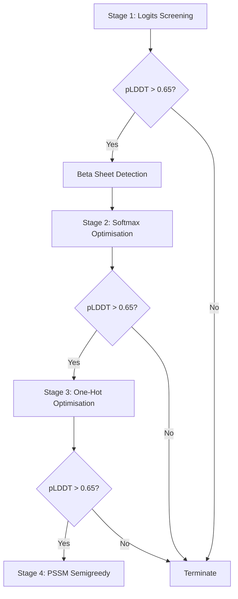

FreeBindCraft implements sophisticated multi-stage design algorithms that progressively optimize protein binders through increasingly constrained optimization phases. These protocols balance exploration and exploitation to generate high-quality binders while maintaining computational efficiency.

## Design Algorithm Architecture

The core design algorithms are implemented in the `binder_hallucination` function within [`functions/colabdesign_utils.py`](functions/colabdesign_utils.py#L23), which orchestrates different optimization strategies based on the `design_algorithm` parameter specified in advanced settings files.

### 4-Stage Protocol (Default)

The 4-stage protocol represents the most comprehensive approach, implementing a graduated optimization strategy:



**Stage 1: Logits Screening** - Initial trajectory evaluation using 50 logit iterations with soft parameter (e_soft=0.9) to assess potential. If successful, continues with additional logit optimization up to the configured `soft_iterations` limit.

**Stage 2: Softmax Optimisation** - Temperature-controlled sampling (e_temp=1e-2) for `temporary_iterations` steps, allowing exploration of sequence space while maintaining structural constraints.

**Stage 3: One-Hot Optimisation** - Deterministic optimization using one-hot encoding for `hard_iterations` steps, refining the best candidates identified in previous stages.

**Stage 4: PSSM Semigreedy** - Final optimization using position-specific scoring matrices with semigreedy mutation strategies for `greedy_iterations` steps.

> [!TIP]
> The 4-stage protocol includes automatic beta sheet detection and optimization adjustment. When beta sheet content exceeds 15%, the algorithm automatically increases soft and temporary iterations while adjusting recycle counts for enhanced optimization.

### 3-Stage Protocol (Peptide Mode)

Designed specifically for peptide binders, the 3-stage protocol streamlines the optimization process:

1. **Logits Phase** - Extended logits optimization
2. **Softmax Phase** - Temperature-controlled exploration  
3. **One-Hot Phase** - Deterministic refinement

This protocol is optimized for shorter sequences and typically uses higher helicity weights (0.95) to promote alpha-helical formation, which is desirable for peptide binders.

### Alternative Algorithms

FreeBindCraft also supports specialized algorithms for different use cases:

- **2-Stage**: Combines PSSM profile generation with semigreedy optimization
- **Greedy**: Pure random mutation strategy focusing on loss reduction
- **MCMC**: Monte Carlo optimization with temperature annealing

## Protocol Configuration Matrix

| Protocol | File | Target Type | Key Features | Acceptance Rate |
|----------|------|-------------|--------------|-----------------|
| 4-Stage Default | `default_4stage_multimer.json` | Miniproteins | Beta optimization, balanced weights | 0.01 |
| 4-Stage Flexible | `default_4stage_multimer_flexible.json` | Flexible targets | Template removal, relaxed constraints | 0.01 |
| 4-Stage Beta | `betasheet_4stage_multimer.json` | Beta-rich binders | Negative helicity (-2.0), beta optimization | 0.01 |
| 3-Stage Peptide | `peptide_3stage_multimer.json` | Peptides | High helicity (0.95), cysteine rejection | 0.1 |

## Parameter Optimization Strategies

### Iteration Distribution

The allocation of iterations across stages critically impacts design quality:

- **Soft Iterations**: Control exploration breadth (typically 75)
- **Temporary Iterations**: Balance exploration/exploitation (typically 45)  
- **Hard Iterations**: Refine promising candidates (typically 5)
- **Greedy Iterations**: Final optimization (typically 15)

### Loss Function Weighting

Different protocols optimize distinct loss function combinations:

```python
# Standard 4-stage weights
"weights_plddt": 0.1,
"weights_pae_intra": 0.4, 
"weights_pae_inter": 0.1,
"weights_con_intra": 1.0,
"weights_con_inter": 1.0,
"weights_helicity": -0.3
```

Beta-optimized protocols use more negative helicity weights (-2.0) to discourage helix formation, while peptide protocols use positive weights (0.95) to promote it.

### Template Handling

Flexible protocols enable template removal during design and prediction:

```json
"rm_template_seq_design": true,
"rm_template_seq_predict": true
```

This allows greater conformational freedom when targeting flexible binding sites.

## Quality Control Integration

Each stage includes stringent quality checkpoints:

> [!TIP]
> Trajectories must maintain pLDDT > 0.65 at each stage transition. Failed trajectories are automatically categorized and moved to appropriate failure directories (LowConfidence, Clashing) for analysis.

The main design loop in [`bindcraft.py`](bindcraft.py#L540) continuously monitors accepted designs and can terminate early when target numbers are reached, preventing unnecessary computation.

## MPNN Integration

After successful trajectory completion, protocols optionally integrate ProteinMPNN for sequence redesign:

- **Interface Fixing**: `mpnn_fix_interface` controls whether interface residues are held constant
- **Sequence Generation**: `num_seqs` determines the number of generated sequences per trajectory
- **Sampling Temperature**: `sampling_temp` controls sequence diversity

The MPNN phase operates independently of the initial design algorithm, allowing flexible combination of design and sequence optimization strategies.

For comprehensive protocol selection and optimization guidance, refer to [Peptide vs Miniprotein Design Modes](17-peptide-vs-miniprotein-design-modes) and [Custom Filter Development](15-custom-filter-development).