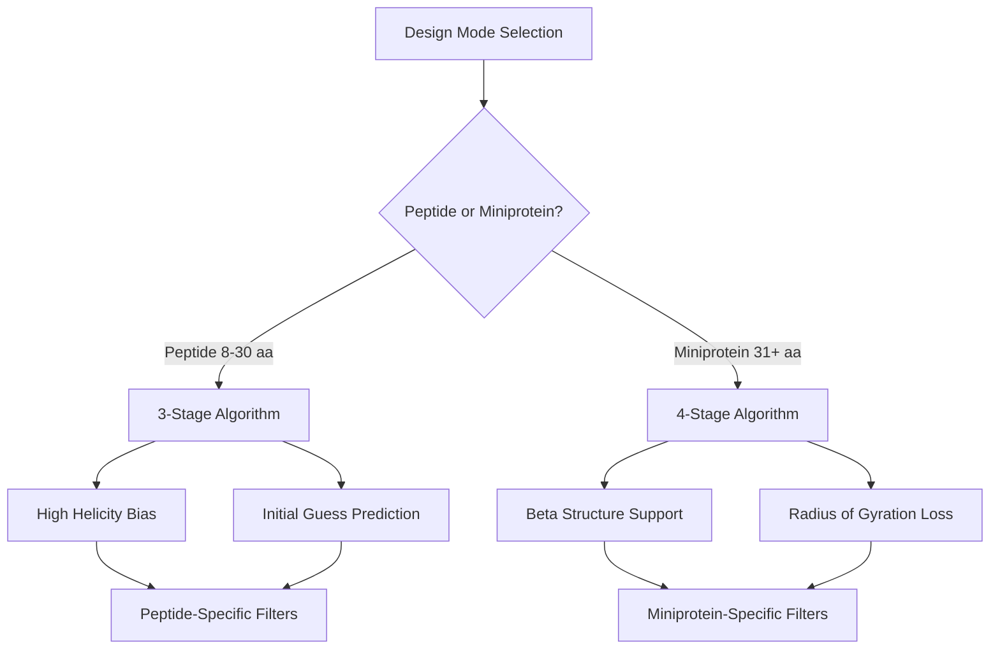

FreeBindCraft provides two distinct design modes optimized for different molecular scales: peptide design (8-30 amino acids) and miniprotein design (31+ amino acids). These modes differ fundamentally in their algorithmic approaches, structural constraints, and optimization strategies to address the unique challenges of each molecular size regime.

## Design Mode Architecture

The selection between peptide and miniprotein modes occurs during the interactive setup process, where users specify their target molecular scale [bindcraft.py#L120-L180]. This choice triggers a cascade of configuration optimizations tailored to the specific design requirements:

## Algorithmic Differences

### Peptide Design: 3-Stage Approach

Peptide design employs a streamlined 3-stage algorithm optimized for smaller, more flexible molecules:

- **Algorithm Structure**: `"design_algorithm": "3stage"` [settings_advanced/peptide_3stage_multimer.json#L4]
- **Initial Guess**: Enabled with `"predict_initial_guess": true` to accelerate convergence for short sequences [settings_advanced/peptide_3stage_multimer.json#L10]
- **Helicity Optimization**: Strong positive bias with `"weights_helicity": 0.95` to promote stable secondary structure formation [settings_advanced/peptide_3stage_multimer.json#L25]
- **Radius of Gyration**: Disabled with `"use_rg_loss": false` as compactness constraints are less critical for peptides [settings_advanced/peptide_3stage_multimer.json#L29]

### Miniprotein Design: 4-Stage Approach

Miniprotein design utilizes a more sophisticated 4-stage algorithm for larger, structurally complex molecules:

- **Algorithm Structure**: `"design_algorithm": "4stage"` [settings_advanced/default_4stage_multimer.json#L4]
- **Initial Guess**: Disabled with `"predict_initial_guess": false` to allow broader exploration of conformational space [settings_advanced/default_4stage_multimer.json#L10]
- **Helicity Control**: Negative bias with `"weights_helicity": -0.3` to discourage excessive helicity and promote structural diversity [settings_advanced/default_4stage_multimer.json#L25]
- **Radius of Gyration**: Enabled with `"use_rg_loss": true` to maintain appropriate compactness for larger proteins [settings_advanced/default_4stage_multimer.json#L29]

## Filtering Strategies

The two modes employ distinct filtering thresholds reflecting their different structural constraints and quality expectations:

### Peptide Filters
- **Interface pTM**: Lower threshold at 0.55, accommodating the inherently lower interface stability of short peptides [settings_filters/peptide_filters.json#L78]
- **Interface pAE**: More lenient threshold at 0.3, recognizing the higher conformational flexibility of peptides [settings_filters/peptide_filters.json#L136]
- **Cysteine Rejection**: Enforced with `"force_reject_AA": true` to prevent disulfide complications in short sequences [settings_advanced/peptide_3stage_multimer.json#L2]

### Miniprotein Filters
- **Interface pTM**: Higher threshold at 0.5, demanding stronger interface formation for larger proteins [settings_filters/default_filters.json#L78]
- **Interface pAE**: Stricter threshold at 0.35, requiring more precise interface geometry [settings_filters/default_filters.json#L136]
- **Cysteine Rejection**: Disabled with `"force_reject_AA": false` to allow disulfide bond formation in larger structures [settings_advanced/default_4stage_multimer.json#L2]

## Performance Characteristics

The architectural differences translate to distinct performance profiles:

| Characteristic | Peptide Mode | Miniprotein Mode |
|----------------|--------------|------------------|
| **Trajectory Efficiency** | Higher acceptance rate (0.1) | Lower acceptance rate (0.01) |
| **Sequence Generation** | 10 sequences per trajectory | 20 sequences per trajectory |
| **Monitoring Threshold** | Starts at 1000 trajectories | Starts at 600 trajectories |
| **Convergence Speed** | Faster due to 3-stage algorithm | Slower due to 4-stage complexity |

> [!TIP]
> The significantly higher acceptance rate for peptide design (0.1 vs 0.01) reflects the reduced conformational complexity of shorter sequences, allowing more designs to pass quality filters per trajectory.

## Configuration Selection

FreeBindCraft automatically presents mode-appropriate options during interactive setup:

**Peptide Configuration Options**:
- `peptide_3stage_multimer`: Standard peptide design
- `peptide_3stage_multimer_mpnn`: Enhanced sequence diversity
- `peptide_3stage_multimer_flexible`: Increased backbone flexibility
- `peptide_3stage_multimer_mpnn_flexible`: Combined enhancements

**Miniprotein Configuration Options**:
- `default_4stage_multimer`: Standard miniprotein design
- `betasheet_4stage_multimer`: Beta-sheet optimized
- Multiple MPNN and flexible variants for specialized applications

## Practical Implications

The choice between peptide and miniprotein modes should be guided by your target application requirements:

- **Peptide Design**: Ideal for rapid prototyping, epitope mapping, and applications requiring small, easily synthesized molecules
- **Miniprotein Design**: Suited for therapeutic applications requiring higher stability, more complex binding interfaces, and sophisticated structural features

The performance comparison from the PDL1 benchmark demonstrates that miniprotein design with default 4-stage settings achieves comparable quality (ipTM ~0.79) while requiring 37% fewer trajectories than traditional approaches [performance_data/pdl1_miniprotein/README.md#L26-L33].

## Next Steps

For detailed implementation guidance, refer to [Multi-Stage Design Protocols](16-multi-stage-design-protocols) to understand the algorithmic mechanics, or [Custom Filter Development](15-custom-filter-development) to tailor filtering strategies for your specific molecular targets.