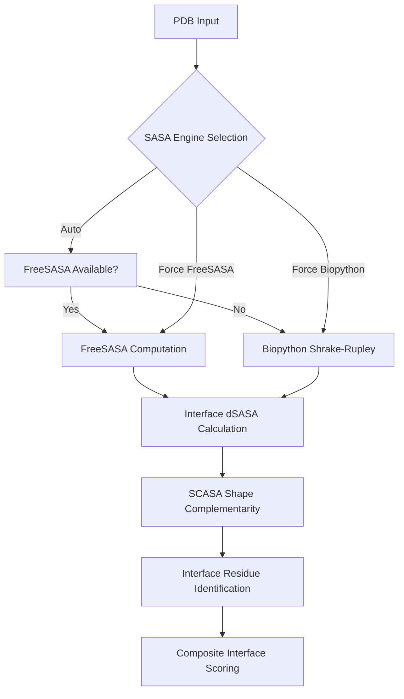

Interface scoring metrics form the quantitative foundation for evaluating binder-target interactions in FreeBindCraft. The system implements a comprehensive dual-pathway architecture that supports both PyRosetta-based scoring and open-source alternatives, enabling robust interface assessment across different computational environments.

## Core Interface Metrics Architecture

FreeBindCraft calculates interface scores through two primary pathways that converge on a standardized output format. The scoring system evaluates multiple complementary aspects of protein-protein interfaces to provide a holistic assessment of binding quality.

### PyRosetta-Based Interface Scoring

When PyRosetta is available, FreeBindCraft leverages Rosetta's sophisticated `InterfaceAnalyzerMover` to compute detailed interface metrics [functions/pyrosetta_utils.py#L31-L186]. The PyRosetta pathway provides comprehensive interface analysis including:

- **Shape Complementarity (SC)**: Measures geometric fit between binder and target surfaces
- **Interface Energy (dG)**: Calculates binding free energy using Rosetta's scoring function
- **Delta SASA (dSASA)**: Quantifies buried surface area upon complex formation
- **Hydrogen Bond Analysis**: Counts interface H-bonds and unsatisfied polar interactions
- **Packing Statistics**: Evaluates interface packing quality through PackStat scores

The PyRosetta implementation uses the full-atom scoring function (`get_fa_scorefxn()`) and performs detailed interface residue analysis to identify hotspot regions and amino acid composition at the binding interface [functions/pyrosetta_utils.py#L44-L70].

### Open-Source Alternative Scoring

FreeBindCraft's PyRosetta-free implementation provides equivalent functionality using Biopython, FreeSASA, and SCASA shape complementarity calculations [functions/pr_alternative_utils.py#L473-L614]. This pathway ensures consistent interface evaluation without proprietary dependencies:

The alternative implementation strategically uses placeholder values for metrics that cannot be accurately computed without PyRosetta, ensuring compatibility with existing filter systems while maintaining functional integrity [functions/pr_alternative_utils.py#L566-L585].

## Interface Score Components

### Geometric and Structural Metrics

| Metric | Description | PyRosetta | Alternative | Typical Range |
|--------|-------------|-----------|-------------|---------------|
| **Shape Complementarity** | Geometric fit quality between surfaces | ✓ | ✓ (SCASA) | 0.0-1.0 |
| **Interface dSASA** | Buried surface area (Ų) | ✓ | ✓ | 0-2000+ |
| **Interface Fraction** | % of binder surface buried | ✓ | ✓ | 0-100% |
| **PackStat** | Packing density score | ✓ | Fixed: 0.65 | 0.5-0.8 |

### Energetic and Interaction Metrics

| Metric | Description | PyRosetta | Alternative | Filter Threshold |
|--------|-------------|-----------|-------------|------------------|
| **Binding Energy (dG)** | Interface free energy | ✓ | Fixed: -10.0 | ≤ 0.0 |
| **Binder Score** | Total binder energy | ✓ | Fixed: -1.0 | ≤ 0.0 |
| **Interface H-bonds** | Number of H-bonds | ✓ | Fixed: 5 | ≥ 3 |
| **Unsat H-bonds** | Unsatisfied polar atoms | ✓ | Fixed: 1 | ≤ 4 |

### Compositional Metrics

The system analyzes amino acid composition at the interface, calculating hydrophobicity percentages and residue distributions. Both implementations compute interface hydrophobicity using the same amino acid set ('ACFGILMPVWY') for consistency [functions/pyrosetta_utils.py#L75-L82], [functions/pr_alternative_utils.py#L99-L100].

## Filter Integration and Thresholds

Interface metrics are integrated into FreeBindCraft's filtering system through JSON configuration files. The default filter set establishes baseline quality criteria for binder designs [settings_filters/default_filters.json#L200-L400]:

- **Shape Complementarity**: Average ≥ 0.6, Stage 1-2 ≥ 0.55
- **Interface dSASA**: Average ≥ 1.0 Ų
- **Interface H-bonds**: Average ≥ 3
- **Unsatisfied H-bonds**: Average ≤ 4
- **Interface Residues**: Average ≥ 7

> [!TIP]
> The filtering system applies progressively stricter criteria across design stages. Early stages (1-2) use active thresholds while later stages (3-5) often disable filters to allow greater diversity exploration.

## Interface Residue Identification

Both scoring pathways use a common `hotspot_residues` function to identify interface residues based on atomic distance criteria. This ensures consistent interface definition across computational methods and facilitates accurate comparison between PyRosetta and alternative implementations.

The system outputs three key data structures for each interface analysis:
1. **Interface Scores Dictionary**: All quantitative metrics
2. **Interface Amino Acid Counts**: Composition analysis  
3. **Interface Residue IDs**: PDB-format residue identifiers

> [!TIP]
> Interface residue identification uses a distance-based approach that can be configured through the scoring parameters, allowing adaptation to different binder sizes and interaction types.

## Performance Considerations

The dual-pathway architecture enables FreeBindCraft to optimize performance based on available resources. PyRosetta provides the most comprehensive analysis but requires significant computational resources and licensing. The open-source alternative offers faster execution for high-throughput screening while maintaining sufficient accuracy for design iteration.

The system includes detailed timing instrumentation for performance monitoring, with breakdown of pose loading, interface analysis, SASA computation, and shape complementarity calculation phases [functions/pyrosetta_utils.py#L35-L44].

## Next Steps

For comprehensive understanding of the interface evaluation workflow, explore the related documentation on [Structural Alignment and RMSD Calculations](19-structural-alignment-and-rmsd-calculations) and [Hydrogen Bond Network Considerations](20-hydrogen-bond-network-considerations). To understand how these metrics integrate into the overall design pipeline, review the [Rejection Analysis Framework](11-rejection-analysis-framework).