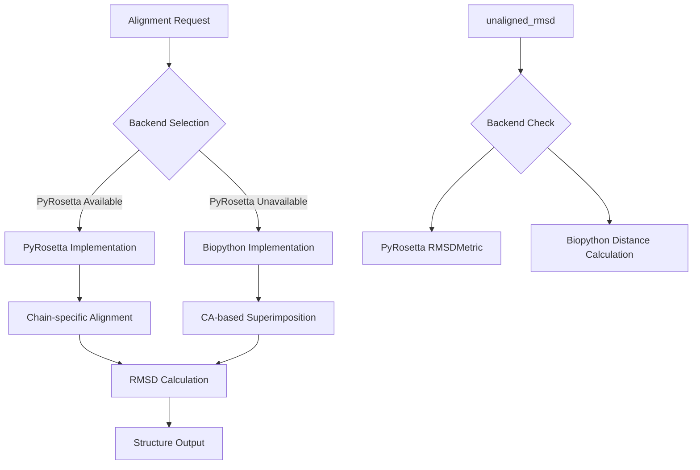

FreeBindCraft implements a comprehensive structural alignment and RMSD calculation framework that supports both PyRosetta and Biopython backends, providing flexibility for different computational environments and licensing requirements. The system handles chain-specific alignments, multi-chain structures, and various RMSD computation scenarios essential for protein binder design evaluation.

## Architecture Overview

The structural alignment system follows a dual-backend architecture with unified interfaces, allowing seamless switching between PyRosetta and open-source alternatives:



## Core Alignment Functions

### Chain-Specific PDB Alignment

The primary alignment function `align_pdbs()` handles chain-specific structural superimposition with automatic backend selection [pyrosetta_utils.py](functions/pyrosetta_utils.py#L187-L223):

```python
def align_pdbs(reference_pdb, align_pdb, reference_chain_id, align_chain_id, use_pyrosetta=True):
    if not use_pyrosetta or not PYROSETTA_AVAILABLE:
        biopython_align_pdbs(reference_pdb, align_pdb, reference_chain_id, align_chain_id)
        return
```

**PyRosetta Implementation**: Uses `AlignChainMover` for precise chain-to-chain alignment with Rosetta's internal coordinate system [pyrosetta_utils.py](functions/pyrosetta_utils.py#L202-L215).

**Biopython Implementation**: Extracts C-alpha atoms and applies Kabsch algorithm through Biopython's `Superimposer` class [biopython_utils.py](functions/biopython_utils.py#L322-L378).

### All-Chain Alignment

For comprehensive structure comparison, `biopython_align_all_ca()` aligns using all C-alpha atoms across all chains in both structures [biopython_utils.py](functions/biopython_utils.py#L433-L498):

```python
# Collect CA atoms from all chains in reference structure
for model in reference_structure:
    for chain in model:
        for residue in chain:
            if is_aa(residue, standard=True) and 'CA' in residue:
                ref_atoms.append(residue['CA'])
```

> [!TIP]
> The alignment system automatically handles chain ID parsing for comma-separated chain specifications, supporting multi-chain target structures commonly used in multimeric binder design.

## RMSD Calculation Methods

### Aligned RMSD

The system provides two approaches for RMSD calculation:

**PyRosetta Method**: Utilizes `RMSDMetric` with chain-specific residue subsets for precise measurements [pyrosetta_utils.py](functions/pyrosetta_utils.py#L257-L261):

```python
rmsd_metric = RMSDMetric()
rmsd_metric.set_comparison_pose(reference_chain_pose)
rmsd = rmsd_metric.calculate(align_chain_pose)
```

**Biopython Method**: Implements direct coordinate distance calculations on C-alpha atoms [biopython_utils.py](functions/biopython_utils.py#L424-L431):

```python
squared_sum = 0.0
for ref_atom, align_atom in zip(reference_atoms, align_atoms):
    squared_sum += sum((ref_atom.coord - align_atom.coord)**2)
rmsd = math.sqrt(squared_sum / len(reference_atoms))
```

### Unaligned RMSD

The `unaligned_rmsd()` function calculates structural deviation without prior alignment, useful for assessing conformational changes [pyrosetta_utils.py](functions/pyrosetta_utils.py#L224-L263). This is particularly valuable for evaluating design trajectory stability and detecting structural drift during the design process.

### Target-Specific RMSD

For design trajectory evaluation, `target_pdb_rmsd()` compares designed structures against the original target, handling multi-chain target specifications [biopython_utils.py](functions/biopython_utils.py#L123-L159):

```python
# Extract the specified chains from starting_pdb
chain_ids = chain_ids_string.split(',')
residues_starting = []
for chain_id in chain_ids:
    chain_id = chain_id.strip()
    chain = structure_starting[0][chain_id]
```

## Implementation Details

### Error Handling and Validation

The alignment system includes robust error handling for various edge cases:

- **Missing C-alpha atoms**: Gracefully handles structures with incomplete backbone data [biopython_utils.py](functions/biopython_utils.py#L468-L470)
- **Chain length mismatches**: Automatically truncates to minimum common residue count [biopython_utils.py](functions/biopython_utils.py#L358-L361)
- **File parsing errors**: Provides informative error messages for malformed PDB files [biopython_utils.py](functions/biopython_utils.py#L446-L449)

### Performance Considerations

The Biopython implementations are optimized for speed while maintaining accuracy:

- **C-alpha atom filtering**: Reduces computational complexity by focusing on backbone atoms [biopython_utils.py](functions/biopython_utils.py#L350-L356)
- **Minimal memory footprint**: Processes structures incrementally without loading unnecessary data
- **Automatic cleanup**: Integrates with `clean_pdb()` for consistent output formatting [biopython_utils.py](functions/biopython_utils.py#L376-L377)

## Usage Patterns

### Design Trajectory Analysis

Structural alignment is integrated throughout the design pipeline for:

- **Convergence monitoring**: Tracking RMSD evolution across design iterations
- **Quality assessment**: Evaluating structural similarity to design targets
- **Multi-chain handling**: Managing complex binder-target interfaces

### Backend Selection Strategy

The system automatically selects the optimal backend based on availability and requirements:

| Scenario | Preferred Backend | Rationale |
|----------|------------------|-----------|
| High-precision alignment | PyRosetta | Rosetta's optimized algorithms |
| Open-source deployment | Biopython | License compatibility |
| Rapid prototyping | Biopython | Faster initialization |
| Production pipelines | PyRosetta | Proven reliability |

> [!TIP]
> All alignment functions return rounded RMSD values to 2 decimal places for consistent reporting across the design pipeline, facilitating threshold-based filtering and statistical analysis.

## Integration Points

The structural alignment system integrates with multiple pipeline components:

- **Chain handling**: Works seamlessly with concatenation/de-concatenation utilities [biopython_utils.py](functions/biopython_utils.py#L500-L687)
- **Filtering framework**: Provides RMSD metrics for design rejection analysis
- **Performance tracking**: Supplies structural metrics for trajectory statistics

This comprehensive alignment infrastructure enables precise structural evaluation throughout the binder design process, supporting both research and production workflows with flexible backend options and robust error handling.

For detailed performance comparisons between PyRosetta and Biopython implementations, see the [Benchmark Results and Metrics](12-benchmark-results-and-metrics) documentation.