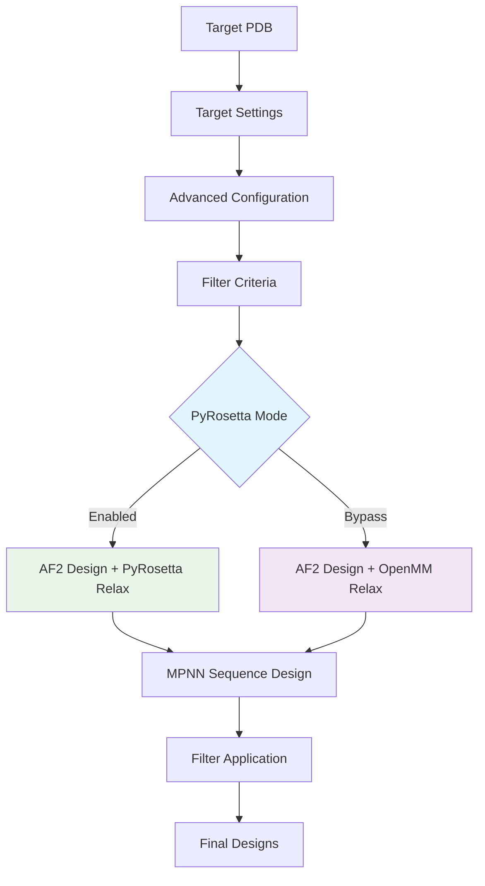

FreeBindCraft enables protein binder design through AlphaFold2-based multimer predictions, offering both traditional PyRosetta integration and an open-source bypass mode. This guide gets you running your first design in minutes.

## System Architecture Overview

FreeBindCraft operates through a modular pipeline that transforms target structures into high-quality binder designs:



## Essential Configuration Files

FreeBindCraft requires three JSON configuration files that control different aspects of the design process:

| Configuration Type | Purpose | Default Location | Key Parameters |
|-------------------|---------|------------------|----------------|
| **Target Settings** | Defines your protein target and design goals | `settings_target/` | PDB path, hotspot residues, binder length |
| **Advanced Settings** | Controls design algorithm and optimization | `settings_advanced/` | Design stages, iterations, model weights |
| **Filter Settings** | Sets quality thresholds for design acceptance | `settings_filters/` | pLDDT, pTM, iPTM score thresholds |

### Target Configuration Example

The core target settings specify your protein target and design objectives:

```json
{
    "design_path": "/root/software/pdl1/",
    "binder_name": "PDL1",
    "starting_pdb": "./example/PDL1.pdb",
    "chains": "A",
    "target_hotspot_residues": "56",
    "lengths": [65, 150],
    "number_of_final_designs": 100
}
```

Sources: [settings_target/PDL1.json](settings_target/PDL1.json#L1-L9)

## Your First Design Run

### Prerequisites Setup

1. **Activate the conda environment**:
   ```bash
   conda activate BindCraft
   ```

2. **Navigate to your installation directory**:
   ```bash
   cd /path/to/your/freebindcraft/folder/
   ```

### Running with Open-Source Bypass (Recommended)

For completely open-source operation without PyRosetta dependencies:

```bash
python -u ./bindcraft.py \
    --settings './settings_target/PDL1.json' \
    --filters './settings_filters/default_filters.json' \
    --advanced './settings_advanced/default_4stage_multimer.json' \
    --no-pyrosetta
```

### Running with PyRosetta Integration

If you have PyRosetta installed and want traditional relaxation:

```bash
python -u ./bindcraft.py \
    --settings './settings_target/PDL1.json' \
    --filters './settings_filters/default_filters.json' \
    --advanced './settings_advanced/default_4stage_multimer.json'
```

Sources: [README.md](README.md#L55-L85), [bindcraft.py](bindcraft.py#L77-L78)

## Interactive Mode

FreeBindCraft features an interactive setup wizard that guides you through configuration when run without settings files or with the `--interactive` flag:

```bash
python -u ./bindcraft.py --interactive
```

The wizard will prompt you to:
- Select target configuration from available JSON files
- Choose filter criteria
- Pick advanced design settings
- Configure PyRosetta vs. bypass mode

Sources: [bindcraft.py](bindcraft.py#L87-L88), [bindcraft.py](bindcraft.py#L120-L424)

## Understanding the Design Process

FreeBindCraft follows a sophisticated multi-stage design pipeline:

1. **4-Stage Design Algorithm**: Progressive refinement through soft, temporary, hard, and greedy iterations
2. **Multimer Validation**: AlphaFold2 multimer predictions for interface quality
3. **MPNN Sequence Design**: ProteinMPNN for sequence optimization
4. **Quality Filtering**: Multi-metric filtering based on confidence scores

### Key Configuration Parameters

| Parameter | Default | Description |
|-----------|---------|-------------|
| `soft_iterations` | 75 | Initial gentle design phase |
| `temporary_iterations` | 45 | Intermediate refinement |
| `hard_iterations` | 5 | Final optimization phase |
| `acceptance_rate` | 0.01 | Design acceptance threshold |
| `num_seqs` | 20 | MPNN sequences per design |

Sources: [settings_advanced/default_4stage_multimer.json](settings_advanced/default_4stage_multimer.json#L1-L67)

## Monitoring Progress

FreeBindCraft provides comprehensive progress tracking:

- **Real-time console output** with design trajectory information
- **CSV files** tracking statistics for each design stage
- **Optional plots and animations** of design evolution
- **Rejection analysis** for failed designs

Enable detailed logging with the `--verbose` flag for complete transparency into the design process.

Sources: [bindcraft.py](bindcraft.py#L79-L80), [bindcraft.py](bindcraft.py#L481-L511)

## Next Steps

After your first successful run:

- Explore [Installation Options](3-installation-options) for advanced setup configurations
- Learn about the [Interactive CLI Setup](4-interactive-cli-setup) for streamlined configuration
- Discover [Docker Container Usage](5-docker-container-usage) for reproducible environments

For deeper technical understanding, proceed to the [PyRosetta Bypass Architecture](6-pyrosetta-bypass-architecture) documentation to understand the open-source alternatives implementation.

