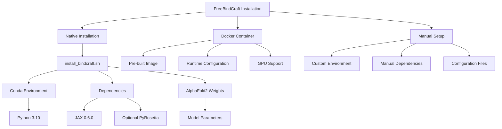

FreeBindCraft offers flexible installation methods to accommodate different development environments and preferences. This guide covers three primary installation approaches: native installation with the automated script, Docker containerization, and manual setup for advanced users.

## Installation Architecture Overview



## Native Installation

The recommended approach for most users is the automated installation script, which handles all dependencies and configuration automatically.

### Prerequisites

- **CUDA-compatible NVIDIA GPU** (required for accelerated computations)
- **Conda or Mamba** package manager
- **Git** for repository cloning
- **Sufficient disk space** (~5GB for dependencies and model weights)

### Installation Script Options

The `install_bindcraft.sh` script provides several configuration options to customize your installation:

| Option | Description | Default |
|--------|-------------|---------|
| `--pkg_manager` | Package manager: 'conda' or 'mamba' | conda |
| `--cuda` | CUDA version (e.g., '12.1', '12.4') | Auto-detect |
| `--no-pyrosetta` | Skip PyRosetta installation (use open-source alternatives) | false |
| `--fix-channels` | Apply conda channel configuration fixes for dependency resolution | false |

### Installation Commands

**Standard Installation (with PyRosetta):**
```bash
git clone https://github.com/cytokineking/FreeBindCraft
cd FreeBindCraft
bash install_bindcraft.sh --cuda '12.4' --pkg_manager 'conda'
```

**PyRosetta-Free Installation:**
```bash
bash install_bindcraft.sh --cuda '12.4' --pkg_manager 'conda' --no-pyrosetta
```

**Installation with Channel Fixes:**
```bash
bash install_bindcraft.sh --cuda '12.4' --fix-channels --no-pyrosetta
```

### Installation Process Breakdown

The installation script performs these key steps:

1. **Environment Creation**: Creates a dedicated conda environment named `BindCraft` with Python 3.10
2. **Package Installation**: Installs core dependencies including JAX 0.6.0, OpenMM, Biopython, and scientific computing libraries
3. **Optional PyRosetta**: Installs PyRosetta if not using the bypass mode
4. **ColabDesign Integration**: Installs the ColabDesign package for protein structure prediction
5. **AlphaFold2 Weights**: Downloads and extracts the required AlphaFold2 model parameters (~2GB)
6. **Binary Permissions**: Sets executable permissions for computational tools (DSSP, SC, FASPR)

> [!TIP]
> The installation script automatically pins JAX to version 0.6.0 for stability, which is critical for reproducible results across different hardware configurations.

## Docker Container Installation

Docker provides a self-contained environment that eliminates dependency conflicts and ensures reproducible deployments.

### Docker Image Features


The official Docker image includes:

- **NVIDIA CUDA 12.1.1** with cuDNN 8 runtime
- **Pre-configured Conda environment** with all dependencies
- **AlphaFold2 model weights** pre-downloaded
- **OpenCL and CUDA support** for OpenMM acceleration
- **Optimized file descriptor limits** for handling large datasets

### Docker Usage Options

**Pull and Run Pre-built Image:**
```bash
# Pull the latest image
docker pull cytokineking/freebindcraft:latest

# Run with GPU support
docker run --gpus all -v $(pwd):/workspace cytokineking/freebindcraft:latest
```

**Build Custom Image:**
```bash
# Clone repository
git clone https://github.com/cytokineking/FreeBindCraft
cd FreeBindCraft

# Build without PyRosetta (default)
docker build -t freebindcraft:latest .

# Build with PyRosetta
docker build --build-arg WITH_PYROSETTA=true -t freebindcraft:pyrosetta .
```

### Docker Configuration

The Docker environment is optimized with these settings:

| Environment Variable | Purpose | Default |
|----------------------|---------|---------|
| `OPENMM_PLATFORM_ORDER` | OpenMM computation platform preference | OpenCL,CUDA |
| `OPENMM_DEFAULT_PLATFORM` | Default OpenMM platform | OpenCL |
| `BINDCRAFT_HOME` | BindCraft installation directory | /app |
| `PYTHONUNBUFFERED` | Python output buffering | 1 |

> [!TIP]
> Docker containers automatically configure file descriptor limits to 65536, preventing issues with large-scale batch processing that can exceed default system limits.

## Manual Installation

For users requiring custom environments or specific dependency versions, manual installation provides complete control.

### Core Dependencies

**Python Environment:**
- Python 3.10
- JAX 0.6.0 (critical for stability)
- NumPy < 2.0.0
- Biopython
- OpenMM
- Pandas, Matplotlib, Seaborn

**Optional Components:**
- PyRosetta (requires license for commercial use)
- FreeSASA (for surface area calculations)
- sc-rs (for shape complementarity calculations)

### Binary Dependencies

Several computational tools must be compiled and placed in the `functions/` directory:

| Binary | Purpose | Source |
|--------|---------|--------|
| `dssp` | Secondary structure assignment | [mkondrak/dssp](https://github.com/mkondrak/dssp) |
| `sc` | Shape complementarity calculations | [Rosetta](https://www.rosettacommons.org/) |
| `FASPR` | Side-chain packing | [FASPR](https://github.com/KoslickiLab/FASPR) |

### Configuration Files

Manual installation requires proper configuration of:

- **Settings files** in `settings_target/`, `settings_filters/`, `settings_advanced/`
- **AlphaFold2 parameters** in `params/` directory
- **Binary executables** with proper permissions in `functions/`

## Installation Verification

After installation, verify your setup with these commands:

**Native Installation:**
```bash
conda activate BindCraft
python -c "import jax, openmm, biopython; print('All dependencies loaded successfully')"
python bindcraft.py --help
```

**Docker Installation:**
```bash
docker run --gpus all cytokineking/freebindcraft:latest python bindcraft.py --help
```

**Binary Verification:**
```bash
# Check executable permissions
ls -la functions/dssp functions/sc functions/FASPR

# Test functionality
./functions/sc --help
./functions/dssp --help
```

## Troubleshooting Common Issues

### Dependency Conflicts

If experiencing conda dependency resolution issues:

```bash
# Use the fix-channels option
bash install_bindcraft.sh --fix-channels

# Or manually configure channels
conda config --remove channels defaults
conda config --prepend channels conda-forge
conda config --append channels nvidia
conda config --set channel_priority strict
```

### GPU Detection Issues

For CUDA-related problems:

```bash
# Verify CUDA installation
nvidia-smi
nvcc --version

# Check conda CUDA packages
conda list | grep cuda
```

### File Descriptor Limits

If encountering "too many open files" errors:

```bash
# Check current limits
ulimit -n

# Increase limits (temporary)
ulimit -n 65536

# Permanent fix requires system configuration
```

## Next Steps

After successful installation, proceed to [Interactive CLI Setup](4-interactive-cli-setup) to learn about the user-friendly configuration wizard, or explore [Docker Container Usage](5-docker-container-usage) for containerized deployment strategies.

For understanding the architectural differences between PyRosetta and open-source alternatives, see [PyRosetta Bypass Architecture](6-pyrosetta-bypass-architecture).