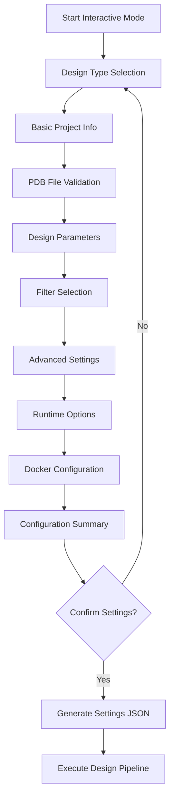
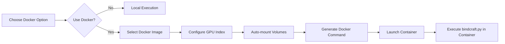

The Interactive CLI Setup provides a user-friendly, guided configuration experience for FreeBindCraft, eliminating the need to manually create complex JSON configuration files. This feature automatically activates when running `bindcraft.py` without command-line arguments in a terminal environment, or can be explicitly invoked with the `--interactive` flag.

## Activation and Entry Points

FreeBindCraft automatically detects when interactive mode should be used based on two conditions:

1. **Automatic Detection**: When no settings file is provided and the script is running in a TTY (terminal) environment
2. **Manual Activation**: When the `--interactive` flag is explicitly specified

The interactive system is implemented through the `_prompt_interactive_and_prepare_args()` function [bindcraft.py#L120-L424], which guides users through a comprehensive configuration process.

## Configuration Workflow

The interactive setup follows a structured workflow that collects all necessary parameters for binder design:



## Design Type Selection

The first decision point determines the overall design strategy:

| Design Type | Length Range | Use Case | Default Settings |
|-------------|--------------|----------|------------------|
| **Miniprotein** | 31+ aa (default 65-150) | Complex binders with structural complexity | default_4stage_multimer |
| **Peptide** | 8-30 aa (default 8-25) | Short linear binders | peptide_3stage_multimer |

This selection influences subsequent choices for filters and advanced settings, automatically tailoring the available options to the appropriate design modality [bindcraft.py#L133-L134].

## Core Configuration Parameters

### Project and Target Setup

The interactive system collects essential project information:

- **Project Name**: Identifier for the binder design project
- **PDB File Path**: Validated path to the target structure file
- **Output Directory**: Location for generated files (defaults to `{project_name}_bindcraft_out`)
- **Target Chains**: Specific chains to target (e.g., "A" or "A,B")
- **Hotspot Residues**: Optional specific residues for targeting (format: "A1,B20-25")

### Design Parameters

Length constraints are configured based on the selected design type:

```python
# Peptide configuration (8-30 aa range)
min_len_val = max(8, min(min_len_val, 30))
max_len_val = max(8, min(max_len_val, 30))

# Miniprotein configuration (31+ aa range)
if min_len_val < 31:
    min_len_val = 31
```

The system also prompts for the number of final designs to generate (default: 100) [bindcraft.py#L158-L177].

## Filter Configuration

FreeBindCraft provides pre-configured filter sets optimized for different design scenarios:

### Available Filter Options

| Filter Type | Peptide Mode | Miniprotein Mode | Purpose |
|-------------|--------------|------------------|---------|
| **peptide_filters** | ✓ | ✗ | Standard peptide filtering |
| **peptide_relaxed_filters** | ✓ | ✗ | Relaxed constraints for peptides |
| **default_filters** | ✗ | ✓ | Standard miniprotein filtering |
| **relaxed_filters** | ✗ | ✓ | Relaxed constraints for miniproteins |
| **no_filters** | ✓ | ✓ | Minimal filtering (for testing) |

The filter selection interface displays available options in a numbered list, with intelligent defaults based on design type [bindcraft.py#L199-L220].

## Advanced Design Protocols

The advanced settings control the core design algorithms and staging protocols:

### Miniprotein Design Protocols

| Protocol | Description | Key Features |
|----------|-------------|--------------|
| **default_4stage_multimer** | Standard 4-stage design | Balanced approach |
| **default_4stage_multimer_mpnn** | MPNN-enhanced design | ProteinMPNN integration |
| **default_4stage_multimer_flexible** | Flexible backbone design | Enhanced conformational sampling |
| **betasheet_4stage_multimer** | Beta-sheet specialized | Optimized for beta-structures |
| **hardtarget variants** | Challenging targets | Enhanced sampling for difficult cases |

### Peptide Design Protocols

| Protocol | Stages | MPNN Support | Flexibility |
|----------|--------|--------------|-------------|
| **peptide_3stage_multimer** | 3-stage | ✗ | Standard |
| **peptide_3stage_multimer_mpnn** | 3-stage | ✓ | Standard |
| **peptide_3stage_multimer_flexible** | 3-stage | ✗ | Enhanced |
| **peptide_3stage_multimer_mpnn_flexible** | 3-stage | ✓ | Enhanced |

The system presents these options in a context-aware menu, showing only protocols relevant to the selected design type [bindcraft.py#L222-L260].

## Runtime Configuration Options

### Performance and Output Control

The interactive setup provides granular control over execution behavior:

| Option | Default | Description |
|--------|---------|-------------|
| **Verbose Output** | Disabled | Detailed timing and progress logs |
| **Save Plots** | Enabled | Generate design trajectory plots |
| **Save Animations** | Enabled | Create design process animations |
| **PyRosetta Integration** | Enabled | Use PyRosetta for relaxation and scoring |
| **Debug PDBs** | Conditional | Save intermediate structures (OpenMM only) |

> [!TIP]
> The debug PDBs option only appears when PyRosetta is disabled, as it's specifically designed for troubleshooting the OpenMM relaxation pipeline. These intermediate structures include: deconcatenated PDBs, PDBFixer results, post-initial-relax structures, and post-FASPR side-chain packed models.

## Docker Container Integration

FreeBindCraft offers seamless Docker integration for reproducible environments:

### Container Configuration Options

The interactive Docker setup includes:

1. **Image Selection**: Lists available local Docker images or allows manual entry
2. **GPU Assignment**: Specifies which GPU device to expose to the container
3. **Volume Mounting**: Automatically mounts necessary directories (current working directory, PDB file location, output directory)

### Docker Execution Flow



The Docker command generation automatically handles volume mounting and GPU exposure, ensuring the containerized environment has access to all necessary files and computational resources [bindcraft.py#L262-L323].

## Configuration Persistence

Once all parameters are collected and confirmed, the interactive system:

1. **Generates Timestamped Settings**: Creates a JSON file with format `interactive_{project_name}_{timestamp}.json`
2. **Saves to Output Directory**: Places the configuration file in the specified output directory
3. **Maps to Command Arguments**: Translates interactive selections to equivalent command-line arguments
4. **Executes Pipeline**: Launches the design process with the collected configuration

This approach ensures reproducibility while maintaining the convenience of interactive configuration [bindcraft.py#L354-L380].

## Error Handling and Validation

The interactive system includes robust validation:

- **PDB File Validation**: Ensures the specified PDB file exists and is accessible
- **Directory Creation**: Automatically creates output directories if they don't exist
- **Input Sanitization**: Validates numeric inputs and applies appropriate constraints
- **Path Resolution**: Converts relative paths to absolute paths for reliability

## Next Steps

After completing the interactive setup, FreeBindCraft proceeds with the design pipeline using the collected configuration. For detailed information about Docker-based execution, see [Docker Container Usage](5-docker-container-usage). To understand the underlying architecture that makes these configurations possible, explore [PyRosetta Bypass Architecture](6-pyrosetta-bypass-architecture).

