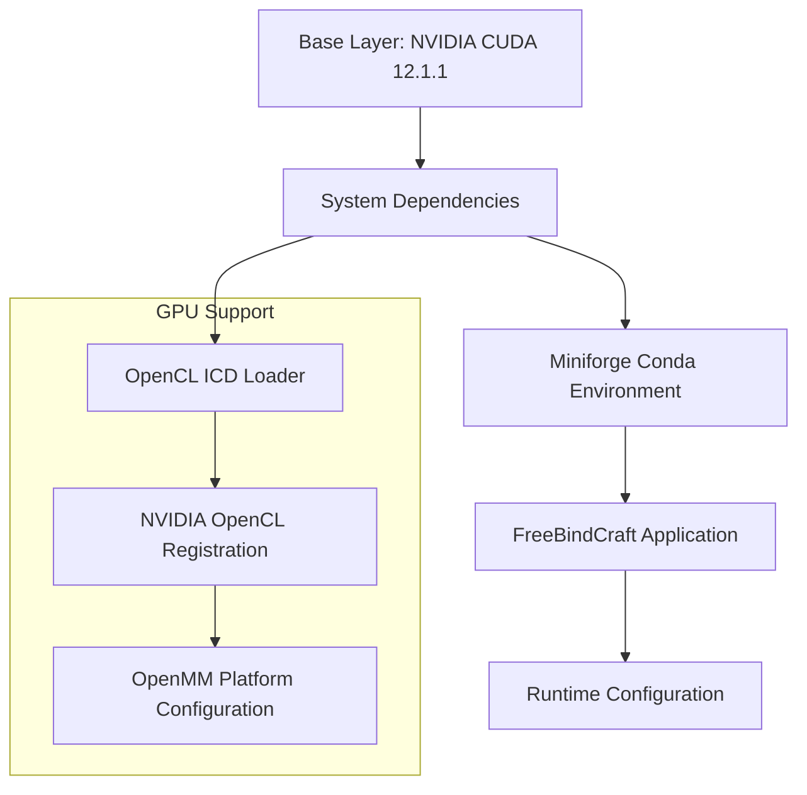
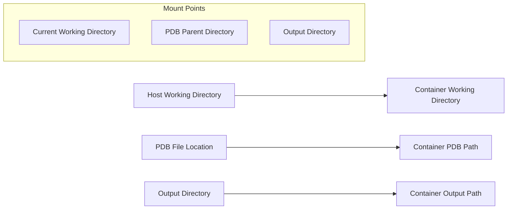

FreeBindCraft provides comprehensive Docker support for streamlined deployment across different environments. The containerized solution ensures reproducible execution with GPU acceleration while offering flexibility between PyRosetta-enabled and open-source alternatives.

## Container Architecture Overview

The Docker implementation follows a multi-layered architecture designed for computational biology workloads:



The container is built on [nvidia/cuda:12.1.1-cudnn8-runtime-ubuntu22.04](Dockerfile#L1) and includes essential system packages for scientific computing. A key architectural decision is the **dual GPU platform support** - OpenCL is preferred over CUDA for OpenMM operations to maximize compatibility across different hardware configurations [docker-entrypoint.sh](docker-entrypoint.sh#L1-L17).

## Build Configuration Options

The Dockerfile supports conditional PyRosetta inclusion through build arguments:

| Build Argument | Default | Effect |
|----------------|---------|--------|
| `WITH_PYROSETTA` | `false` | Controls PyRosetta installation during build |
| `CUDA_VERSION` | `12.1` | Matches CUDA toolkit version to base image |

> [!TIP]
> The default configuration builds without PyRosetta to create a fully open-source container. Set `WITH_PYROSETTA=true` during build to include proprietary dependencies for enhanced scoring capabilities.

To build the container with PyRosetta:
```bash
docker build --build-arg WITH_PYROSETTA=true -t freebindcraft:gpu-pyrosetta .
```

## Interactive Docker CLI

FreeBindCraft includes a specialized interactive wrapper [`docker_cli.py`](docker_cli.py#L1-L339) that guides users through container-based execution without requiring manual Docker command construction. The CLI performs intelligent configuration management:

### Design Type Selection
- **Miniprotein mode**: 31+ amino acids with 4-stage multimer protocols
- **Peptide mode**: 8-30 amino acids with optimized 3-stage protocols

### Configuration Discovery
The CLI automatically discovers available configuration files within the container image:

```python
filter_names = list_json_basenames_in_image(selected_image, "/app/settings_filters")
adv_names = list_json_basenames_in_image(selected_image, "/app/settings_advanced")
```

This ensures users only see compatible options for their selected container image.

### Volume Management Strategy
The CLI implements intelligent volume mounting to ensure file accessibility:



## Runtime Execution

### Entry Point Configuration
The container uses [`docker-entrypoint.sh`](docker-entrypoint.sh#L1-L17) which performs critical system optimizations:

1. **File descriptor limits**: Increases to 65,536 to handle BindCraft's intensive file operations
2. **Working directory**: Ensures execution from `/app`
3. **Process execution**: Uses `exec` for proper signal handling and Modal compatibility

### GPU Resource Management
The container exposes GPU resources through NVIDIA's container toolkit:

```bash
docker run --gpus device=0 freebindcraft:gpu python bindcraft.py [options]
```

The OpenMM configuration prioritizes OpenCL over CUDA through environment variables:
- `OPENMM_PLATFORM_ORDER=OpenCL,CUDA`
- `OPENMM_DEFAULT_PLATFORM=OpenCL`

## Configuration File Integration

### Filter Settings
Available filter configurations vary by design type:

| Design Type | Available Filters | Default |
|-------------|------------------|---------|
| Miniprotein | `default_filters`, `relaxed_filters`, `no_filters` | `default_filters` |
| Peptide | `peptide_filters`, `peptide_relaxed_filters`, `no_filters` | `peptide_filters` |

### Advanced Protocol Settings
The container includes 16 pre-configured advanced settings for miniproteins and 4 for peptides, covering:
- Standard vs MPNN-based design
- Flexible vs rigid backbone protocols
- Hard target optimizations
- Beta-sheet specific configurations

## Usage Examples

### Basic Interactive Execution
```bash
python docker_cli.py
```

### Direct Container Execution
```bash
docker run --rm -it \
  --gpus device=0 \
  -v $(pwd):$(pwd) \
  -v /path/to/pdbs:/path/to/pdbs \
  -w $(pwd) \
  freebindcraft:gpu \
  python bindcraft.py \
    -s settings.json \
    -f /app/settings_filters/default_filters.json \
    -a /app/settings_advanced/default_4stage_multimer.json
```

### Performance-Optimized Execution
```bash
docker run --rm -it \
  --gpus device=0 \
  --shm-size=8g \
  --ulimit nofile=65536:65536 \
  -v $(pwd):$(pwd) \
  freebindcraft:gpu \
  python bindcraft.py --verbose --no-pyrosetta [options]
```

> [!TIP]
> For production workloads, consider increasing shared memory with `--shm-size=8g` to prevent IPC bottlenecks during multi-process execution.

## Container Optimization Features

### System Resource Management
The entrypoint script automatically handles system constraints that commonly affect computational biology workflows:
- File descriptor limits for high-throughput processing
- Working directory consistency
- Proper signal propagation for graceful termination

### Environment Configuration
The container establishes optimized environment variables for scientific computing:
- `PYTHONUNBUFFERED=1` for real-time logging
- `BINDCRAFT_HOME=/app` for consistent path resolution
- OpenMM platform preferences for GPU acceleration

## Next Steps

After mastering Docker container usage, explore the [PyRosetta Bypass Architecture](6-pyrosetta-bypass-architecture) to understand how the container leverages open-source alternatives, or proceed to [OpenMM Relaxation Pipeline](7-openmm-relaxation-pipeline) for detailed implementation insights.

The Docker container serves as the foundation for reproducible computational protein design, providing both accessibility for beginners and flexibility for advanced users requiring custom configurations.