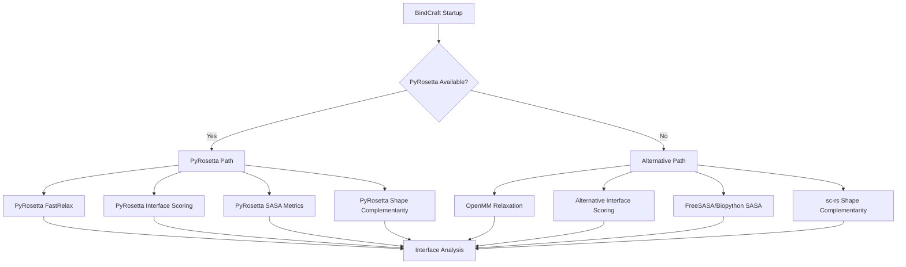

FreeBindCraft's PyRosetta bypass architecture enables comprehensive protein binder design without proprietary dependencies, implementing a sophisticated alternative pipeline that maintains high-quality results while improving accessibility and performance. This architecture replaces PyRosetta's proprietary scoring and relaxation functions with open-source equivalents that provide comparable functionality.

## Architecture Overview

The bypass architecture operates through a conditional dispatch system that detects PyRosetta availability and seamlessly switches to alternative implementations when needed. At runtime, the system evaluates whether PyRosetta is properly initialized and available, then routes computational tasks to appropriate implementations.



The architecture is triggered via the `--no-pyrosetta` flag or automatically when PyRosetta initialization fails [bindcraft.py#L77-L78](bindcraft.py#L77-L78). The system maintains full compatibility with existing workflows through a unified interface in the PyRosetta utilities module.

## Core Component Replacements

### Structure Relaxation: OpenMM Pipeline

The most significant architectural component is the OpenMM-based relaxation system that replaces PyRosetta's FastRelax. This implementation provides GPU-accelerated structure optimization while maintaining the quality needed for downstream scoring.

The relaxation pipeline implements a sophisticated multi-stage approach:

1. **Chain De-concatenation**: ColabDesign concatenates target chains into a single chain 'A', which can cause OpenMM to inappropriately infer peptide bonds between biologically distinct chains. The system splits concatenated chains based on original biological boundaries and discontinuous segments [pr_alternative_utils.py#L43-L47](pr_alternative_utils.py#L43-L47).

2. **Multi-stage Force Field Application**: The relaxation uses Amber14 with OBC2 implicit solvent, applying backbone restraints that ramp down across stages while adding custom Lennard-Jones repulsive forces that ramp up to resolve steric clashes [pr_alternative_utils.py#L847-L890](pr_alternative_utils.py#L847-L890).

3. **Optional FASPR Integration**: After OpenMM relaxation, the system can apply FASPR side-chain repacking for improved rotamer placement, followed by hydrogen addition and short minimization [pr_alternative_utils.py#L859-L860](pr_alternative_utils.py#L859-L860).

4. **Process Isolation**: The relaxation runs in subprocesses to ensure clean OpenCL context teardown between designs, preventing driver state accumulation issues during long runs [pr_alternative_utils.py#L1575-L1579](pr_alternative_utils.py#L1575-L1579).

### Interface Scoring System

The alternative interface scoring system combines multiple open-source tools to provide comprehensive analysis:

- **Surface Area Calculations**: Prefers FreeSASA for SASA calculations with Biopython Shrake-Rupley fallback, implementing area-weighted hydrophobicity metrics that correlate closely with PyRosetta's layer-based approach [pr_alternative_utils.py#L473-L520](pr_alternative_utils.py#L473-L520).

- **Shape Complementarity**: Uses the `sc-rs` Rust implementation (MIT-licensed) to compute Lawrence & Colman SC statistics, providing near-identical values to PyRosetta with improved performance [technical_overview/FreeBindCraft_Technical_Overview.md#L126-L137](technical_overview/FreeBindCraft_Technical_Overview.md#L126-L137).

- **Interface Residue Identification**: Employs KD-tree neighbor searches between binder and target heavy atoms within 4.0 Å to identify interface residues and compute composition metrics [biopython_utils.py#L212-L214](biopython_utils.py#L212-L214).

### Structural Analysis Pipeline

The architecture provides complete structural analysis capabilities without PyRosetta dependency:

- **Alignment and RMSD**: Biopython-based structural alignment using C-alpha atoms for both aligned and unaligned RMSD calculations [biopython_utils.py#L322-L324](biopython_utils.py#L322-L324).

- **Secondary Structure Analysis**: Integrates DSSP calculations with caching to reduce redundant computations, providing secondary structure percentage calculations [biopython_utils.py#L22-L27](biopython_utils.py#L22-L27).

- **Clash Detection**: Implements C-alpha clash scoring to identify deformed trajectories that may indicate structural problems [biopython_utils.py#L162-L164](biopython_utils.py#L162-L164).

## Performance and Validation

The bypass architecture was validated through empirical analysis of approximately 20,000 trajectories and 400,000 MPNN sequence variants. Key findings include:

- **Rejection Analysis**: >90% of rejections are driven by AlphaFold metrics alone, with PyRosetta-specific metrics accounting for minimal impact on accept/reject decisions [technical_overview/FreeBindCraft_Technical_Overview.md#L35-L42](technical_overview/FreeBindCraft_Technical_Overview.md#L35-L42).

- **Performance Improvements**: OpenMM relaxation typically achieves 2-4× speedup compared to CPU FastRelax while maintaining sufficient quality for clash resolution prior to interface scoring [technical_overview/FreeBindCraft_Technical_Overview.md#L78-L85](technical_overview/FreeBindCraft_Technical_Overview.md#L78-L85).

- **Metric Correlation**: FreeSASA-derived SASA values show close agreement with PyRosetta, while the area-weighted hydrophobicity approach provides more interpretable surface exposure metrics [technical_overview/FreeBindCraft_Technical_Overview.md#L92-L108](technical_overview/FreeBindCraft_Technical_Overview.md#L92-L108).

## Implementation Architecture

The bypass system is implemented through a modular dispatch pattern that maintains clean separation between PyRosetta and alternative implementations:

```python
def score_interface(pdb_file, binder_chain="B", use_pyrosetta=True):
    """
    Calculate interface scores using PyRosetta or alternative methods.
    Dispatches to appropriate implementation based on availability.
    """
    if not use_pyrosetta or not PYROSETTA_AVAILABLE:
        return alt.pr_alternative_score_interface(pdb_file, binder_chain)
    # PyRosetta implementation follows...
```

This pattern is consistently applied across all major functions including relaxation, scoring, alignment, and RMSD calculations [pyrosetta_utils.py#L31-L35](pyrosetta_utils.py#L31-L35).

## Limitations and Considerations

While the bypass architecture provides comprehensive functionality, some considerations remain:

- **Energetic Metrics**: Interface energetics (dG, energy scores) use conservative placeholders as they rarely impact accept/reject decisions but would require complex re-implementation [technical_overview/FreeBindCraft_Technical_Overview.md#L137-L152](technical_overview/FreeBindCraft_Technical_Overview.md#L137-L152).

- **Hydrogen Bond Networks**: Buried unsatisfied hydrogen bond analysis is omitted due to model dependency and limited impact on protein-protein interfaces compared to protein cores [technical_overview/FreeBindCraft_Technical_Overview.md#L143-L150](technical_overview/FreeBindCraft_Technical_Overview.md#L143-L150).

- **Experimental Validation**: Wet-lab validation comparing bypass mode to PyRosetta-inclusive runs remains to be conducted [technical_overview/FreeBindCraft_Technical_Overview.md#L159-L160](technical_overview/FreeBindCraft_Technical_Overview.md#L159-L160).

## Integration Points

The architecture integrates seamlessly with existing BindCraft workflows through several key integration points:

- **Command Line Interface**: The `--no-pyrosetta` flag enables bypass mode at runtime without code changes [bindcraft.py#L77-L78](bindcraft.py#L77-L78).

- **Configuration Management**: Advanced settings control relaxation parameters, SASA engine selection, and FASPR integration [pr_alternative_utils.py#L847-L861](pr_alternative_utils.py#L847-L861).

- **Data Schema Compatibility**: The system maintains CSV schema compatibility through appropriate placeholders for omitted metrics, ensuring downstream analysis tools continue to function [technical_overview/FreeBindCraft_Technical_Overview.md#L152-L155](technical_overview/FreeBindCraft_Technical_Overview.md#L152-L155).

The PyRosetta bypass architecture represents a significant advancement in making protein binder design more accessible while maintaining the quality and reliability needed for computational design workflows. For detailed implementation of specific components, see the [OpenMM Relaxation Pipeline](7-openmm-relaxation-pipeline), [FreeSASA Surface Analysis](8-freesasa-surface-analysis), and [Shape Complementarity with sc-rs](9-shape-complementarity-with-sc-rs) documentation.