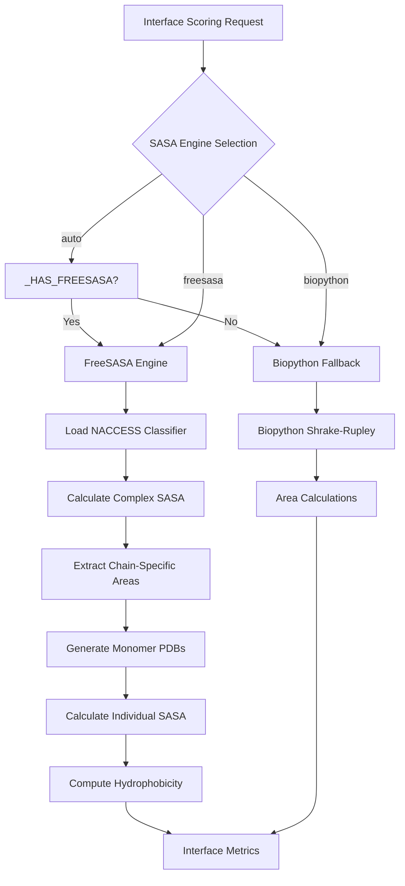

FreeSASA serves as the primary solvent-accessible surface area (SASA) calculation engine in FreeBindCraft's PyRosetta bypass architecture, providing accurate surface area measurements essential for interface scoring and design evaluation.

## Architecture and Integration

FreeSASA is integrated into FreeBindCraft through the `_compute_sasa_metrics_with_freesasa()` function in [functions/pr_alternative_utils.py](functions/pr_alternative_utils.py#L325-L468). The architecture follows a hierarchical approach with automatic fallback to Biopython's Shrake-Rupley algorithm when FreeSASA is unavailable or encounters errors.



## Configuration and Classifier System

FreeSASA utilizes a NACCESS-style atom type classifier for precise surface area calculations. The system supports flexible configuration through multiple pathways:

1. **Environment Variable**: `FREESASA_CONFIG` points to custom classifier files
2. **Repository Default**: Bundled [functions/freesasa_naccess.cfg](functions/freesasa_naccess.cfg) provides comprehensive atom type definitions
3. **Fallback Mode**: Default FreeSASA behavior when no classifier is specified

The classifier defines atomic radii and polar/apolar classifications for all standard amino acid atoms and nucleic acid components, ensuring consistent SASA calculations across different molecular contexts [functions/freesasa_naccess.cfg](functions/freesasa_naccess.cfg#L5-L200).

## SASA Calculation Pipeline

The FreeSASA implementation follows a systematic approach to generate comprehensive interface metrics:

### Complex Structure Analysis
The process begins by loading the complete PDB structure with the specified classifier, calculating total surface areas for the binder-target complex [functions/pr_alternative_utils.py](functions/pr_alternative_utils.py#L357-L361). Chain-specific selections are then applied using FreeSASA's selection API:

```python
selection_defs = [
    f"binder, chain {str(binder_chain)}",
    f"target, chain {str(target_chain)}",
]
sel_area = freesasa.selectArea(selection_defs, structure_complex, result_complex)
```

### Monomer Generation and Analysis
Individual chain structures are extracted using Biopython's PDB parser, written to temporary files, and analyzed separately to determine monomeric SASA values [functions/pr_alternative_utils.py](functions/pr_alternative_utils.py#L378-L444). This approach enables accurate calculation of buried surface area (dSASA) through the difference between monomeric and complex states.

### Surface Hydrophobicity Computation
A distinctive feature of FreeSASA integration is the area-weighted surface hydrophobicity calculation. Unlike binary exposure models, this method computes the fraction of total binder SASA contributed by hydrophobic residues (A, C, F, G, I, L, M, P, V, W, Y) using residue-level selections [functions/pr_alternative_utils.py](functions/pr_alternative_utils.py#L412-L423):

```python
sel_defs = [
    "hydro, resn ala+val+leu+ile+met+phe+pro+trp+tyr+cys+gly"
]
```

> [!TIP]
> The area-weighted hydrophobicity calculation provides more nuanced surface characterization than binary layer-based approaches, naturally weighting residues by their actual exposed surface area rather than treating all hydrophobics equally.

## Interface Metrics Generation

FreeSASA-derived calculations feed into comprehensive interface scoring through the `pr_alternative_score_interface()` function [functions/pr_alternative_utils.py](functions/pr_alternative_utils.py#L473-L608). Key metrics include:

- **Interface dSASA**: Total buried surface area calculated as monomer SASA minus complex SASA for both binder and target
- **Interface Fraction**: Normalized interface size computed as `(interface_total_dSASA / binder_sasa_in_complex * 100.0)` [functions/pr_alternative_utils.py](functions/pr_alternative_utils.py#L565)
- **Surface Hydrophobicity**: Area-weighted fraction of hydrophobic surface exposure
- **Interface Composition**: Amino acid distribution at the binding interface

## Performance and Accuracy

FreeSASA demonstrates close agreement with PyRosetta SASA calculations, with minor variations attributable to algorithmic differences rather than systematic biases. The technical overview documentation shows strong correlation between FreeSASA-derived metrics and PyRosetta reference values [technical_overview/FreeBindCraft_Technical_Overview.md](technical_overview/FreeBindCraft_Technical_Overview.md#L96-L98).

> [!TIP]
> FreeSASA provides superior computational efficiency compared to PyRosetta for SASA calculations, with typical execution times under 0.5 seconds per structure while maintaining high accuracy.

## Error Handling and Robustness

The implementation includes comprehensive error handling with automatic fallback to Biopython when FreeSASA encounters issues [functions/pr_alternative_utils.py](functions/pr_alternative_utils.py#L466-L468). This ensures continuous operation in diverse computational environments while preferring the more accurate FreeSASA engine when available.

Temporary file management follows robust cleanup procedures to prevent resource leaks, and warning suppression mechanisms minimize console noise during normal operation [functions/pr_alternative_utils.py](functions/pr_alternative_utils.py#L212-L218).

## Integration with Design Pipeline

FreeSASA surface analysis integrates seamlessly with other PyRosetta bypass components:

- **OpenMM Relaxation**: Provides structural context for accurate SASA calculations
- **Shape Complementarity**: Complements surface area measurements with geometric fit analysis  
- **Interface Residue Identification**: Works with hotspot detection to focus calculations on relevant regions

The modular design allows flexible engine selection through the `sasa_engine` parameter, supporting "auto", "freesasa", and "biopython" modes to accommodate different deployment scenarios [functions/pr_alternative_utils.py](functions/pr_alternative_utils.py#L516-L554).

FreeSASA represents a critical component in enabling PyRosetta-free protein design workflows while maintaining scientific rigor and computational efficiency. For comprehensive understanding of how SASA metrics integrate with the broader scoring system, see [Interface Scoring Metrics](18-interface-scoring-metrics).