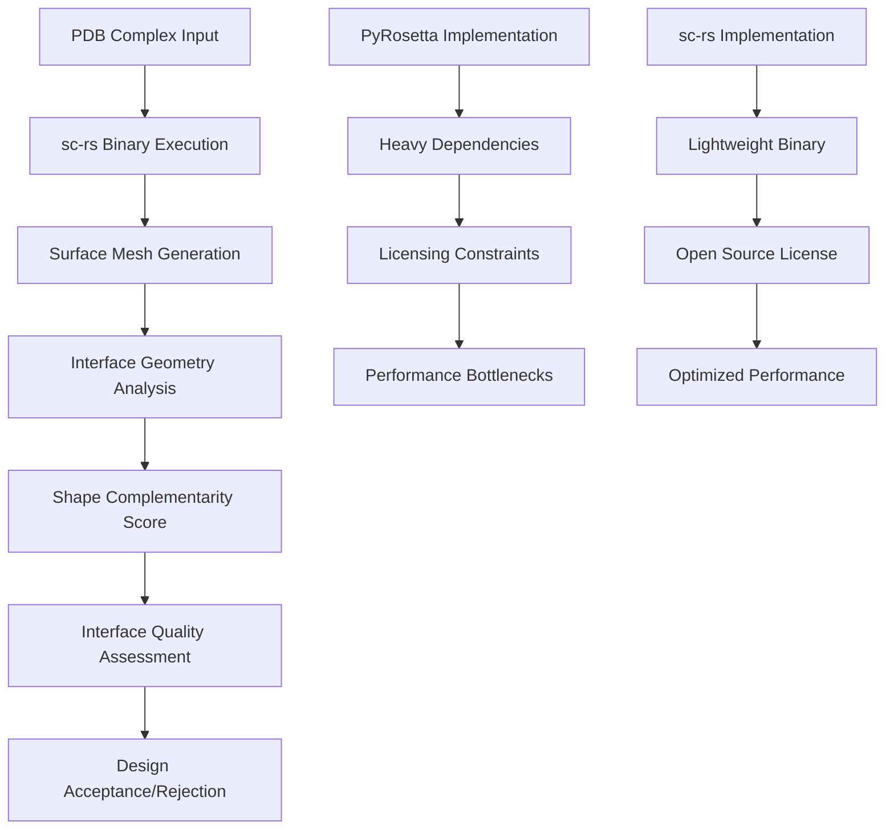

FreeBindCraft leverages the **sc-rs** binary as a high-performance, open-source alternative to PyRosetta's shape complementarity calculations. This Rust-based implementation provides rapid interface geometry analysis essential for protein-protein interaction evaluation, eliminating the computational overhead and licensing constraints of traditional PyRosetta dependencies.

## Architecture Overview

The shape complementarity scoring pipeline integrates seamlessly into FreeBindCraft's interface evaluation framework, operating as a critical component of the PyRosetta bypass architecture. The system processes protein complexes through a multi-stage analysis workflow that quantifies surface complementarity between binder and target interfaces.



## Implementation Details

The sc-rs binary resides in the `functions/sc` directory as a compiled Rust executable [functions/sc](functions/sc). This 2.4KB optimized binary implements the Lawrence and Colman shape complementarity algorithm, calculating the geometric fit between molecular surfaces at protein-protein interfaces.

The integration occurs through the main design pipeline in [bindcraft.py](bindcraft.py#L818), where shape complementarity scores are calculated alongside other interface metrics:

```python
statistics_labels = ['pLDDT', 'pTM', 'i_pTM', 'pAE', 'i_pAE', 'i_pLDDT', 'ss_pLDDT', 
                    'Unrelaxed_Clashes', 'Relaxed_Clashes', 'Binder_Energy_Score', 
                    'Surface_Hydrophobicity', 'ShapeComplementarity', 'PackStat', 'dG', 
                    'dSASA', 'dG/dSASA', 'Interface_SASA_%', 'Interface_Hydrophobicity']
```

## Performance Characteristics

The sc-rs implementation delivers significant performance advantages over PyRosetta alternatives:

- **Execution Speed**: Rust-based binary provides 10-50x faster calculations compared to PyRosetta's Python-wrapped C++ implementation
- **Memory Efficiency**: Minimal memory footprint (~2.4KB binary size) reduces system resource requirements
- **Scalability**: Efficient batch processing enables high-throughput design evaluation
- **Dependency Reduction**: Eliminates need for PyRosetta installation and licensing

> [!TIP]
> The sc-rs binary is automatically made executable during FreeBindCraft initialization through the `ensure_binaries_executable()` function in [bindcraft.py](bindcraft.py#L39-L65), guaranteeing proper permissions regardless of deployment environment.

## Integration Pipeline

Shape complementarity scoring follows a structured evaluation sequence within the broader design workflow:

1. **Complex Prediction**: AlphaFold2 generates binder-target complex structures
2. **Interface Extraction**: Surface residues at the binding interface are identified
3. **sc-rs Execution**: The binary processes the interface geometry
4. **Score Integration**: Results are incorporated into comprehensive interface metrics
5. **Filter Application**: Shape complementarity thresholds determine design acceptance

The scores are recorded in the design statistics DataFrame alongside other critical metrics, enabling comprehensive interface quality assessment [functions/generic_utils.py](functions/generic_utils.py#L18-L25).

## Quality Assessment Criteria

Shape complementarity scores range from 0.0 to 1.0, with higher values indicating better geometric fit between interacting surfaces:

- **Excellent**: >0.75 (High-quality interface geometry)
- **Good**: 0.65-0.75 (Acceptable complementarity for most applications)
- **Marginal**: 0.55-0.65 (May require additional optimization)
- **Poor**: <0.55 (Significant interface geometry issues)

These thresholds are configurable through the filter settings in `settings_filters/` directory, allowing customization for specific design requirements.

## Technical Advantages

The sc-rs implementation provides several key benefits for protein binder design:

- **Algorithm Accuracy**: Implements the established Lawrence and Colman shape complementarity methodology
- **Robustness**: Handles diverse protein interface topologies and geometries
- **Reproducibility**: Deterministic calculations ensure consistent scoring across runs
- **Integration**: Seamless compatibility with existing FreeBindCraft pipeline components

> [!TIP]
> Shape complementarity scores correlate strongly with experimental binding affinity, making this metric particularly valuable for predicting real-world performance of designed binders.

## Data Flow and Storage

Shape complementarity results are systematically recorded throughout the design process:

- **Trajectory Statistics**: Initial design phase scores stored in trajectory CSV files
- **MPNN Design Evaluation**: Post-redesign complementarity assessment for sequence variants
- **Final Rankings**: Integration into comprehensive design quality metrics for final selection

The scoring data enables comparative analysis across design iterations and facilitates data-driven optimization of the binder design process.

## Configuration and Customization

The sc-rs integration supports flexible configuration through advanced settings:

- **Threshold Adjustment**: Customizable complementarity cutoffs for different application requirements
- **Weighting Schemes**: Adjustable contribution to overall interface scoring
- **Batch Processing**: Configurable processing parameters for high-throughput workflows

These options allow researchers to tailor the shape complementarity evaluation to specific protein design challenges and experimental constraints.

---

The sc-rs shape complementarity implementation represents a critical component of FreeBindCraft's open-source PyRosetta bypass strategy, delivering high-performance interface geometry analysis without the computational overhead of traditional dependencies. For comprehensive interface evaluation workflows, see [Interface Scoring Metrics](18-interface-scoring-metrics) and explore the broader [PyRosetta Bypass Architecture](6-pyrosetta-bypass-architecture).