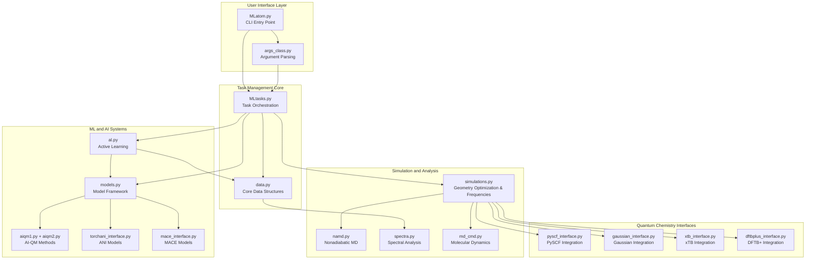
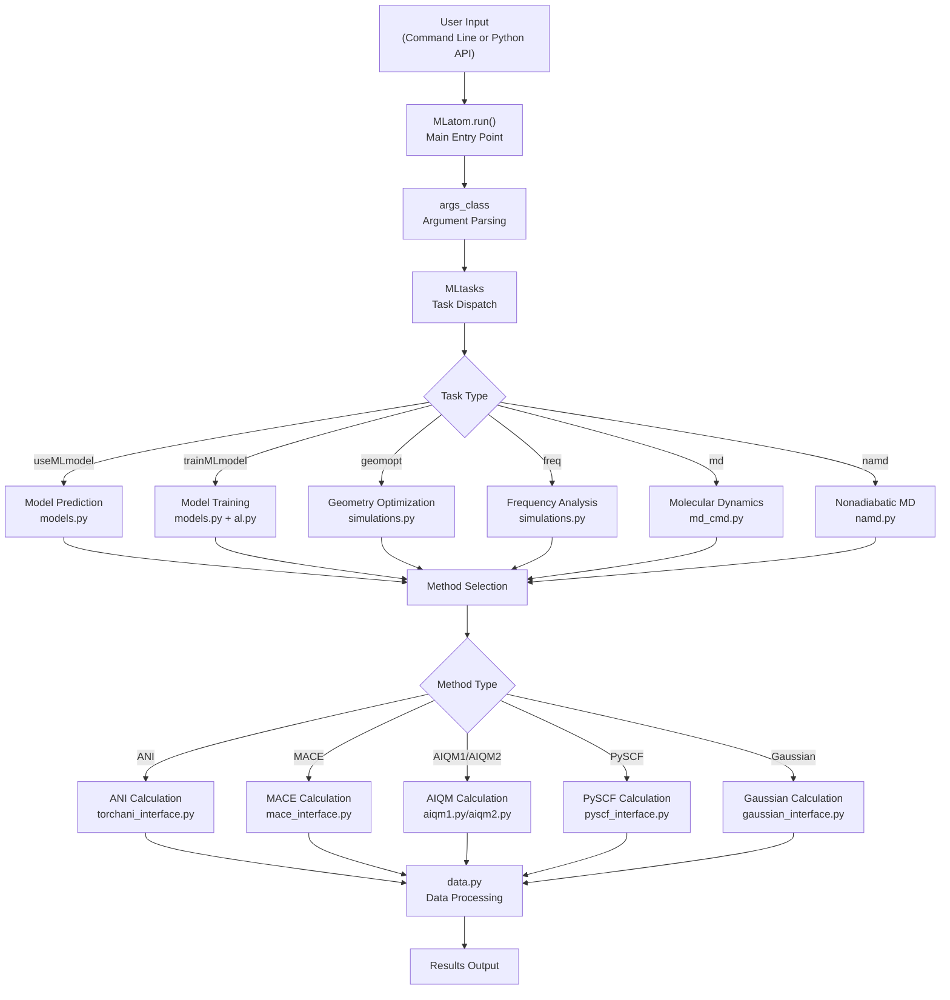
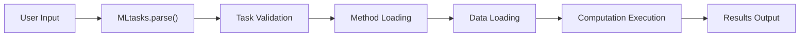

# Overview

<details>
<summary>Relevant source files</summary>

The following files were used as context for generating this wiki page:

- [README.md](README.md)
- [mlatom/__init__.py](mlatom/__init__.py)

</details>


This document provides a comprehensive overview of MLatom, a package for atomistic simulations with machine learning. It covers the overall architecture, key capabilities, and how the different systems work together to enable ML-enhanced computational chemistry and molecular dynamics.

For specific installation and usage instructions, see [Getting Started](#1.1). For detailed information about individual subsystems, refer to the respective sections: [Core Architecture](#2), [Machine Learning Systems](#4), [Molecular Simulations](#5), and [Quantum Chemistry Interfaces](#6).

## Purpose and Scope

MLatom is an open-source package designed to integrate machine learning methods with atomistic simulations and quantum chemistry calculations. The package serves as a unified platform that combines:

- **Machine Learning Models**: Neural network potentials (ANI, MACE), kernel methods (KRR), and hybrid AI-QM approaches
- **Quantum Chemistry Interfaces**: Integration with major QM programs (PySCF, Gaussian, DFTB+, xTB)
- **Molecular Simulations**: Geometry optimization, frequency analysis, molecular dynamics, and nonadiabatic dynamics
- **Active Learning**: Automated model training and uncertainty quantification workflows
- **Spectroscopic Analysis**: UV/Vis, IR, and Raman spectra calculations

The package is distributed under an MIT license (modified to request proper citations) and is available both as a standalone Python package and through the XACS cloud computing platform.

Sources: [README.md:33-39](), [mlatom/__init__.py:1-16]()

## System Architecture

### High-Level Component Overview

MLatom follows a modular architecture with clear separation between user interface, task management, computational backends, and data handling layers.

#### System Architecture Diagram


Sources: [mlatom/__init__.py:1-16]()

### Core Data Flow

The execution flow in MLatom follows a clear pipeline from user input to computational results:

#### Data Flow Pipeline


Sources: [mlatom/__init__.py:2-3]()

## Key Capabilities

### Machine Learning Integration

MLatom provides extensive machine learning capabilities through several key components:

| Component | Purpose | Key Classes/Functions |
|-----------|---------|----------------------|
| **Model Framework** | Base infrastructure for ML models | `models.py`, `model_cls.py` |
| **Active Learning** | Automated model training with uncertainty | `al.py`, `al_utils.py` |
| **Neural Networks** | ANI, MACE, and custom NN potentials | `torchani_interface.py`, `mace_interface.py` |
| **Hybrid Methods** | AI-enhanced quantum methods | `aiqm1.py`, `aiqm2.py` |
| **Traditional ML** | Kernel ridge regression and related methods | `kreg` in `models.py` |

Sources: [mlatom/__init__.py:6-13]()

### Simulation Capabilities

The package supports a wide range of molecular simulation methods:

- **Geometry Optimization**: Single and multi-point optimizations with various optimizers
- **Frequency Analysis**: Vibrational frequencies, IR spectra, thermochemistry
- **Molecular Dynamics**: Classical MD with various thermostats and barostats  
- **Nonadiabatic Dynamics**: Surface hopping, trajectory calculations
- **Spectroscopic Analysis**: UV/Vis, IR, Raman spectra generation and analysis

Sources: [mlatom/__init__.py:4-5](), [README.md:13-19]()

### Quantum Chemistry Integration

MLatom interfaces with major quantum chemistry programs through dedicated modules:

- **PySCF**: DFT, post-HF methods, TDDFT calculations
- **Gaussian**: Full Gaussian functionality integration
- **DFTB+**: Density functional tight-binding calculations
- **xTB**: Extended tight-binding methods
- **Additional interfaces**: ORCA, Sparrow, MNDO, and others

Sources: [mlatom/__init__.py:7]()

## Entry Points and Usage

### Command Line Interface

The primary entry point is through the `MLatom.py` module, which provides the `run()` function:

```python
from mlatom import run
run()  # Command line interface
```

### Python API

Key classes and functions are directly importable:

```python
import mlatom
# Core data structures
mol = mlatom.molecule()
db = mlatom.molecular_database()

# Simulation functions  
mlatom.optimize_geometry(molecule=mol, method='AIQM1')
mlatom.freq(molecule=mol, method='AIQM1')

# Machine learning
model = mlatom.ani()
mlatom.al(molecular_database=db, model=model)
```

Sources: [mlatom/__init__.py:3-6]()

### Task-Based Execution

The `MLtasks` module orchestrates execution based on parsed arguments and task types, supporting both programmatic and CLI-driven workflows.

#### Task Execution Flow


Sources: [mlatom/__init__.py:2]()

## Version and Updates

The current version is 3.18.3, with regular updates introducing new features such as:

- **Recent additions**: FSSH dynamics, KRR in Julia, MDtrajNet-1 model, ECTS diffusion model
- **Advanced features**: Multi-state ANI, gapMD, periodic boundary conditions
- **Enhanced interfaces**: Updated MACE support, improved QM program integration
- **Spectroscopy**: UV/Vis, IR, Raman spectra calculations with various methods

Sources: [mlatom/__init__.py:15](), [README.md:6-31]()

This overview provides the foundation for understanding MLatom's architecture and capabilities. For detailed information about specific subsystems, refer to the dedicated sections in this documentation.

---