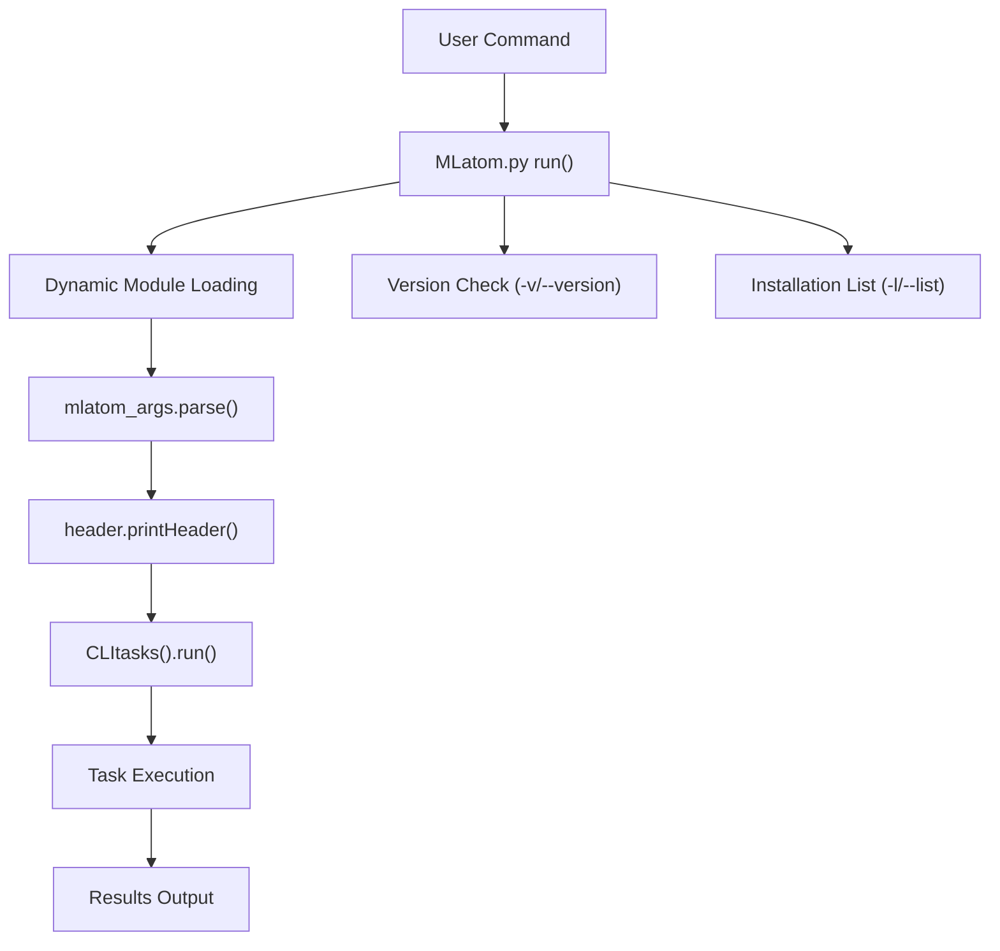
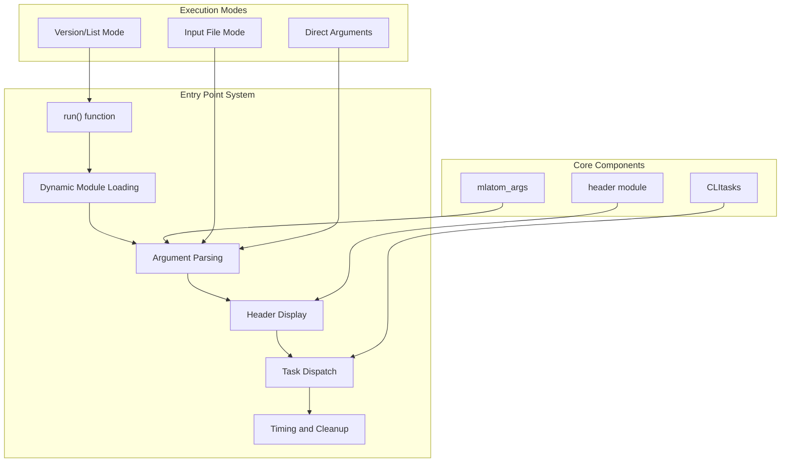
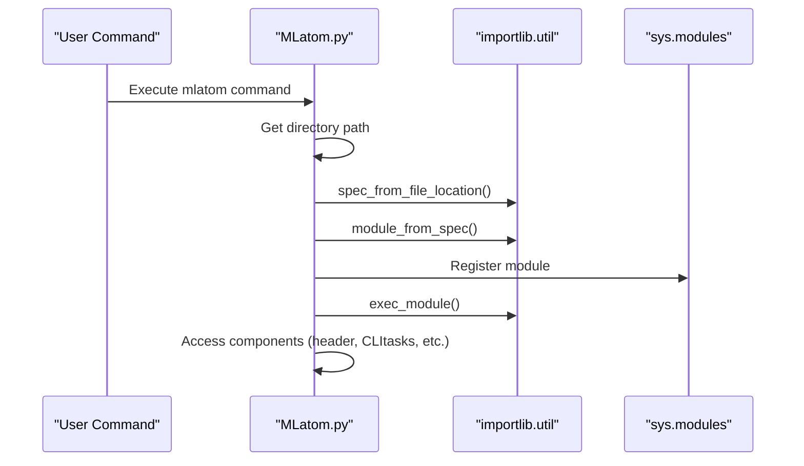

# Getting Started

<details>
<summary>Relevant source files</summary>

The following files were used as context for generating this wiki page:

- [README.md](README.md)
- [mlatom/MLatom.py](mlatom/MLatom.py)

</details>


This document covers the installation, basic usage patterns, and entry points for MLatom - a package for atomistic simulations with machine learning. This page provides the essential information needed to begin using MLatom effectively.

For detailed information about specific subsystems, see [Core Architecture](#2), [Machine Learning Systems](#4), [Molecular Simulations](#5), and [Quantum Chemistry Interfaces](#6).

## Installation and Setup

MLatom can be installed via pip using the following command:

```bash
python3 -m pip install -U MLatom
```

Additional dependencies may need to be installed depending on the specific features you plan to use. MLatom is distributed under an MIT license (modified to request proper citations) and is part of the XACS (Xiamen Atomistic Computing Suite).

### Version Management

MLatom provides built-in version management commands:

| Command | Purpose |
|---------|---------|
| `mlatom -v` or `mlatom --version` | Display current version and check for updates |
| `mlatom -l` or `mlatom --list` | List all available MLatom installations |

These commands are handled in the main entry point at [mlatom/MLatom.py:83-136]().

**Sources:** [README.md:41-45](), [mlatom/MLatom.py:83-136]()

## Basic Usage Patterns

### Command Line Execution

MLatom operates primarily through its command-line interface. The basic execution pattern follows this structure:

```bash
mlatom [options] [input_file]
```

### Execution Flow Overview



**Entry Point Flow Diagram**

The system uses dynamic module loading to ensure the correct MLatom instance is loaded, particularly important when multiple versions may be installed.

**Sources:** [mlatom/MLatom.py:63-176]()

## System Entry Points

### Main Entry Point

The primary entry point is the `run()` function in [mlatom/MLatom.py:63](), which orchestrates the complete execution workflow:



**Main System Components**

### Key System Components

| Component | File Location | Purpose |
|-----------|---------------|---------|
| `run()` | [mlatom/MLatom.py:63]() | Main execution orchestrator |
| `mlatom_args` | Referenced in [mlatom/MLatom.py:78]() | Command-line argument parsing |
| `CLItasks` | Referenced in [mlatom/MLatom.py:77]() | Task execution and dispatching |
| `header` | Referenced in [mlatom/MLatom.py:76]() | Version info and citations |

### Dynamic Module Loading

MLatom uses a sophisticated dynamic loading mechanism to ensure the correct instance is loaded:



**Dynamic Loading Process**

This approach, implemented in [mlatom/MLatom.py:64-78](), handles cases where multiple MLatom versions might be installed and ensures consistent module loading.

**Sources:** [mlatom/MLatom.py:64-78]()

## Execution Workflow

### Standard Execution Process

The standard execution follows this sequence:

1. **Startup Phase**: Version display, argument parsing, and initialization
2. **Header Phase**: Citation information and system details 
3. **Task Phase**: Main computational work through `CLItasks`
4. **Cleanup Phase**: Timing information and termination

### Input Processing

MLatom supports two primary input modes:

| Mode | Description | Implementation |
|------|-------------|----------------|
| Input File | Single file containing all parameters | Detected in [mlatom/MLatom.py:147-154]() |
| Direct Arguments | Command-line arguments | Processed via `args.parse()` |

When an input file is provided, MLatom displays the file contents for transparency and reproducibility.

**Sources:** [mlatom/MLatom.py:140-172]()

## Next Steps

After successful installation and basic setup:

1. **Learn Core Concepts**: Review [Core Architecture](#2) for fundamental data structures and model framework
2. **Explore Tasks**: See [Command Line Interface](#3) for detailed argument handling and task types  
3. **Choose Application Area**:
   - Machine Learning: [Machine Learning Systems](#4)
   - Molecular Simulations: [Molecular Simulations](#5)
   - Quantum Chemistry: [Quantum Chemistry Interfaces](#6)

The system is designed with modularity in mind, allowing users to focus on specific capabilities while maintaining access to the full feature set through consistent interfaces.

**Sources:** [README.md:1-54](), [mlatom/MLatom.py:1-176]()

---