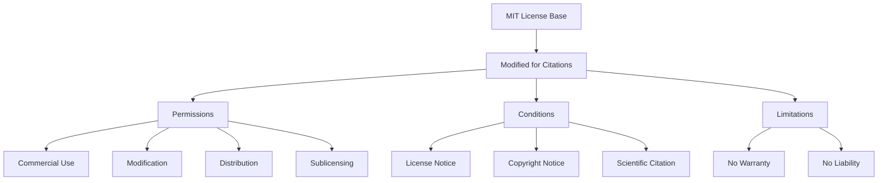
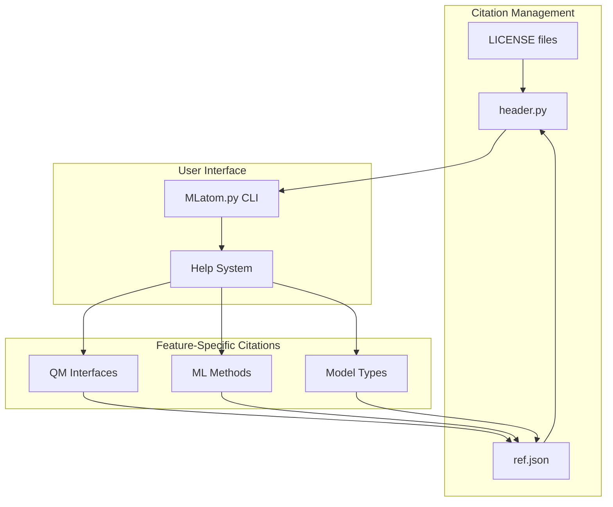
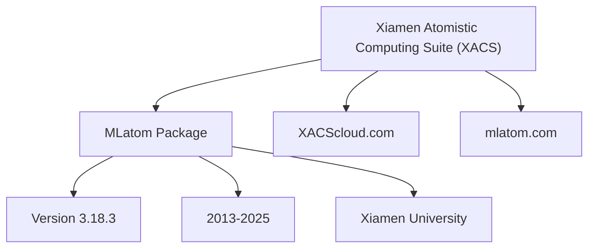

# License and Attribution

<details>
<summary>Relevant source files</summary>

The following files were used as context for generating this wiki page:

- [LICENSE](LICENSE)
- [mlatom/LICENSE](mlatom/LICENSE)

</details>


This document covers the licensing terms, attribution requirements, and citation guidelines for the MLatom package. It explains the legal framework under which MLatom is distributed and the specific citation obligations for users of the software.

For information about getting started with MLatom installation and usage, see [Getting Started](#1.1). For technical documentation about the package architecture, see [Core Architecture](#2).

## License Terms

MLatom is distributed under a modified MIT License that includes mandatory citation requirements for scientific publications. The software is free to use, modify, and distribute, but users must provide proper attribution when using MLatom in research.

### License Structure



Sources: [LICENSE:10-51](), [mlatom/LICENSE:10-51]()

### Copyright Information

The software is copyrighted by Pavlo O. Dral from 2013 onwards. The copyright notice must be included in all copies or substantial portions of the software.

**Copyright Holder:** Pavlo O. Dral  
**Copyright Period:** 2013-present  
**Website:** http://dr-dral.com/  

Sources: [LICENSE:11-12](), [mlatom/LICENSE:11-12]()

## Attribution Requirements

### Mandatory Citation for Scientific Publications

When MLatom or its derivatives are used in scientific publications, two primary citations are required:

#### Primary Journal Citation
```
Pavlo O. Dral, Fuchun Ge, Yi-Fan Hou, Peikun Zheng, Yuxinxin Chen,
Mario Barbatti, Olexandr Isayev, Cheng Wang, Bao-Xin Xue,
Max Pinheiro Jr, Yuming Su, Yiheng Dai, Yangtao Chen, Lina Zhang,
Shuang Zhang, Arif Ullah, Quanhao Zhang, Yanchi Ou.
J. Chem. Theory Comput. 2024, 20, 1193-1213.
```

#### Software Package Citation
```
Pavlo O. Dral, Fuchun Ge, Yi-Fan Hou, Yuxinxin Chen, Peikun Zheng,
Bao-Xin Xue, Mikolaj Martyka, Lina Zhang, Jakub Martinka, Quanhao Zhang,
Xin-Yu Tong, Arif Ullah, Sebastian V. Pios, Vignesh B. Kumar, Yanchi Ou,
Max Pinheiro Jr, Yuming Su, Yiheng Dai, Yangtao Chen, Shuang Zhang,
Matheus O. Bispo
MLatom: A Package for Atomistic Simulations with Machine Learning,
version 3.18.3, Xiamen University, Xiamen, China, 2013-2025.
```

Sources: [LICENSE:26-38](), [mlatom/LICENSE:26-38]()

## Citation Management System

MLatom implements a systematic approach to handling citations for different interfaces and features through dedicated code modules.

### Citation Infrastructure



Sources: [LICENSE:40-41](), [mlatom/LICENSE:40-41]()

### Additional Citation Requirements

Beyond the mandatory citations, specific MLatom interfaces and features require additional citations. These are managed through:

| Component | Purpose | Location |
|-----------|---------|----------|
| `header.py` | Citation display and management | Referenced in license |
| `ref.json` | Database of feature-specific citations | Referenced in license |
| Web documentation | Comprehensive citation guide | http://mlatom.com |

The license explicitly states: "The citations for MLatom's interfaces and features shall be eventually included too."

Sources: [LICENSE:40-41](), [mlatom/LICENSE:40-41]()

## Project Affiliation

MLatom is part of the Xiamen Atomistic Computing Suite (XACS) ecosystem:

### Project Structure



**Institutional Affiliation:** Xiamen University, Xiamen, China  
**Project Websites:**
- Main site: http://mlatom.com/
- Cloud platform: https://XACScloud.com
- Developer site: http://dr-dral.com/

Sources: [LICENSE:6-8](), [mlatom/LICENSE:6-8]()

## License File Locations

The license text is maintained in two locations within the repository:

| File Path | Purpose |
|-----------|---------|
| `LICENSE` | Root directory license file |
| `mlatom/LICENSE` | Package-level license file |

Both files contain identical content and serve as the authoritative source for licensing terms.

Sources: [LICENSE:1-51](), [mlatom/LICENSE:1-51]()

---