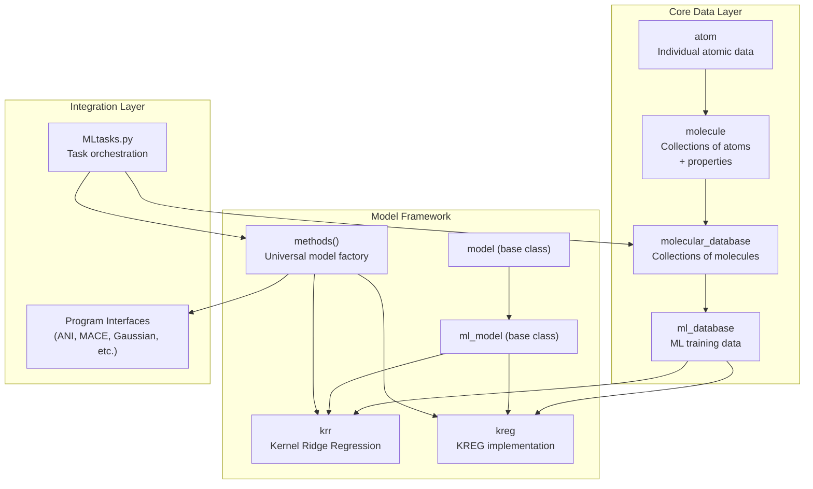
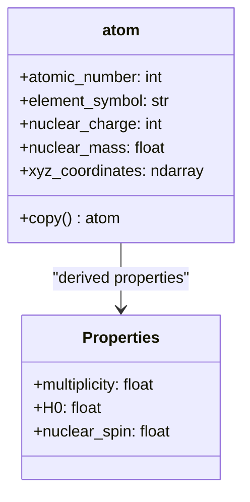
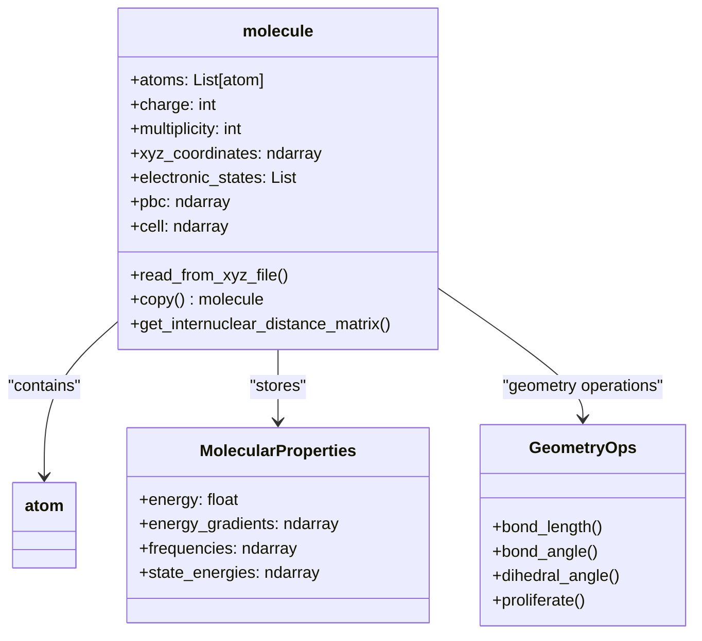
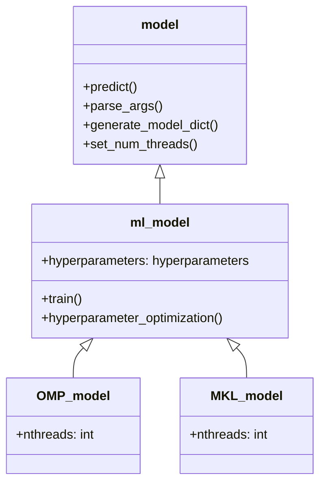
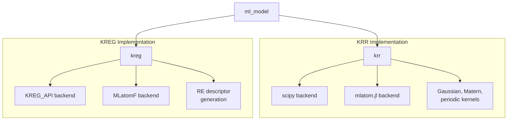
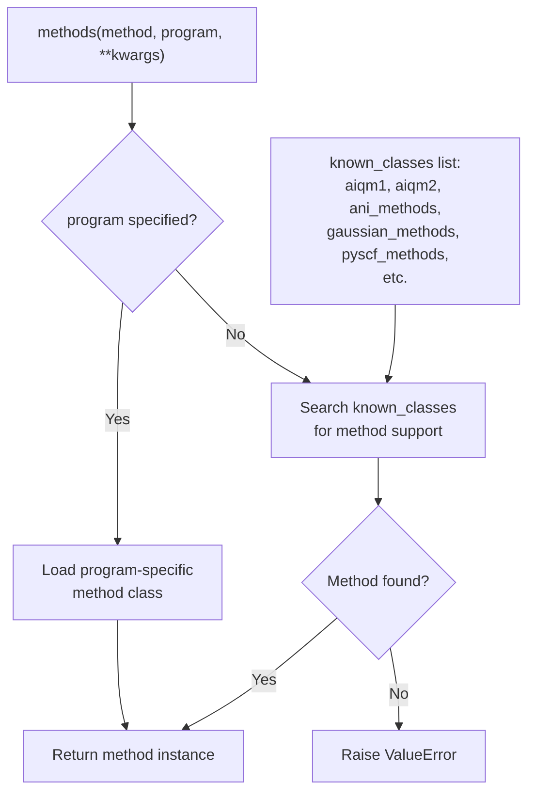
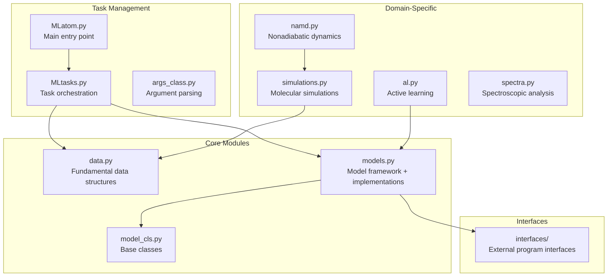

# Core Architecture

<details>
<summary>Relevant source files</summary>

The following files were used as context for generating this wiki page:

- [mlatom/__init__.py](mlatom/__init__.py)
- [mlatom/data.py](mlatom/data.py)
- [mlatom/models.py](mlatom/models.py)

</details>


This document covers MLatom's fundamental data structures, model framework, and package organization that form the foundation for all molecular simulations and machine learning workflows. For command-line interface details, see [Command Line Interface](#3). For specific machine learning implementations, see [Machine Learning Systems](#4).

## Overview

MLatom's architecture is built around a hierarchy of core data structures and a flexible model framework that enables seamless integration between quantum chemistry calculations, machine learning models, and molecular simulations. The architecture follows a layered design where data flows from fundamental atomic representations through molecular assemblies to machine learning databases.



Sources: [mlatom/data.py:1-2000](), [mlatom/models.py:1-800](), [mlatom/__init__.py:1-16]()

## Data Structure Hierarchy

The core data structures form a hierarchical system where atomic data aggregates into molecular representations, which then organize into databases for machine learning workflows.

### Atomic Level: `atom` Class

The `atom` class represents individual atoms with their nuclear properties and coordinates:



Key features include automatic element symbol resolution and isotope property lookup through the periodic table mapping system.

Sources: [mlatom/data.py:191-294]()

### Molecular Level: `molecule` Class

The `molecule` class aggregates atoms and manages molecular properties:



The class supports multiple file formats (XYZ, SMILES, Gaussian), periodic boundary conditions, and vectorial properties for gradients and forces.

Sources: [mlatom/data.py:329-1320]()

### Database Level: `molecular_database` and `ml_database`

Two complementary database classes handle different data organization needs:

```mermaid
graph TD
    subgraph "molecular_database"
        MOLDB_CLASS["molecular_database"]
        MOLS["molecules: List[molecule]"]
        MOLDB_OPS["read_from_xyz_file()<br/>read_from_h5_file()<br/>get_properties()"]
    end
    
    subgraph "ml_database" 
        MLDB_CLASS["ml_database"]
        ENTRIES["entries: List[entry]"]
        ENTRY_CLASS["entry<br/>x: ndarray<br/>y: Union[float, ndarray]"]
        MLDB_OPS["split()<br/>get_x()<br/>get_property()"]
    end
    
    MOLDB_CLASS --> MOLS
    MOLDB_CLASS --> MOLDB_OPS
    MLDB_CLASS --> ENTRIES
    ENTRIES --> ENTRY_CLASS
    MLDB_CLASS --> MLDB_OPS
    
    MOLS -.-> ENTRIES : "can convert"
```

The `molecular_database` focuses on chemical structure and properties, while `ml_database` provides a general-purpose container for machine learning with arbitrary feature vectors and targets.

Sources: [mlatom/data.py:364-1600](), [mlatom/data.py:38-177]()

## Model Framework Architecture

The model framework provides a unified interface for various computational methods through an inheritance hierarchy and factory pattern.

### Base Model Classes



Base classes define common interfaces while specialized classes add training capabilities and threading support.

Sources: [mlatom/model_cls.py](), [mlatom/models.py:16-17]()

### Core ML Implementations

The framework includes two primary kernel-based implementations:



Both classes support energy and gradient predictions with automatic hyperparameter optimization capabilities.

Sources: [mlatom/models.py:18-342](), [mlatom/models.py:343-553]()

### Universal Method Factory

The `methods()` function provides a unified entry point for all computational methods:



This factory pattern enables automatic method detection and provides consistent interfaces across different quantum chemistry programs and ML models.

Sources: [mlatom/models.py:626-690](), [mlatom/models.py:624-625]()

## Package Organization

MLatom's modular structure separates concerns while enabling flexible composition:



The `__init__.py` exposes key classes and functions for direct user access while maintaining clean module boundaries.

Sources: [mlatom/__init__.py:1-16](), [mlatom/MLatom.py](), [mlatom/MLtasks.py]()

---