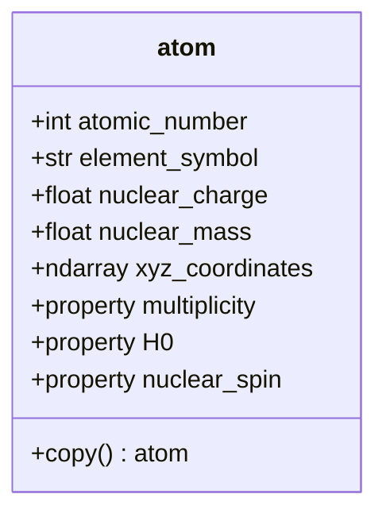
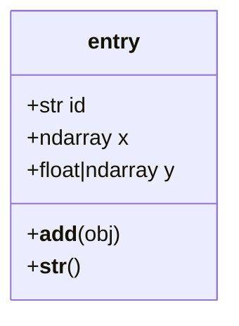
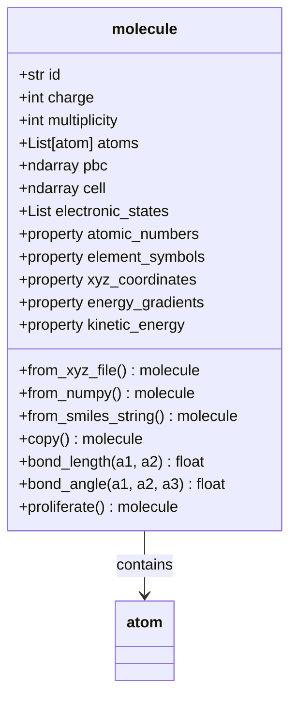
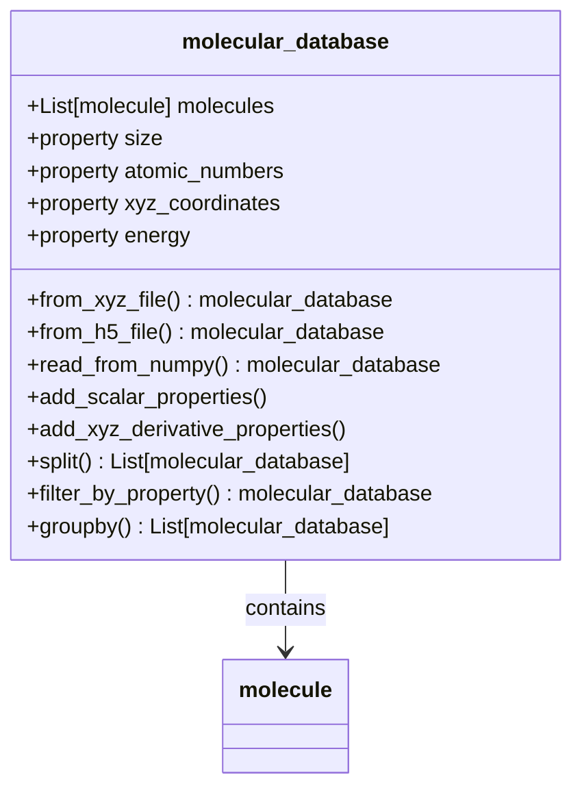
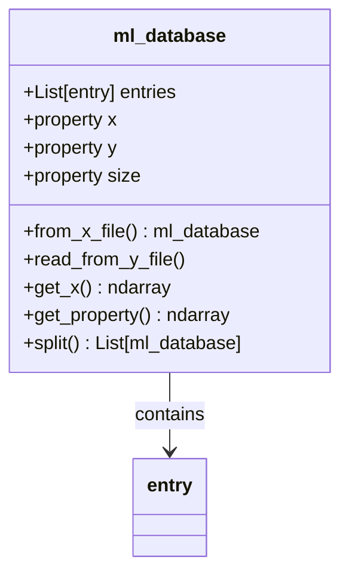
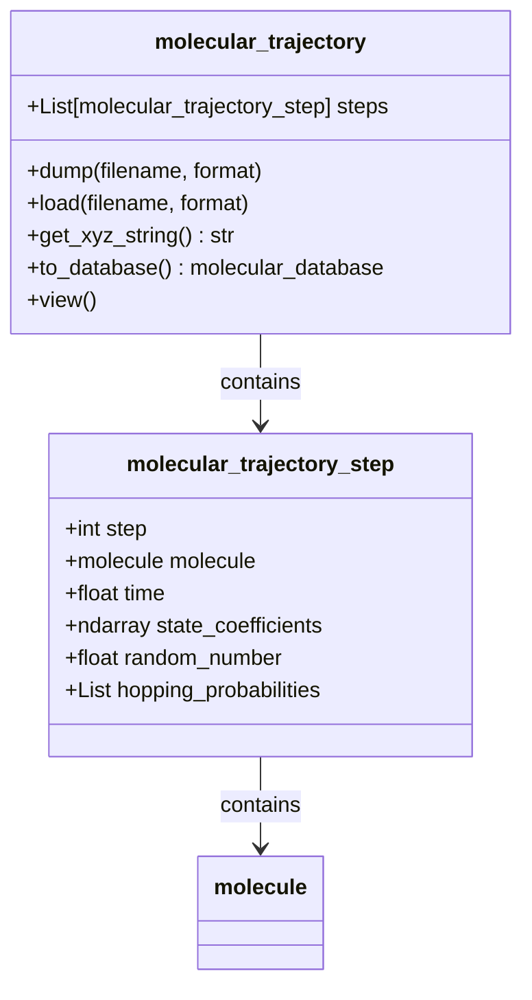
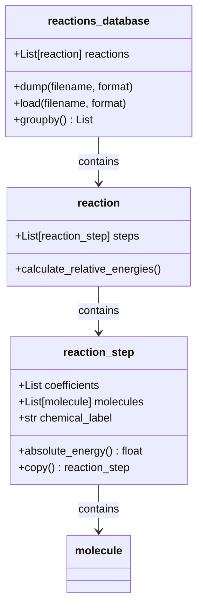
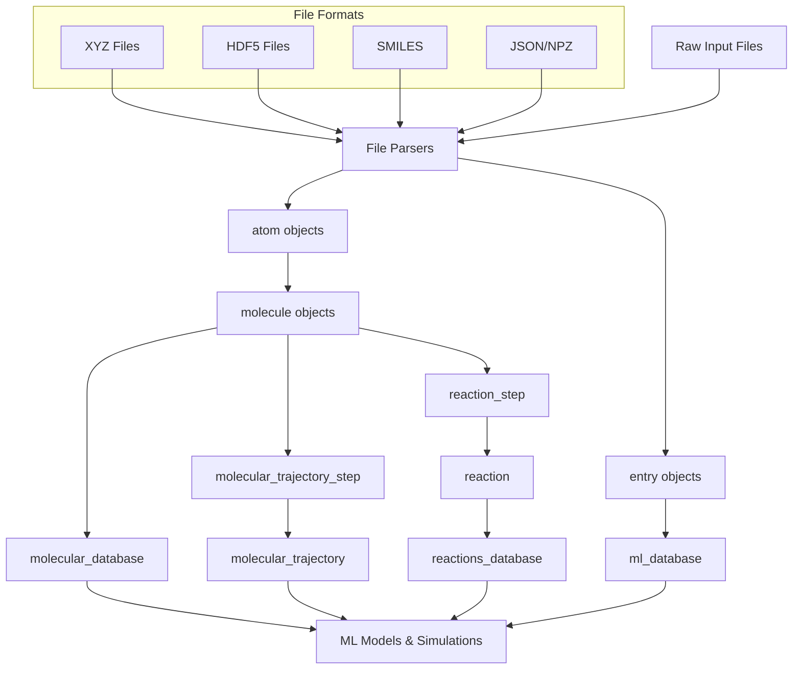
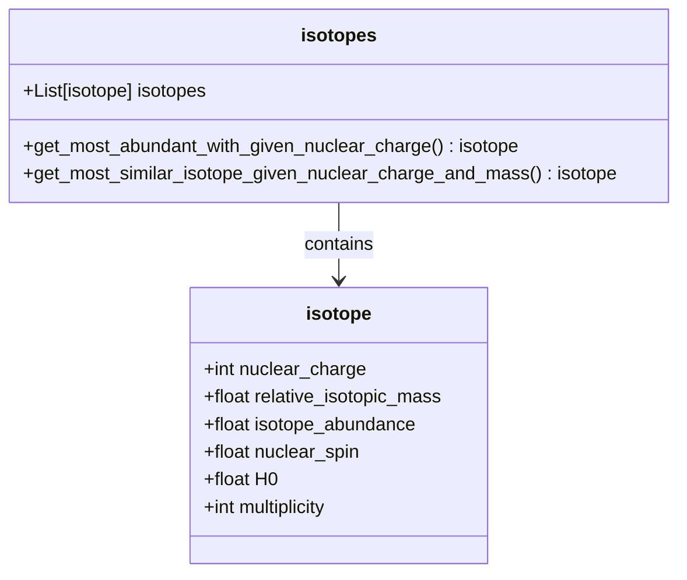

# Data Structures

Relevant source files

The following files were used as context for generating this wiki page:

- [mlatom/data.py](mlatom/data.py)

## Purpose and Scope

This page documents the core data structures in MLatom that represent atoms, molecules, molecular databases, and trajectories. These classes form the foundation for all molecular data handling, from individual atomic properties to collections of molecules used in machine learning workflows and molecular dynamics simulations.

For information about the model framework that operates on these data structures, see [Model Framework](#2.2). For details about molecular simulations that generate trajectory data, see [Core Simulations](#5.1) and [Molecular Dynamics](#5.2).

## Core Atomic and Entry Structures

### Atom Class

The `atom` class [mlatom/data.py:191-294]() represents individual atoms with their fundamental properties:

**Key Properties:**
- `atomic_number`: Defines the element type
- `element_symbol`: String representation (e.g., 'H', 'C', 'O')
- `xyz_coordinates`: 3D position in Angström units
- `nuclear_mass`: Atomic mass, with automatic isotope lookup

The class uses property decorators to provide multiple ways to access the same atomic information and automatically converts between atomic number, element symbol, and nuclear charge [mlatom/data.py:222-279]().

**Sources:** [mlatom/data.py:191-294]()

### Entry Class

The `entry` class [mlatom/data.py:23-37]() provides a basic data container for machine learning applications:

Each entry contains input features (`x`) and target values (`y`) with a unique identifier. Entries can be combined using the `+` operator to create `ml_database` objects.

**Sources:** [mlatom/data.py:23-37]()

## Molecular Structures

### Molecule Class

The `molecule` class [mlatom/data.py:329-1320]() is the central structure representing complete molecular systems:

**Key Features:**
- **Atomic Structure**: Contains a list of `atom` objects
- **Electronic Properties**: Charge, multiplicity, electronic states
- **Periodic Boundary Conditions**: Support for periodic systems via `pbc` and `cell`
- **Multiple Input Formats**: Can be created from XYZ files, NumPy arrays, or SMILES strings
- **Geometric Analysis**: Built-in methods for bond lengths, angles, and dihedral angles

**Data Loading Methods:**
- `from_xyz_file()`: Standard XYZ format with support for COLUMBUS, NEWTON-X, and Turbomole formats
- `from_numpy()`: Direct creation from coordinate and species arrays
- `from_smiles_string()`: Generation from SMILES with 3D optimization

**Sources:** [mlatom/data.py:329-1320]()

## Database and Collection Structures

### Molecular Database

The `molecular_database` class [mlatom/data.py:1364-2239]() manages collections of molecules:

**Key Capabilities:**
- **Batch Operations**: Apply properties to all molecules simultaneously
- **Data Splitting**: Random or user-defined splits for training/validation
- **File I/O**: Support for XYZ, HDF5, JSON, and NPZ formats
- **Property Management**: Add scalar properties, gradients, and vectorial properties
- **Filtering and Grouping**: Select subsets based on property values

**Sources:** [mlatom/data.py:1364-2239]()

### ML Database

The `ml_database` class [mlatom/data.py:38-177]() is designed specifically for machine learning workflows:

This class provides specialized methods for handling feature matrices (`x`) and target vectors (`y`) common in machine learning applications.

**Sources:** [mlatom/data.py:38-177]()

## Trajectory Structures

### Molecular Trajectory

For molecular dynamics and optimization tasks, MLatom provides trajectory data structures:

**Supported Formats:**
- **H5MD**: High-performance binary format for large trajectories
- **JSON**: Human-readable format for smaller datasets
- **Plain Text**: Multiple files (XYZ, gradients, energies, etc.)

**Sources:** [mlatom/data.py:2561-2923]()

## Chemical Reaction Structures

MLatom provides specialized structures for handling chemical reactions:

**Sources:** [mlatom/data.py:2291-2436]()

## Data Flow and Relationships

The following diagram illustrates how data flows through MLatom's core structures:

**Sources:** [mlatom/data.py:296-318](), [mlatom/data.py:436-564](), [mlatom/data.py:1405-1463]()

## Isotope and Atomic Data

MLatom includes comprehensive isotope data for accurate mass calculations:

The isotope database contains data for elements 1-118 with nuclear masses, abundances, and nuclear spin information sourced from NIST [mlatom/data.py:3269-3665]().

**Sources:** [mlatom/data.py:3269-3665]()

## Utility and I/O Classes

### HDF5 Support

MLatom provides specialized HDF5 handling through several classes:

- `h5md`: H5MD format support for trajectory data [mlatom/data.py:2931-3080]()
- `h5dataloader`: Efficient loading of large HDF5 datasets [mlatom/data.py:3081-3130]()

### Data Conversion

The module includes utilities for converting between different data representations:
- `class_instance_to_dict()`: Serialization to dictionary format [mlatom/data.py:2439-2464]()
- `dict_to_*_class_instance()`: Deserialization from dictionaries [mlatom/data.py:2466-2559]()

**Sources:** [mlatom/data.py:2931-3130](), [mlatom/data.py:2439-2559]()

---