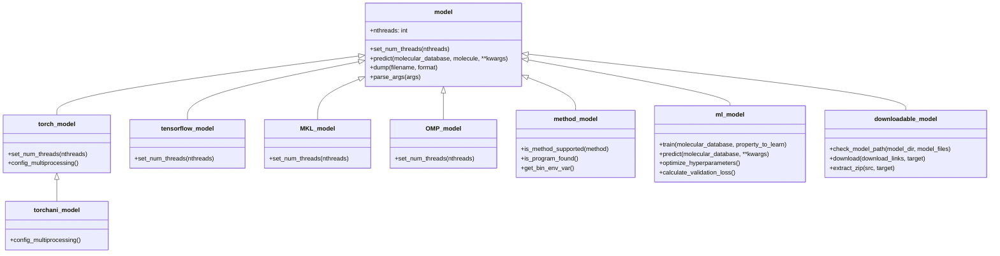
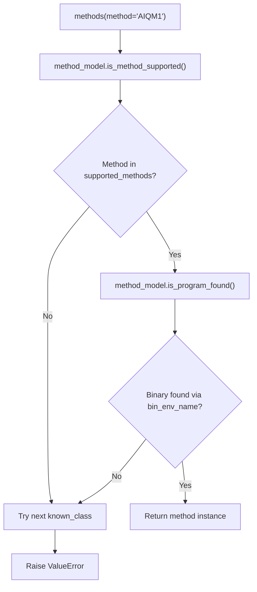
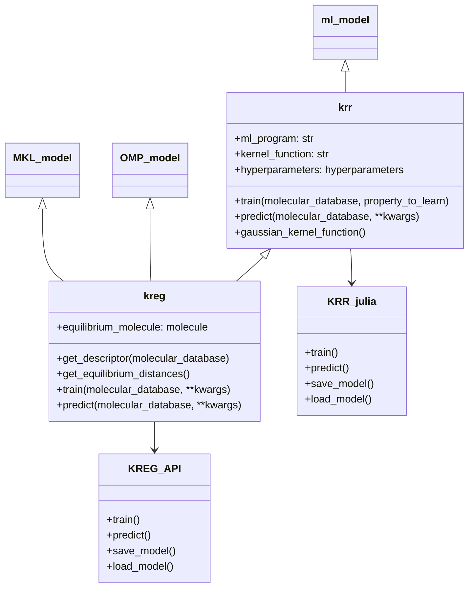
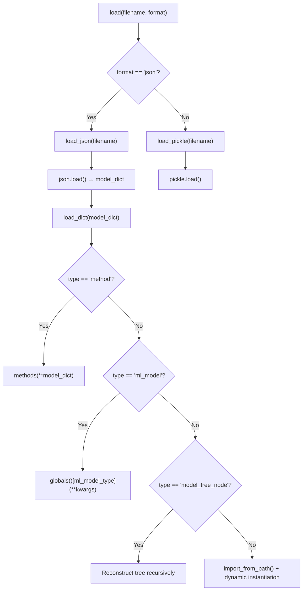
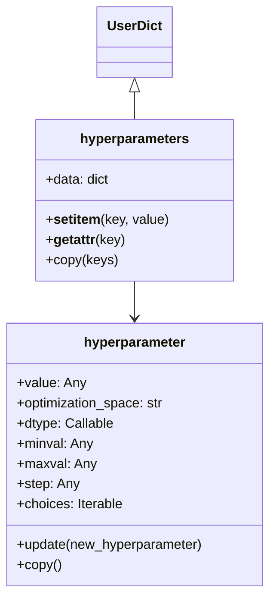
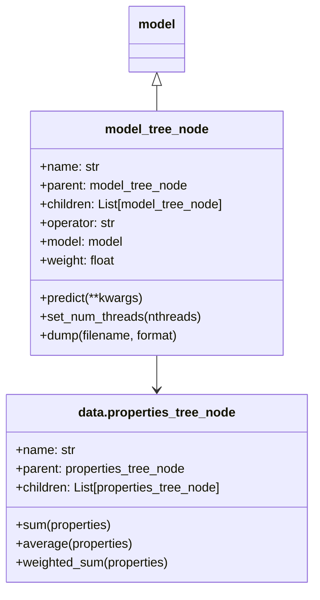
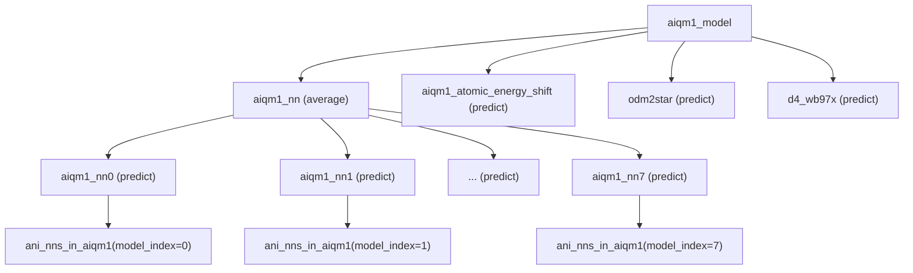

# Model Framework

<details>
<summary>Relevant source files</summary>

The following files were used as context for generating this wiki page:

- [mlatom/aiqm1.py](mlatom/aiqm1.py)
- [mlatom/aiqm2.py](mlatom/aiqm2.py)
- [mlatom/model_cls.py](mlatom/model_cls.py)
- [mlatom/models.py](mlatom/models.py)

</details>


This document covers the core model framework infrastructure in MLatom, including base model classes, kernel ridge regression (KRR/KREG) implementations, and model loading/saving mechanisms. The framework provides a unified interface for different types of computational models while handling threading, hyperparameter optimization, and model composition.

For information about specific machine learning implementations, see [Machine Learning Systems](#4). For quantum chemistry method interfaces, see [Quantum Chemistry Interfaces](#6).

## Base Model Classes Architecture

The model framework is built around a hierarchy of base classes that provide common functionality for all computational models in MLatom.

### Core Model Hierarchy



The base `model` class [mlatom/model_cls.py:20-131]() provides fundamental functionality including:
- Thread management via `set_num_threads()`
- Universal prediction interface through `predict()`
- Model serialization with `dump()`
- Integration with geometry optimization logging

Specialized base classes handle different computational backends:
- `torch_model` [mlatom/model_cls.py:132-144]() manages PyTorch threading
- `tensorflow_model` [mlatom/model_cls.py:150-155]() sets TensorFlow parallelism
- `MKL_model` and `OMP_model` [mlatom/model_cls.py:156-167]() control Intel MKL and OpenMP threads

**Sources:** [mlatom/model_cls.py:20-200]()

### Method and Model Discovery

The `method_model` class [mlatom/model_cls.py:168-200]() provides automatic method discovery:



The `known_classes` list [mlatom/models.py:624]() defines the search order for method resolution, with AIQM methods having priority over basic quantum chemistry interfaces.

**Sources:** [mlatom/model_cls.py:168-200](), [mlatom/models.py:626-691]()

## KRR/KREG Implementations

### Kernel Ridge Regression Architecture



The `krr` class [mlatom/models.py:18-342]() implements kernel ridge regression with multiple backend options:
- `scipy` backend for direct matrix operations
- `mlatom.jl` backend using Julia implementation

Key features include:
- Multiple kernel functions: Gaussian, periodic Gaussian, Matern
- Automatic hyperparameter initialization based on kernel type
- Support for training on both energies and gradients

**Sources:** [mlatom/models.py:18-342]()

### KREG Implementation Details

The `kreg` class [mlatom/models.py:343-553]() extends KRR with relative equilibrium (RE) descriptors:

```python
# Descriptor calculation using equilibrium distances
descriptor[ii] = eq_distmat[iatomind][jatomind]/distmat[iatomind][jatomind]
```

The class supports two primary backends:
- `KREG_API` for optimized native implementation
- `MLatomF` for legacy Fortran interface

Training workflow [mlatom/models.py:459-521]():
1. Determine equilibrium molecule from lowest energy structure
2. Generate RE descriptors for all molecules  
3. Train kernel matrix with regularization
4. Save model coefficients

**Sources:** [mlatom/models.py:343-553]()

## Model Factory and Loading System

### Method Factory Function

The `methods()` function [mlatom/models.py:626-691]() serves as the primary entry point for model creation:

```mermaid
flowchart TD
    A["methods(method, program, **kwargs)"] --> B{program specified?}
    B -->|Yes| C["Use program_methods module"]
    B -->|No| D["Search known_classes"]
    
    C --> E["program_methods(method, **kwargs)"]
    D --> F["For each method_class in known_classes"]
    F --> G{is_method_supported(method)?}
    G -->|Yes| H{is_program_found()?}
    G -->|No| I["Try next class"]
    H -->|Yes| J["method_class(method, **kwargs)"]
    H -->|No| I
    I --> K{More classes?}
    K -->|Yes| F
    K -->|No| L["Raise ValueError"]
```

The factory supports both explicit program specification and automatic discovery based on available programs and supported methods.

**Sources:** [mlatom/models.py:626-691]()

### Model Loading Infrastructure



Model serialization preserves:
- Model type and module information
- Hyperparameter values and constraints  
- Thread configuration
- Nested model structures for composite models

**Sources:** [mlatom/models.py:699-773]()

## Hyperparameter Management

### Hyperparameter Classes



The `hyperparameter` class [mlatom/model_cls.py:849-898]() encapsulates individual parameters with:
- Value storage with automatic type casting
- Optimization space definition (linear, log, etc.)
- Bounds and constraints for optimization

The `hyperparameters` class [mlatom/model_cls.py:900-951]() provides a dictionary-like interface with automatic conversion to `hyperparameter` objects.

**Sources:** [mlatom/model_cls.py:849-951]()

### Hyperparameter Optimization

The `ml_model.optimize_hyperparameters()` method [mlatom/model_cls.py:602-721]() supports multiple optimization algorithms:

```mermaid
flowchart TD
    A["optimize_hyperparameters()"] --> B{optimization_algorithm}
    B -->|"grid"| C["Grid search with scipy.optimize"]
    B -->|"TPE"| D["Tree-structured Parzen Estimator with hyperopt"]
    B -->|"Nelder-Mead"| E["Scipy minimize methods"]
    B -->|"BFGS", "L-BFGS-B", etc.| E
    
    C --> F["optimize_grid() custom implementation"]
    D --> G["hyperopt.fmin() with space mapping"]
    E --> H["scipy.optimize.minimize()"]
    
    F --> I["Update hyperparameters.value"]
    G --> I
    H --> I
```

Cross-validation and holdout validation are handled through `cross_validation()` and `holdout_validation()` methods that automatically split datasets and calculate validation losses.

**Sources:** [mlatom/model_cls.py:602-764]()

## Model Composition System

### Model Tree Node Architecture

The `model_tree_node` class [mlatom/model_cls.py:953-1135]() enables hierarchical model composition:



Supported operators [mlatom/model_cls.py:1057-1074]():
- `predict`: Execute child model prediction
- `sum`: Add results from all children  
- `average`: Compute mean of child results
- `weighted_sum`: Weighted combination using node weights

**Sources:** [mlatom/model_cls.py:953-1135]()

### Example: AIQM1 Model Composition



This composition [mlatom/aiqm1.py:54-66]() combines:
- 8 neural network models (averaged)
- Atomic energy shift corrections
- ODM2* quantum mechanical method
- D4 dispersion corrections

The tree structure automatically handles property aggregation and uncertainty quantification across all component models.

**Sources:** [mlatom/aiqm1.py:54-66](), [mlatom/model_cls.py:987-1077]()

---