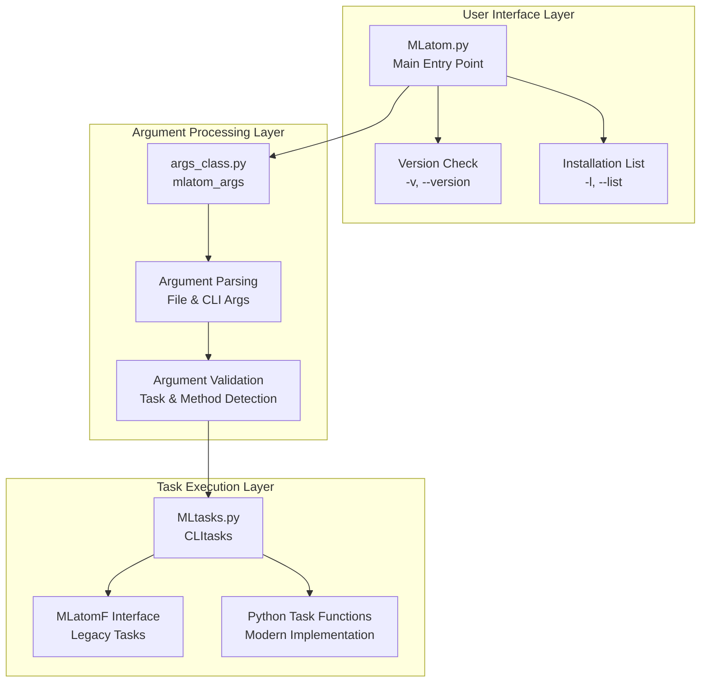
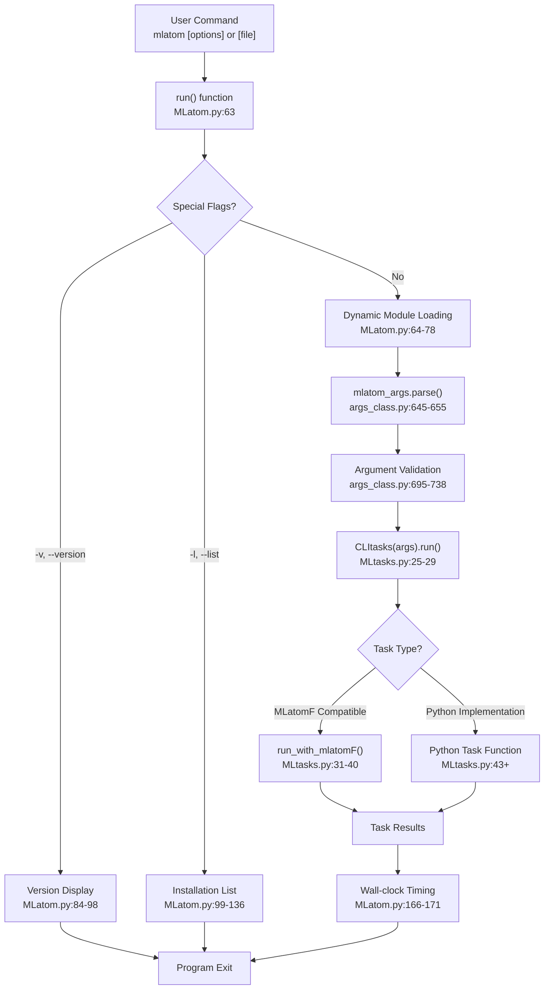
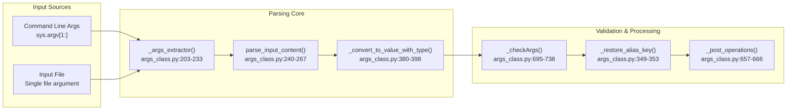
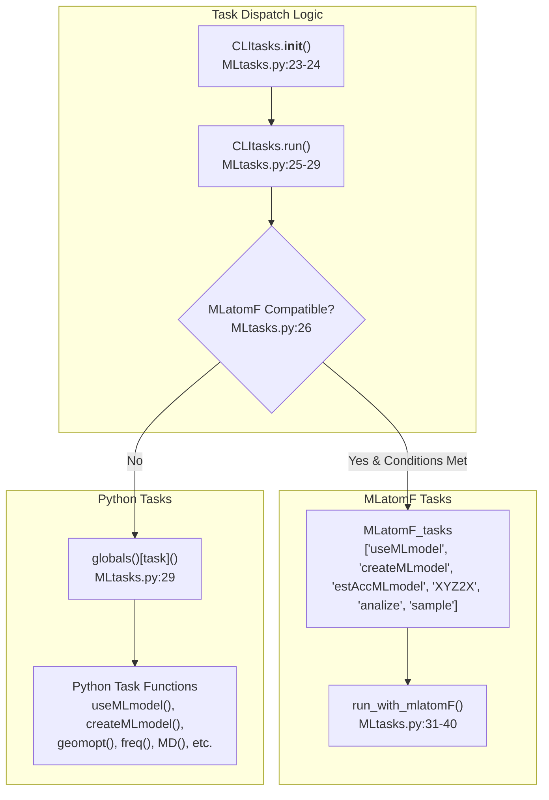
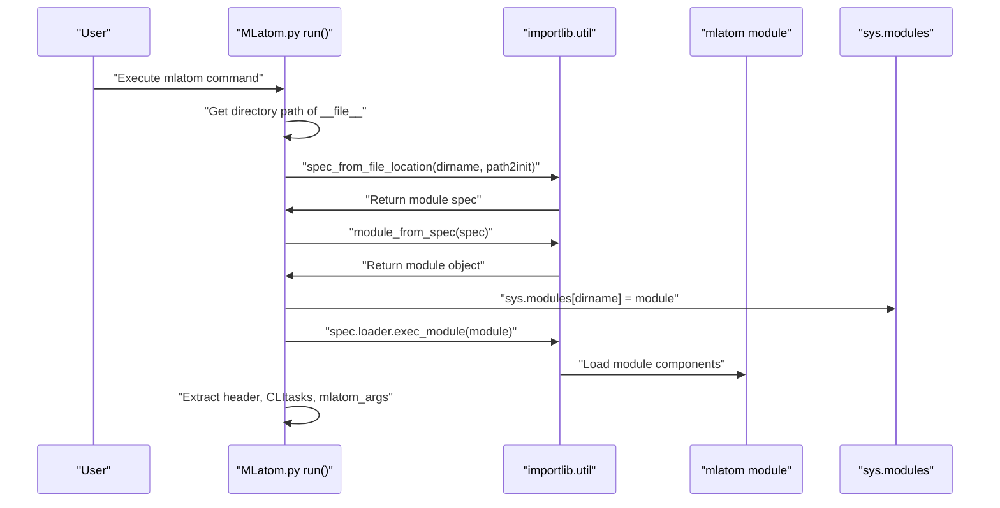
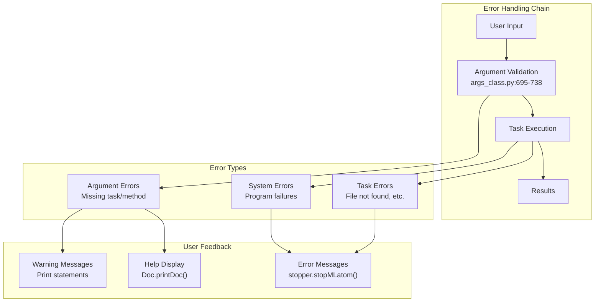

# Command Line Interface

Relevant source files

The following files were used as context for generating this wiki page:

- [mlatom/MLatom.py](mlatom/MLatom.py)
- [mlatom/MLtasks.py](mlatom/MLtasks.py)
- [mlatom/args_class.py](mlatom/args_class.py)
- [mlatom/interfaces/xtb_interface.py](mlatom/interfaces/xtb_interface.py)

The Command Line Interface (CLI) is the primary entry point for users to interact with MLatom. It provides a unified command-line interface that handles argument parsing, task dispatching, and execution flow control for all MLatom functionality including machine learning tasks, molecular simulations, and quantum chemistry calculations.

For information about the core task implementations, see [Task Management and Arguments](#3.2). For details on the underlying data structures used by CLI tasks, see [Data Structures](#2.1).

## CLI Architecture Overview

The MLatom CLI follows a three-layer architecture that separates user input processing, argument parsing, and task execution:

**CLI Entry Point Flow**
Sources: [mlatom/MLatom.py:63-173](), [mlatom/args_class.py:401-762](), [mlatom/MLtasks.py:14-29]()

## Command Line Execution Flow

The CLI execution follows a structured pipeline from user input to task completion:

**Command Execution Pipeline**
Sources: [mlatom/MLatom.py:63-173](), [mlatom/args_class.py:645-655](), [mlatom/MLtasks.py:25-40]()

## Argument Parsing System

The argument parsing system provides flexible input handling that supports both command-line arguments and input files:

| Component | Class/Function | Purpose |
|-----------|---------------|---------|
| Base Parser | `ArgsBase` | Generic argument parsing with key-value support |
| MLatom Parser | `mlatom_args` | MLatom-specific argument handling and validation |
| Task Detection | `_checkArgs()` | Automatic task identification from arguments |
| Method Detection | Built-in | Automatic method identification from arguments |

**Argument Processing Pipeline**
Sources: [mlatom/args_class.py:203-267](), [mlatom/args_class.py:695-738](), [mlatom/args_class.py:349-398]()

## Task Categories and Dispatch

MLatom organizes functionality into distinct task categories, each handled by specific dispatch logic:

| Category | Tasks | Handler |
|----------|-------|---------|
| ML Tasks | `useMLmodel`, `createMLmodel`, `estAccMLmodel` | Python or MLatomF |
| Data Tasks | `XYZ2X`, `analyze`, `sample` | Mixed implementation |
| Simulation Tasks | `geomopt`, `freq`, `MD`, `al` | Python implementation |
| Specialized | `learningCurve`, `crossSection`, `MLQD` | Python implementation |

**Task Dispatch Architecture**
Sources: [mlatom/MLtasks.py:14-29](), [mlatom/MLtasks.py:31-40]()

## Dynamic Module Loading

MLatom implements sophisticated dynamic module loading to ensure that the CLI uses the same instance of the mlatom package from which it's executed:

**Dynamic Loading Sequence**
Sources: [mlatom/MLatom.py:64-78]()

## Version and Installation Management

The CLI provides built-in version checking and installation discovery capabilities:

| Flag | Function | Purpose |
|------|----------|---------|
| `-v`, `--version` | Version display | Shows current version, checks for updates |
| `-l`, `--list` | Installation list | Lists all available MLatom installations |

The version checking system [mlatom/MLatom.py:84-98]() queries PyPI for the latest version and notifies users of available updates. The installation listing system [mlatom/MLatom.py:99-136]() searches multiple locations including:

- Current installation directory
- PYTHONPATH directories  
- Site-packages directories

Sources: [mlatom/MLatom.py:84-136]()

## Error Handling and User Feedback

The CLI implements comprehensive error handling and user feedback mechanisms:

**Error Handling Flow**
Sources: [mlatom/args_class.py:695-738](), [mlatom/MLtasks.py:653-665]()

---