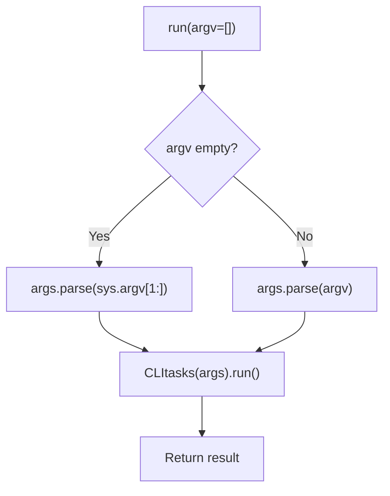
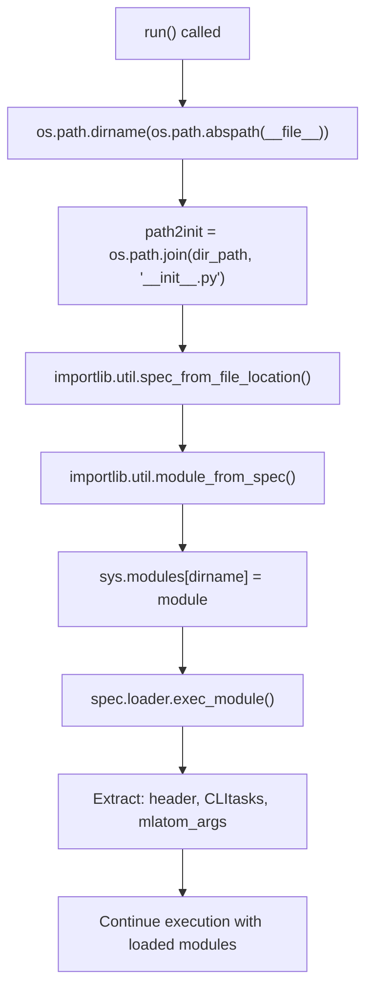
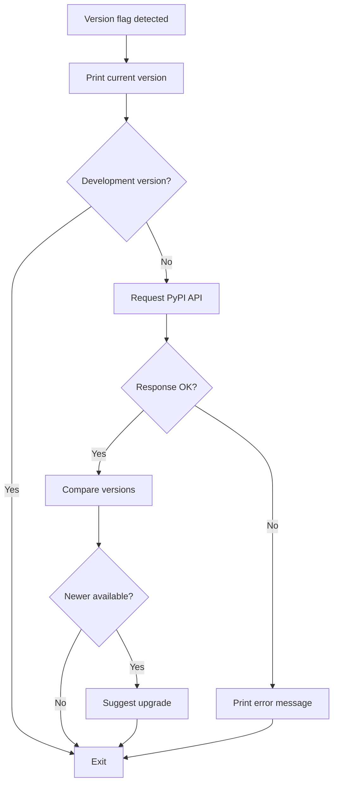
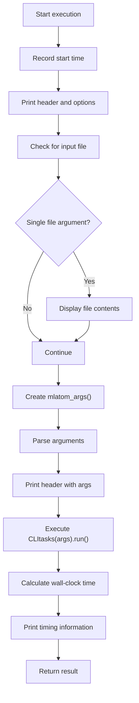
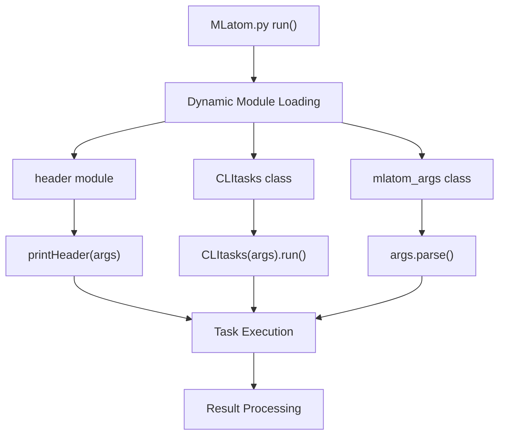

# Entry Point and Execution

Relevant source files

The following files were used as context for generating this wiki page:

- [mlatom/MLatom.py](mlatom/MLatom.py)

This document covers the main entry point and execution control mechanisms in MLatom, specifically focusing on the command-line interface entry point and how execution flows through the system. This includes dynamic module loading, version management, argument parsing integration, and task execution orchestration.

For information about specific task implementations and argument parsing details, see [Task Management and Arguments](#3.2). For details about the core data structures used during execution, see [Data Structures](#2.1).

## Main Entry Point Function

The primary entry point for MLatom is the `run()` function in [mlatom/MLatom.py:63-173](). This function serves as both the programmatic API entry point and the command-line interface handler.

The `run()` function accepts an optional `argv` parameter, allowing it to be called either:
- Directly from the command line (using `sys.argv`)
- Programmatically with custom arguments

**Main Entry Point Flow**
Sources: [mlatom/MLatom.py:63-173]()

## Dynamic Module Loading

MLatom implements a sophisticated dynamic module loading mechanism to ensure that the correct instance of the mlatom package is used, particularly important when multiple versions might be installed.

The loading process involves several key steps:

| Step | Action | Code Location |
|------|--------|---------------|
| 1 | Get directory path of current file | [mlatom/MLatom.py:69]() |
| 2 | Build path to `__init__.py` | [mlatom/MLatom.py:70]() |
| 3 | Create module spec from file location | [mlatom/MLatom.py:72-73]() |
| 4 | Load module and register in `sys.modules` | [mlatom/MLatom.py:74-75]() |
| 5 | Import required submodules | [mlatom/MLatom.py:76-78]() |

**Dynamic Module Loading Process**
Sources: [mlatom/MLatom.py:64-78]()

## Version Management

The entry point provides comprehensive version management functionality through command-line flags:

### Version Display (`-v`, `--version`)

When the version flag is provided, the system:
1. Displays the current version from `mlatom_with_this_file.__version__`
2. Checks PyPI for the latest version (if not a development version)
3. Suggests upgrade if a newer version is available

**Version Check Flow**
Sources: [mlatom/MLatom.py:83-98]()

### Installation Listing (`-l`, `--list`)

The list functionality discovers all MLatom installations by searching:
- Current installation location
- `PYTHONPATH` directories
- Site packages directories

The search process uses the helper function `get_version_from_init()` to extract version information from `__init__.py` files.

Sources: [mlatom/MLatom.py:99-136]()

## Execution Flow

The main execution sequence follows a structured pattern with comprehensive logging and timing:

**Main Execution Flow**
Sources: [mlatom/MLatom.py:80-173]()

### Output Formatting

The entry point provides consistent output formatting with:
- Header sections delimited by `=` characters (78 characters wide)
- Timestamp logging for start and end times
- Wall-clock time reporting in seconds, minutes, and hours
- Input file content display for single-file inputs

Sources: [mlatom/MLatom.py:138-155](), [mlatom/MLatom.py:166-171]()

## Integration with Core Systems

The entry point serves as the orchestration layer connecting several core systems:

**System Integration Architecture**
Sources: [mlatom/MLatom.py:76-78](), [mlatom/MLatom.py:155-164]()

### Component Responsibilities

| Component | Responsibility | Integration Point |
|-----------|----------------|-------------------|
| `header` | Version info and citation printing | [mlatom/MLatom.py:76](), [mlatom/MLatom.py:161]() |
| `CLItasks` | Task execution and orchestration | [mlatom/MLatom.py:77](), [mlatom/MLatom.py:164]() |
| `mlatom_args` | Command-line argument parsing | [mlatom/MLatom.py:78](), [mlatom/MLatom.py:155-159]() |

The entry point maintains a clean separation of concerns while providing unified access to all MLatom functionality through the command-line interface.

Sources: [mlatom/MLatom.py:63-173]()

---