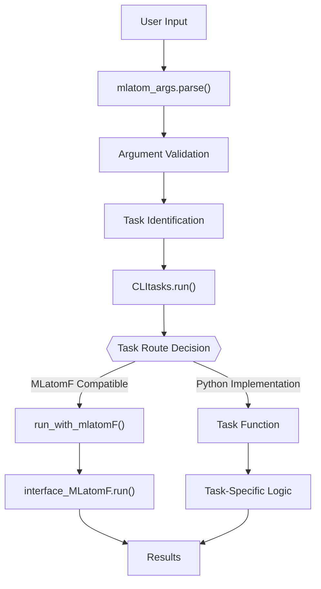
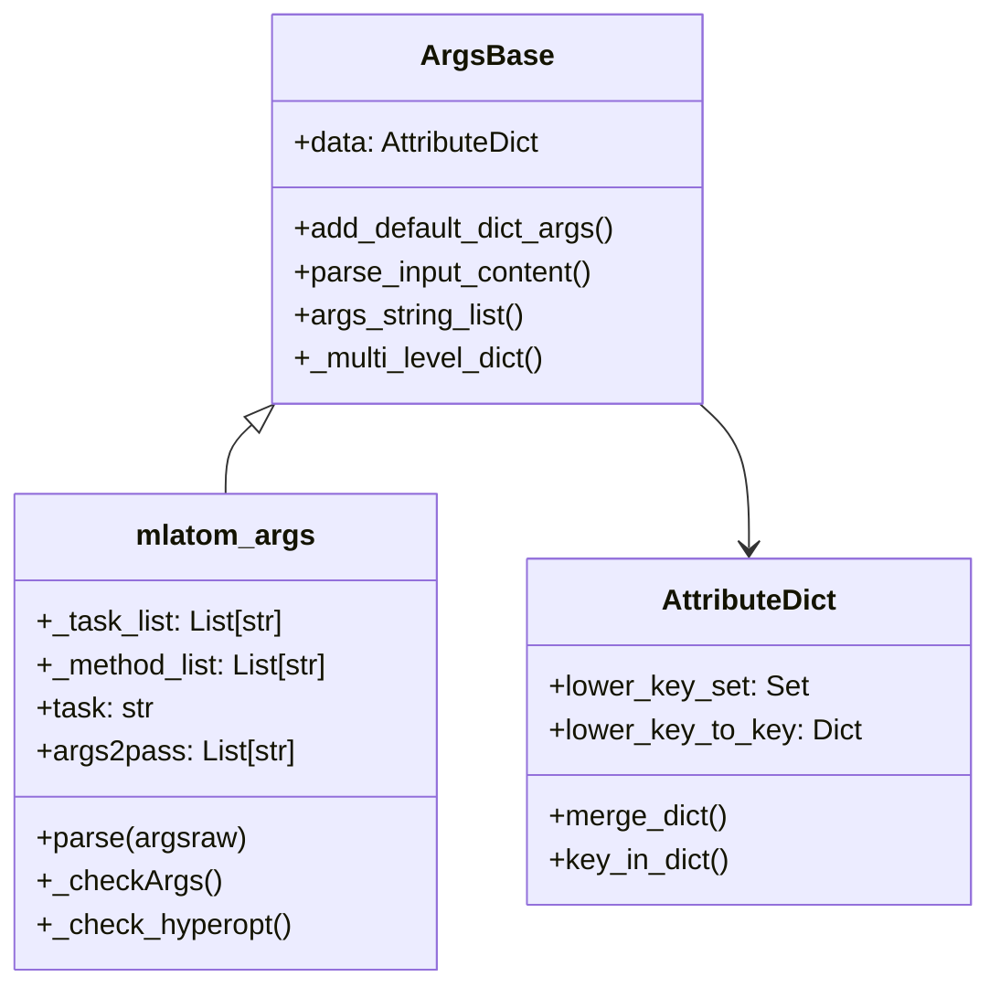
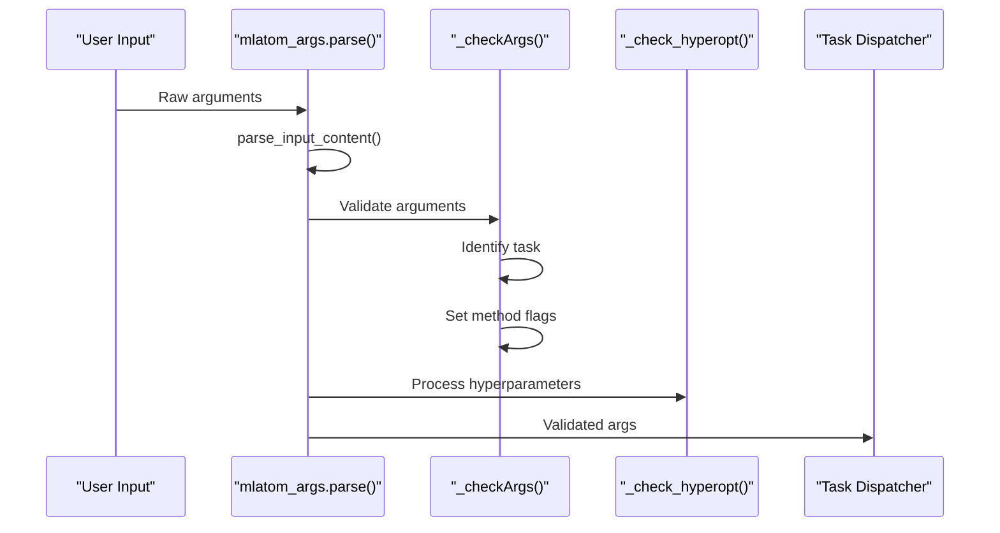
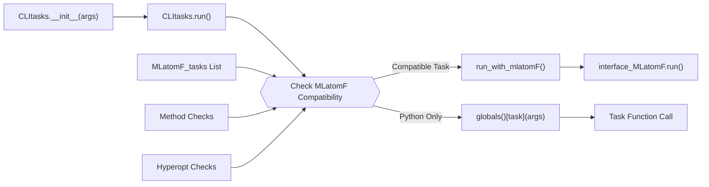
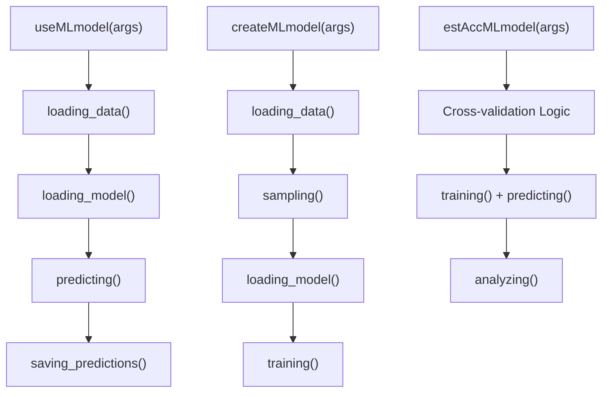
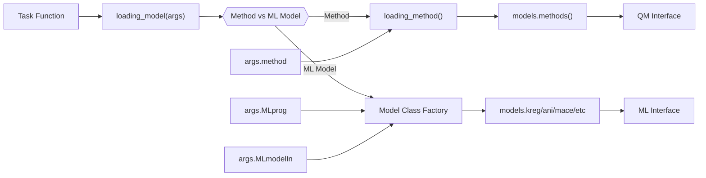
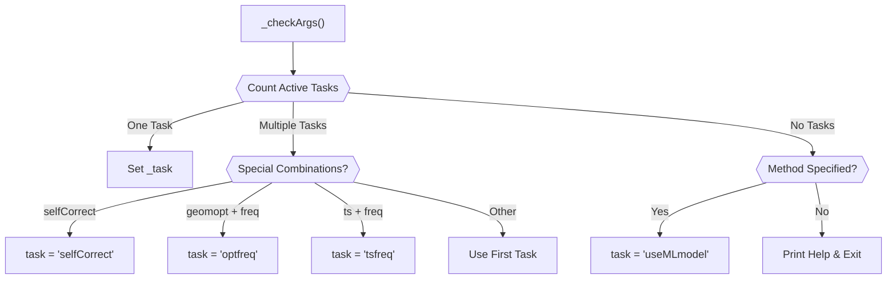
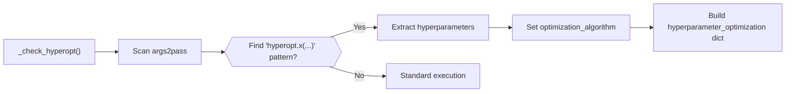

# Task Management and Arguments

Relevant source files

The following files were used as context for generating this wiki page:

- [mlatom/MLtasks.py](mlatom/MLtasks.py)
- [mlatom/args_class.py](mlatom/args_class.py)
- [mlatom/interfaces/xtb_interface.py](mlatom/interfaces/xtb_interface.py)

This page documents MLatom's command-line interface task management and argument parsing system. It covers how user input is parsed, validated, and dispatched to appropriate task implementations. For information about the main entry point and execution flow, see [Entry Point and Execution](#3.1).

## Architecture Overview

The CLI system consists of two main components: argument parsing handled by the `mlatom_args` class, and task dispatch managed by the `CLItasks` class. The system supports both legacy Fortran implementations (MLatomF) and modern Python implementations for various computational tasks.

Sources: [mlatom/args_class.py:645-656](), [mlatom/MLtasks.py:25-29](), [mlatom/MLtasks.py:31-40]()

## Argument Parsing System

### Core Classes

The argument parsing is built on a hierarchical class structure with specialized handling for MLatom's diverse parameter set:

Sources: [mlatom/args_class.py:153-172](), [mlatom/args_class.py:401-407](), [mlatom/args_class.py:53-62]()

### Supported Tasks and Methods

The system defines comprehensive lists of supported computational tasks and quantum chemistry methods:

| Task Category | Examples | Implementation |
|---------------|----------|----------------|
| ML Tasks | `useMLmodel`, `createMLmodel`, `estAccMLmodel` | Python/MLatomF |
| Data Tasks | `XYZ2SMI`, `sample`, `analyze` | Mixed |
| Simulation Tasks | `geomopt`, `freq`, `MD`, `irc` | Python |
| Analysis Tasks | `crossSection`, `MLQD`, `al` | Python |

Sources: [mlatom/args_class.py:410-437](), [mlatom/args_class.py:444]()

### Argument Processing Flow

Sources: [mlatom/args_class.py:645-656](), [mlatom/args_class.py:695-738](), [mlatom/args_class.py:680-693]()

## Task Dispatch Mechanism

### CLItasks Class

The `CLItasks` class serves as the central dispatcher, routing tasks between MLatomF (Fortran) and Python implementations based on compatibility and feature requirements:

Sources: [mlatom/MLtasks.py:14-29](), [mlatom/MLtasks.py:15-22]()

### Task Implementation Categories

The system implements tasks through several patterns:

| Pattern | Examples | Description |
|---------|----------|-------------|
| Direct Functions | `useMLmodel()`, `createMLmodel()` | Core ML workflow tasks |
| Simulation Tasks | `geomopt()`, `freq()`, `MD()` | Molecular simulation workflows |
| Data Processing | `XYZ2SMI()`, `sample()` | File format conversion and sampling |
| Interface Wrappers | `al()`, `MLQD()` | Calls to specialized modules |

Sources: [mlatom/MLtasks.py:43-651]()

## Key Task Functions

### Machine Learning Tasks

The core ML tasks follow a consistent pattern of data loading, model setup, and execution:

Sources: [mlatom/MLtasks.py:43-77](), [mlatom/MLtasks.py:79-93](), [mlatom/MLtasks.py:95-148]()

### Reusable Utility Functions

The system provides several reusable functions that support multiple tasks:

| Function | Purpose | Key Parameters |
|----------|---------|----------------|
| `loading_data()` | Load molecular databases from files | `XYZfile`, `Yfile`, `YgradXYZfile` |
| `loading_model()` | Instantiate ML models or methods | `MLprog`, `method`, `MLmodelIn` |
| `sampling()` | Generate train/test splits | `sampling`, `Ntrain`, `CVtest` |
| `predicting()` | Run model predictions | `value`, `gradient`, `hessian` |
| `analyzing()` | Compute statistical metrics | `ref_value`, `est_value` |

Sources: [mlatom/MLtasks.py:653-666](), [mlatom/MLtasks.py:693-717](), [mlatom/MLtasks.py:719-825](), [mlatom/MLtasks.py:827-844](), [mlatom/MLtasks.py:887-1013]()

## Integration with Model Framework

The task system integrates with MLatom's model framework through standardized interfaces:

Sources: [mlatom/MLtasks.py:693-717](), [mlatom/MLtasks.py:668-691]()

## Error Handling and Validation

The argument validation system performs several checks to ensure proper task execution:

### Task Detection Logic

Sources: [mlatom/args_class.py:695-738]()

### Hyperparameter Optimization Setup

The system automatically detects and configures hyperparameter optimization based on argument patterns:

Sources: [mlatom/args_class.py:680-693]()

This architecture provides a flexible and extensible system for managing diverse computational chemistry tasks while maintaining compatibility with legacy components and supporting advanced features like hyperparameter optimization and cross-validation.

---