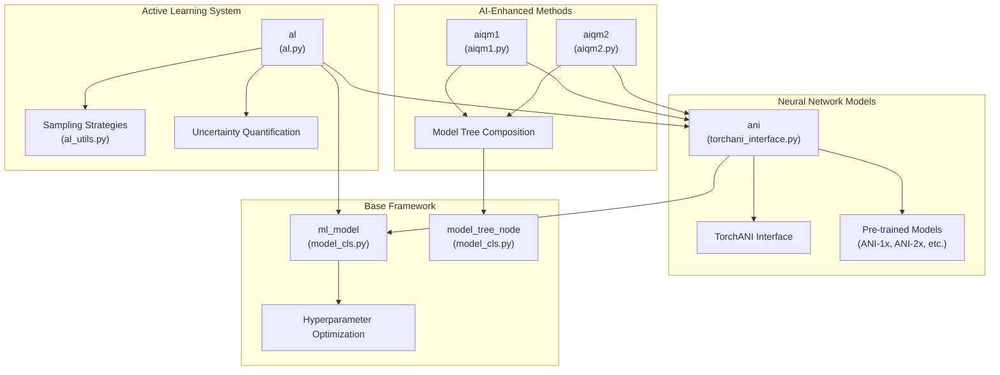
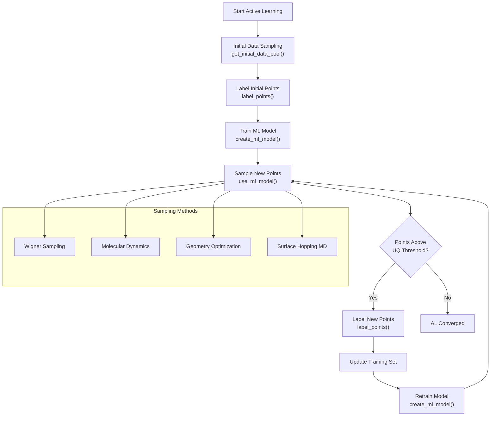
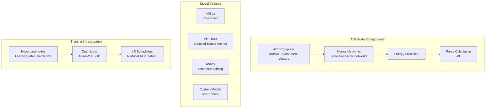
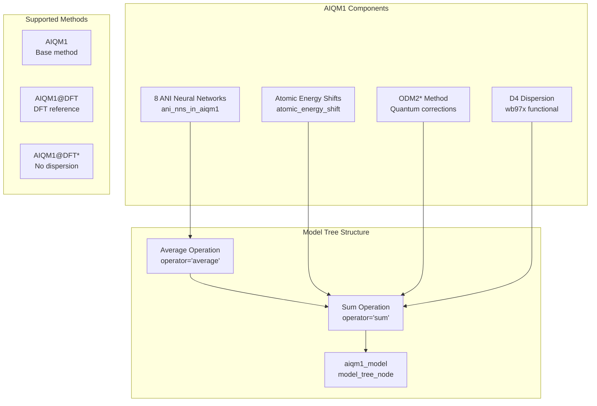
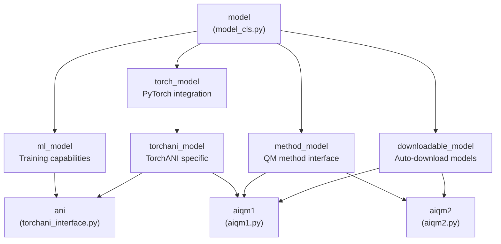

# Machine Learning Systems

<details>
<summary>Relevant source files</summary>

The following files were used as context for generating this wiki page:

- [mlatom/aiqm1.py](mlatom/aiqm1.py)
- [mlatom/aiqm2.py](mlatom/aiqm2.py)
- [mlatom/al.py](mlatom/al.py)
- [mlatom/al_utils.py](mlatom/al_utils.py)
- [mlatom/interfaces/torchani_interface.py](mlatom/interfaces/torchani_interface.py)
- [mlatom/model_cls.py](mlatom/model_cls.py)

</details>


This page documents MLatom's machine learning capabilities, including active learning workflows, neural network models, and AI-enhanced quantum mechanical methods. The ML systems provide automated model training, uncertainty quantification, and hybrid AI-QM approaches for molecular simulations.

For quantum chemistry interfaces that these ML models can interface with, see [Quantum Chemistry Interfaces](#6). For core data structures used by ML models, see [Data Structures](#2.1). For the overall model framework architecture, see [Model Framework](#2.2).

## Architecture Overview

The machine learning systems in MLatom are built around several core components that work together to provide comprehensive ML-driven molecular modeling capabilities.

**ML System Architecture**


Sources: [mlatom/al.py](), [mlatom/interfaces/torchani_interface.py](), [mlatom/aiqm1.py](), [mlatom/aiqm2.py](), [mlatom/model_cls.py]()

## Active Learning System

The active learning system automates the iterative process of training ML models, sampling new points based on uncertainty, and retraining models with expanded datasets.

### Core Active Learning Workflow

The main active learning class `al` orchestrates the entire workflow:

| Component | Class/Function | Description |
|-----------|----------------|-------------|
| Main Controller | `al` | Manages the complete active learning cycle |
| Samplers | `Sampler` | Various sampling strategies for new points |
| Model Trainers | `ml_model_trainer` | Handles ML model training |
| Uncertainty Quantification | `uq` methods | Evaluates model uncertainty |

**Active Learning Process Flow**


Sources: [mlatom/al.py:355-403](), [mlatom/al.py:414-584](), [mlatom/al_utils.py:8-757]()

### Sampling Strategies

The `Sampler` class provides multiple strategies for generating candidate points:

| Sampler | Method | Use Case |
|---------|--------|----------|
| `wigner` | Quantum harmonic oscillator sampling | Initial conditions generation |
| `md` | Molecular dynamics trajectories | Dynamic sampling |
| `batch_md` | Parallel MD trajectories | High-throughput sampling |
| `geomopt` | Geometry optimization paths | Transition state searches |
| `lzsh` | Landau-Zener surface hopping | Nonadiabatic dynamics |

The samplers are implemented with a common interface in [mlatom/al_utils.py:34-35]():

```python
def sample(self,**kwargs):
    return self.sampler_function(**kwargs)
```

Sources: [mlatom/al_utils.py:8-33](), [mlatom/al_utils.py:83-123](), [mlatom/al_utils.py:167-243]()

## Neural Network Models

The neural network models are primarily based on the ANI (Accurate Neural Network Interatomic potentials) architecture, interfaced through TorchANI.

### ANI Model Implementation

The `ani` class provides a complete interface to TorchANI for training and prediction:

**ANI Model Architecture**


Sources: [mlatom/interfaces/torchani_interface.py:86-139](), [mlatom/interfaces/torchani_interface.py:277-305]()

### Key Features

The ANI implementation includes:

- **Hyperparameter Management**: Comprehensive hyperparameter system with optimization support [mlatom/interfaces/torchani_interface.py:99-127]()
- **Multi-GPU Support**: CUDA device management and batch processing [mlatom/interfaces/torchani_interface.py:140-159]()
- **Energy and Force Training**: Joint training on energies and gradients [mlatom/interfaces/torchani_interface.py:495-520]()
- **Model Loading/Saving**: Checkpoint management and model persistence [mlatom/interfaces/torchani_interface.py:175-276]()

### Training Process

The training process supports validation monitoring and early stopping:

```python
# Key training parameters from hyperparameters
batch_size = 8
max_epochs = 1000000
learning_rate = 0.001
early_stopping_learning_rate = 1.0E-5
force_coefficient = 0.1
```

Sources: [mlatom/interfaces/torchani_interface.py:308-544]()

## AI-Enhanced Quantum Methods

The AI-enhanced methods combine neural networks with quantum mechanical corrections to achieve high accuracy for molecular properties.

### AIQM1 Method

AIQM1 combines ANI neural networks with quantum mechanical corrections:

**AIQM1 Composition Structure**


Sources: [mlatom/aiqm1.py:48-66](), [mlatom/aiqm1.py:171-276]()

### AIQM2 Method

AIQM2 uses GFN2-xTB* as the base quantum method:

| Component | Purpose | Implementation |
|-----------|---------|----------------|
| `gfn2xtbstar` | Base quantum method | GFN2-xTB* interface |
| `aiqm2_nn` | ML corrections | 8 ANI models averaged |
| `d4wb97x` | Dispersion corrections | D4 with wb97x functional |

The model composition follows the same tree structure as AIQM1 but with different base methods [mlatom/aiqm2.py:122-164]().

### Model Tree Composition

Both AIQM methods use the `model_tree_node` system for composing multiple models:

```python
# Example composition operators
operator='predict'    # Apply model prediction
operator='average'     # Average multiple predictions  
operator='sum'        # Sum contributions
operator='weighted_sum' # Weighted combination
```

This allows flexible combination of different theoretical methods and ML models [mlatom/model_cls.py:953-1077]().

Sources: [mlatom/aiqm1.py:15-132](), [mlatom/aiqm2.py:5-165](), [mlatom/model_cls.py:953-1135]()

## Model Framework and Base Classes

The ML system is built on a hierarchy of base classes that provide common functionality:

**Model Class Hierarchy**


### Key Base Class Features

| Base Class | Key Features | File Reference |
|------------|--------------|----------------|
| `model` | Thread management, prediction interface | [model_cls.py:20-131]() |
| `ml_model` | Training, validation, hyperparameter optimization | [model_cls.py:336-847]() |
| `torch_model` | PyTorch thread configuration | [model_cls.py:132-144]() |
| `downloadable_model` | Automatic model downloading | [model_cls.py:201-334]() |

### Hyperparameter System

The framework includes a sophisticated hyperparameter management system:

```python
class hyperparameters(UserDict):
    # Auto-converts values to hyperparameter objects
    # Supports optimization spaces: 'linear', 'log'
    # Includes validation and type casting
```

Hyperparameter optimization supports multiple algorithms including grid search, TPE (Tree-structured Parzen Estimator), and scipy optimizers [mlatom/model_cls.py:602-721]().

Sources: [mlatom/model_cls.py:20-952](), [mlatom/model_cls.py:849-951]()

---