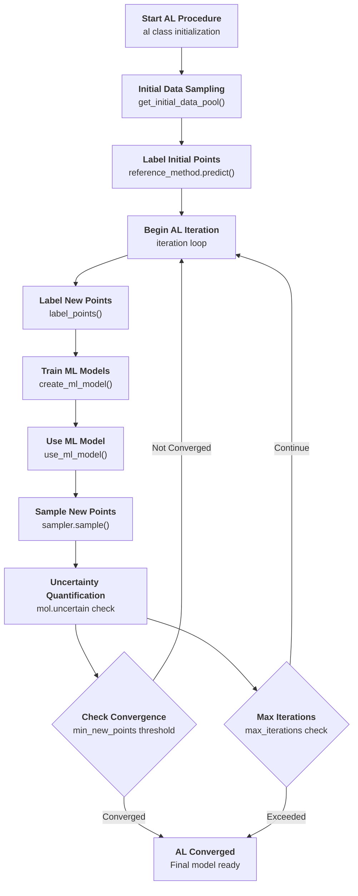
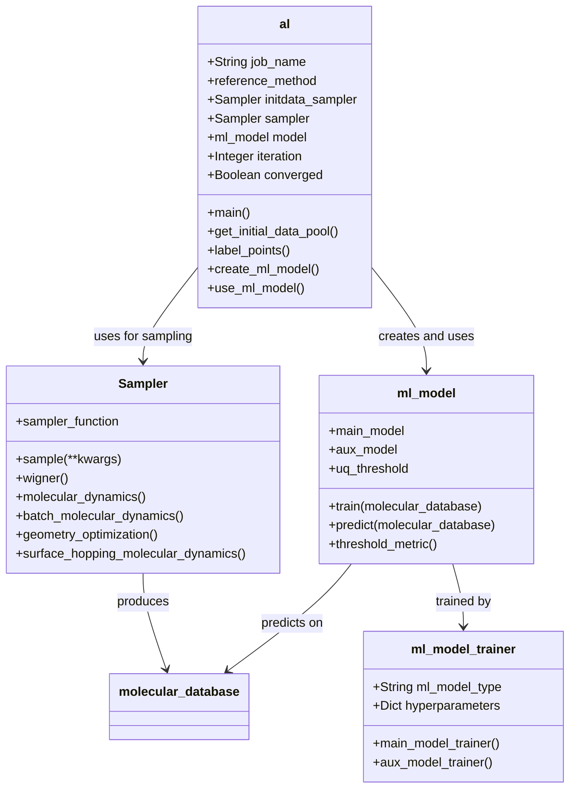
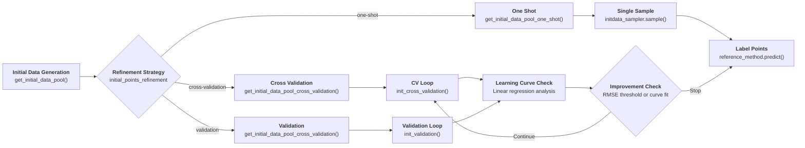
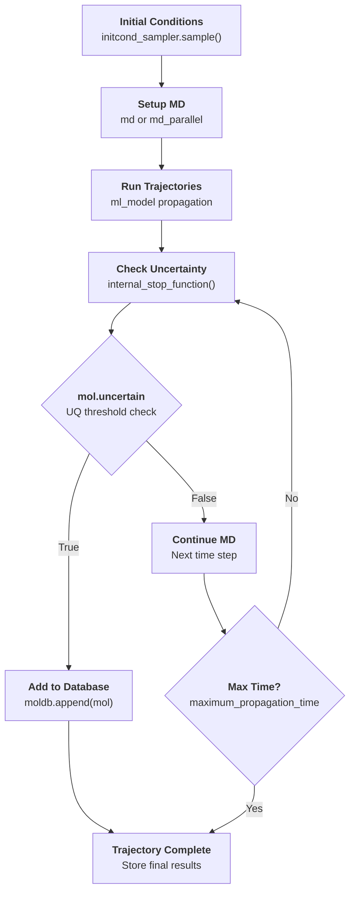
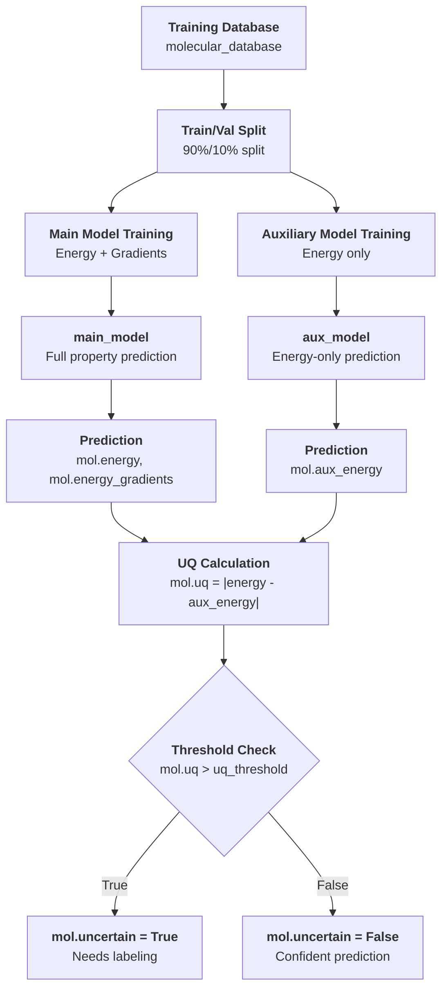
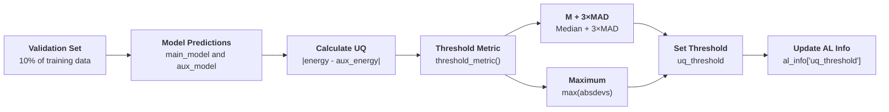
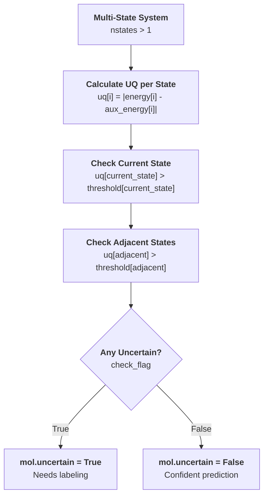

# Active Learning

Relevant source files

The following files were used as context for generating this wiki page:

- [mlatom/al.py](mlatom/al.py)
- [mlatom/al_utils.py](mlatom/al_utils.py)

This page documents the active learning system in MLatom, which provides automated iterative machine learning workflows for molecular simulations. The system adaptively samples molecular configurations, trains ML models, and identifies regions of chemical space requiring more data.

For information about the underlying ML models used in active learning, see [Neural Network Models](#4.2). For simulation methods that active learning can employ, see [Molecular Dynamics](#5.2) and [Advanced Dynamics](#5.3).

## System Architecture

The active learning system is built around several key components that work together to create an iterative learning workflow:

### Active Learning Workflow

Sources: [mlatom/al.py:355-403]()

### Core Classes and Relationships

Sources: [mlatom/al.py:16-315](), [mlatom/al_utils.py:8-35](), [mlatom/al_utils.py:1207-1388](), [mlatom/al_utils.py:1001-1037]()

## Active Learning Process

### Initialization and Configuration

The `al` class is initialized with extensive configuration options that control every aspect of the active learning workflow:

| Parameter Category | Key Parameters | Description |
|-------------------|----------------|-------------|
| **Job Control** | `job_name`, `max_iterations` | Basic job settings and termination conditions |
| **Reference Method** | `reference_method` | High-accuracy method for labeling data |
| **Initial Sampling** | `initdata_sampler`, `initial_points_refinement` | Strategy for generating initial training data |
| **ML Models** | `ml_model_type`, `device`, `property_to_learn` | ML model configuration |
| **Active Sampling** | `sampler`, `new_points`, `min_new_points` | Strategy for sampling new uncertain points |
| **Convergence** | `min_new_points`, `max_iterations` | Criteria for stopping the AL procedure |

Sources: [mlatom/al.py:20-49](), [mlatom/al.py:50-315]()

### Initial Data Pool Generation

The system supports multiple strategies for generating initial training data:

Sources: [mlatom/al.py:414-432](), [mlatom/al.py:436-511](), [mlatom/al.py:570-585]()

## Sampling Strategies

The `Sampler` class provides multiple strategies for generating molecular configurations:

### Available Sampling Methods

| Sampler Type | Function | Use Case |
|--------------|----------|----------|
| **wigner** | `wigner()` | Quantum harmonic oscillator sampling around equilibrium |
| **md** | `molecular_dynamics()` | Classical MD trajectories with uncertainty stopping |
| **batch_md** | `batch_molecular_dynamics()` | Parallel MD trajectories |
| **geomopt** | `geometry_optimization()` | Geometry optimization with uncertainty checking |
| **lzsh** | `surface_hopping_molecular_dynamics()` | Surface hopping for multi-state systems |
| **random** | `random()` | Random displacement from reference geometry |
| **fixed** | `fixed()` | Use pre-defined molecular configurations |

Sources: [mlatom/al_utils.py:8-33]()

### Molecular Dynamics Sampling

Sources: [mlatom/al_utils.py:167-243](), [mlatom/al_utils.py:246-321]()

## Machine Learning Models

### Dual Model Architecture

The active learning system employs a dual model architecture for uncertainty quantification:

Sources: [mlatom/al_utils.py:1261-1360](), [mlatom/al_utils.py:1362-1379]()

### Supported Model Types

The system supports multiple ML model architectures:

| Model Type | Class | Capabilities |
|------------|-------|--------------|
| **KREG** | `models.kreg` | Kernel ridge regression with hyperparameter optimization |
| **ANI** | `models.ani` | Neural network potentials with TorchANI |
| **MACE** | `models.mace` | Message-passing neural networks |
| **MSANI** | `models.msani` | Multi-state ANI for excited states |

Sources: [mlatom/al_utils.py:1039-1079](), [mlatom/al_utils.py:1081-1113](), [mlatom/al_utils.py:1115-1149]()

## Uncertainty Quantification

### Threshold Determination

The system automatically determines uncertainty thresholds using statistical metrics:

Sources: [mlatom/al_utils.py:1389-1404](), [mlatom/al_utils.py:1347-1354]()

### Multi-State Uncertainty

For multi-state systems (NAMD), uncertainty is checked across multiple electronic states:

Sources: [mlatom/al_utils.py:1771-1793]()

## Integration with Simulations

The active learning system integrates seamlessly with various simulation methods to enable automated discovery of important molecular configurations. The uncertainty-based stopping criteria ensure that simulations are terminated when the ML model becomes unreliable, triggering the addition of new training data.

Sources: [mlatom/al.py:1-10](), [mlatom/al_utils.py:1-7]()

---