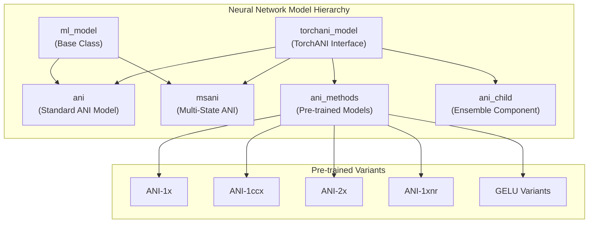
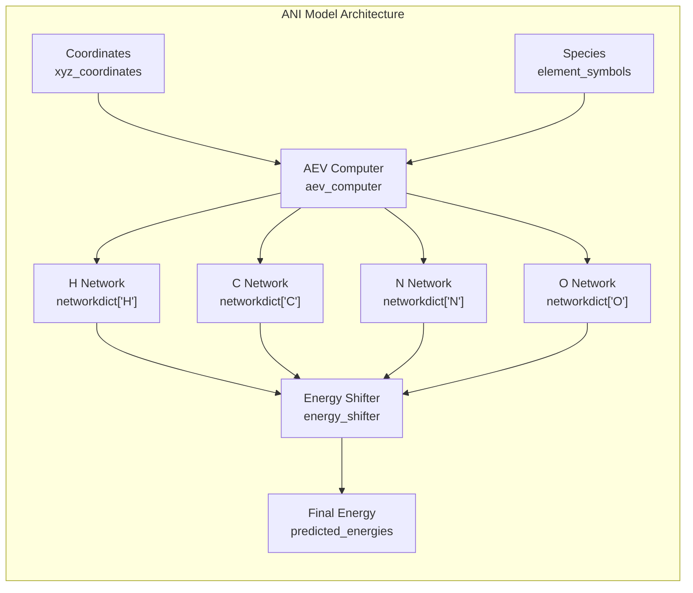
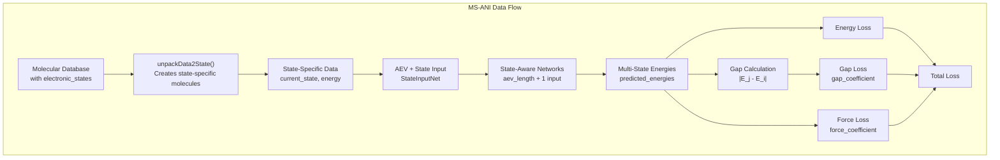
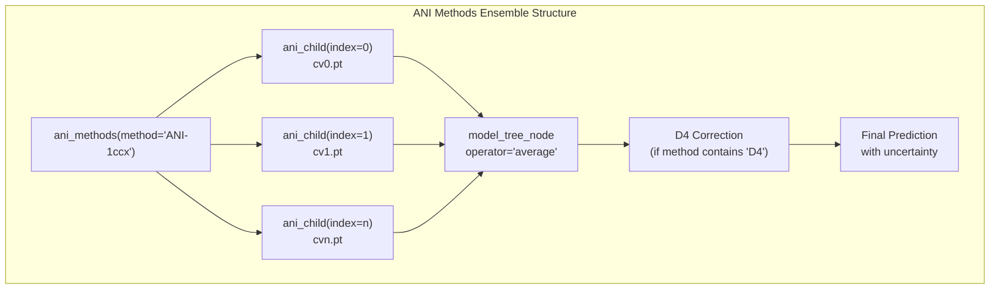
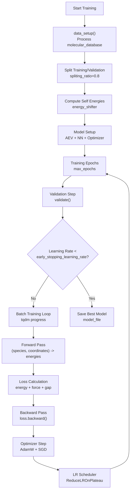
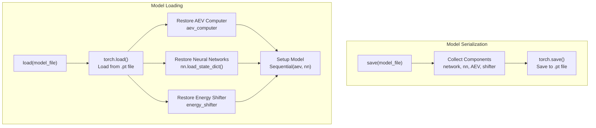

# Neural Network Models

Relevant source files

The following files were used as context for generating this wiki page:

- [mlatom/interfaces/torchani_interface.py](mlatom/interfaces/torchani_interface.py)

This document covers the neural network-based machine learning models implemented in MLatom, primarily focusing on the ANI (ANAKIN-ME) model family and their extensions. These models provide accurate neural network potentials for molecular energy and force predictions using atomic environment vectors (AEV) as input features.

For information about other machine learning approaches like kernel ridge regression, see [Model Framework](#2.2). For active learning workflows that utilize these neural networks, see [Active Learning](#4.1).

## Overview

MLatom implements several neural network model classes that interface with the TorchANI library to provide fast and accurate molecular property predictions. The main neural network models include:

- **ANI Models**: Standard ANI neural network potentials for energy and force prediction
- **Multi-State ANI (MS-ANI)**: Extension for learning multiple electronic states simultaneously  
- **Pre-trained ANI Methods**: Access to established ANI-1x, ANI-1ccx, and ANI-2x models

Sources: [mlatom/interfaces/torchani_interface.py:86-138](), [mlatom/interfaces/torchani_interface.py:814-864](), [mlatom/interfaces/torchani_interface.py:1596-1608]()

## ANI Model Architecture

The `ani` class implements the core ANI neural network model with customizable architecture and hyperparameters. The model consists of atomic environment vector (AEV) computation followed by element-specific neural networks.

### Core Components

| Component | Purpose | Key Methods |
|-----------|---------|-------------|
| **AEV Computer** | Converts molecular geometry to atomic environment vectors | `AEV_setup()` |
| **Neural Networks** | Element-specific networks for energy prediction | `NN_setup()`, `NN_initialize()` |
| **Energy Shifter** | Applies atomic self-energy corrections | Handled via TorchANI |
| **Optimizers** | AdamW and SGD optimizers with scheduling | `optimizer_setup()` |

Sources: [mlatom/interfaces/torchani_interface.py:592-604](), [mlatom/interfaces/torchani_interface.py:606-636](), [mlatom/interfaces/torchani_interface.py:689-693]()

### Hyperparameters

The ANI model supports extensive hyperparameter customization:

| Category | Parameters | Default Values |
|----------|------------|----------------|
| **Training** | `batch_size`, `max_epochs`, `learning_rate` | 8, 1000000, 0.001 |
| **Network** | `neurons`, `activation_function` | [[160, 128, 96]], 'CELU(0.1)' |
| **AEV** | `Rcr`, `Rca`, `EtaR`, `ShfR` | 5.2, 3.5, [16.0], [0.9, 1.16875, ...] |
| **Loss** | `force_coefficient`, `loss_type` | 0.1, 'weighted' |

Sources: [mlatom/interfaces/torchani_interface.py:99-127]()

## Multi-State ANI (MS-ANI)

The `msani` class extends the standard ANI model to handle multiple electronic states simultaneously, enabling learning of excited state energies and energy gaps between states.

### Key Features

- **Multi-State Learning**: Trains on multiple electronic states for each molecular geometry
- **Gap Loss Function**: Additional loss term for energy gaps between states
- **State-Aware Architecture**: Neural networks receive state information as input

Sources: [mlatom/interfaces/torchani_interface.py:45-56](), [mlatom/interfaces/torchani_interface.py:1392-1420](), [mlatom/interfaces/torchani_interface.py:1220-1284]()

## Pre-trained ANI Methods

The `ani_methods` class provides access to established pre-trained ANI models with ensemble predictions and uncertainty quantification.

### Available Methods

| Method | Description | Elements Supported |
|--------|-------------|-------------------|
| **ANI-1x** | Original ANI model | H, C, N, O |
| **ANI-1ccx** | Coupled-cluster trained | H, C, N, O |
| **ANI-2x** | Improved architecture | H, C, N, O |
| **ANI-1xnr** | Reactive potential | H, C, N, O |
| **GELU variants** | Alternative activation functions | H, C, N, O |

### Ensemble Architecture

Sources: [mlatom/interfaces/torchani_interface.py:1623-1657](), [mlatom/interfaces/torchani_interface.py:1659-1689](), [mlatom/interfaces/torchani_interface.py:1651-1657]()

## Training Process

### Data Preparation and Training Loop

The training process involves several key steps handled by the `train()` method:

Sources: [mlatom/interfaces/torchani_interface.py:308-544](), [mlatom/interfaces/torchani_interface.py:762-811](), [mlatom/interfaces/torchani_interface.py:413-444]()

### Loss Functions

The training supports multiple loss function combinations:

| Loss Type | Components | Formula |
|-----------|------------|---------|
| **Energy Only** | MSE on energies | `mse(E_pred, E_true)` |
| **Energy + Forces** | Weighted combination | `E_loss + force_coefficient * F_loss` |
| **Multi-State** | Energy + gap losses | `E_loss + gap_coefficient * Gap_loss` |
| **Geometric** | Geometric mean | `sqrt(E_loss * F_loss)` |

Sources: [mlatom/interfaces/torchani_interface.py:446-447](), [mlatom/interfaces/torchani_interface.py:507-510](), [mlatom/interfaces/torchani_interface.py:1255-1265]()

## Prediction and Data Conversion

### Data Flow During Prediction

```mermaid
graph LR
    subgraph "MLatom to TorchANI Conversion"
        moldb["molecular_database<br/>MLatom format"]
        converter["molDB2ANIdata()<br/>Data converter"]
        ani_data["TorchANI Data<br/>species, coordinates"]
        
        species_map["species_to_indices()<br/>Map to model species"]
        collate["collate(batch_size)<br/>Batch and pad"]
        
        model_input["Model Input<br/>Tensors on device"]
        
        moldb --> converter
        converter --> ani_data
        ani_data --> species_map
        species_map --> collate
        collate --> model_input
    end
    
    subgraph "Prediction Process"
        forward["Forward Pass<br/>model(species, coords)"]
        energy_shift["Apply Energy Shifter<br/>Add self energies"]
        
        gradients["Compute Gradients<br/>autograd.grad()"]
        hessian["Compute Hessian<br/>torchani.utils.hessian()"]
        
        model_input --> forward
        forward --> energy_shift
        energy_shift --> gradients
        gradients --> hessian
    end
    
    subgraph "Result Storage"
        store_energy["add_scalar_properties()<br/>Store energies"]
        store_grads["add_xyz_vectorial_properties()<br/>Store gradients"]
        store_hess["add_hessian_properties()<br/>Store hessians"]
        
        energy_shift --> store_energy
        gradients --> store_grads
        hessian --> store_hess
    end
```

Sources: [mlatom/interfaces/torchani_interface.py:58-74](), [mlatom/interfaces/torchani_interface.py:547-590](), [mlatom/interfaces/torchani_interface.py:569-590]()

## Model Persistence and Loading

### Save/Load Architecture

The neural network models support comprehensive serialization:

| Saved Component | Purpose | Storage Format |
|----------------|---------|----------------|
| **network** | Network architecture | `networkdict` (OrderedDict) |
| **nn** | Trained parameters | `state_dict()` |
| **AEV_computer** | Feature computation | TorchANI AEVComputer object |
| **energy_shifter** | Self-energy corrections | TorchANI EnergyShifter object |
| **args** | Model metadata | Dictionary with species, parameters |

Sources: [mlatom/interfaces/torchani_interface.py:175-196](), [mlatom/interfaces/torchani_interface.py:198-275](), [mlatom/interfaces/torchani_interface.py:273-274]()

---