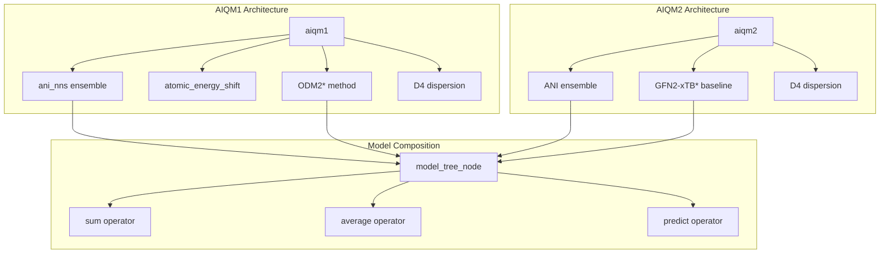
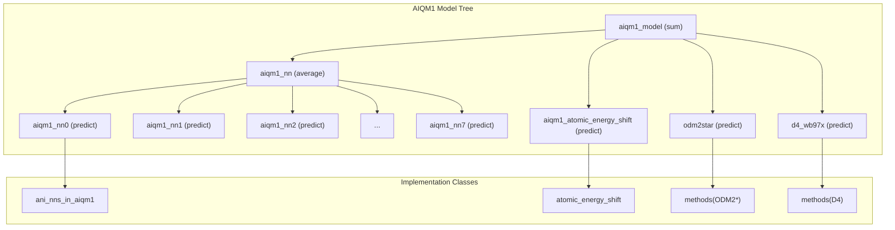
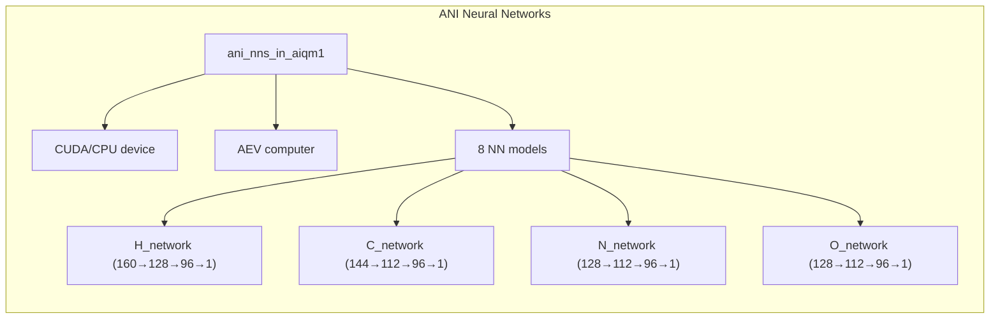
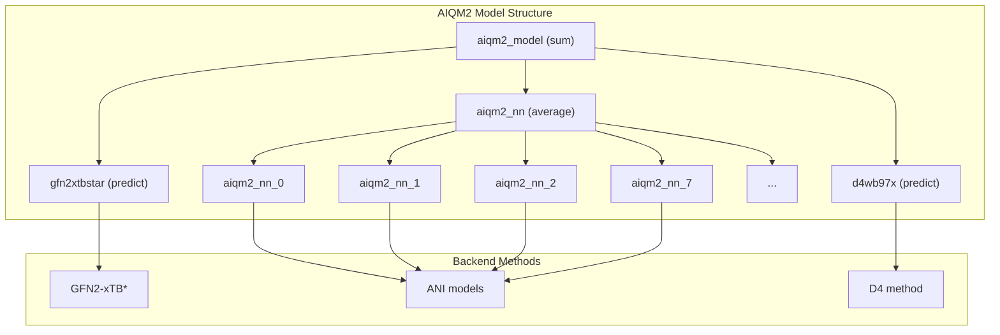
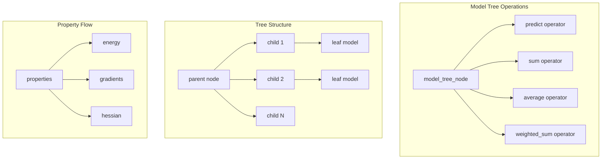
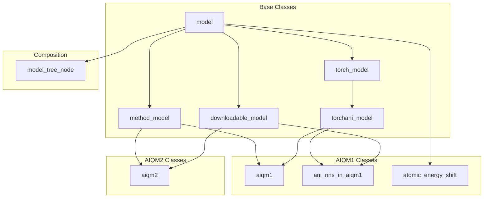
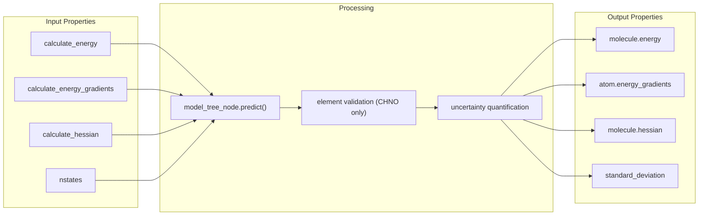

# AI-Enhanced Quantum Methods

<details>
<summary>Relevant source files</summary>

The following files were used as context for generating this wiki page:

- [mlatom/aiqm1.py](mlatom/aiqm1.py)
- [mlatom/aiqm2.py](mlatom/aiqm2.py)
- [mlatom/model_cls.py](mlatom/model_cls.py)

</details>


This document covers MLatom's AI-enhanced quantum mechanical methods, specifically AIQM1 and AIQM2. These hybrid methods combine neural network models with traditional quantum chemistry calculations to provide accurate and efficient molecular property predictions. For neural network models without quantum chemistry components, see [Neural Network Models](#4.2). For general active learning workflows, see [Active Learning](#4.1).

## Overview

AI-Enhanced Quantum Methods in MLatom implement hybrid approaches that combine machine learning models with quantum chemistry calculations. The two main methods are AIQM1 and AIQM2, which use different baseline quantum chemistry methods but share a common architectural approach of hierarchical model composition.

### Method Architecture



**Sources:** [mlatom/aiqm1.py:15-67](), [mlatom/aiqm2.py:5-164](), [mlatom/model_cls.py:953-1135]()

## AIQM1 Method

The `aiqm1` class implements the Artificial Intelligence Quantum Mechanical method 1, which combines ANI neural networks with ODM2* quantum chemistry calculations.

### AIQM1 Components



**Sources:** [mlatom/aiqm1.py:48-66](), [mlatom/aiqm1.py:171-318](), [mlatom/aiqm1.py:134-170]()

### AIQM1 Method Variants

The AIQM1 implementation supports three method variants:

| Method | Description | Components |
|--------|-------------|------------|
| `AIQM1` | Standard AIQM1 | ANI NNs + ODM2* + D4 + atomic shifts |
| `AIQM1@DFT` | DFT-trained variant | ANI NNs + ODM2* + D4 + atomic shifts |
| `AIQM1@DFT*` | DFT without D4 | ANI NNs + ODM2* + atomic shifts |

**Sources:** [mlatom/aiqm1.py:43-46](), [mlatom/aiqm1.py:63-65]()

### Neural Network Ensemble

The `ani_nns_in_aiqm1` class implements the neural network component using 8 ANI models for uncertainty quantification:



**Sources:** [mlatom/aiqm1.py:171-318](), [mlatom/aiqm1.py:231-276]()

## AIQM2 Method

The `aiqm2` class implements AIQM2, which uses GFN2-xTB* as the baseline quantum chemistry method with neural network corrections.

### AIQM2 Architecture



**Sources:** [mlatom/aiqm2.py:101-164](), [mlatom/aiqm2.py:122-158]()

### AIQM2 Method Variants

| Method | Description | Model Directory |
|--------|-------------|-----------------|
| `AIQM2` | Standard AIQM2 | `aiqm2_model` |
| `AIQM2@DFT` | DFT-trained variant | `aiqm2_dft_model` |
| `AIQM2@DFT*` | Alias for `AIQM2@DFT` | `aiqm2_dft_model` |

**Sources:** [mlatom/aiqm2.py:32](), [mlatom/aiqm2.py:104-115]()

## Model Composition Framework

The AI-enhanced quantum methods leverage MLatom's hierarchical model composition system implemented through the `model_tree_node` class.

### Model Tree Operations



**Sources:** [mlatom/model_cls.py:953-1135](), [mlatom/model_cls.py:987-1077]()

### Operator Implementation

The model tree supports different combination operators:

| Operator | Function | Usage |
|----------|----------|-------|
| `predict` | Execute leaf model | Individual model components |
| `sum` | Add child predictions | AIQM total energy |
| `average` | Average child predictions | Neural network ensembles |
| `weighted_sum` | Weighted combination | Custom model weighting |

**Sources:** [mlatom/model_cls.py:1043-1075]()

## Implementation Details

### Class Hierarchy



**Sources:** [mlatom/model_cls.py:20-200](), [mlatom/aiqm1.py:15](), [mlatom/aiqm2.py:5]()

### Property Calculation Flow

Both AIQM methods support multiple property calculations:



**Sources:** [mlatom/aiqm1.py:68-132](), [mlatom/aiqm2.py:62-99](), [mlatom/model_cls.py:987-1112]()

### Element Support and Validation

Both AIQM1 and AIQM2 are restricted to CHNO elements (H, C, N, O):

```python
for atom in molecule.atoms:
    if not atom.atomic_number in [1, 6, 7, 8]:
        raise ValueError("Molecule contains elements other than CHNO")
```

**Sources:** [mlatom/aiqm1.py:83-87](), [mlatom/aiqm2.py:88-91]()

## Usage Examples

### Basic AIQM1 Usage

```python
import mlatom as ml

# Initialize molecule
mol = ml.data.molecule()
mol.read_from_xyz_file(filename='ethanol.xyz')

# Run AIQM1 calculation
aiqm1 = ml.methods(method='AIQM1', qm_program='MNDO')
aiqm1.predict(molecule=mol, 
              calculate_energy=True, 
              calculate_energy_gradients=True)

# Access results
energy = mol.energy
gradient = mol.get_energy_gradients()
uncertainty = mol.aiqm1_nn.energy_standard_deviation
```

### Basic AIQM2 Usage

```python
# Run AIQM2 calculation  
aiqm2 = ml.methods(method='AIQM2')
aiqm2.predict(molecule=mol,
              calculate_energy=True,
              calculate_energy_gradients=True,
              calculate_hessian=True)

# Access results
energy = mol.energy
gradients = mol.get_energy_gradients() 
hessian = mol.hessian
uncertainty = mol.aiqm2_model.energy_standard_deviation
```

**Sources:** [mlatom/aiqm1.py:27-38](), [mlatom/aiqm2.py:16-28]()

---