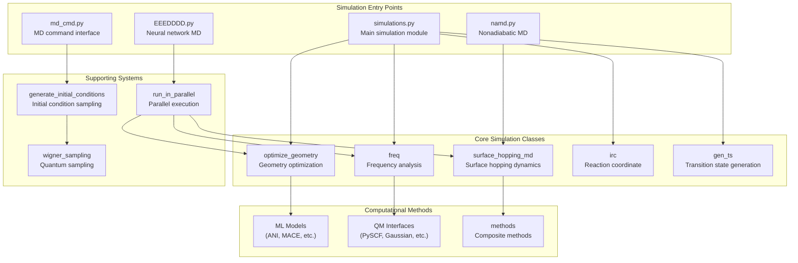
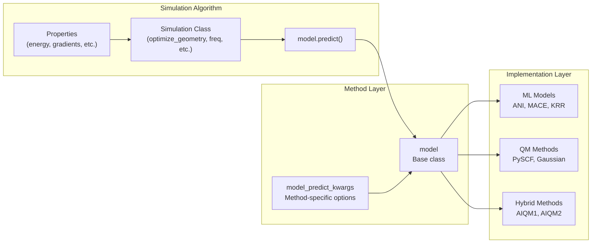
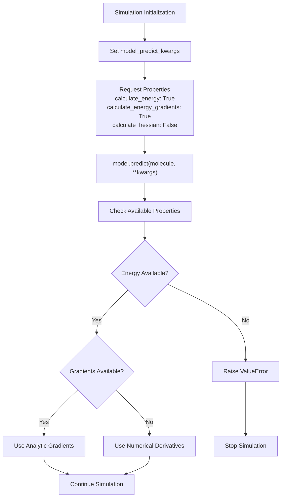
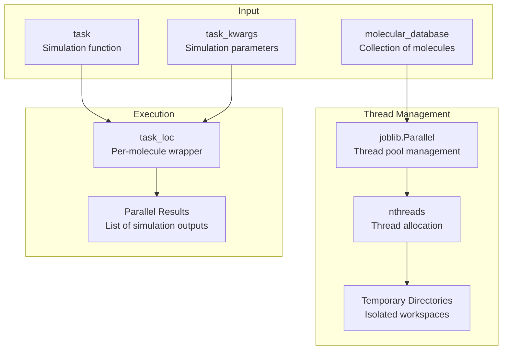
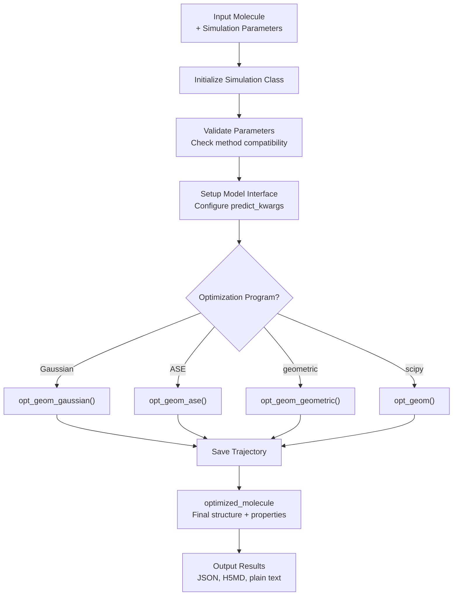

# Molecular Simulations

Relevant source files

The following files were used as context for generating this wiki page:

- [mlatom/EEEDDDD.py](mlatom/EEEDDDD.py)
- [mlatom/constants.py](mlatom/constants.py)
- [mlatom/gen_ts_methods.py](mlatom/gen_ts_methods.py)
- [mlatom/initial_conditions.py](mlatom/initial_conditions.py)
- [mlatom/interfaces/sparrow_interface.py](mlatom/interfaces/sparrow_interface.py)
- [mlatom/md_cmd.py](mlatom/md_cmd.py)
- [mlatom/namd.py](mlatom/namd.py)
- [mlatom/simulations.py](mlatom/simulations.py)

This document covers MLatom's molecular simulation capabilities, including geometry optimization, frequency analysis, molecular dynamics, and nonadiabatic dynamics. These simulation methods form the core computational engines that utilize machine learning models and quantum chemistry methods to study molecular structure and dynamics.

For machine learning models used in simulations, see [Machine Learning Systems](#4). For quantum chemistry interfaces that provide electronic structure calculations, see [Quantum Chemistry Interfaces](#6).

## Simulation Architecture Overview

MLatom's simulation system is built around a modular architecture that separates simulation algorithms from the underlying computational methods (ML models or quantum chemistry programs).

### Core Simulation Framework

Sources: [mlatom/simulations.py:1-50](), [mlatom/namd.py:1-30](), [mlatom/initial_conditions.py:1-20](), [mlatom/EEEDDDD.py:1-30]()

### Simulation Type Classification

MLatom organizes simulations into several categories based on their computational requirements and physical phenomena:

| Simulation Type | Primary Classes | Key Methods | Typical Use Cases |
|----------------|----------------|-------------|-------------------|
| **Static Properties** | `optimize_geometry`, `freq` | Energy, gradients, Hessian | Structure optimization, vibrational analysis |
| **Classical Dynamics** | `md`, `MD_CMD` | Energy, forces | Thermal sampling, conformational search |
| **Quantum Dynamics** | `surface_hopping_md` | Energies, forces, couplings | Photochemistry, excited state dynamics |
| **Neural Network MD** | `EEEDDDD` | Trajectory prediction | Long timescale dynamics |

Sources: [mlatom/simulations.py:75-200](), [mlatom/namd.py:20-80](), [mlatom/md_cmd.py:50-100]()

## Integration with Computational Methods

The simulation framework is designed to work seamlessly with both machine learning models and quantum chemistry programs through a unified interface.

### Method Integration Pattern

Sources: [mlatom/simulations.py:115-130](), [mlatom/simulations.py:200-220]()

### Property Calculation Flow

The simulation classes interact with computational methods through standardized property requests:

Sources: [mlatom/simulations.py:202-207](), [mlatom/simulations.py:324-330]()

## Parallel Execution Framework

MLatom provides a sophisticated parallel execution system for running simulations across multiple molecules or trajectories.

### Parallel Execution Architecture

The `run_in_parallel` function [mlatom/simulations.py:23-73]() provides a flexible framework for parallelizing any simulation task:

The parallel system automatically:
- Distributes available threads among molecules
- Creates isolated temporary directories when requested
- Handles thread-specific model configurations
- Collects results from all parallel executions

Sources: [mlatom/simulations.py:23-73]()

## Simulation Data Flow

The simulation system follows a consistent data flow pattern that ensures compatibility across different simulation types:

### Standard Simulation Pipeline

Sources: [mlatom/simulations.py:215-218](), [mlatom/simulations.py:227-416]()

This architecture ensures that simulations can utilize any available computational method while maintaining consistent interfaces and output formats across the entire MLatom ecosystem.

---