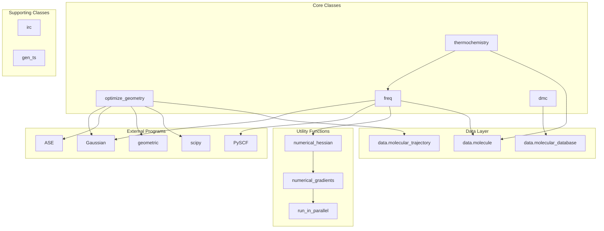
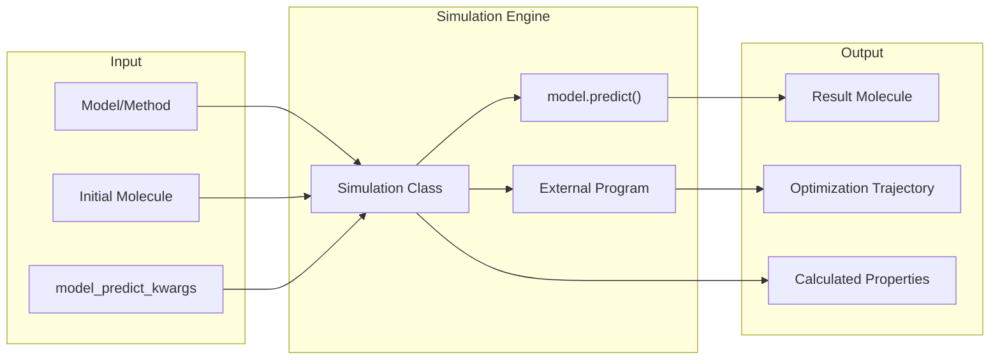
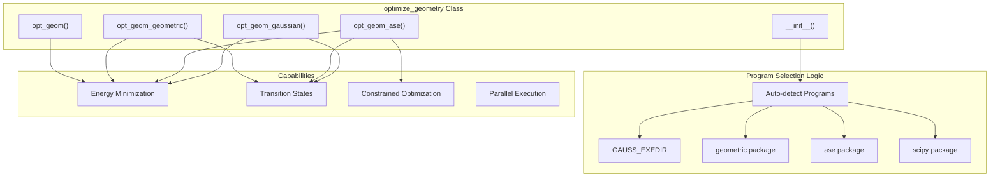
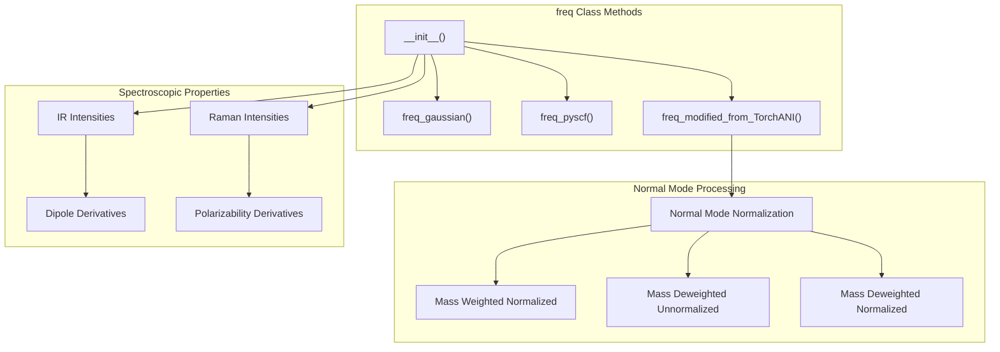
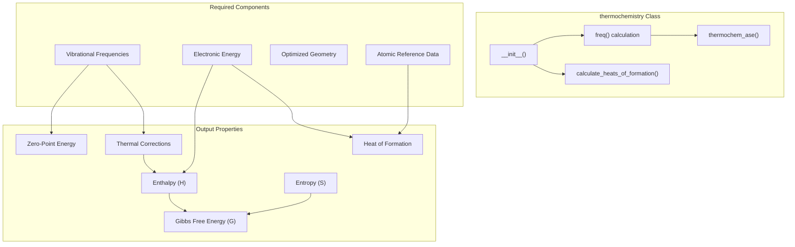
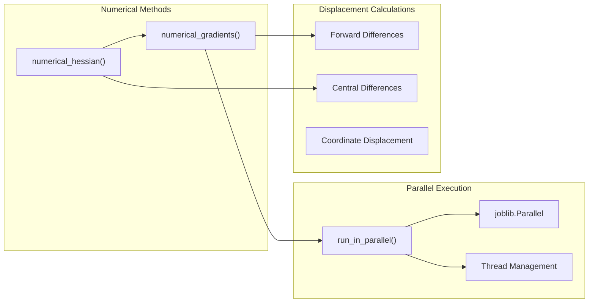
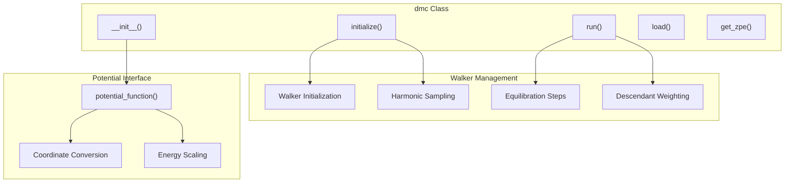

# Core Simulations

<details>
<summary>Relevant source files</summary>

The following files were used as context for generating this wiki page:

- [mlatom/simulations.py](mlatom/simulations.py)

</details>


This page documents the core molecular simulation capabilities provided by MLatom's simulation framework. The system handles geometry optimization, frequency analysis, thermochemical property calculations, and various utility functions for molecular simulations. These components work together to provide comprehensive simulation workflows that interface with quantum chemistry programs, machine learning models, and external optimization engines.

For molecular dynamics simulations, see [Molecular Dynamics](#5.2). For advanced dynamics like nonadiabatic molecular dynamics, see [Advanced Dynamics](#5.3). For spectroscopic calculations, see [Spectroscopic Analysis](#5.4).

## Architecture Overview

The core simulation system is built around several main classes that handle different types of molecular calculations. These classes share common patterns for model integration, parallel execution, and trajectory handling.

### Core Simulation Classes



Sources: [mlatom/simulations.py:75-950]()

### Model Integration Pattern

All simulation classes follow a consistent pattern for integrating with MLatom's model framework, supporting both machine learning models and quantum chemistry methods.



Sources: [mlatom/simulations.py:115-224](), [mlatom/simulations.py:507-556]()

## Geometry Optimization

The `optimize_geometry` class provides comprehensive geometry optimization capabilities with support for multiple optimization engines and transition state searches.

### Optimization Backends



Sources: [mlatom/simulations.py:75-224](), [mlatom/simulations.py:145-163]()

### Key Features and Configuration

| Feature | Description | Supported Programs |
|---------|-------------|-------------------|
| Energy Minimization | Standard geometry optimization | All programs |
| Transition State Search | Saddle point optimization | Gaussian, ASE, geometric |
| Constrained Optimization | Fixed bonds, angles, dihedrals | ASE, geometric |
| Trajectory Dumping | Save optimization trajectory | All programs |
| Parallel Model Evaluation | Multi-threaded model calls | All programs |

The class automatically selects an appropriate optimization program based on availability, with preference order: geometric → Gaussian → ASE → scipy.

### Trajectory and Output Management

The optimization process can optionally dump trajectories at each step, which is particularly useful for monitoring convergence and analyzing optimization paths:

```python
# Trajectory dumping configuration
self.dump_trajectory_interval = dump_trajectory_interval
if self.program.casefold() == 'Gaussian'.casefold(): 
    self.dump_trajectory_interval = 1  # Gaussian needs traj file
if self.program.casefold() == 'geometric'.casefold(): 
    self.dump_trajectory_interval = 1
```

Sources: [mlatom/simulations.py:180-196](), [mlatom/simulations.py:227-283]()

## Frequency Analysis

The `freq` class handles vibrational frequency calculations, normal mode analysis, and spectroscopic property computation.

### Frequency Calculation Backends



Sources: [mlatom/simulations.py:479-772](), [mlatom/simulations.py:660-770]()

### Hessian-Based Frequency Calculation

The core frequency calculation uses a modified algorithm from TorchANI that solves the generalized eigenvalue problem:

```
Hq = w² * Tq
```

Where H is the Hessian matrix, q are normal coordinates, T is the mass matrix, and w² are the eigenvalues corresponding to vibrational frequencies.

The implementation follows this workflow:
1. Calculate molecular Hessian using the provided model
2. Mass-scale the Hessian matrix using atomic masses
3. Solve eigenvalue problem to get frequencies and normal modes
4. Convert units and apply appropriate normalization

Sources: [mlatom/simulations.py:696-771]()

### Spectroscopic Intensity Calculations

The class can calculate IR and Raman intensities when appropriate derivatives are available:

| Property | Required Input | Output Units |
|----------|---------------|--------------|
| IR Intensities | Dipole derivatives | km/mol |
| Raman Intensities | Polarizability derivatives | Å⁴/amu |
| Normal Modes | Hessian matrix | Various normalizations |
| Force Constants | Eigenvalues, reduced masses | mDyne/Å |

Sources: [mlatom/simulations.py:591-657](), [mlatom/simulations.py:623-657]()

## Thermochemical Properties

The `thermochemistry` class builds upon frequency analysis to compute thermodynamic properties and heats of formation.

### Thermochemical Workflow



Sources: [mlatom/simulations.py:774-875](), [mlatom/simulations.py:824-839]()

### Available Thermochemical Properties

The calculation provides a comprehensive set of thermodynamic properties stored in the molecule object:

| Property | Symbol | Description |
|----------|--------|-------------|
| `ZPE` | ZPE | Zero-point energy |
| `U0` | U₀ | Internal energy at 0K |
| `H0` | H₀ | Enthalpy at 0K |
| `H` | H | Enthalpy at 298K |
| `G` | G | Gibbs free energy |
| `S` | S | Entropy |
| `DeltaHf298` | ΔHf298 | Heat of formation at 298K |
| `atomization_energy_0K` | - | Atomization energy at 0K |

Sources: [mlatom/simulations.py:796-823]()

## Numerical Methods and Utilities

The simulation module includes several utility functions for numerical calculations and parallel execution.

### Numerical Differentiation



Sources: [mlatom/simulations.py:970-1048](), [mlatom/simulations.py:23-73]()

### Parallel Execution Framework

The `run_in_parallel` function provides a general framework for parallelizing molecular calculations across multiple molecules or conformations:

```python
def run_in_parallel(molecular_database=None, task=None, task_kwargs={},
                    nthreads=None,
                    create_temp_directories=False,
                    create_and_keep_temp_directories=False):
```

Key features:
- Automatic thread allocation based on available CPUs and molecules
- Optional temporary directory creation for each parallel task
- Model thread count management to prevent over-subscription
- Support for any task function that takes a molecule as input

Sources: [mlatom/simulations.py:23-73]()

## Advanced Simulation Methods

### Diffusion Monte Carlo

The `dmc` class provides quantum mechanical zero-point energy calculations using the PyVibDMC package:



Sources: [mlatom/simulations.py:877-969]()

### Transition State Generation

The module provides transition state generation capabilities through the `gen_ts` function, with support for different methods:

| Method | Description | Supported Features |
|--------|-------------|-------------------|
| ECTS | Elementary Chemical Transformation Search | Path generation, averaging |

Sources: [mlatom/simulations.py:417-449]()

### Intrinsic Reaction Coordinate

The `irc` class provides reaction path following capabilities using Gaussian's IRC functionality:

```python
class irc():
    def __init__(self, **kwargs):
        # Setup model and molecule
        # Run Gaussian IRC calculation
        gaussian_interface.run_gaussian_job(filename=f'{filename}.com', 
                                          molecule=self.ts_molecule, 
                                          external_task='irc', 
                                          model_predict_kwargs=self.model_predict_kwargs)
```

Sources: [mlatom/simulations.py:451-477]()

---