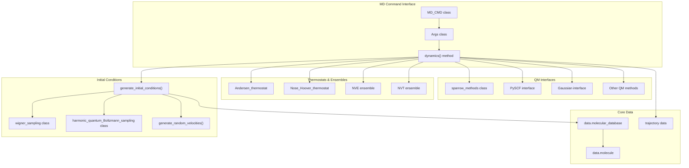
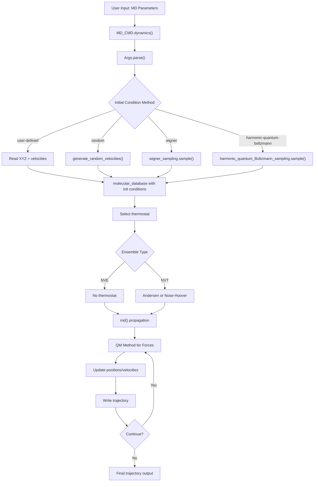
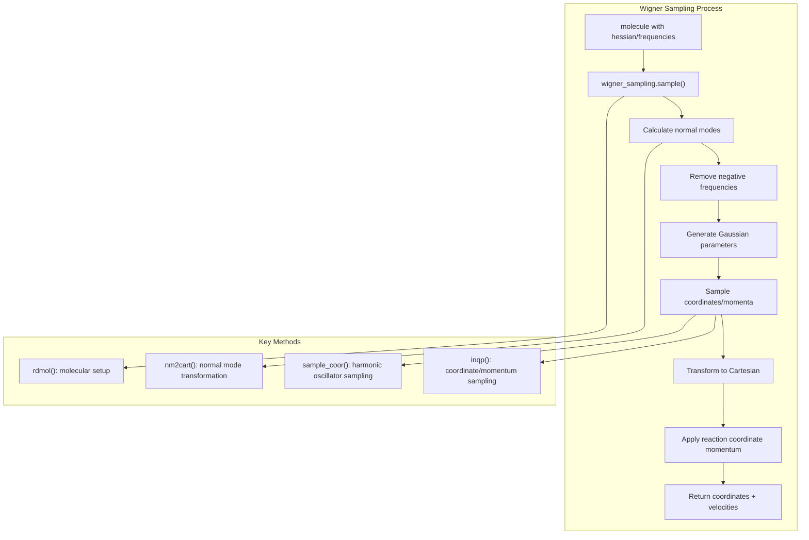
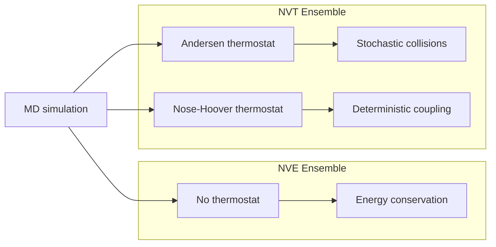
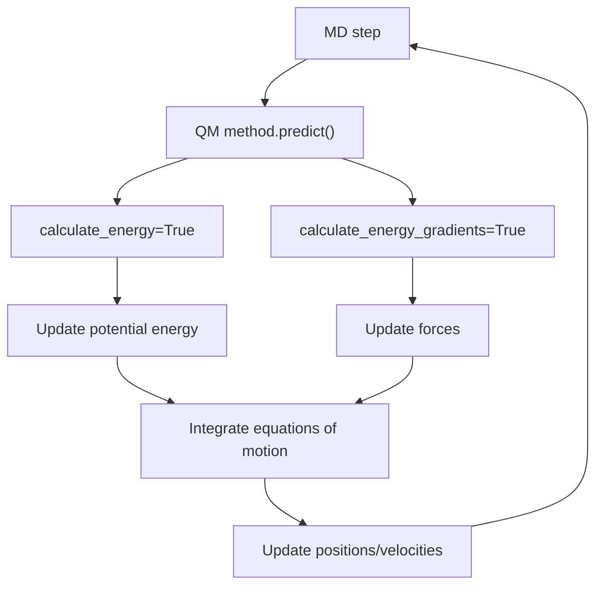

# Molecular Dynamics

<details>
<summary>Relevant source files</summary>

The following files were used as context for generating this wiki page:

- [mlatom/constants.py](mlatom/constants.py)
- [mlatom/initial_conditions.py](mlatom/initial_conditions.py)
- [mlatom/interfaces/sparrow_interface.py](mlatom/interfaces/sparrow_interface.py)
- [mlatom/md_cmd.py](mlatom/md_cmd.py)

</details>


This document covers the molecular dynamics (MD) simulation capabilities in MLatom, including initial condition generation, classical MD propagation, and integration with quantum chemistry methods for force calculations. For advanced dynamics like nonadiabatic molecular dynamics and surface hopping, see [Advanced Dynamics](#5.3). For core simulation utilities like geometry optimization, see [Core Simulations](#5.1).

## System Architecture

The molecular dynamics system in MLatom consists of several interconnected components that handle initial condition sampling, trajectory propagation, and integration with various computational methods.

### MD System Components



**Sources:** [mlatom/md_cmd.py:1-241](), [mlatom/initial_conditions.py:1-764]()

### Data Flow in MD Simulations



**Sources:** [mlatom/md_cmd.py:58-221](), [mlatom/initial_conditions.py:69-264]()

## Initial Conditions Generation

The `generate_initial_conditions()` function provides multiple methods for sampling initial molecular configurations and velocities for MD simulations.

### Supported Sampling Methods

| Method | Description | Key Parameters |
|--------|-------------|----------------|
| `user-defined` | Read from XYZ and velocity files | `file_with_initial_xyz_coordinates`, `file_with_initial_xyz_velocities` |
| `random` | Random velocities from temperature | `initial_temperature`, `degrees_of_freedom` |
| `maxwell-boltzmann` | Maxwell-Boltzmann velocity distribution | `initial_temperature` |
| `wigner` | Quantum mechanical Wigner sampling | `temperature`, `use_hessian` |
| `harmonic-quantum-boltzmann` | Quantum Boltzmann distribution | `temperature`, `use_hessian` |

**Sources:** [mlatom/initial_conditions.py:96-106]()

### Wigner Sampling Implementation

The `wigner_sampling` class implements quantum mechanical Wigner sampling based on normal modes and frequencies:



**Sources:** [mlatom/initial_conditions.py:362-589]()

### Energy Window Filtering

The system supports filtering initial conditions by excitation energy windows using `excitation_energy_window_filter()`:

- Calculates excitation energies and oscillator strengths
- Filters configurations within specified energy window
- Applies statistical weighting based on oscillator strengths
- Iteratively generates sufficient configurations

**Sources:** [mlatom/initial_conditions.py:17-67]()

## MD Command Interface

The `MD_CMD` class provides a command-line interface for setting up and running MD simulations.

### Key Parameters

The `Args` class defines essential MD parameters:

```python
# Time integration
'dt': 0.1,                    # Time step in fs
'trun': 1000,                 # Trajectory length in fs

# Initial conditions
'initConditions': '',         # Sampling method
'initTemperature': 300,       # Initial temperature in K

# Thermostats
'ensemble': 'nve',           # NVE or NVT
'thermostat': '',            # Thermostat type
'temperature': 300,          # Target temperature
'gamma': 0.2,               # Andersen thermostat parameter

# File I/O
'trajH5MDout': 'traj.h5',   # H5MD trajectory output
'trajTextOut': 'traj',      # Plain text trajectory
```

**Sources:** [mlatom/md_cmd.py:17-46]()

### Thermostat Integration

The system supports multiple thermostats for temperature control:



**Sources:** [mlatom/md_cmd.py:192-208]()

## Integration with Quantum Chemistry Methods

MD simulations can use various quantum chemistry methods for energy and force calculations. The `sparrow_interface` demonstrates this integration pattern.

### QM Method Interface Pattern



**Sources:** [mlatom/interfaces/sparrow_interface.py:59-163]()

### Supported QM Methods

The system integrates with multiple quantum chemistry programs:
- **Sparrow**: Semi-empirical methods (DFTB, MNDO, AM1, PM3, etc.)
- **PySCF**: DFT and post-HF methods
- **Gaussian**: Various quantum chemistry methods
- **xTB**: Extended tight-binding methods

**Sources:** [mlatom/interfaces/sparrow_interface.py:42-47]()

## Constants and Unit Conversions

Physical constants and unit conversions are centralized in the `constants` module:

```python
# Time conversions
au2fs = 2.4188843265857E-2     # Atomic units to femtoseconds
fs2au = 1.0 / au2fs

# Energy conversions  
Hartree2kcalpermol = 627.509474
kB_in_Hartree = ...            # Boltzmann constant in Hartree/K

# Distance conversions
Bohr2Angstrom = 0.52917721092
Angstrom2Bohr = 1.0 / Bohr2Angstrom
```

**Sources:** [mlatom/constants.py:10-49]()

---