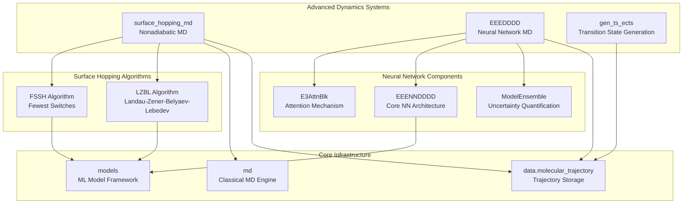
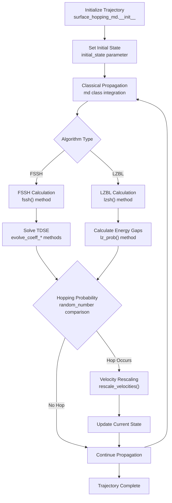
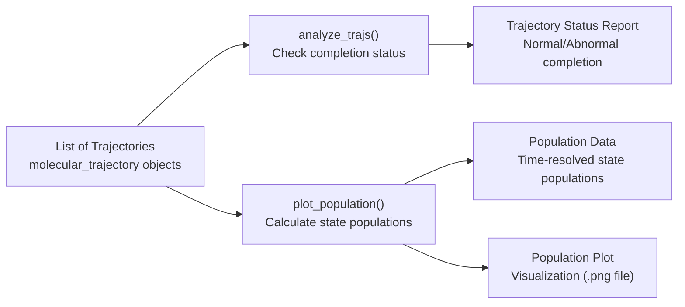
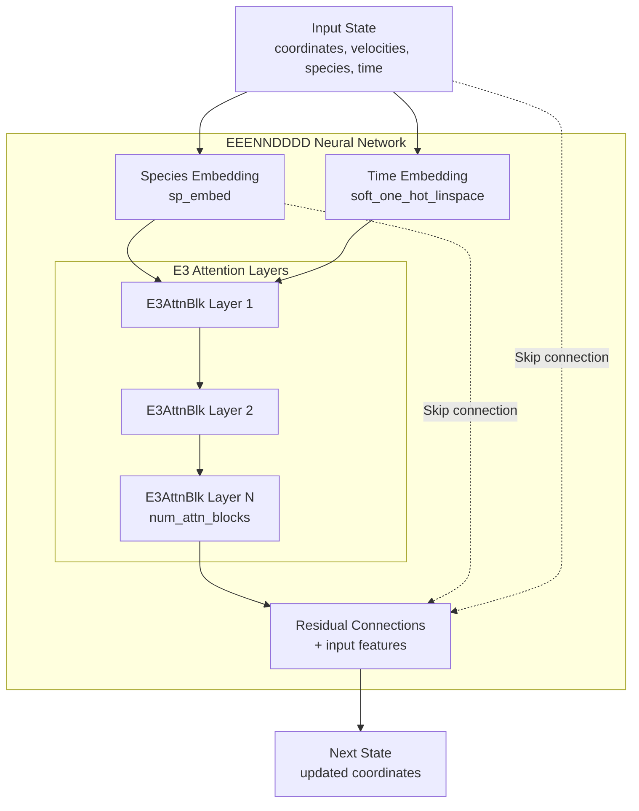
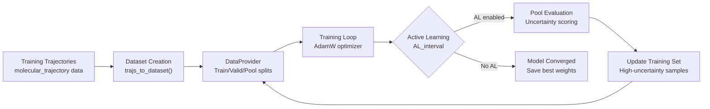
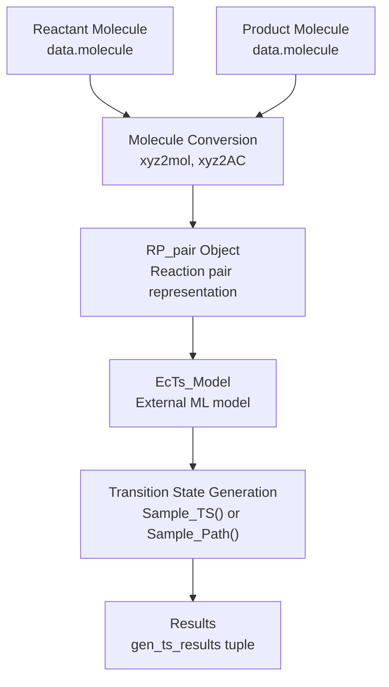
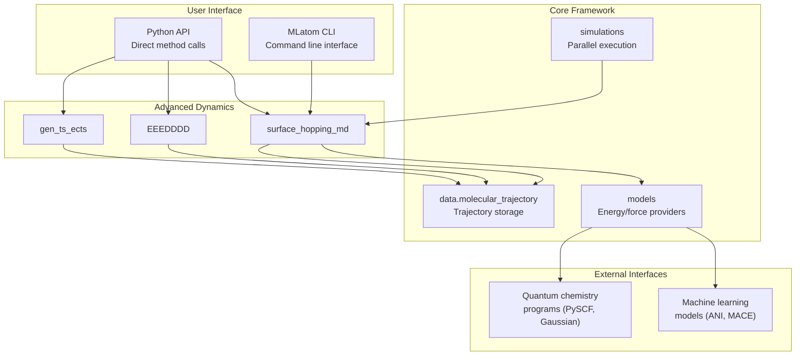

# Advanced Dynamics

<details>
<summary>Relevant source files</summary>

The following files were used as context for generating this wiki page:

- [mlatom/EEEDDDD.py](mlatom/EEEDDDD.py)
- [mlatom/gen_ts_methods.py](mlatom/gen_ts_methods.py)
- [mlatom/namd.py](mlatom/namd.py)

</details>


This page covers advanced molecular dynamics capabilities in MLatom beyond traditional classical molecular dynamics. These include nonadiabatic molecular dynamics with surface hopping algorithms, neural network-based trajectory propagation, and transition state generation methods. For basic molecular dynamics simulations, see [Molecular Dynamics](#5.2). For geometry optimization and frequency calculations, see [Core Simulations](#5.1).

## Overview

Advanced dynamics in MLatom encompasses three main areas: nonadiabatic molecular dynamics for studying photochemical processes and excited state dynamics, neural network-based molecular dynamics using machine learning models to propagate trajectories, and computational methods for generating transition state structures. These methods extend beyond the adiabatic Born-Oppenheimer approximation used in classical molecular dynamics.



**Sources:** [mlatom/namd.py:1-942](), [mlatom/EEEDDDD.py:1-949](), [mlatom/gen_ts_methods.py:1-96]()

## Nonadiabatic Molecular Dynamics

Nonadiabatic molecular dynamics allows the study of processes where the Born-Oppenheimer approximation breaks down, such as photochemical reactions, energy transfer, and electronic relaxation. MLatom implements surface hopping algorithms to handle transitions between electronic states during molecular dynamics.

### Surface Hopping Algorithms

The `surface_hopping_md` class provides two main surface hopping algorithms:

| Algorithm | Description | Key Features |
|-----------|-------------|--------------|
| **FSSH** | Fewest Switches Surface Hopping | Coherent evolution of state coefficients, decoherence corrections |
| **LZBL** | Landau-Zener-Belyaev-Lebedev | Probabilistic hopping based on energy gap dynamics |



**Sources:** [mlatom/namd.py:21-251](), [mlatom/namd.py:499-653](), [mlatom/namd.py:451-492]()

### FSSH Implementation Details

The FSSH algorithm evolves quantum state coefficients coherently while allowing probabilistic hops between electronic states. Key components include:

- **Time-dependent Schrödinger equation integration**: Multiple integrators available (`RK4`, `AM5`, `Butcher`)
- **Decoherence corrections**: Simplified Decay of Mixing (SDM) model
- **Velocity rescaling**: Along nonadiabatic coupling vectors or momentum direction

The implementation subdivides each classical time step into smaller quantum time steps for accurate TDSE integration:

```python
# From namd.py lines 514-515
n_substeps = int(self.time_step / self.time_step_tdse)
```

**Sources:** [mlatom/namd.py:238-250](), [mlatom/namd.py:513-653](), [mlatom/namd.py:682-753]()

### Trajectory Analysis and Population Dynamics

The module provides analysis functions for surface hopping trajectories:

- `analyze_trajs()`: Analyzes trajectory completion status
- `plot_population()`: Creates state population plots over time
- `plot_population_from_disk()`: Analysis for trajectories stored on disk



**Sources:** [mlatom/namd.py:767-942]()

## Neural Network-Based Molecular Dynamics

The `EEEDDDD` model implements neural network-based molecular dynamics using E3-equivariant attention mechanisms. This approach learns to propagate molecular trajectories directly from training data, enabling efficient simulation of complex molecular systems.

### Architecture Overview

The neural network architecture combines several advanced components:

| Component | Purpose | Implementation |
|-----------|---------|----------------|
| **Species Embedding** | Atomic type representation | `torch.nn.Embedding` |
| **E3 Attention Blocks** | Equivariant message passing | `E3AttnBlk` class |
| **Time Encoding** | Temporal information embedding | Gaussian basis functions |
| **Spatial Encoding** | Distance-based representations | Soft one-hot encoding |



**Sources:** [mlatom/EEEDDDD.py:99-197](), [mlatom/EEEDDDD.py:26-96]()

### E3-Equivariant Attention Mechanism

The `E3AttnBlk` class implements rotation-equivariant attention using spherical harmonics and tensor products:

- **Query/Key/Value projections**: Using `o3.Linear` and `o3.FullyConnectedTensorProduct`
- **Spherical harmonics**: Encode directional information
- **Attention weights**: Distance and time-dependent MLP networks
- **Multi-head attention**: Parallel processing of different representation spaces

Key architectural parameters include `lmax` for spherical harmonic order, `num_heads` for attention heads, and various `irreps_*` parameters defining the irreducible representations.

**Sources:** [mlatom/EEEDDDD.py:25-96](), [mlatom/EEEDDDD.py:200-218]()

### Training and Active Learning

The `EEEDDDD` model supports sophisticated training protocols:



**Sources:** [mlatom/EEEDDDD.py:342-577](), [mlatom/EEEDDDD.py:794-863]()

### Trajectory Propagation

The trained model can propagate molecular trajectories using the `propagate()` method:

- **Time segmentation**: Long trajectories split into manageable segments
- **Energy conservation**: Optional velocity rescaling with potential models
- **Ensemble uncertainty**: Support for model ensembles and uncertainty quantification
- **Periodic boundary conditions**: Support for crystal simulations

**Sources:** [mlatom/EEEDDDD.py:646-717]()

## Transition State Generation

The `gen_ts_ects()` function provides an interface to the EcTs (External Transition State) method for generating transition state structures between reactant and product molecules.

### EcTs Integration

The function integrates with the external EcTs package to generate transition states:



**Sources:** [mlatom/gen_ts_methods.py:11-96]()

### Output Structure

The `gen_ts_results` named tuple provides structured output:

| Field | Type | Description |
|-------|------|-------------|
| `ts` | `List[data.molecule]` | Generated transition state structures |
| `avg_ts` | `data.molecule` | Average transition state structure |
| `path` | `List[data.molecular_database]` | Complete reaction paths (if requested) |
| `avg_path` | `data.molecular_database` | Average reaction path |

**Sources:** [mlatom/gen_ts_methods.py:5-10](), [mlatom/gen_ts_methods.py:70-96]()

## Integration with MLatom Ecosystem

Advanced dynamics methods integrate seamlessly with the broader MLatom framework:



**Sources:** [mlatom/namd.py:14-16](), [mlatom/EEEDDDD.py:13-15](), [mlatom/gen_ts_methods.py:3]()

The advanced dynamics capabilities extend MLatom's simulation framework beyond classical molecular dynamics, enabling the study of photochemical processes, machine learning-accelerated dynamics, and transition state chemistry within a unified computational platform.

---