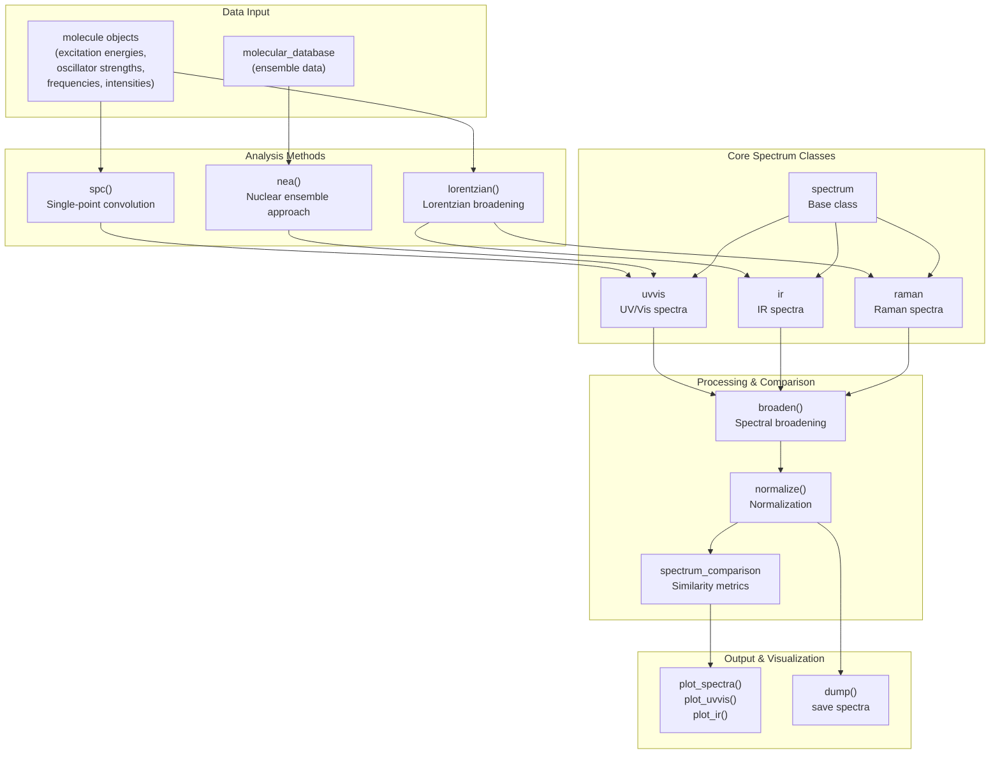
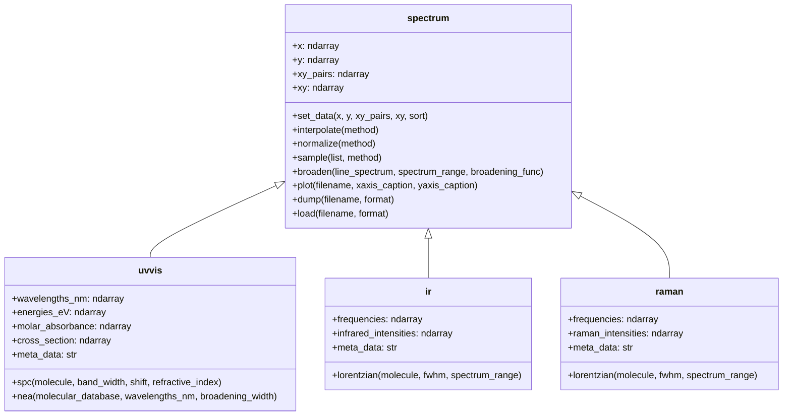
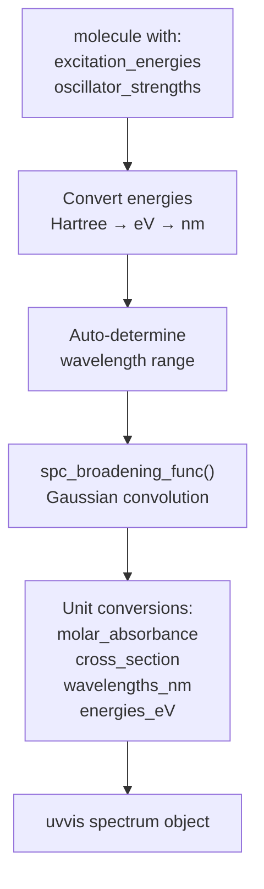
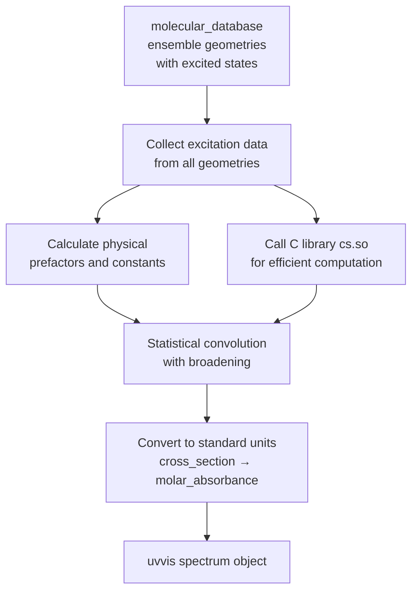
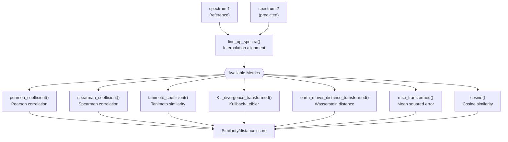

# Spectroscopic Analysis

<details>
<summary>Relevant source files</summary>

The following files were used as context for generating this wiki page:

- [mlatom/interfaces/mace_interface.py](mlatom/interfaces/mace_interface.py)
- [mlatom/spectra.py](mlatom/spectra.py)

</details>


This document covers MLatom's spectroscopic analysis capabilities for generating and analyzing UV/Vis, IR, and Raman spectra from molecular simulations. The system provides tools for spectrum calculation, broadening, comparison, and visualization.

For information about molecular simulations that generate the underlying data, see [Core Simulations](#5.1). For advanced dynamics calculations, see [Advanced Dynamics](#5.3).

## System Architecture



**Spectrum Data Flow and Processing Pipeline**

The spectroscopic analysis system processes molecular properties through several stages to generate and analyze spectra.

Sources: [mlatom/spectra.py:1-1371]()

## Core Data Structures

The `spectrum` class serves as the foundation for all spectroscopic data in MLatom, providing essential data management and processing capabilities.

### Spectrum Base Class



**Core Spectrum Class Hierarchy**

The spectrum classes provide specialized functionality for different types of spectroscopy while sharing common data management operations.

Sources: [mlatom/spectra.py:17-216](), [mlatom/spectra.py:217-451](), [mlatom/spectra.py:452-490](), [mlatom/spectra.py:494-532]()

### Data Management Features

| Method | Purpose | Key Parameters |
|--------|---------|----------------|
| `set_data()` | Initialize spectral data | `x`, `y`, `xy_pairs`, `sort` |
| `interpolate()` | Create interpolation function | `method` ("linear", "cubic") |
| `sample()` | Resample spectrum at new points | `list`, `method` |
| `normalize()` | Normalize spectral intensities | `method` ("average", "max", "sqrt", "msc") |
| `broaden()` | Apply broadening functions | `broadening_func`, `broadening_func_kwargs` |

Sources: [mlatom/spectra.py:21-41](), [mlatom/spectra.py:42-49](), [mlatom/spectra.py:52-80](), [mlatom/spectra.py:82-87](), [mlatom/spectra.py:90-111]()

## UV/Vis Spectroscopy Methods

The UV/Vis analysis system provides two primary approaches for generating absorption spectra from molecular excited state calculations.

### Single-Point Convolution (SPC)

The SPC method generates UV/Vis spectra from single-geometry excited state calculations using Gaussian broadening.



**SPC Method Processing Flow**

The SPC implementation follows the methodology described in DOI: 10.1007/s00894-020-04355-y for efficient single-point spectrum generation.

Sources: [mlatom/spectra.py:284-341](), [mlatom/spectra.py:342-363]()

### Nuclear Ensemble Approach (NEA)

The NEA method generates spectra from molecular ensembles using statistical sampling of nuclear configurations.



**NEA Method Processing Flow**

The NEA implementation uses a compiled C library for efficient statistical calculations over molecular ensembles.

Sources: [mlatom/spectra.py:366-450](), [mlatom/spectra.py:440-445]()

## Vibrational Spectroscopy

The IR and Raman analysis capabilities provide broadening and visualization for vibrational spectra.

### IR Spectroscopy

```python
# Example IR spectrum generation
ir_spectrum = ir.lorentzian(
    molecule=mol,           # molecule with frequencies and infrared_intensities
    fwhm=30,               # Full width at half maximum
    spectrum_range=np.arange(500, 4001)  # wavenumber range
)
```

The IR class handles infrared spectra with Lorentzian line shape broadening. The `lorentzian()` method applies the `Lorentzian_line_shape_function` to convert discrete vibrational frequencies into continuous spectra.

Sources: [mlatom/spectra.py:479-489](), [mlatom/spectra.py:148-161]()

### Raman Spectroscopy

The Raman class provides identical functionality to IR spectra but works with Raman intensities instead of IR intensities. The same Lorentzian broadening approach applies to generate continuous Raman spectra from discrete vibrational modes.

Sources: [mlatom/spectra.py:521-531]()

## Spectrum Comparison and Analysis

The `spectrum_comparison` class provides comprehensive tools for quantitative spectral analysis and similarity assessment.



**Spectrum Comparison Workflow**

The comparison system aligns spectra and applies various similarity metrics for quantitative analysis.

### Available Comparison Metrics

| Metric | Method | Range | Purpose |
|--------|--------|-------|---------|
| Pearson Correlation | `pearson_coefficient()` | [-1, 1] | Linear correlation |
| Spearman Correlation | `spearman_coefficient()` | [-1, 1] | Rank correlation |
| Tanimoto Coefficient | `tanimoto_coefficient()` | [0, 1] | Molecular similarity |
| Kullback-Leibler | `KL_divergence_transformed()` | [0, 1] | Information divergence |
| Jensen-Shannon | `JS_divergence_transformed()` | [0, 1] | Symmetric divergence |
| Earth Mover Distance | `earth_mover_distance_transformed()` | [0, 1] | Wasserstein distance |
| Mean Squared Error | `mse_transformed()` | [0, 1] | Point-wise error |
| Cosine Similarity | `cosine()` | [-1, 1] | Angular similarity |

Sources: [mlatom/spectra.py:540-602](), [mlatom/spectra.py:636-1012]()

## Visualization and Plotting

The plotting system provides specialized visualization for different spectral types with interactive capabilities.

### General Spectrum Plotting

The `plot_spectra()` function handles generic spectral visualization with extensive customization options including normalization, shifting, and range selection.

Sources: [mlatom/spectra.py:1017-1116]()

### UV/Vis Plotting Features

```python
# UV/Vis plotting with interactive broadening
plot_uvvis(
    spectra=[uvvis_spectrum],
    molecule=mol,                    # for oscillator strength display
    spc=True,                       # enable SPC calculation
    band_width_slider=True,         # interactive broadening control
    shift=True,                     # align spectra maxima
    normalize=True                  # normalize intensities
)
```

The UV/Vis plotting system includes interactive widgets for real-time parameter adjustment and dual-axis display of both continuous spectra and discrete oscillator strengths.

Sources: [mlatom/spectra.py:1118-1202]()

### IR Plotting Features

```python
# IR plotting with peak highlighting
plot_ir(
    spectra=[ir_spectrum],
    molecule=mol,
    lorentzian=True,               # apply Lorentzian broadening
    band_width_slider=True,        # interactive FWHM control
    peak_highlight_slider=True,    # highlight individual peaks
    scaling_factor=0.95            # frequency scaling
)
```

The IR plotting system provides peak highlighting with molecular visualization and interactive broadening parameter control.

Sources: [mlatom/spectra.py:1204-1366]()

---