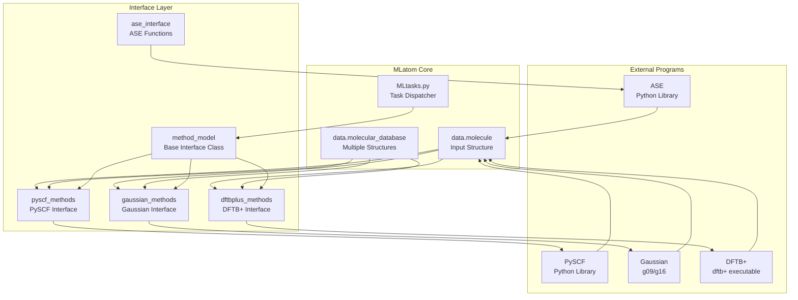
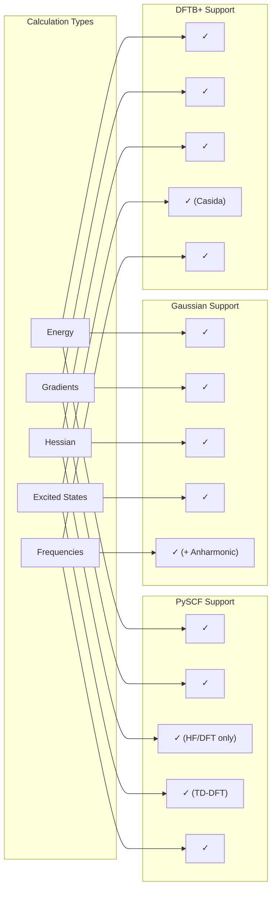
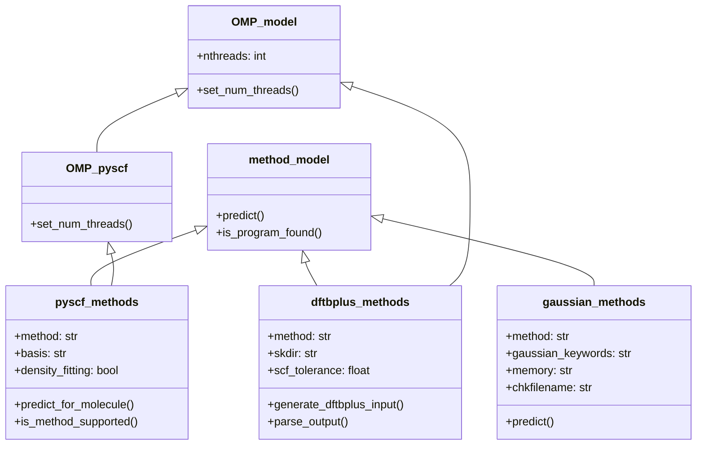
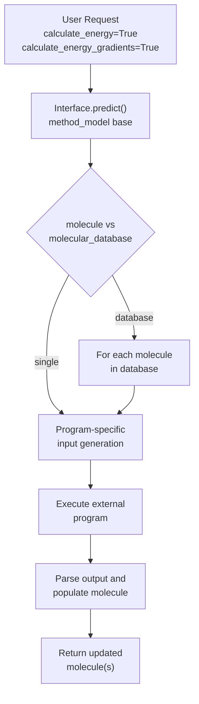

# Quantum Chemistry Interfaces

<details>
<summary>Relevant source files</summary>

The following files were used as context for generating this wiki page:

- [mlatom/interfaces/__init__.py](mlatom/interfaces/__init__.py)
- [mlatom/interfaces/ase_interface.py](mlatom/interfaces/ase_interface.py)
- [mlatom/interfaces/dftbplus_interface.py](mlatom/interfaces/dftbplus_interface.py)
- [mlatom/interfaces/gaussian_interface.py](mlatom/interfaces/gaussian_interface.py)
- [mlatom/interfaces/pyscf_interface.py](mlatom/interfaces/pyscf_interface.py)

</details>


## Purpose and Scope

The quantum chemistry interfaces in MLatom provide a unified way to access external quantum chemistry programs and packages for electronic structure calculations. These interfaces enable MLatom to leverage established quantum chemistry software while maintaining a consistent API for users. The interfaces handle program execution, input file generation, output parsing, and data conversion between MLatom's internal data structures and external program formats.

For information about molecular simulations using these interfaces, see [Core Simulations](#5.1). For machine learning model interfaces, see [Model Framework](#2.2).

## Interface Architecture Overview

The quantum chemistry interfaces follow a consistent architecture pattern where MLatom acts as a coordinator between its internal molecular data structures and external computational programs.



**Interface Architecture Pattern**
- Each interface inherits from `method_model` base class
- Interfaces generate program-specific input files
- External programs are executed via subprocess or direct API calls
- Output is parsed and mapped back to MLatom data structures

Sources: [mlatom/interfaces/pyscf_interface.py:18-22](), [mlatom/interfaces/gaussian_interface.py:15-16](), [mlatom/interfaces/dftbplus_interface.py:17-18]()

## Supported Programs and Capabilities

| Program | Interface Class | Calculation Types | Input Method | Key Features |
|---------|----------------|-------------------|--------------|--------------|
| PySCF | `pyscf_methods` | HF, DFT, MP2, CCSD, TD-DFT, CASCI | Direct API | In-memory execution, broad method support |
| Gaussian | `gaussian_methods` | HF, DFT, MP2, CCSD, TD-DFT, Anharmonic | Input files | Production calculations, anharmonic analysis |
| DFTB+ | `dftbplus_methods` | DFTB, TD-DFTB | Input files | Fast semi-empirical calculations |
| ASE | Various functions | Any ASE calculator | ASE objects | Geometry optimization, transition states |

**Method Support Matrix**


Sources: [mlatom/interfaces/pyscf_interface.py:40-49](), [mlatom/interfaces/gaussian_interface.py:32-36](), [mlatom/interfaces/dftbplus_interface.py:35-57]()

## Core Interface Classes and Method Dispatch

The interface system uses a class hierarchy with consistent method signatures for quantum chemistry calculations.



**Method Dispatch Flow**


Sources: [mlatom/interfaces/pyscf_interface.py:23-31](), [mlatom/interfaces/gaussian_interface.py:18-60](), [mlatom/interfaces/dftbplus_interface.py:33-78]()

## Program-Specific Interface Details

### PySCF Interface

The `pyscf_methods` class provides direct integration with the PySCF quantum chemistry library through Python API calls rather than external process execution.

**Key Features:**
- Direct in-memory calculations via PySCF API
- Support for `HF`, `MP2`, `DFT`, `CISD`, `CCSD`, `CCSD(T)`, `TD-DFT`
- DM21 functional support with neural network integration
- Thermochemistry calculations with frequency analysis
- Density fitting options for performance

**Method Detection Pattern:**
```python
# Method format: "B3LYP/6-31G*" 
method = method.split('/')[0]  # Extract method
basis = method.split('/')[1]   # Extract basis set
```

Sources: [mlatom/interfaces/pyscf_interface.py:31-90](), [mlatom/interfaces/pyscf_interface.py:91-363]()

### Gaussian Interface  

The `gaussian_methods` class interfaces with Gaussian quantum chemistry software through input file generation and output parsing.

**Key Features:**
- Support for Gaussian 09 and 16 via `$GAUSS_EXEDIR`
- Comprehensive job types: single point, optimization, frequencies, TD-DFT
- Anharmonic frequency analysis capabilities  
- Checkpoint file management for large calculations
- Archive section parsing for multiple energy levels

**Input Generation Flow:**
1. Generate `.com` input file with method and keywords
2. Execute via subprocess: `[Gaussianbin, filename]`
3. Parse `.log` output file for results
4. Optional: Read Hessian from `.chk` file

Sources: [mlatom/interfaces/gaussian_interface.py:38-142](), [mlatom/interfaces/gaussian_interface.py:322-892]()

### DFTB+ Interface

The `dftbplus_methods` class provides access to the DFTB+ semi-empirical quantum chemistry program.

**Key Features:**
- DFTB method with SCC (self-consistent charges)  
- TD-DFTB for excited states via Casida approach
- Slater-Koster parameter file management via `$skfiles`
- Support for forces, Hessians, and excited state gradients
- Third-order corrections and Hubbard derivatives

**Parameter Management:**
- Automatic detection of elements and SK files
- Angular momentum assignment per element type
- Hubbard derivative parameters for elements

Sources: [mlatom/interfaces/dftbplus_interface.py:33-88](), [mlatom/interfaces/dftbplus_interface.py:97-344]()

### ASE Interface Functions

The ASE interface provides specialized functions for geometry optimization and transition state calculations rather than a class-based approach.

**Key Functions:**
- `optimize_geometry()`: Structure optimization with various algorithms
- `transition_state()`: TS search via dimer method or NEB
- `MLatomCalculator`: ASE calculator wrapper for MLatom models
- `thermochemistry()`: Thermodynamic property calculation

**Integration Pattern:**
1. Convert MLatom molecules to ASE atoms objects
2. Set up ASE calculator with MLatom model
3. Run ASE optimization/analysis routines
4. Convert results back to MLatom format

Sources: [mlatom/interfaces/ase_interface.py:23-89](), [mlatom/interfaces/ase_interface.py:172-213]()

---