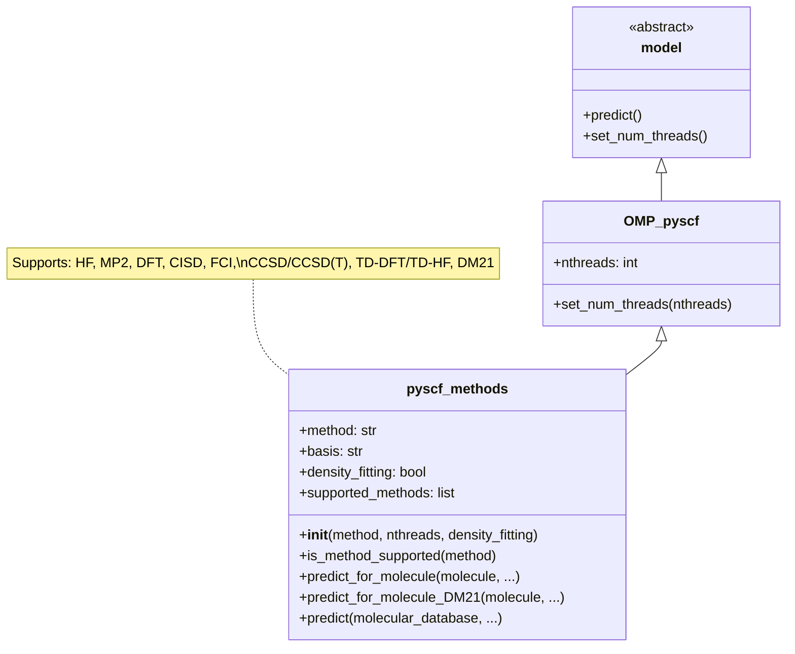
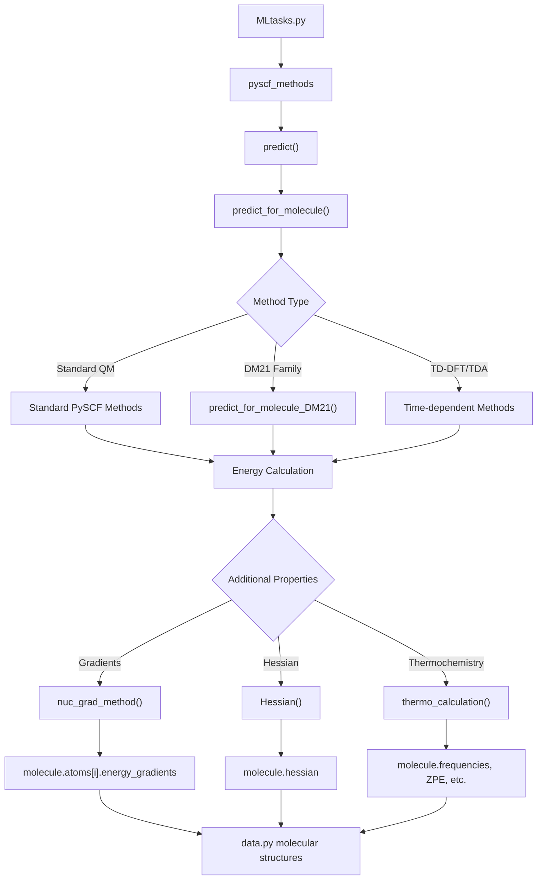
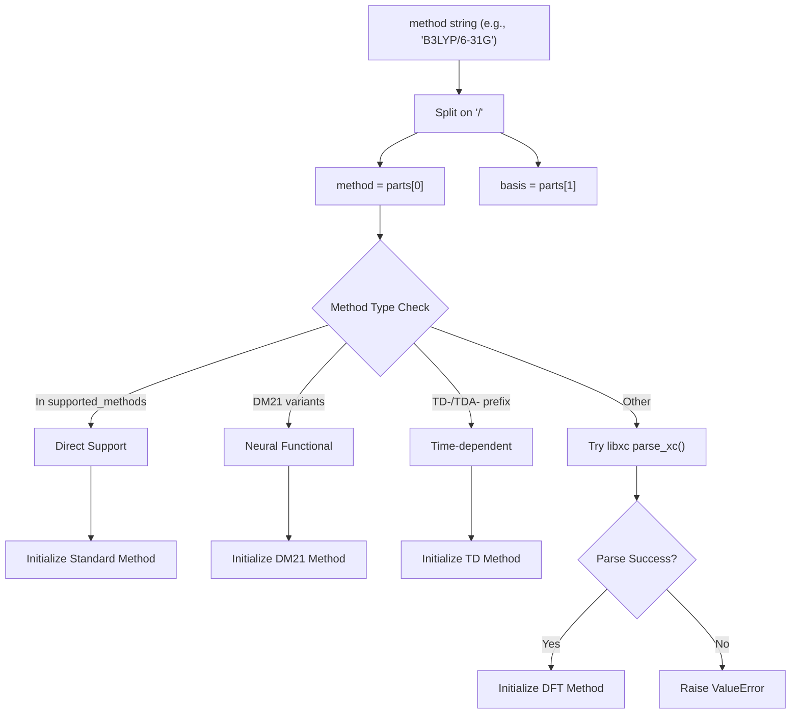
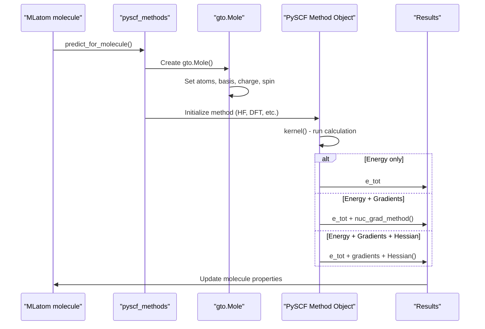
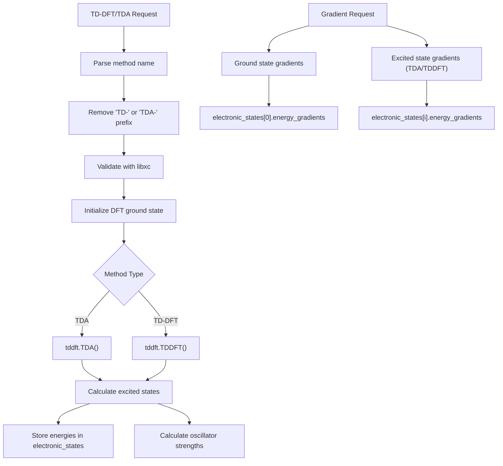
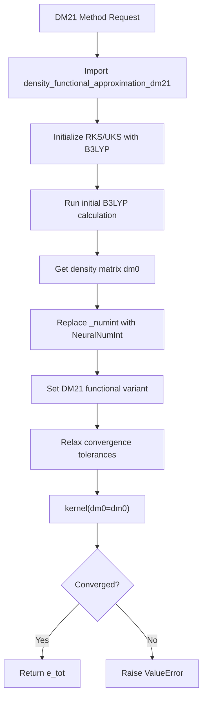
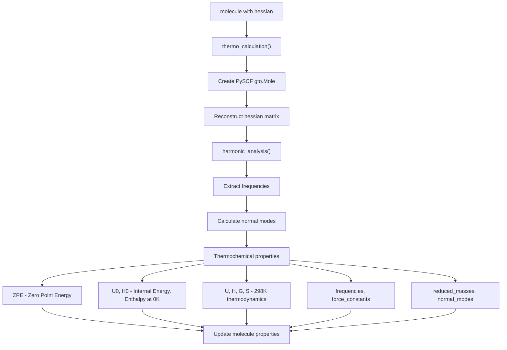
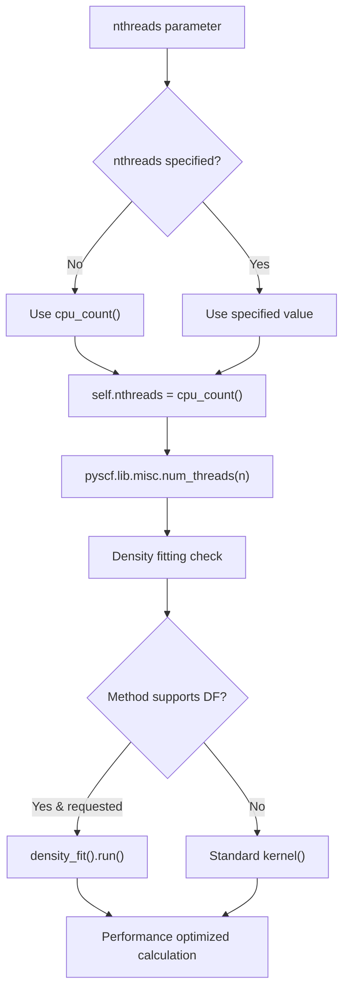
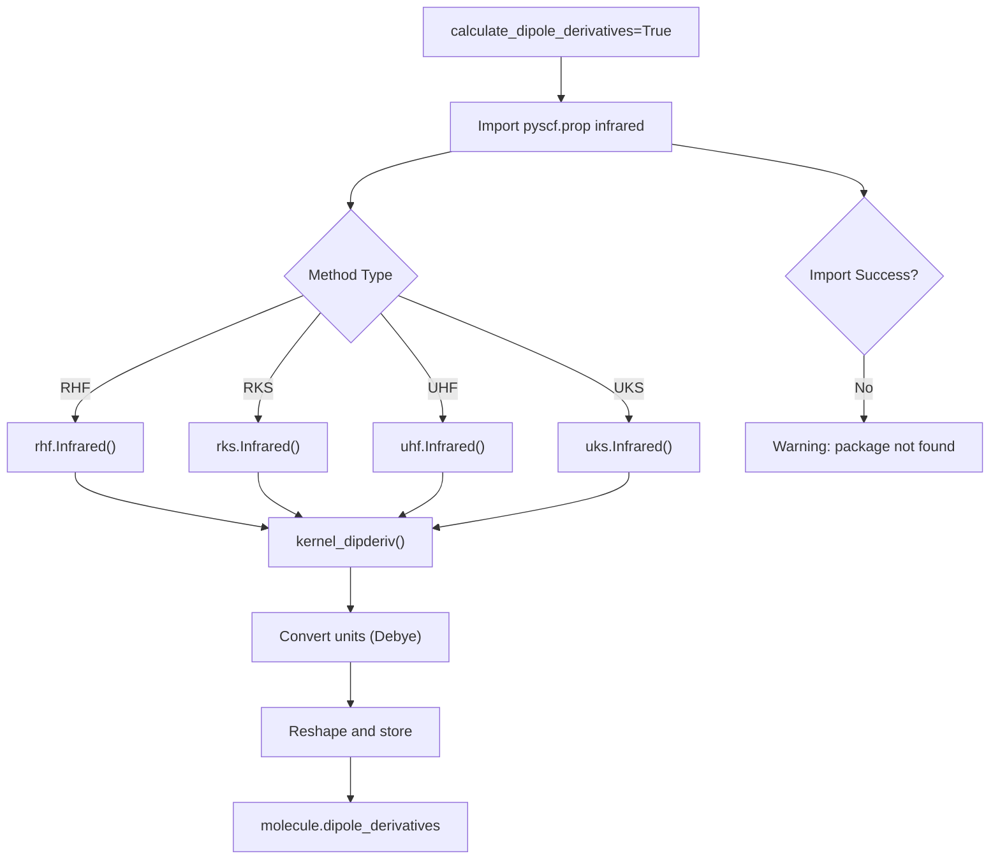

# PySCF Interface

Relevant source files

The following files were used as context for generating this wiki page:

- [mlatom/interfaces/pyscf_interface.py](mlatom/interfaces/pyscf_interface.py)

This document covers the PySCF (Python-based Simulations of Chemistry Framework) interface within MLatom, which provides access to a wide range of quantum chemistry methods including DFT, post-Hartree-Fock methods, and time-dependent methods. The interface handles energy calculations, geometry optimizations, frequency analysis, and thermochemical properties.

For information about other quantum chemistry interfaces, see [Gaussian and ASE Interfaces](#6.2) and [DFTB+ and Other Interfaces](#6.3). For details about the core model framework that this interface integrates with, see [Model Framework](#2.2).

## Architecture Overview

The PySCF interface is built around a hierarchical class structure that inherits from MLatom's base model framework while providing threading control and method-specific implementations.

### Class Structure

**Sources:** [mlatom/interfaces/pyscf_interface.py:23-31](), [mlatom/interfaces/pyscf_interface.py:50-90]()

### Integration with MLatom Core

**Sources:** [mlatom/interfaces/pyscf_interface.py:91-363](), [mlatom/interfaces/pyscf_interface.py:365-421]()

## Supported Methods and Capabilities

The interface supports a comprehensive range of quantum chemistry methods with varying levels of derivative support.

### Method Support Matrix

| Method Category | Methods | Energy | Gradients | Hessian |
|----------------|---------|---------|-----------|---------|
| **Hartree-Fock** | HF | ✓ | ✓ | ✓ |
| **Post-HF** | MP2, CISD, CCSD, CCSD(T), FCI | ✓ | ✓* | ✗ |
| **DFT** | Any libxc functional | ✓ | ✓ | ✓ |
| **Time-dependent** | TD-DFT, TDA | ✓ | ✓ | ✗ |
| **Neural Functionals** | DM21, DM21m, DM21mc, DM21mu | ✓ | ✗ | ✗ |

*FCI gradients not supported, UCCSD(T) gradients not supported

**Sources:** [mlatom/interfaces/pyscf_interface.py:41-49](), [mlatom/interfaces/pyscf_interface.py:238-292]()

### Method Detection and Initialization

**Sources:** [mlatom/interfaces/pyscf_interface.py:68-89](), [mlatom/interfaces/pyscf_interface.py:52-66]()

## Core Implementation Details

### Molecule Processing Pipeline

The interface converts MLatom molecule objects to PySCF format and handles various calculation types through a unified prediction workflow.

**Sources:** [mlatom/interfaces/pyscf_interface.py:91-103](), [mlatom/interfaces/pyscf_interface.py:220-262]()

### Special Method Implementations

#### Time-Dependent Methods

**Sources:** [mlatom/interfaces/pyscf_interface.py:136-198]()

#### DM21 Neural Functionals

**Sources:** [mlatom/interfaces/pyscf_interface.py:310-351]()

## Thermochemistry and Vibrational Analysis

The interface provides comprehensive thermochemical analysis through integration with PySCF's harmonic analysis capabilities.

### Thermochemistry Calculation Flow

**Sources:** [mlatom/interfaces/pyscf_interface.py:365-421](), [mlatom/interfaces/pyscf_interface.py:423-524]()

### Thermodynamic Property Calculations

The interface implements a modified version of PySCF's thermochemistry calculations with contributions from electronic, translational, rotational, and vibrational degrees of freedom.

| Property | Components | Storage Location |
|----------|------------|------------------|
| **Zero Point Energy** | 0.5 * Σ(hν) | `molecule.ZPE` |
| **Internal Energy (0K)** | E₀ + ZPE | `molecule.U0` |
| **Enthalpy (298K)** | U + PV terms | `molecule.H` |
| **Gibbs Free Energy** | H - TS | `molecule.G` |
| **Entropy** | Electronic + Trans + Rot + Vib | `molecule.S` |

**Sources:** [mlatom/interfaces/pyscf_interface.py:409-419](), [mlatom/interfaces/pyscf_interface.py:513-522]()

## Advanced Features

### Threading and Performance Optimization

**Sources:** [mlatom/interfaces/pyscf_interface.py:23-30](), [mlatom/interfaces/pyscf_interface.py:62-66](), [mlatom/interfaces/pyscf_interface.py:215-226]()

### Error Handling and Convergence

The interface implements robust error handling for various failure modes:

- **Convergence failures**: Checks `pyscf_method.converged` before storing results
- **Method support validation**: Pre-flight checks using `is_method_supported()`
- **Gradient limitations**: Method-specific restrictions (e.g., no FCI gradients)
- **DM21 requirements**: Dependency checking and installation guidance

**Sources:** [mlatom/interfaces/pyscf_interface.py:231-237](), [mlatom/interfaces/pyscf_interface.py:240-242](), [mlatom/interfaces/pyscf_interface.py:318-322]()

### Dipole Derivatives (Experimental)

**Sources:** [mlatom/interfaces/pyscf_interface.py:528-554]()

---