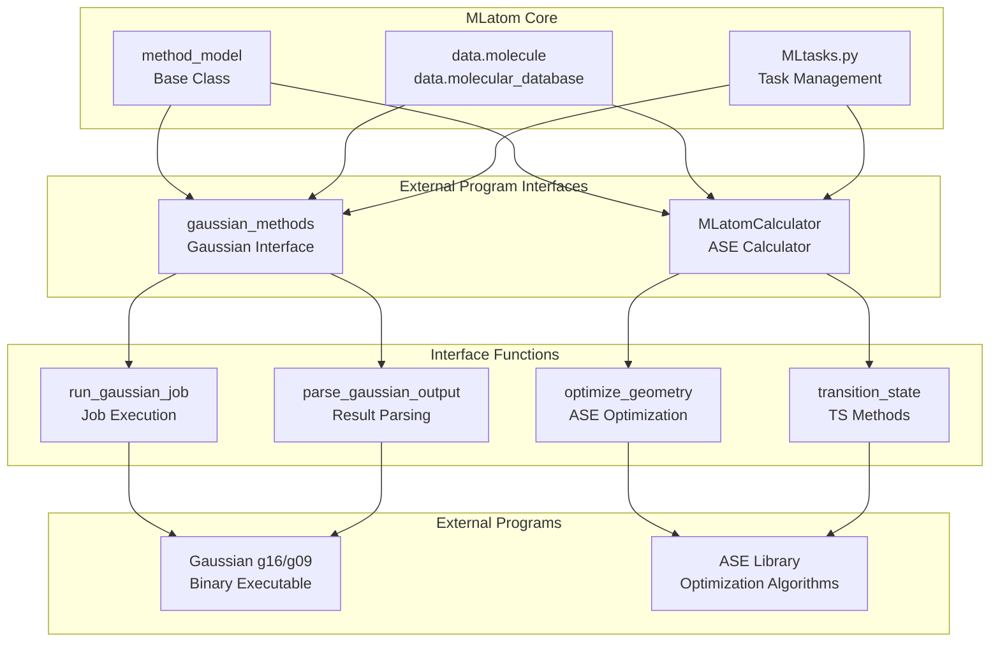
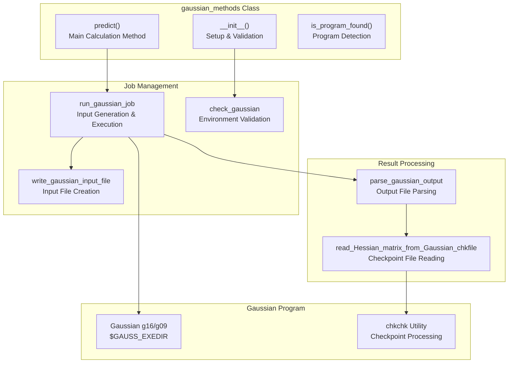
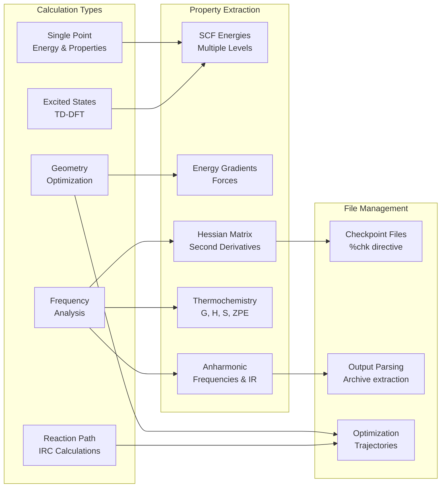
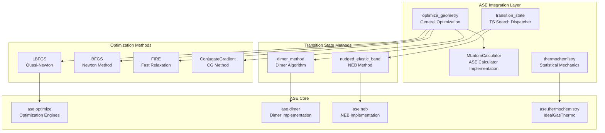
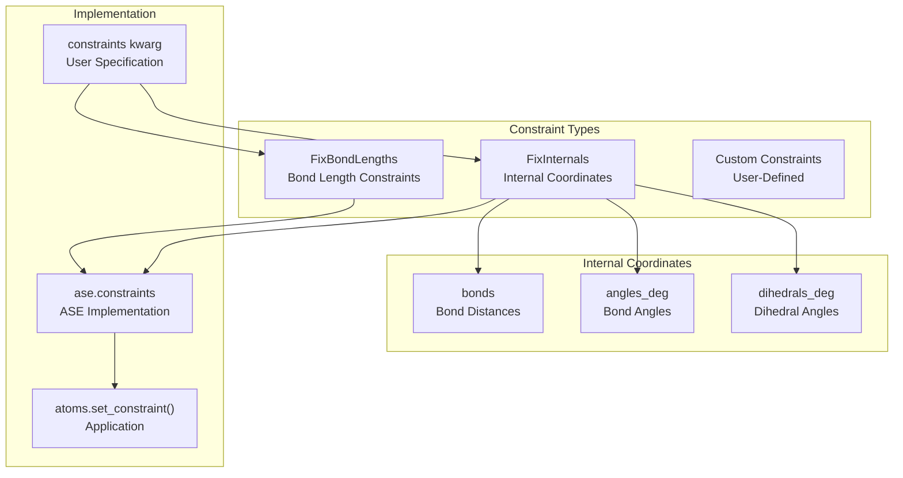
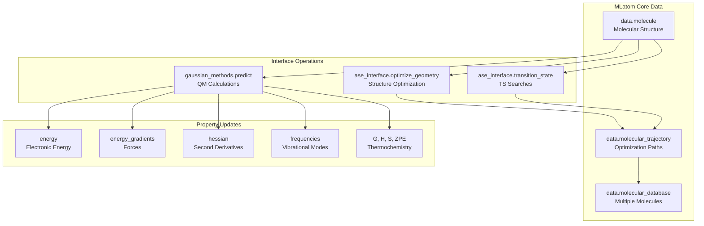

# Gaussian and ASE Interfaces

Relevant source files

The following files were used as context for generating this wiki page:

- [mlatom/interfaces/ase_interface.py](mlatom/interfaces/ase_interface.py)
- [mlatom/interfaces/gaussian_interface.py](mlatom/interfaces/gaussian_interface.py)

This document covers the integration interfaces between MLatom and external quantum chemistry and molecular simulation packages, specifically the Gaussian quantum chemistry program and the Atomic Simulation Environment (ASE) library. These interfaces enable MLatom to leverage external computational engines for quantum mechanical calculations and advanced molecular simulations.

For information about other quantum chemistry interfaces like PySCF, see [PySCF Interface](#6.1). For DFTB+ and other interfaces, see [DFTB+ and Other Interfaces](#6.3).

## Interface Architecture Overview

The quantum chemistry and simulation interfaces in MLatom follow a consistent pattern where external programs are wrapped by interface classes that conform to MLatom's model framework.

Sources: [mlatom/interfaces/gaussian_interface.py:1-1035](), [mlatom/interfaces/ase_interface.py:1-261]()

## Gaussian Interface

The Gaussian interface provides comprehensive integration with the Gaussian quantum chemistry package, supporting both single-point calculations and complex workflows.

### Core Components

Sources: [mlatom/interfaces/gaussian_interface.py:18-142]()

### Calculation Types and Features

| Feature | Implementation | Key Parameters |
|---------|---------------|----------------|
| **Single Point Energy** | Direct method specification | `method='B3LYP/6-31G*'` |
| **Geometry Optimization** | External potential interface | `external_task='opt'` |
| **Frequency Analysis** | Harmonic and anharmonic | `calculate_hessian=True` |
| **Excited States** | TD-DFT calculations | `nstates>1`, TD method parsing |
| **Thermochemistry** | Complete property extraction | ZPE, enthalpies, free energies |
| **Forces** | Energy gradient calculations | `calculate_energy_gradients=True` |

Sources: [mlatom/interfaces/gaussian_interface.py:70-112](), [mlatom/interfaces/gaussian_interface.py:143-240]()

### Advanced Features

The Gaussian interface supports sophisticated quantum chemistry workflows:

Sources: [mlatom/interfaces/gaussian_interface.py:322-950]()

## ASE Interface

The ASE interface integrates MLatom models with the Atomic Simulation Environment, enabling advanced molecular simulations and optimization algorithms.

### Architecture

Sources: [mlatom/interfaces/ase_interface.py:23-213]()

### MLatomCalculator Implementation

The `MLatomCalculator` class bridges MLatom models with ASE's calculator interface:

| Method | Purpose | Key Implementation |
|--------|---------|-------------------|
| `__init__()` | Calculator setup | Model storage, trajectory tracking |
| `calculate()` | Energy/forces computation | Model prediction, unit conversion |
| `implemented_properties` | Supported properties | `['energy', 'forces']` |

The calculator handles coordinate conversion between ASE atoms objects and MLatom molecules through temporary XYZ files.

Sources: [mlatom/interfaces/ase_interface.py:172-213]()

### Constrained Optimization

The ASE interface supports various geometric constraints:

Sources: [mlatom/interfaces/ase_interface.py:42-68]()

### Transition State Methods

The interface provides two primary transition state search methods:

#### Dimer Method
- **Purpose**: Local transition state optimization
- **Implementation**: Uses `ase.dimer.DimerControl` and `MinModeAtoms`
- **Key Features**: Random seed control, displacement calculations
- **Usage**: Single saddle point searches

#### Nudged Elastic Band (NEB)
- **Purpose**: Reaction pathway and transition state finding
- **Implementation**: Uses `ase.neb.NEB` with interpolated images
- **Key Features**: Multiple image optimization, pathway visualization
- **Usage**: Connecting reactants to products via minimum energy path

Sources: [mlatom/interfaces/ase_interface.py:91-169]()

## Integration with MLatom Core Systems

Both interfaces integrate seamlessly with MLatom's core data structures and task management:

Sources: [mlatom/interfaces/gaussian_interface.py:84-142](), [mlatom/interfaces/ase_interface.py:32-89]()

## Usage Patterns and Workflows

### Gaussian Workflow
1. **Initialization**: Set up `gaussian_methods` with method specification
2. **Environment Check**: Validate `GAUSS_EXEDIR` environment variable
3. **Job Execution**: Generate input files, run calculations, parse outputs
4. **Result Integration**: Update molecule objects with computed properties

### ASE Workflow  
1. **Calculator Setup**: Create `MLatomCalculator` with MLatom model
2. **Geometry Conversion**: Convert between MLatom molecules and ASE atoms
3. **Optimization/Search**: Run ASE algorithms with trajectory tracking
4. **Result Extraction**: Update MLatom data structures with optimized geometries

Both interfaces maintain full compatibility with MLatom's task management system and can be invoked through the standard CLI or programmatic interfaces.

Sources: [mlatom/interfaces/gaussian_interface.py:38-61](), [mlatom/interfaces/ase_interface.py:23-89]()

---