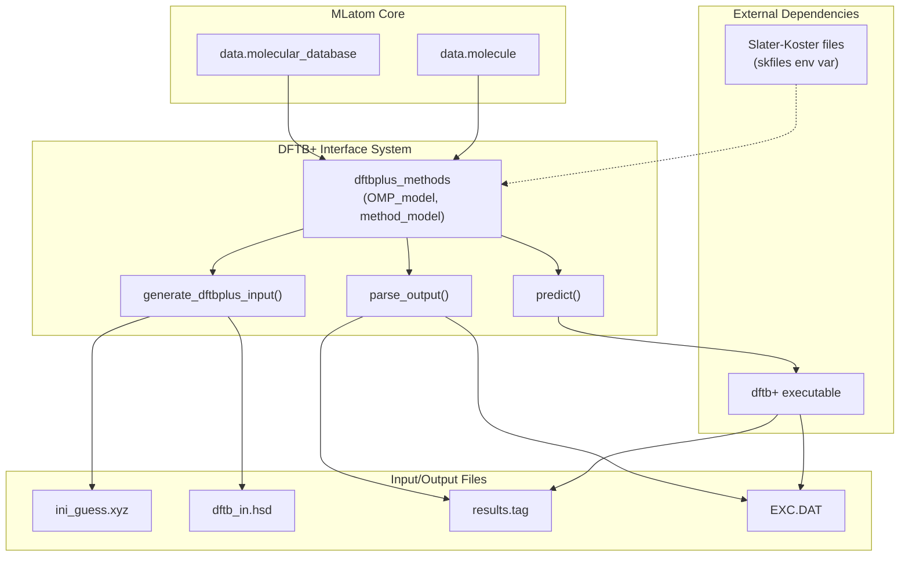
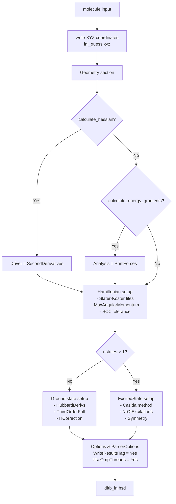
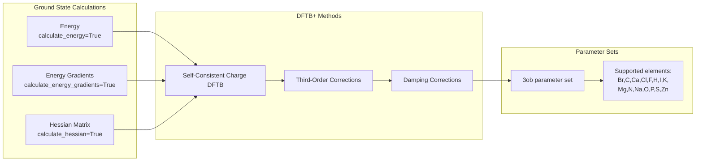
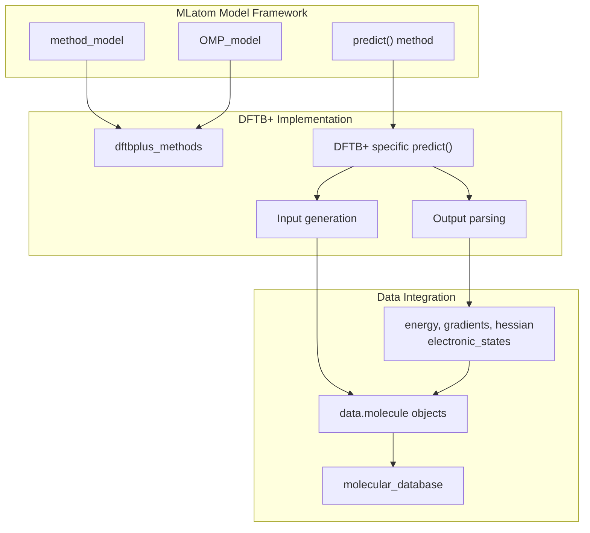

# DFTB+ and Other Interfaces

Relevant source files

The following files were used as context for generating this wiki page:

- [mlatom/interfaces/__init__.py](mlatom/interfaces/__init__.py)
- [mlatom/interfaces/dftbplus_interface.py](mlatom/interfaces/dftbplus_interface.py)

This document covers the DFTB+ interface implementation in MLatom and briefly discusses additional quantum chemistry program interfaces. The DFTB+ interface provides access to density functional tight-binding calculations for molecular properties, energies, gradients, and excited states.

For PySCF interface details, see [PySCF Interface](#6.1). For Gaussian and ASE interfaces, see [Gaussian and ASE Interfaces](#6.2).

## DFTB+ Interface Overview

The DFTB+ interface in MLatom provides seamless integration with the DFTB+ quantum chemistry program through the `dftbplus_methods` class. This interface supports ground state and excited state calculations, including energies, gradients, Hessian matrices, and spectroscopic properties.

### Key Features

The DFTB+ interface supports:
- **Ground state calculations**: Single-point energy and gradient calculations
- **Excited state calculations**: Linear response time-dependent DFTB for electronic excitations
- **Frequency analysis**: Hessian matrix calculations for vibrational frequencies
- **Spectroscopic properties**: Oscillator strengths and excitation energies
- **Multi-threading**: OpenMP parallelization support

Sources: [mlatom/interfaces/dftbplus_interface.py:33-79]()

## DFTB+ Interface Architecture

**DFTB+ Interface Architecture**

Sources: [mlatom/interfaces/dftbplus_interface.py:33-345]()

## Implementation Details

### Class Structure and Initialization

The `dftbplus_methods` class inherits from both `OMP_model` and `method_model`, providing OpenMP threading capabilities and standard method interfaces. The class initialization handles program detection and Slater-Koster file location:

| Parameter | Description | Default |
|-----------|-------------|---------|
| `method` | DFTB method specification | "DFTB" |
| `nthreads` | Number of OpenMP threads | CPU count |
| `save_files_in_current_directory` | File output location | True |
| `working_directory` | Custom working directory | None |
| `scf_tolerance` | SCF convergence threshold | Auto-set |

The interface requires the `dftb+` executable and Slater-Koster parameter files accessible via the `skfiles` environment variable.

Sources: [mlatom/interfaces/dftbplus_interface.py:60-79]()

### Input File Generation

**DFTB+ Input Generation Workflow**

The input generation process creates a complete DFTB+ input file based on molecular structure and calculation requirements. Key components include geometry specification, Hamiltonian setup with appropriate Slater-Koster files, and calculation-specific options.

Sources: [mlatom/interfaces/dftbplus_interface.py:97-190]()

### Output Parsing and Property Extraction

The output parsing system extracts molecular properties from DFTB+ result files:

| Property | Source File | Processing |
|----------|-------------|------------|
| Energy | `results.tag` | Direct extraction |
| Forces/Gradients | `results.tag` | Unit conversion to Hartree/Bohr |
| Hessian | `results.tag` | Matrix reshaping and unit conversion |
| Excitation Energies | `EXC.DAT` | eV to Hartree conversion |
| Oscillator Strengths | `EXC.DAT` | Direct extraction |

For excited state calculations, the parser creates electronic state objects with appropriate energy assignments and property distributions.

Sources: [mlatom/interfaces/dftbplus_interface.py:192-280]()

## Supported Calculations

### Ground State Properties

The interface supports comprehensive ground state property calculations:

**Ground State Calculation Methods**

Sources: [mlatom/interfaces/dftbplus_interface.py:143-156]()

### Excited State Calculations

For multi-state calculations (`nstates > 1`), the interface employs linear response time-dependent DFTB:

- **Casida approach**: Diagonalization of the response matrix
- **Symmetry handling**: Singlet and triplet state support
- **State-specific properties**: Forces and energies for individual excited states
- **Transition properties**: Oscillator strengths and transition dipole moments

Sources: [mlatom/interfaces/dftbplus_interface.py:158-180]()

## Integration with MLatom Framework

The DFTB+ interface integrates seamlessly with MLatom's model framework through inheritance and standardized prediction methods:

**Integration with MLatom Model Framework**

The interface supports batch processing through `molecular_database` objects and provides standardized property assignment to `molecule` objects.

Sources: [mlatom/interfaces/dftbplus_interface.py:281-345]()

## Other Quantum Chemistry Interfaces

While this document focuses primarily on the DFTB+ interface, MLatom's quantum chemistry interface ecosystem includes several other programs accessible through the broader interface system. These interfaces follow similar patterns of input generation, external program execution, and output parsing.

The interfaces directory structure suggests a modular approach where each quantum chemistry program has its dedicated interface module following consistent design patterns established in the model framework.

Sources: [mlatom/interfaces/__init__.py:1]()

## Usage and Error Handling

The DFTB+ interface includes comprehensive error checking for program availability and parameter file access. The `is_program_found()` class method validates both executable availability and Slater-Koster file accessibility before calculations proceed.

Key validation points:
- DFTB+ executable detection via `shutil.which()`
- Slater-Koster file directory validation
- Element support verification against parameter sets
- SCF convergence threshold validation for different calculation types

Sources: [mlatom/interfaces/dftbplus_interface.py:80-96]()

---