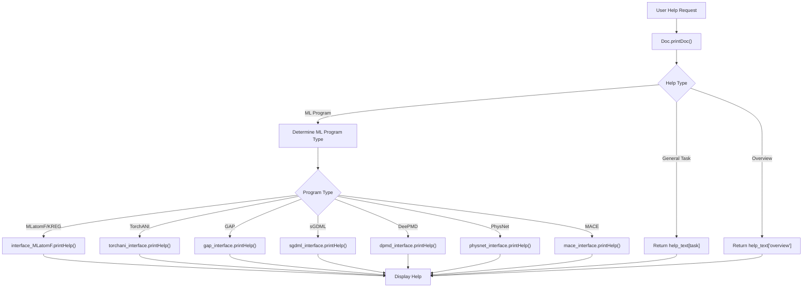
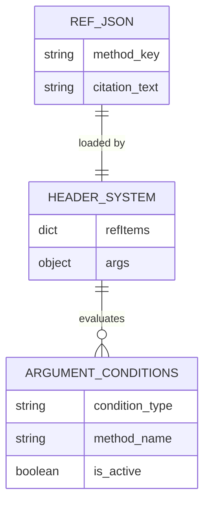
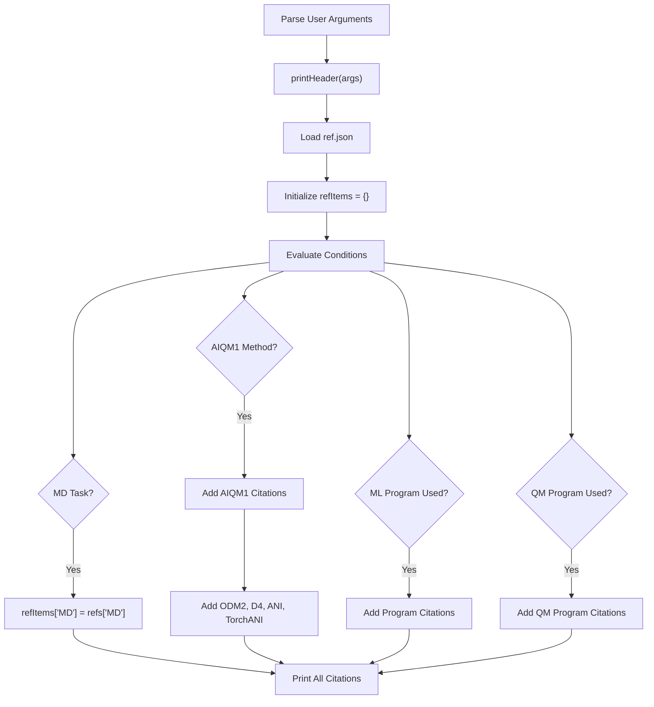

# Documentation and Support

<details>
<summary>Relevant source files</summary>

The following files were used as context for generating this wiki page:

- [mlatom/doc.py](mlatom/doc.py)
- [mlatom/header.py](mlatom/header.py)
- [mlatom/md.py](mlatom/md.py)
- [mlatom/ref.json](mlatom/ref.json)

</details>


This page covers MLatom's comprehensive documentation and support infrastructure, including the help system, automatic citation management, and developer resources. The system provides context-sensitive help for users and automatically manages scientific citations for all features used in calculations.

For information about the command-line interface and task management, see [Command Line Interface](#3). For details about specific calculation methods, see the relevant sections on [Machine Learning Systems](#4), [Molecular Simulations](#5), and [Quantum Chemistry Interfaces](#6).

## Help System Architecture

MLatom's help system is built around a centralized documentation framework that provides detailed usage information for all features and commands.

### Core Documentation Classes

```mermaid
classDiagram
    class Doc {
        +printDoc(argdict)
        +help_text: dict
        +molDescriptorDoc: str
        +Default_MLprog_type: str
    }
    
    class "Header System" {
        +printHeader(args)
        +load_references()
        +determine_citations()
    }
    
    class "Interface Help" {
        +MLatomF.printHelp()
        +torchani_interface.printHelp()
        +gap_interface.printHelp()
        +sgdml_interface.printHelp()
        +dpmd_interface.printHelp()
        +physnet_interface.printHelp()
        +mace_interface.printHelp()
    }
    
    Doc --> "Interface Help" : "delegates to"
    "Header System" --> "ref.json" : "loads from"
```

**Title**: MLatom Documentation System Architecture

The [`Doc`]() class in [`mlatom/doc.py`]() serves as the central hub for all documentation requests. It maintains a comprehensive `help_text` dictionary containing detailed usage instructions for every major MLatom feature.

Sources: [mlatom/doc.py:11-67]()

### Help Text Organization

The help system organizes documentation into several categories:

| Category | Description | Examples |
|----------|-------------|----------|
| **ML Tasks** | Machine learning workflows | `createMLmodel`, `useMLmodel`, `estAccMLmodel` |
| **General Methods** | Pre-built calculation methods | `AIQM1`, `ANI-1ccx`, `GFN2-xTB` |
| **Data Tasks** | Data processing and analysis | `XYZ2X`, `analyze`, `sample` |
| **Simulations** | Molecular dynamics and optimization | `MD`, `geomopt`, `freq` |
| **Advanced Features** | Specialized capabilities | `crossSection`, `MLTPA`, `MLQD` |

Sources: [mlatom/doc.py:150-961]()

### Context-Sensitive Help Routing



**Title**: Context-Sensitive Help Request Flow

The system intelligently routes help requests to the appropriate documentation source based on the `MLprog` or `MLmodelType` specified by the user.

Sources: [mlatom/doc.py:22-61]()

## Citation Management System

MLatom automatically manages scientific citations to ensure proper attribution for all methods and programs used in calculations.

### Reference Database Structure

The citation system is built around a JSON reference database that maps method identifiers to their corresponding citations:



**Title**: Citation Management Data Structure

The [`ref.json`]() file contains over 50 scientific references, each associated with specific methods, programs, or techniques:

```json
{
    "AIQM1": "P. Zheng, R. Zubatyuk, W. Wu, O. Isayev, P.O. Dral,\nNat. Commun. 2021, 12, 7022",
    "TorchANI": "X. Gao, F. Ramezanghorbani, O. Isayev, J. S. Smith, A. E. Roitberg,\nJ. Chem. Inf. Model. 2020, 60, 3408"
}
```

Sources: [mlatom/ref.json:1-55]()

### Automatic Citation Detection



**Title**: Automatic Citation Detection and Assembly Flow

The [`printHeader`]() function in [`mlatom/header.py`]() analyzes the user's arguments and automatically determines which citations are required based on the features being used.

Sources: [mlatom/header.py:5-241]()

### Citation Categories

The system tracks citations across multiple categories:

| Category | Examples | Trigger Conditions |
|----------|----------|-------------------|
| **ML Methods** | ANI, MACE, sGDML | `MLprog`, `MLmodelType` arguments |
| **QM Programs** | PySCF, Gaussian, Sparrow | `QMprog` argument |
| **AI-QM Methods** | AIQM1, ODM2 | `method` argument |
| **Specialized Tasks** | ML-NEA, MLTPA | `crossSection`, `MLTPA` flags |
| **Optimization** | hyperopt, TPE | hyperopt usage detected |

Sources: [mlatom/header.py:48-142]()

## Available Documentation Types

### Task-Specific Documentation

Each major MLatom task has comprehensive documentation including usage syntax, required arguments, optional parameters, and examples:

```mermaid
mindmap
  root)Documentation Types(
    ML Tasks
      createMLmodel
      useMLmodel
      estAccMLmodel
      learningCurve
      deltaLearn
    General Methods
      AIQM1
      ANI variants
      GFN2-xTB
      CCSD(T)*/CBS
    Simulations
      geomopt
      freq
      MD
      MLQD
    Data Processing
      XYZ2X
      analyze
      sample
      slice
    Advanced Features
      crossSection
      MLTPA
      hyperopt
```

**Title**: MLatom Documentation Coverage Map

Each documentation entry follows a consistent structure:
- **Usage**: Command syntax and patterns
- **Arguments**: Required and optional parameters
- **Output**: Expected results and file formats  
- **Examples**: Working command-line examples

Sources: [mlatom/doc.py:150-961]()

### Interface-Specific Documentation

MLatom provides specialized documentation for each supported ML program interface:

| Interface | Documentation Location | Key Features |
|-----------|----------------------|--------------|
| **MLatomF** | `interface_MLatomF.printHelp()` | KREG models, kernel options |
| **TorchANI** | `torchani_interface.printHelp()` | ANI model variants |
| **GAP** | `gap_interface.printHelp()` | GAP-SOAP descriptors |
| **sGDML** | `sgdml_interface.printHelp()` | sGDML and GDML models |
| **DeePMD** | `dpmd_interface.printHelp()` | DeepPot-SE and DPMD |
| **MACE** | `mace_interface.printHelp()` | MACE model configuration |

Sources: [mlatom/doc.py:30-56]()

## Help System Usage Patterns

### Command-Line Help Access

Users can access help through several patterns:

```bash
# General help
MLatom.py help

# Task-specific help  
MLatom.py createMLmodel help
MLatom.py geomopt help

# Interface-specific help
MLatom.py MLprog=TorchANI help
MLatom.py MLmodelType=sGDML help
```

### Help Request Processing Flow

```mermaid
sequenceD diagram
    participant U as "User"
    participant CLI as "Command Line"
    participant Doc as "Doc.printDoc()"
    participant Interface as "Interface Help"
    participant Output as "Terminal Output"
    
    U->>CLI: "MLatom.py createMLmodel help"
    CLI->>Doc: "argdict={'createMLmodel': True, 'help': True}"
    Doc->>Doc: "Search help_text for 'createMLmodel'"
    Doc->>Output: "Print help_text['createMLmodel']"
    
    U->>CLI: "MLatom.py MLprog=TorchANI help"  
    CLI->>Doc: "argdict={'MLprog': 'TorchANI', 'help': True}"
    Doc->>Interface: "torchani_interface.printHelp()"
    Interface->>Output: "Print TorchANI-specific help"
```

**Title**: Help System Request Processing Sequence

The system processes help requests by matching argument patterns and routing to appropriate documentation sources.

Sources: [mlatom/doc.py:22-66]()

## Developer Documentation Support

### Molecular Descriptor Documentation

The system includes reusable documentation components for complex topics like molecular descriptors:

```python
molDescriptorDoc = '''
  Optional arguments specifying descriptor:
    molDescriptor=S            molecular descriptor S
      RE [default]             vector {Req/R}, where R is internuclear distance
      CM                       Coulomb matrix
    molDescrType=S             type S of molecular descriptor
      sorted                   default for molDescrType=CM
      unsorted                 default for molDescrType=RE
      permuted                 molecular descriptor with all atom permutations
'''
```

This documentation component is reused across multiple help entries that involve molecular descriptors.

Sources: [mlatom/doc.py:68-92]()

### ML Program Interface Documentation Template

The system provides a standardized template for documenting ML program interfaces:

| Component | Description |
|-----------|-------------|
| **Program Matrix** | Maps MLmodelType to default MLprog |
| **Supported Models** | Lists available model types per program |
| **Usage Examples** | Shows interface-specific syntax |
| **Cross-References** | Links to related help topics |

Sources: [mlatom/doc.py:94-148]()

### Citation Integration for Developers

The citation system provides a template for adding new methods and ensuring proper attribution:

1. **Add Reference**: Include citation in [`ref.json`]()
2. **Add Condition**: Create detection logic in [`printHeader`]()
3. **Test Coverage**: Ensure citation appears when method is used

This systematic approach ensures that all new features automatically receive proper citation management.

Sources: [mlatom/header.py:5-241](), [mlatom/ref.json:1-55]()