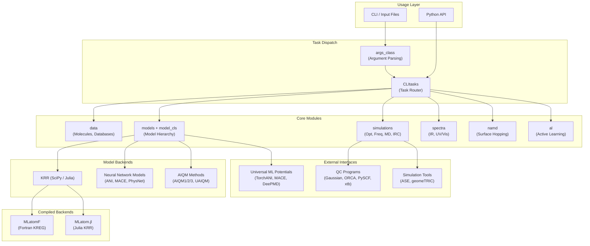

**MLatom** is an open-source Python package for atomistic simulations that unifies machine learning (ML) models with quantum chemical (QC) methods — including DFT, wavefunction-based approaches, and semi-empirical approximations — into a single, coherent workflow. Originally founded by Pavlo O. Dral on 10 September 2013 and currently at version **3.22.0**, MLatom is developed at Xiamen University and commercially supported by [Aitomistic](https://aitomistic.com). It is distributed under a modified MIT license that requests proper citation of the software and its constituent methods in scientific publications.


What makes MLatom distinctive is its ability to serve as a **single entry point** for the full atomistic simulation pipeline: from molecular data management and ML model training, through geometry optimization and molecular dynamics, all the way to spectroscopic predictions and nonadiabatic dynamics on excited-state potential energy surfaces. You interact with it through three complementary usage modes — as a Python library, via declarative input files, or through a command-line interface — each described in detail on the [Usage Modes and Input Files](4-usage-modes-and-input-files) page.

Sources: [MLatom.py](mlatom/MLatom.py#L1-L55), [__init__.py](mlatom/__init__.py#L1-L17), [README.md](README.md#L1-L20)

## What You Can Do with MLatom

MLatom covers a remarkably broad scope of computational chemistry tasks. At the highest level, its capabilities fall into five major pillars:

| Pillar | Key Capabilities | Representative Classes/Functions |
|---|---|---|
| **Machine Learning Models** | Kernel Ridge Regression (KREG), ANI neural networks, PhysNet, MACE, DeePMD, GAP, transfer learning | [`krr`](mlatom/models.py#L17-L82), [`ani`](mlatom/__init__.py#L13), `mace`, `gap_model` |
| **AI-Enhanced QM Methods** | AIQM1, AIQM2, AIQM3, UAIQM, OmniP2x — hybrid ML + semi-empirical/DFT composites | [`aiqm1`](mlatom/aiqm1.py#L18-L60), `aiqm2`, `aiqm3` |
| **Atomistic Simulations** | Geometry optimization, IRC, frequency analysis, molecular dynamics (NVE/NVT), thermochemistry | [`optimize_geometry`](mlatom/simulations.py#L33), [`md`](mlatom/md.py#L27-L60), [`md_parallel`](mlatom/md_parallel.py#L20-L60), [`irc`](mlatom/simulations.py#L33) |
| **Excited-State Dynamics** | Fewest-switches surface hopping (FSSH), LZBL algorithm, nonadiabatic coupling calculations | [`surface_hopping_md`](mlatom/namd.py#L17-L60), [`gap_md`](mlatom/gap_md.py#L35-L50) |
| **Spectroscopy** | IR spectra, Raman spectra, UV/Vis via nuclear ensemble approach (ML-NEA), two-photon absorption | [`spectrum`](mlatom/spectra.py#L17-L45) |

Beyond these pillars, MLatom provides a sophisticated **active learning** framework ([`al`](mlatom/al.py#L15-L80)) that automatically selects which molecular configurations to compute with expensive reference methods, iteratively improving ML model accuracy with minimal quantum chemistry calculations. It also supports **delta-learning** — correcting low-level QM methods with ML — and **composite methods** such as CCSD(T)\*/CBS for high-accuracy single-point energies.

Sources: [__init__.py](mlatom/__init__.py#L1-L17), [namd.py](mlatom/namd.py#L17-L60), [md.py](mlatom/md.py#L17-L60), [spectra.py](mlatom/spectra.py#L17-L45), [al.py](mlatom/al.py#L15-L80)

## High-Level Architecture

MLatom's internal architecture follows a layered design that cleanly separates concerns between data representation, model computation, simulation orchestration, and external program integration. The diagram below illustrates how these layers connect:



The **Usage Layer** provides both a programmatic Python API and a CLI that internally routes through the `args_class` parser and the `CLItasks` dispatcher. The **Core Modules** contain the domain logic: `data` handles molecular representation, `models` and `model_cls` implement the full model hierarchy, `simulations` orchestrates geometry optimization and dynamics, and dedicated modules handle spectroscopy, nonadiabatic dynamics, and active learning. Below that, **Model Backends** implement specific ML algorithms, **External Interfaces** wrap third-party software, and **Compiled Backends** provide high-performance Fortran and Julia implementations for kernel ridge regression.

Sources: [MLtasks.py](mlatom/MLtasks.py#L1-L45), [args_class.py](mlatom/args_class.py#L1-L50), [__init__.py](mlatom/__init__.py#L1-L17)

## Project Structure at a Glance

The repository is organized around the main `mlatom/` Python package, with compiled backends, external interfaces, and add-on models each living in their own subdirectories:

```
mlatom/                          # Main Python package
├── __init__.py                  # Public API exports & version (3.22.0)
├── MLatom.py                    # Entry point: run() function
├── args_class.py                # CLI argument parsing (AttributeDict)
├── MLtasks.py                   # Task dispatch (CLItasks router)
│
├── data.py                      # atom, molecule, molecular_database, ml_database
├── model_cls.py                 # Base model class hierarchy
├── models.py                    # KRR, ANI, AIQM, method wrappers
├── simulations.py               # Geometry optimization, freq, IRC, thermochemistry
├── md.py / md_parallel.py       # Molecular dynamics (serial & parallel)
├── namd.py                      # Nonadiabatic molecular dynamics (FSSH, LZBL)
├── spectra.py                   # Spectrum generation & analysis
├── al.py / al_utils.py          # Active learning pipeline
├── header.py                    # Reference/citation management
│
├── interfaces/                  # External program wrappers
│   ├── gaussian_interface.py
│   ├── orca_interface.py
│   ├── pyscf_interface.py
│   ├── xtb_interface.py
│   ├── torchani_interface.py
│   ├── mace_interface.py
│   └── ... (20+ interfaces)
│
├── addons/                      # Specialized models
│   ├── aiqm3/                   # AIQM3 method
│   ├── omnip2x/                 # Multi-state potentials
│   └── uaiqm/                   # Universal updatable AI-QM methods
│
├── MLatomF_src/                 # Fortran backend for KREG
│   ├── MLatomF.f90              # Main Fortran program
│   ├── A_KRR.f90                # Kernel Ridge Regression
│   ├── molDescr.f90             # Molecular descriptors
│   └── ...
│
├── julia/                       # Julia backend for KRR
│   ├── KREG.jl / krr.jl
│   └── ...
│
└── fortran/                     # Additional Fortran utilities
```

Sources: [__init__.py](mlatom/__init__.py#L1-L17), [args_class.py](mlatom/args_class.py#L1-L50), [MLtasks.py](mlatom/MLtasks.py#L1-L45)

## Key Design Principles

Several architectural decisions shape how MLatom works in practice. Understanding these will help you navigate the codebase and use the package effectively.

**Three usage paradigms coexist.** Every capability in MLatom can be accessed through the Python API (for programmatic control and Jupyter workflows), through declarative input files (for reproducible batch jobs), or via the command line (for quick scripting). The `CLItasks` class in [MLtasks.py](mlatom/MLtasks.py#L17-L45) acts as a router that translates CLI arguments into the same internal function calls used by the Python API, ensuring consistent behavior across all modes.

**A unified model abstraction.** All computational methods — whether they are pure ML models (KRR, ANI), hybrid AI-QM methods (AIQM1/2/3), external QC programs (Gaussian, ORCA), or even composite schemes like CCSD(T)\*/CBS — implement a common `predict()` interface defined in the base [`model`](mlatom/model_cls.py#L21-L65) class. This means you can swap a DFT calculation for a neural network potential without changing your simulation code.

**Multilingual compute backends.** Performance-critical kernel ridge regression is available through three backends: a Fortran implementation ([MLatomF_src/](mlatom/MLatomF_src/)), a Julia implementation ([julia/](mlatom/julia/)), and a pure-Python/SciPy implementation. The system automatically selects the appropriate backend based on configuration, with the Fortran backend serving as the historical default for KREG models.

**Automatic reference tracking.** MLatom's `header` module ([header.py](mlatom/header.py#L1-L200)) automatically detects which methods, models, and external programs you use and prints the corresponding scientific citations. This is driven by a JSON reference database ([ref.json](mlatom/ref.json)) and ensures that all relevant work is properly acknowledged.

> [!TIP]
> The `methods()` factory function (imported from `mlatom.models`) is the simplest way to instantiate any computational method. For example, `ml.methods(method='AIQM1')` or `ml.methods(method='AIQM2', qm_program='xtb')` automatically configures the correct class with sensible defaults, abstracting away the complexity of the model hierarchy.

> [!TIP]
> Active learning ([al.py](mlatom/al.py#L15-L80)) is one of MLatom's most powerful features. It automatically identifies which molecular configurations need expensive reference calculations, iteratively building accurate ML models with minimal computational cost. This is especially valuable when exploring conformational spaces or training reactive potential energy surfaces.

## Quick Installation

MLatom installs as a standard Python package with a single command:

```bash
python3 -m pip install -U mlatom
```

Some features — particularly those involving external quantum chemistry programs (Gaussian, ORCA, MNDO/Sparrow, xtb), neural network potentials (TorchANI, MACE, DeePMD), or the Fortran backend — require additional dependencies. The [Installation and Dependencies](3-installation-and-dependencies) page provides a comprehensive guide to configuring these optional components.

## Where to Go Next

This overview has introduced MLatom's scope and architecture. Depending on your goal, the following pages are the natural next steps in your reading journey:

- **[Quick Start](2-quick-start)** — Run your first MLatom calculation in under five minutes, with minimal prerequisites
- **[Installation and Dependencies](3-installation-and-dependencies)** — Set up MLatom with all optional backends and external programs
- **[Usage Modes and Input Files](4-usage-modes-and-input-files)** — Understand the three ways to interact with MLatom (Python API, input files, CLI)
- **[Architecture Overview](5-architecture-overview)** — Deep dive into the internal design, module relationships, and data flow patterns

For users who want to jump straight into specific capabilities, the catalog's **Deep Dive** sections cover each subsystem in detail — from the [Molecule and Atom Classes](6-molecule-and-atom-classes) at the foundation, through [Model Class Hierarchy](9-model-class-hierarchy) and [Molecular Dynamics Engine](19-molecular-dynamics-engine), to advanced topics like [Active Learning Pipeline](24-active-learning-pipeline) and [Nonadiabatic and Surface-Hopping Dynamics](20-nonadiabatic-and-surface-hopping-dynamics).