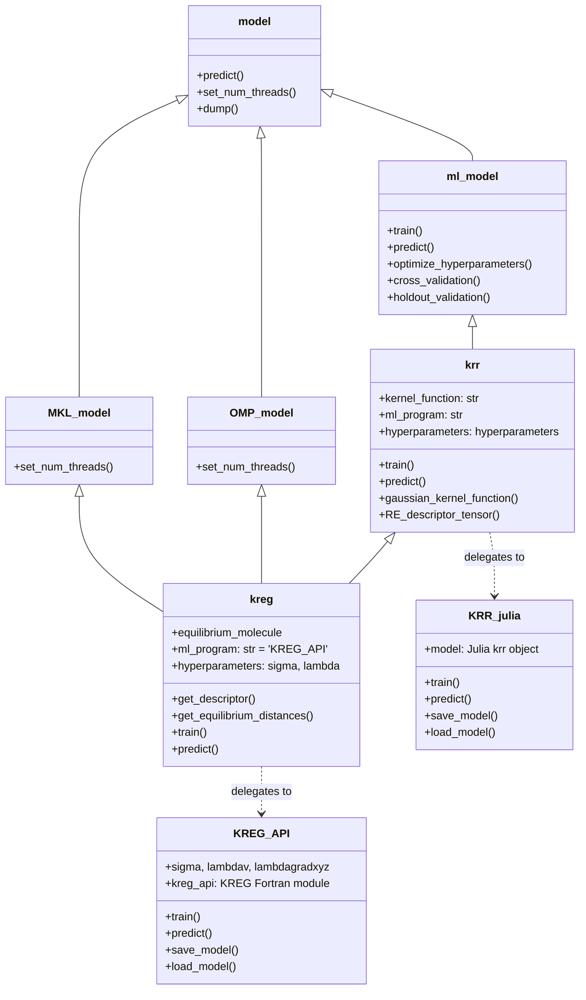
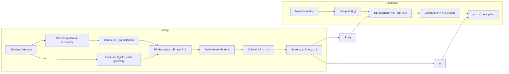

Kernel Ridge Regression (KRR) is a foundational machine learning method in MLatom for constructing molecular machine learning potentials and property predictors. MLatom provides two tightly integrated classes—`krr` for general-purpose kernel regression and `kreg` for molecular potentials built on the RE (Reverse Equilibrium) descriptor—each with multiple computational backends ranging from pure Python to high-performance Fortran compiled via NumPy bindings. This page documents their architecture, supported kernels, gradient learning, and backend strategies.

## Class Hierarchy and Architectural Overview

The KRR subsystem is built on two classes defined in [models.py](mlatom/models.py#L18-L555) that share a clear division of labor. The base class `krr` provides a generic kernel ridge regression implementation, while the specialized subclass `kreg` extends it with molecular-specific functionality: the RE descriptor, OMP (OpenMP) threading support, and MKL (Intel Math Kernel Library) acceleration through the `OMP_model` and `MKL_model` mixin classes from [model_cls.py](mlatom/model_cls.py#L163-L169).

The `kreg` class inherits from both `krr` (for regression logic) and `OMP_model`/`MKL_model` (for thread control), giving it access to the Fortran backend's parallel capabilities. When the `ml_program` parameter is set to `'KREG_API'`, the class delegates computation to the `KREG_API` wrapper in [kreg_api.py](mlatom/kreg_api.py#L11-L178), which interfaces with the compiled Fortran module in [KREG.f90](mlatom/fortran/KREG.f90#L1-L665).

## Supported Kernel Functions and Hyperparameters

The `krr` class supports four kernel functions, each with its own set of hyperparameters registered at initialization time in [models.py](mlatom/models.py#L50-L73):

| Kernel Function | Hyperparameters | Description |
|---|---|---|
| `Gaussian` | `sigma`, `lambda` | Standard radial basis function; `sigma` controls the kernel width (bandwidth) |
| `periodic_Gaussian` | `sigma`, `lambda`, `period` | Gaussian kernel with periodicity for angular/cyclic coordinates |
| `decaying_periodic_Gaussian` | `sigma`, `lambda`, `period`, `sigmap` | Periodic Gaussian with an additional decay envelope controlled by `sigmap` |
| `Matern` | `sigma`, `lambda`, `nn` | Matern family kernel; `nn` is the smoothness order (default 2) |

All hyperparameters are encapsulated as `hyperparameter` objects from [model_cls.py](mlatom/model_cls.py#L856-L905), carrying optimization metadata such as `minval`, `maxval`, and `optimization_space` (log or linear). The regularization parameter `lambda` (spelled `lambdav` in Fortran contexts) is always present with a default value of 2⁻³⁵ and a log-scale optimization range from 2⁻³⁵ to 1.0, as defined in [models.py](mlatom/models.py#L51-L58).

> [!TIP]
> The `kreg` subclass declares its own class-level `hyperparameters` at [models.py](mlatom/models.py#L354-L363) containing only `lambda` and `sigma`. This class-level definition serves as the default set, but instance-level `__init__` merges any user-provided hyperparameters via `self.hyperparameters.update(hyperparameters)`, so additional keys like `lambdaGradXYZ` can be injected at construction time.

## Backend Strategies: scipy, mlatom.jl, KREG_API, and MLatomF

MLatom routes KRR computation to one of four backends, selected via the `ml_program` constructor parameter. Each backend has distinct capabilities and trade-offs:

| Backend | `ml_program` value | Kernel functions | Gradient learning | Hessian | Threading | Implementation |
|---|---|---|---|---|---|---|
| SciPy | `'scipy'` | Gaussian (analytic derivatives via PyTorch) | ✓ (joint value+gradient) | ✗ | Single-threaded | Pure Python + SciPy/PyTorch |
| Julia | `'mlatom.jl'` | Gaussian, periodic_Gaussian, decaying_periodic_Gaussian, Matern | ✗ (values only) | ✗ | Julia threads | Julia via PyJulia |
| KREG API | `'KREG_API'` | Gaussian (RE descriptor) | ✓ (joint value+gradient) | ✓ | OpenMP | Fortran f2py + MKL/LAPACK |
| MLatomF | `'MLatomF'` | Gaussian (RE descriptor) | ✓ | ✓ | Varies | Standalone Fortran process |

### SciPy Backend

When `ml_program='scipy'`, the `krr.train()` method constructs the kernel matrix entirely in Python, starting at [models.py](mlatom/models.py#L157-L221). It subtracts the prior from training labels, builds the kernel matrix by evaluating the kernel function pairwise across all training geometries, adds the regularization term λ·I to the diagonal, then solves the linear system **Kα = y** using either Cholesky or LU decomposition from `scipy.linalg`. The default strategy tries Cholesky first and falls back to LU if the matrix is not positive definite—a pattern mirrored in the Fortran backend's `solveSysLinEqs` at [mathUtils.f90](mlatom/fortran/mathUtils.f90#L8-L33).

For gradient learning under the scipy backend, the kernel matrix is extended to include both energy and force blocks. The matrix dimension becomes `N_train + 3 × N_atoms × N_train`, with cross-terms encoding the kernel derivatives with respect to nuclear coordinates. These analytic derivatives are computed using PyTorch's autograd in the `gaussian_kernel_function` method at [models.py](mlatom/models.py#L286-L319), which leverages automatic differentiation through the RE descriptor computation in `RE_descriptor_tensor` at [models.py](mlatom/models.py#L321-L333).

### KREG_API Backend (Fortran via f2py)

The `KREG_API` class in [kreg_api.py](mlatom/kreg_api.py#L11-L178) wraps a compiled Fortran module that provides the highest performance for molecular potential construction. It selects the correct NumPy-version-specific binary at import time—either `fortran.np1.KREG` or `fortran.np2.KREG` based on the major NumPy version—in [kreg_api.py](mlatom/kreg_api.py#L6-L9).

The Fortran kernel in [KREG.f90](mlatom/fortran/KREG.f90#L1-L665) implements the full KREG workflow: RE descriptor computation, kernel matrix assembly with analytic value and gradient covariances, regression coefficient calculation, and prediction of energies, gradients (forces), and Hessians. Key functions include:

- **`kernel()`** at [KREG.f90](mlatom/fortran/KREG.f90#L87-L95): The Gaussian kernel `exp(-d²/(2σ²))` computed over RE descriptor space
- **`calc_RE_descriptors()`** at [KREG.f90](mlatom/fortran/KREG.f90#L257-L271): Batch computation of RE descriptors `R_eq/R_ij` for all training geometries
- **`calc_kernel_matrix()`** at [KREG.f90](mlatom/fortran/KREG.f90#L293-L346): Full kernel matrix assembly including value-value, value-gradient, and gradient-gradient covariances, with OpenMP parallelization (`!$OMP PARALLEL DO`)
- **`calcAlpha()`** at [KREG.f90](mlatom/fortran/KREG.f90#L598-L627): Solves the regularized linear system using LAPACK's Cholesky (`dpotrf`/`dpotrs`) with Bunch-Kaufman fallback (`dsytrf`/`dsytrs`) via [mathUtils.f90](mlatom/fortran/mathUtils.f90#L24-L31)
- **`predict()`** at [KREG.f90](mlatom/fortran/KREG.f90#L534-L596): Predicts energies, forces, and Hessians for new geometries with OpenMP parallelization over prediction points

> [!TIP]
> The Fortran backend uses separate regularization parameters for values (`lambdav`) and gradients (`lambdagradxyz`), applied independently to the diagonal blocks of the augmented kernel matrix in `calcAlpha()` at [KREG.f90](mlatom/fortran/KREG.f90#L617-L622). The `kreg` class maps its `lambda` hyperparameter to `lambdav` by default, but supports an optional `lambdaGradXYZ` key in the hyperparameters dict at [models.py](mlatom/models.py#L508-L509).

### Julia Backend

The Julia backend is accessible through two code paths. For the general `krr` class, the `KRR_julia` wrapper in [krr_julia.py](mlatom/krr_julia.py#L8-L97) loads the Julia implementation from [julia/krr.jl](mlatom/julia/krr.jl) and supports all four kernel functions (Gaussian, periodic Gaussian, decaying periodic Gaussian, Matern). For the molecular `kreg` class, the `KREG_julia` wrapper in [julia/kreg_julia.py](mlatom/julia/kreg_julia.py#L13-L234) loads the mirror implementation in [julia/KREG.jl](mlatom/julia/KREG.jl#L1-L247), which implements the identical RE descriptor and gradient kernel functions as the Fortran version. Both wrappers use `PyJulia` (`julia.Main`) for cross-language invocation.

## RE Descriptor: The Molecular Representation

The **RE descriptor** (Reverse Equilibrium descriptor) is the core molecular representation used by the `kreg` class. For a molecule with N atoms, it produces a vector of dimension N(N−1)/2, where each element is the ratio of an equilibrium interatomic distance to the current interatomic distance:

**RE_ij = R_eq_ij / R_ij**

This descriptor provides translational and rotational invariance by construction, and its derivatives with respect to nuclear coordinates are analytically computable—essential for force learning. The descriptor is computed in the Fortran backend by the `RE_descriptor` subroutine at [KREG.f90](mlatom/fortran/KREG.f90#L241-L255), using a precomputed atom-pair index array `ac2dArray` that maps atom indices to descriptor vector indices.

The equilibrium geometry can be provided explicitly via the `equilibrium_molecule` constructor argument, or automatically selected as the geometry with the lowest energy (or lowest `y` value) from the training database, as implemented in `get_equilibrium_molecule()` at [models.py](mlatom/models.py#L447-L457).

## Training Workflow

The training workflow diverges depending on the selected backend. The `krr.train()` method at [models.py](mlatom/models.py#L76-L223) handles the `scipy` and `mlatom.jl` paths, while `kreg.train()` at [models.py](mlatom/models.py#L459-L521) adds the `KREG_API` and `MLatomF` paths. The common steps are:

1. **Data extraction**: Load xyz coordinates, descriptors, and target properties from the molecular database
2. **Prior subtraction**: Subtract the prior value (default 0.0, or `'mean'` for the training set mean) from reference values at [models.py](mlatom/models.py#L107-L125)
3. **Kernel matrix construction**: Compute the kernel matrix, optionally augmented with gradient blocks
4. **Linear system solution**: Solve (K + λI)α = y for regression coefficients
5. **Model persistence**: Save the model to an `.npz` file (scipy/Julia) or `.unf` file (MLatomF)

For the KREG_API backend, step 3 is delegated entirely to the Fortran `train` subroutine at [KREG.f90](mlatom/fortran/KREG.f90#L495-L532), which internally handles descriptor computation, kernel matrix assembly, and coefficient calculation. The Julia backend follows a similar delegation pattern through `KRR_julia.train()` at [krr_julia.py](mlatom/krr_julia.py#L13-L46).

## Prediction and Gradient Computation

Prediction follows the standard KRR formula: **y\*(x) = Σᵢ αᵢ K(x, xᵢ) + prior**. For models trained with gradients, the prediction formula extends to include gradient-weighted kernel terms, enabling analytic force prediction without numerical differentiation.

The `kreg.predict()` method at [models.py](mlatom/models.py#L523-L552) dispatches to the appropriate backend. The Fortran backend's `predict` subroutine at [KREG.f90](mlatom/fortran/KREG.f90#L534-L596) can simultaneously compute energies, forces, and full Hessians in a single call, with OpenMP parallelization over prediction points. The scipy backend iterates over molecules in Python at [models.py](mlatom/models.py#L258-L281), computing kernel vectors and their derivatives via PyTorch autograd.

## Prior Function

The prior acts as a baseline value subtracted during training and added back during prediction. Supported prior types are defined in [models.py](mlatom/models.py#L107-L125):

| Prior value | Behavior |
|---|---|
| `None` / `0` | Zero prior (raw regression) |
| `'mean'` | Mean of training target values |
| Float/Int | User-specified constant |
| NumPy array | 1-D array of per-property priors |

Both the Python (`krr`) and Fortran (`KREG_API`) backends implement prior handling during training at [models.py](mlatom/models.py#L107-L125) and [kreg_api.py](mlatom/kreg_api.py#L55-L62) respectively.

## Model Serialization

All Python-accessible backends use NumPy's `.npz` format for model persistence. The `KREG_API.save_model()` at [kreg_api.py](mlatom/kreg_api.py#L134-L150) stores sigma, Natoms, Xsize, RE descriptors, equilibrium distances, and regression coefficients. The `KRR_julia.save_model()` at [krr_julia.py](mlatom/krr_julia.py#L53-L66) additionally stores kernel type metadata and kernel-specific parameters. The MLatomF backend uses a proprietary `.unf` (unformatted Fortran) binary format via the `MLatomF` standalone executable interface.

## Navigating Further

- For the broader model class hierarchy that `krr` and `kreg` participate in, see [Model Class Hierarchy](9-model-class-hierarchy)
- To understand how hyperparameters like `sigma` and `lambda` are optimized, see [Hyperparameter Optimization](12-hyperparameter-optimization)
- For molecular databases that feed into KRR training, see [Molecular Database Management](7-molecular-database-management)
- For the Fortran backend internals beyond KRR, see [Fortran Backend MLatomF](28-fortran-backend-mlatomf)