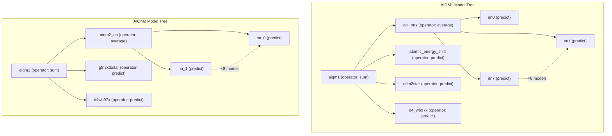

This page documents MLatom's family of **Artificial Intelligence-Quantum Mechanical (AIQM)** methods and the underlying **delta learning** architecture that powers them. AIQM methods are composite computational approaches that combine low-cost quantum mechanics (QM) baselines with neural network corrections, achieving near-CCSD(T) accuracy at semiempirical cost. The implementation centers on a **model tree composition framework** expressed through the `model_tree_node` class, which orchestrates how baseline methods, ML corrections, and dispersion terms are combined.

## The Delta Learning Paradigm

Delta learning is a strategy in which a machine learning model is trained to predict the *difference* between a high-level reference method and a lower-level baseline method, rather than learning absolute properties directly. In MLatom's AIQM family, this manifests as a composite computational pipeline: a semiempirical or density functional baseline provides the bulk of the energy, while an ensemble of neural networks corrects the systematic errors of that baseline. The final prediction is the algebraic sum of all components, including an optional dispersion correction and an atomic energy shift.

The critical architectural insight is that **the user never interacts with the tree structure directly**. Each AIQM class (`aiqm1`, `aiqm2`) assembles its own model tree internally during initialization, and the `predict()` call simply traverses that tree. The `model_tree_node` class in [model_cls.py](mlatom/model_cls.py#L960-L1140) provides the recursive traversal logic, supporting operators such as `'sum'`, `'average'`, `'weighted_sum'`, and `'predict'` (leaf node invocation). Correspondingly, the `properties_tree_node` class in [data.py](mlatom/data.py#L1471-L1524) mirrors this tree structure on the molecular data side, accumulating energy, gradient, and hessian contributions from each child before reducing them with the appropriate operator.

Sources: [model_cls.py](mlatom/model_cls.py#L960-L1140), [data.py](mlatom/data.py#L1471-L1524)

## Model Composition Architecture

The following diagram illustrates how the model tree is structured for both AIQM methods, showing the relationship between the computational components and the operators that combine their outputs:



Both AIQM1 and AIQM2 share the same high-level pattern: an ensemble of neural networks provides the delta correction (averaged to reduce variance), a semiempirical baseline supplies the reference energy, and a D4 dispersion term adds long-range correction. The differences lie in the baseline method and the neural network architecture used.

Sources: [aiqm1.py](mlatom/aiqm1.py#L60-L75), [aiqm2.py](mlatom/aiqm2.py#L94-L99)

## AIQM1: ODM2*-Based Delta Learning

The `aiqm1` class in [aiqm1.py](mlatom/aiqm1.py#L15-L152) implements the original AIQM1 method as described in the [AIQM1 paper](https://doi.org/10.1038/s41467-021-27340-2). It inherits from both `torchani_model` and `method_model`, combining PyTorch-based neural network inference with the generic method dispatch machinery.

### Model Assembly

During initialization, `load_model()` constructs a four-component (or three-component, depending on variant) model tree [aiqm1.py](mlatom/aiqm1.py#L60-L75):

1. **Neural Network Ensemble** — Eight `ani_nns_in_aiqm1` instances are created (indices 0–7), each wrapped in a `model_tree_node` with `operator='predict'`. These are collected under a parent node with `operator='average'`, producing an ensemble-averaged ML correction.
2. **Atomic Energy Shift** — A constant per-element correction applied via the `atomic_energy_shift` class [aiqm1.py](mlatom/aiqm1.py#L153-L188). Different shift values are stored for the CC and DFT training targets.
3. **ODM2* Baseline** — The semiempirical ODM2* method, invoked through the generic `methods()` factory with `program` set to MNDO or Sparrow [aiqm1.py](mlatom/aiqm1.py#L70).
4. **D4 Dispersion** — The DFT-D4 dispersion correction with ωB97X functional, added for AIQM1 and AIQM1@DFT variants but **omitted** for AIQM1@DFT* (the asterisk convention indicates the dispersion term is absent) [aiqm1.py](mlatom/aiqm1.py#L72-L74).

The `@DFT` and `@DFT*` suffixed variants differ in which neural network weights and atomic energy shifts are loaded, corresponding to whether the NN was trained against DFT or CCSD(T) reference data. The `@DFT*` variant further excludes the D4 dispersion term.

### Neural Network Architecture

The `ani_nns_in_aiqm1` class [aiqm1.py](mlatom/aiqm1.py#L190-L335) defines a TorchANI-compatible architecture with element-specific networks for H, C, N, and O. The AEV (Atomic Environment Vector) computation uses the standard TorchANI `AEVComputer` with radial cutoff Rcr = 5.2 Å and angular cutoff Rca = 4.0 Å [aiqm1.py](mlatom/aiqm1.py#L205-L218). Each element has a dedicated feedforward network with GELU activations and element-specific hidden layer widths (H: 160→128→96, C: 144→112→96, N/O: 128→112→96) [aiqm1.py](mlatom/aiqm1.py#L250-L295).

### Supported Methods and Atomic Energies

AIQM1 supports three method variants, each with distinct per-element atomic energy references [aiqm1.py](mlatom/aiqm1.py#L43-L46):

| Method | Training Target | D4 Dispersion | Elements |
|--------|----------------|---------------|----------|
| `AIQM1` | CCSD(T)/CBS | ✓ | H, C, N, O |
| `AIQM1@DFT` | DFT (ωB97X/6-31G*) | ✓ | H, C, N, O |
| `AIQM1@DFT*` | DFT (ωB97X/6-31G*) | ✗ | H, C, N, O |

### Prediction Flow

When `predict()` is called, AIQM1 delegates to the model tree's recursive prediction engine. For single-atom molecules, a special-case path directly returns the stored atomic energy (with an ODM2*-based correction for non-standard charge/multiplicity states) [aiqm1.py](mlatom/aiqm1.py#L104-L115). For multi-atom molecules, the full model tree evaluates all components. After prediction, the standard deviation across the 8 NN ensemble members is computed and stored on the molecule object for uncertainty quantification [aiqm1.py](mlatom/aiqm1.py#L127-L140).

Sources: [aiqm1.py](mlatom/aiqm1.py#L15-L152), [aiqm1.py](mlatom/aiqm1.py#L153-L188), [aiqm1.py](mlatom/aiqm1.py#L190-L335)

## AIQM2: GFN2-xTB*-Based Delta Learning

The `aiqm2` class in [aiqm2.py](mlatom/aiqm2.py#L5-L199) represents the second generation of AIQM methods. It inherits from `method_model` and `downloadable_model`, reflecting its design as a self-contained, downloadable model package.

### Model Assembly

AIQM2's model tree has a simpler three-component structure assembled in the `load()` method [aiqm2.py](mlatom/aiqm2.py#L140-L195):

1. **GFN2-xTB* Baseline** — A semiempirical tight-binding method serving as the baseline, wrapped in a `model_tree_node` with `operator='predict'` [aiqm2.py](mlatom/aiqm2.py#L78-L84).
2. **Neural Network Ensemble** — Eight TorchANI model instances loaded from checkpoint files (`cv0.pt` through `cv7.pt`), wrapped in an `ani_wrapper` that silently removes unsupported prediction kwargs (dipole derivatives, polarizability derivatives), and combined under an `operator='average'` node [aiqm2.py](mlatom/aiqm2.py#L163-L189).
3. **D4 Dispersion** — Same DFT-D4/wB97X dispersion correction as in AIQM1 [aiqm2.py](mlatom/aiqm2.py#L86-L92).

The key architectural difference from AIQM1 is that AIQM2 does **not** include an explicit atomic energy shift component — the NN correction is trained to absorb whatever shifts are necessary. Additionally, AIQM2 provides a reloadable architecture: the `reload_baseline()`, `reload_dispersion()`, and `reload()` methods allow re-initializing individual tree components, which is useful when changing the working directory or reconfiguring external program paths [aiqm2.py](mlatom/aiqm2.py#L78-L99).

### Model Download and Storage

AIQM2 leverages the `downloadable_model` mixin [model_cls.py](mlatom/model_cls.py#L208-L313) for automatic model download from Zenodo and a mirror URL. The `check_model_path()` method first verifies whether model files already exist locally; if not, `download()` fetches and extracts the zip archive [aiqm2.py](mlatom/aiqm2.py#L155-L156). Two model variants exist — CC-trained and DFT-trained — each with its own download URL and model directory [aiqm2.py](mlatom/aiqm2.py#L142-L153).

### Supported Methods

| Method | Training Target | D4 Dispersion | Elements |
|--------|----------------|---------------|----------|
| `AIQM2` | CCSD(T) | ✓ | H, C, N, O |
| `AIQM2@DFT` | DFT | ✓ | H, C, N, O |
| `AIQM2@DFT*` | DFT | ✗ | H, C, N, O |

Sources: [aiqm2.py](mlatom/aiqm2.py#L5-L199), [model_cls.py](mlatom/model_cls.py#L208-L313)

## Model Tree Node: The Composition Engine

The `model_tree_node` class [model_cls.py](mlatom/model_cls.py#L960-L1140) is the structural backbone of all AIQM methods. It implements a tree data structure where each node either wraps a concrete model (leaf) or aggregates child results (branch). The `predict()` method [model_cls.py](mlatom/model_cls.py#L994-L1083) implements recursive depth-first evaluation:

**Leaf nodes** (`self.children is None and self.operator == 'predict'`) invoke the wrapped model's `predict()` directly, then transfer computed properties (energy, energy_gradients, hessian) from the molecule to a `properties_tree_node` attached to the molecule's attribute dictionary.

**Branch nodes** recursively call `predict()` on all children, then apply the specified operator to aggregate results. The `properties_tree_node` class [data.py](mlatom/data.py#L1471-L1524) provides three aggregation methods — `sum()` [L1484-L1492], `average()` [L1506-L1514], and `weighted_sum()` [L1494-L1504] — plus `standard_deviation()` [L1516-L1524] for uncertainty quantification across ensemble members.

> [!TIP]
> The model tree is evaluated **bottom-up**: leaf models compute first, then results bubble up through branch operators. The final molecular properties (energy, gradients, hessian) are only written back to the molecule object at the **root node** level via `update_molecular_properties()`, which means intermediate components store their results in `properties_tree_node` objects attached to the molecule's `__dict__` as named attributes (e.g., `mol.aiqm1_nn`, `mol.odm2star`). This design enables post-hoc analysis of individual component contributions.

### Supported Operators

| Operator | Behavior | Use in AIQM |
|----------|----------|-------------|
| `'predict'` | Leaf node: delegates to the wrapped model's `predict()` | Every leaf component |
| `'sum'` | Sums child property values element-wise | Top-level root node of AIQM1/AIQM2 |
| `'average'` | Computes mean across child property values | NN ensemble aggregation |
| `'weighted_sum'` | Weighted sum using per-child `weight` attribute | Not used in current AIQM methods |

### Multi-State Support

The model tree natively supports excited-state and multi-state calculations via the `nstates` and `current_state` kwargs. When `nstates > 1`, the prediction loop iterates over `molecule.electronic_states`, creating and evaluating a full `properties_tree_node` tree for each electronic state [model_cls.py](mlatom/model_cls.py#L1016-L1034). The `update_molecular_properties()` method then writes the current state's properties back to the parent molecule.

Sources: [model_cls.py](mlatom/model_cls.py#L960-L1140), [data.py](mlatom/data.py#L1471-L1524)

## Uncertainty Quantification via Ensemble Standard Deviation

Both AIQM1 and AIQM2 use an ensemble of 8 neural networks trained on different data splits (cross-validation). After prediction, the standard deviation across these 8 predictions is computed and stored as an uncertainty estimate. In AIQM1, this is done by calling `standard_deviation()` on the NN ensemble's `properties_tree_node` [aiqm1.py](mlatom/aiqm1.py#L136-L140]. In AIQM2, the same operation is performed on the NN component [aiqm2.py](mlatom/aiqm2.py#L138). The resulting `energy_standard_deviation` is accessible on the molecule object (e.g., `mol.aiqm1_nn.energy_standard_deviation` or `mol.aiqm2_model_nn.energy_standard_deviation`).

Sources: [aiqm1.py](mlatom/aiqm1.py#L136-L140), [aiqm2.py](mlatom/aiqm2.py#L138), [data.py](mlatom/data.py#L1516-L1524)

## Method Dispatch Through the Factory Function

The `methods()` factory function in [models.py](mlatom/models.py#L627-L691) is the unified entry point for creating any model instance, including AIQM methods. When `method='AIQM1'` is requested without a `program` argument, the factory iterates through `known_classes` [models.py](mlatom/models.py#L625-L625) — an ordered list where `aiqm1` and `aiqm2` appear first. Each class's `is_method_supported()` classmethod is checked against the requested method string, and the first match is instantiated. This priority ordering ensures that AIQM classes take precedence over more generic interfaces when method names overlap.

Sources: [models.py](mlatom/models.py#L624-L691)

## AIQM3 and UAIQM: Add-On Methods

AIQM3 ([addons/aiqm3/aiqm3.py](mlatom/addons/aiqm3/aiqm3.py#L5-L48)) and UAIQM ([addons/uaiqm/uaiqm.py](mlatom/addons/uaiqm/uaiqm.py#L16-L72)) are implemented as add-on stubs. When instantiated, they detect whether the requested method is in their `supported_methods` list and, if so, raise a `ValueError` directing the user to the Aitomic commercial platform at `MLatom.com/aitomic`. This indicates that AIQM3 and UAIQM are **proprietary extensions** with the same delta-learning architecture but not available in the open-source distribution.

UAIQM declares a notably broader set of supported methods spanning different baselines (`gfn2xtbstar`, `odm2star`, `wb97x631gp`, `wb97xdef2tzvpp`) and training targets (`dft`, `cc`) [addons/uaiqm/uaiqm.py](addons/uaiqm/uaiqm.py#L41-L41], suggesting a parameterized delta-learning framework where users can compose custom AIQM variants by selecting baseline and training data independently.

Sources: [addons/aiqm3/aiqm3.py](mlatom/addons/aiqm3/aiqm3.py#L5-L48), [addons/uaiqm/uaiqm.py](mlatom/addons/uaiqm/uaiqm.py#L16-L72)

## Comparison of AIQM Implementations

| Feature | AIQM1 | AIQM2 | AIQM3 / UAIQM |
|---------|-------|-------|---------------|
| **File** | [aiqm1.py](mlatom/aiqm1.py) | [aiqm2.py](mlatom/aiqm2.py) | [addons/](mlatom/addons/) (stub) |
| **Baseline** | ODM2* (MNDO/Sparrow) | GFN2-xTB* | Multiple options |
| **NN Framework** | TorchANI (custom AEV) | TorchANI (wrapper) | Proprietary |
| **NN Architecture** | Element-specific GELU FFN | TorchANI checkpoint | Proprietary |
| **Ensemble Size** | 8 | 8 | — |
| **Atomic Energy Shift** | Yes | No | — |
| **D4 Dispersion** | Yes (except `@DFT*`) | Yes (except `@DFT*`) | — |
| **Auto-Download** | Yes (via `downloadable_model`) | Yes (via `downloadable_model`) | No (proprietary) |
| **Reloadable Components** | No (full reload) | Yes (per-component) | — |
| **Element Coverage** | H, C, N, O | H, C, N, O | Expanded |
| **License** | Open source | Open source | Commercial (Aitomic) |

## Usage Patterns

Both AIQM1 and AIQM2 follow the same calling convention through MLatom's unified interface. The examples below demonstrate the standard workflow:

```python
import mlatom as ml

# --- AIQM1 example ---
mol = ml.data.molecule()
mol.read_from_xyz_file(filename='ethanol.xyz')
aiqm1 = ml.methods(method='AIQM1', qm_program='MNDO')
aiqm1.predict(molecule=mol, calculate_energy=True, calculate_energy_gradients=True)
energy = mol.energy
gradient = mol.energy_gradients
uncertainty = mol.aiqm1_nn.energy_standard_deviation

# --- AIQM2 example ---
mol2 = ml.data.molecule()
mol2.read_from_xyz_file(filename='ethanol.xyz')
aiqm2 = ml.methods(method='AIQM2')
aiqm2.predict(molecule=mol2, calculate_energy=True, calculate_energy_gradients=True, calculate_hessian=True)
energy2 = mol2.energy
gradient2 = mol2.get_energy_gradients()
hessian2 = mol2.hessian
uncertainty2 = mol2.aiqm2_model_nn.energy_standard_deviation
```

> [!TIP]
> Both AIQM1 and AIQM2 are restricted to molecules containing **only H, C, N, O** atoms. Attempting to predict on molecules with other elements will raise a `ValueError` [aiqm1.py](mlatom/aiqm1.py#L92-L96), [aiqm2.py](mlatom/aiqm2.py#L127-L130). For broader element coverage, consider the UAIQM add-on or universal ML potentials described in [Universal ML Potential Interfaces](15-universal-ml-potential-interfaces).

Sources: [aiqm1.py](mlatom/aiqm1.py#L17-L39), [aiqm2.py](mlatom/aiqm2.py#L7-L29)

## Navigating Further

- **[Model Class Hierarchy](9-model-class-hierarchy)** — Understand the parent classes (`model`, `method_model`, `torchani_model`, `downloadable_model`) that AIQM methods inherit from.
- **[Kernel Ridge Regression Models](10-kernel-ridge-regression-models)** — See how ML models are trained for delta learning with custom baselines.
- **[Hyperparameter Optimization](12-hyperparameter-optimization)** — Learn how to tune ML model hyperparameters when building custom delta-learning pipelines.
- **[Transfer Learning and Model Fine-Tuning](13-transfer-learning-and-model-fine-tuning)** — Explore how pre-trained AIQM components can be adapted to new domains.
- **[AIQM3 and UAIQM Add-on Models](26-aiqm3-and-uaiqm-add-on-models)** — Details on the commercial add-on methods and their expanded capabilities.
- **[Quantum Chemistry Program Interfaces](14-quantum-chemistry-program-interfaces)** — The external program interfaces (MNDO, Sparrow, xTB) that serve as baselines in AIQM methods.