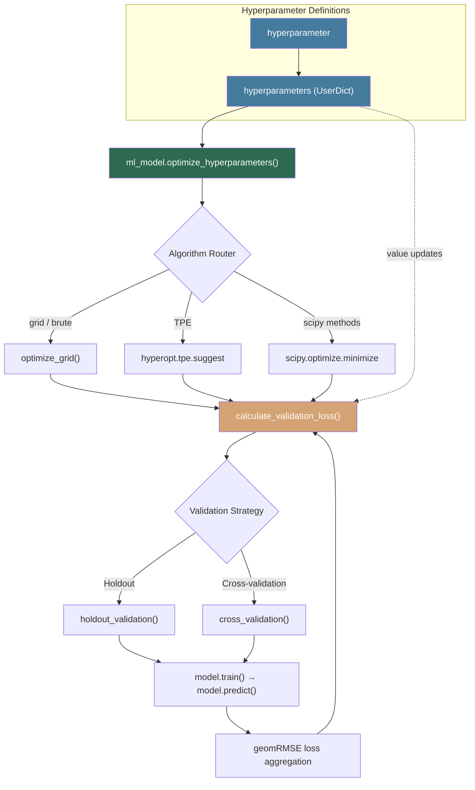
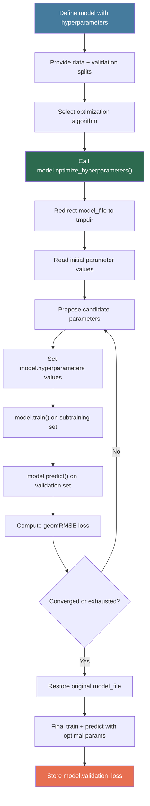

Effective machine learning models depend critically on well-chosen hyperparameters. MLatom provides a unified, extensible hyperparameter optimization framework embedded directly within the `ml_model` superclass, enabling any trainable ML model to search its parameter space without external tooling. This system integrates seamlessly with the model's training and prediction lifecycle, supports multiple optimization algorithms and validation strategies, and exposes a clean declarative API for defining searchable parameter spaces.

## Architectural Overview

The hyperparameter optimization subsystem is built around four core components: the **`hyperparameter`** data class, the **`hyperparameters`** collection container, the **`optimize_hyperparameters()`** orchestration method on `ml_model`, and the **`calculate_validation_loss()`** evaluation engine. These four elements form a closed loop: hyperparameters define the search space, the optimizer proposes candidates, the validation loss evaluator scores them, and the loop iterates until convergence or exhaustion.

Sources: [model_cls.py](mlatom/model_cls.py#L609-L728), [model_cls.py](mlatom/model_cls.py#L856-L955)

## The `hyperparameter` and `hyperparameters` Data Model

The `hyperparameter` class encapsulates a single tunable parameter with all metadata needed for search space definition. Each instance carries its current value, bounds (`minval`/`maxval`), a search space type (`optimization_space`), and a dtype enforcement mechanism. The `hyperparameters` container extends `collections.UserDict` to provide dict-like access while automatically wrapping bare values as `hyperparameter` instances.

The `optimization_space` field is particularly important: it controls how grid points are distributed and how the TPE sampler constructs its probability model. The value `'linear'` produces evenly spaced samples between bounds, while `'log'` produces logarithmically spaced samples — essential for parameters like regularization strength that span many orders of magnitude. The `dtype` field enforces type coercion on every value assignment, preventing silent type corruption during optimization iterations. When a `hyperparameter` is updated via `__setattr__`, the incoming value is cast through the dtype if it doesn't already match [model_cls.py](mlatom/model_cls.py#L875-L880).

The `hyperparameters` class provides transparent attribute access: reading `model.hyperparameters.sigma` returns the raw `.value` of the underlying `hyperparameter` object, while assigning `model.hyperparameters.sigma = 2.0` updates the `.value` in-place or creates a new wrapped instance [model_cls.py](mlatom/model_cls.py#L922-L941). The `.copy(keys=...)` method enables selective deep-copying of a subset of hyperparameters, which is used by `kreg.__init__` to create per-instance hyperparameter collections from the class-level defaults [models.py](mlatom/models.py#L380).

| Attribute | Type | Purpose |
|-----------|------|---------|
| `value` | `Any` | Current parameter value (dtype-enforced) |
| `optimization_space` | `str` | `'linear'` or `'log'` — controls search space geometry |
| `minval` / `maxval` | `Any` | Search boundaries for bounded optimization |
| `step` | `Any` | Step size for discrete search (reserved) |
| `choices` | `Iterable[Any]` | Discrete value set for categorical search |
| `dtype` | `Callable` | Type caster; auto-derived from initial value if `None` |
| `name` | `str` | Human-readable identifier for debugging output |

Sources: [model_cls.py](mlatom/model_cls.py#L856-L905), [model_cls.py](mlatom/model_cls.py#L907-L955)

## Model-Specific Hyperparameter Definitions

Each ML model class declares its own tunable hyperparameters with physically meaningful defaults and bounds. The **KRR** model (`krr`) maintains a registry of kernel-specific candidates and activates the relevant subset based on the `kernel_function` argument [models.py](mlatom/models.py#L50-L73). The **KREG** model (`kreg`) defines its hyperparameters as a class-level attribute, enabling shared defaults across all instances while supporting per-instance override via constructor arguments [models.py](mlatom/models.py#L354-L381).

The KREG class provides the most concrete example. It declares `lambda` (regularization) and `sigma` (kernel width) with logarithmic search spaces spanning [2⁻³⁵, 1.0] and [2⁻⁵, 2⁹] respectively. These bounds reflect the physical scale of molecular potential energy surfaces: regularization must be capable of approaching machine epsilon for well-conditioned problems, while the kernel width must accommodate both tightly bound and loosely scattered configurations. During `__init__`, the class-level `hyperparameters` is copied and then merged with any user-provided overrides, ensuring that instance mutations never contaminate the class default [models.py](mlatom/models.py#L380-L381).

The KRR model is more nuanced. It defines a dictionary of all possible hyperparameters — `sigma`, `lambda`, `sigmap`, `period`, and `nn` — and selects the active set based on kernel function type. Gaussian kernels activate `sigma`; periodic Gaussian kernels additionally activate `period`; decaying periodic Gaussian kernels add `sigmap`; Matern kernels use `nn` instead of `sigma` [models.py](mlatom/models.py#L50-L73).

| Model | Hyperparameter | Default | Search Space | Physical Role |
|-------|---------------|---------|--------------|---------------|
| `krr` (Gaussian) | `sigma` | 1.0 | log [2⁻⁵, 2⁹] | Gaussian kernel width |
| `krr` (any) | `lambda` | 2⁻³⁵ | log [2⁻³⁵, 1.0] | L2 regularization strength |
| `krr` (periodic) | `period` | 1.0 | log [2⁻⁵, 2⁹] | Periodic kernel period |
| `krr` (decaying periodic) | `sigmap` | 100.0 | log [2⁻⁵, 2⁹] | Periodic kernel width |
| `krr` (Matern) | `nn` | 2 | linear [1, 50] | Matern smoothness order |
| `kreg` | `sigma` | 1.0 | log [2⁻⁵, 2⁹] | Kernel width (RE descriptor) |
| `kreg` | `lambda` | 2⁻³⁵ | log [2⁻³⁵, 1.0] | Regularization (values + gradients) |

Sources: [models.py](mlatom/models.py#L50-L73), [models.py](mlatom/models.py#L354-L383)

## Optimization Algorithms

The `optimize_hyperparameters()` method routes to one of three algorithm families based on the `optimization_algorithm` argument. All three share a common interface: they accept an initial parameter vector, invoke `calculate_validation_loss()` as the objective function, and write the optimal parameter values back into `self.hyperparameters`.

### Grid Search

Grid search is implemented via the standalone `optimize_grid()` function, which uses a recursive coordinate descent over the parameter grid. For each parameter dimension, it fixes all other dimensions at their first values, sweeps the remaining parameter, and recurses inward until the final dimension is exhausted [model_cls.py](mlatom/model_cls.py#L819-L854). Grid resolution defaults to 9 points per dimension but is configurable via `optimization_algorithm_kwargs['grid_size']`. The grid spacing respects each hyperparameter's `optimization_space`: linear spaces use `np.linspace`, while log spaces use `np.logspace` with natural logarithm base [model_cls.py](mlatom/model_cls.py#L680-L686). Grid search does not respect `maximum_evaluations` — it exhaustively evaluates all grid points, making it suitable only for low-dimensional spaces or coarse preliminary sweeps.

### Bayesian Optimization (TPE)

The Tree-structured Parzen Estimator is available through the `hyperopt` library. When `optimization_algorithm='tpe'`, the system maps each hyperparameter's search space to a `hyperopt.hp` distribution: `'linear'` maps to `hp.uniform`, and `'log'` maps to `hp.loguniform` with bounds transformed through `np.log` [model_cls.py](mlatom/model_cls.py#L690-L722). The `hyperopt.fmin()` call uses `hyperopt.tpe.suggest` as the acquisition function and respects `maximum_evaluations` as the budget. This makes TPE the recommended algorithm for moderate-dimensional spaces (2–10 parameters) where the validation loss evaluation is expensive — such as training kernel ridge regression models on molecular databases with gradient learning.

### scipy.optimize Gradient-Based Methods

For problems where the loss landscape is relatively smooth, the framework delegates to `scipy.optimize.minimize` with any of 14 scipy methods: Nelder-Mead, BFGS, L-BFGS-B, Powell, CG, Newton-CG, TNC, COBYLA, SLSQP, trust-constr, dogleg, trust-krylov, and trust-exact [model_cls.py](mlatom/model_cls.py#L662-L671). Bounds are extracted from `minval`/`maxval` on each hyperparameter and passed directly to scipy. The `maximum_evaluations` parameter maps to scipy's `maxiter`. These methods are most effective when combined with log-space parameterization (since the loss surface is often smoother in log-space for kernel parameters) and when the number of hyperparameters is small enough for gradient estimation to be tractable.

| Algorithm | Family | Budget Control | Gradient Required | Best For |
|-----------|--------|---------------|-------------------|----------|
| `grid` / `brute` | Exhaustive | `grid_size` per dim | No | Coarse 1–3D sweeps |
| `tpe` | Bayesian | `maximum_evaluations` | No | Expensive 2–10D targets |
| `Nelder-Mead` | Derivative-free | `maximum_evaluations` | No | Noisy, non-smooth losses |
| `L-BFGS-B` | Quasi-Newton | `maximum_evaluations` | Approx. | Smooth bounded problems |
| `Powell` | Direction set | `maximum_evaluations` | No | Moderate dimensions |

Sources: [model_cls.py](mlatom/model_cls.py#L658-L727)

## Validation Loss Computation

The `calculate_validation_loss()` method is the objective function that all optimizers evaluate. Its default loss metric is a **geometric mean RMSE** (referred to internally as `geomRMSE`), which balances scalar properties (e.g., energies) and vectorial properties (e.g., gradients) on equal footing [model_cls.py](mlatom/model_cls.py#L577-L585). When both energy and gradient errors are available, the combined loss is `sqrt(RMSE_energy × RMSE_gradients)`; when only one is available, it reduces to the individual RMSE. This formulation ensures that neither error component dominates the optimization signal, which is critical for models trained on both energies and forces.

The method supports two validation strategies selected by the caller's arguments:

- **Holdout validation**: accepts separate `subtraining_*` and `validation_*` databases, trains on the subtraining set, predicts on the validation set, and computes the loss. This is routed through `holdout_validation()` [model_cls.py](mlatom/model_cls.py#L729-L740).
- **Cross-validation**: accepts `cv_splits_molecular_databases` (a list of pre-split folds), iterates over leave-one-out splits, trains on each subtraining combination, predicts on the held-out fold, and aggregates results. This is routed through `cross_validation()` [model_cls.py](mlatom/model_cls.py#L742-L770).

Critically, `calculate_validation_loss()` calls `self.reset()` after computing the error [model_cls.py](mlatom/model_cls.py#L590), which cleans up the trained model artifact. This prevents stale model files from interfering with subsequent optimization iterations — each evaluation starts from a clean slate. The entire `optimize_hyperparameters()` method further wraps its work in a `tempfile.TemporaryDirectory` context, redirecting model file writes to a temporary location so the original model file is never corrupted during search [model_cls.py](mlatom/model_cls.py#L658-L661).

For advanced use cases, a custom `validation_loss_function` callable can be provided along with `validation_loss_function_kwargs`, bypassing the default geomRMSE entirely [model_cls.py](mlatom/model_cls.py#L587-L588).

> [!TIP]
> When optimizing hyperparameters for models that learn both energies and gradients, the default geometric-mean RMSE ensures balanced treatment. If you need to weight energies more heavily (e.g., for thermochemistry), provide a custom `validation_loss_function` that applies your preferred weighting scheme.

Sources: [model_cls.py](mlatom/model_cls.py#L450-L607), [model_cls.py](mlatom/model_cls.py#L577-L585)

## CLI Integration and TPE Argument Parsing

The framework integrates with MLatom's input file system through `parse_hyperparameter_optimization()`, which translates TPE distribution specifications from the command line into `hyperparameter` objects. When the optimization algorithm is `'tpe'`, the parser expects hyperparameter specifications in hyperopt's DSL format — e.g., `loguniform(-35, 0)` or `uniform(0, 10)` — and extracts the space type and bounds from the string [model_cls.py](mlatom/model_cls.py#L432-L448). For log-space parameters, the raw bounds (which hyperopt expects in log₂ space) are transformed via `2**lb` and `2**hb` to produce absolute values for `minval` and `maxval` [model_cls.py](mlatom/model_cls.py#L443-L445).

The `mlatom_args._check_hyperopt()` method (in `args_class.py`) handles pre-validation of hyperopt-specific syntax before it reaches the model parser [args_class.py](mlatom/args_class.py#L691-L705). This two-stage parsing ensures that malformed hyperopt specifications are caught early with meaningful error messages.

## End-to-End Optimization Workflow

The complete optimization lifecycle proceeds as follows. The user defines hyperparameters on the model, provides training data and validation strategy, selects an algorithm, and invokes `optimize_hyperparameters()`. Internally, the system: (1) redirects model file I/O to a temporary directory, (2) iterates parameter proposals through the chosen algorithm, (3) for each proposal, sets hyperparameter values, trains the model on the subtraining set, predicts on the validation set, and computes the loss, (4) feeds the loss back to the optimizer, and (5) upon convergence, restores the original model file path, trains one final time with the optimal parameters, and stores the validation loss in `self.validation_loss` [model_cls.py](mlatom/model_cls.py#L726-L727).

Sources: [model_cls.py](mlatom/model_cls.py#L609-L728), [model_cls.py](mlatom/model_cls.py#L658-L661)

## Practical Considerations

**Temporary directory isolation** is a critical safety mechanism. During optimization, the model's `model_file` attribute is redirected to `tmpdirname/saved_name` inside a `with tempfile.TemporaryDirectory()` block [model_cls.py](mlatom/model_cls.py#L658-L661). This ensures that intermediate model files — which may be large kernel matrices or regression coefficient arrays — are automatically cleaned up when the search completes, regardless of success or failure. The original `model_file` is restored before the method returns [model_cls.py](mlatom/model_cls.py#L724).

**Model reset between iterations** is enforced by `self.reset()` at the end of each `calculate_validation_loss()` call [model_cls.py](mlatom/model_cls.py#L590). For KREG models using the KREG_API backend, this calls `clean_up()` which re-invokes `__init__()` to deallocate all Fortran arrays [kreg_api.py](mlatom/kreg_api.py#L174-L175). Without this reset, stale kernel matrices and alpha coefficients from previous iterations would corrupt subsequent training runs.

**Debug output** can be activated by passing `debug=True` to either `calculate_validation_loss()` or `optimize_hyperparameters()`. When enabled, each evaluation prints the current hyperparameter values and the computed validation loss [model_cls.py](mlatom/model_cls.py#L599-L602).

> [!TIP]
> For production hyperparameter optimization runs, start with a coarse grid search (grid_size=5) to identify the approximate region of the minimum, then refine with TPE (maximum_evaluations=100–500) for precise convergence. This two-stage approach dramatically reduces total evaluation count compared to pure TPE with a wide initial search space.

Sources: [model_cls.py](mlatom/model_cls.py#L658-L661), [model_cls.py](mlatom/model_cls.py#L590), [kreg_api.py](mlatom/kreg_api.py#L174-L175)

## Navigation

This page covered the hyperparameter optimization framework at its architectural core. To understand how these optimized hyperparameters flow into model training, see [Kernel Ridge Regression Models](10-kernel-ridge-regression-models). For strategies on preparing the cross-validation splits consumed by this system, consult [Data Sampling and Cross-Validation Strategies](25-data-sampling-and-cross-validation-strategies). To learn how optimized models are re-used through serialization, proceed to [Transfer Learning and Model Fine-Tuning](13-transfer-learning-and-model-fine-tuning).