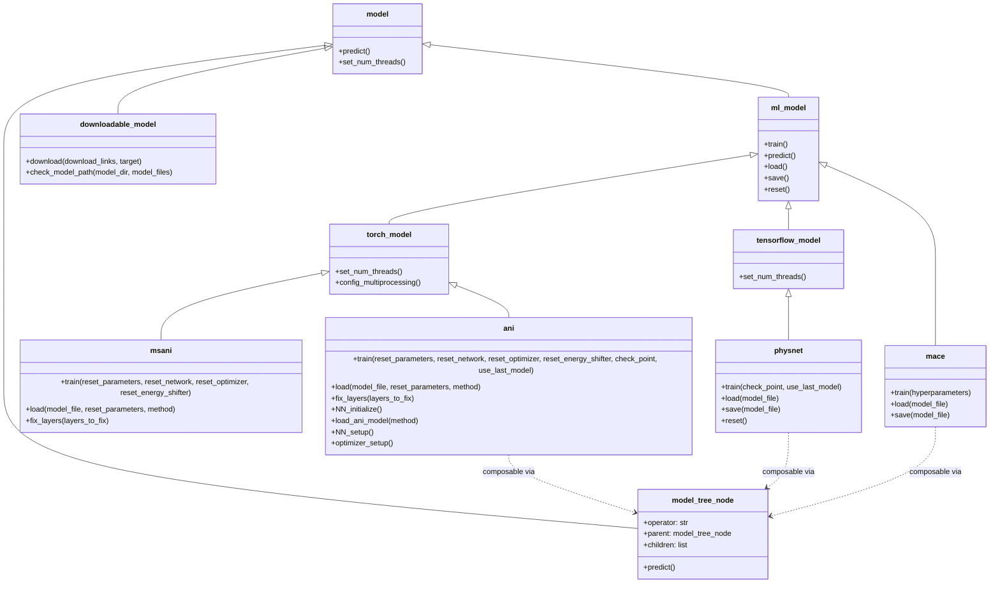
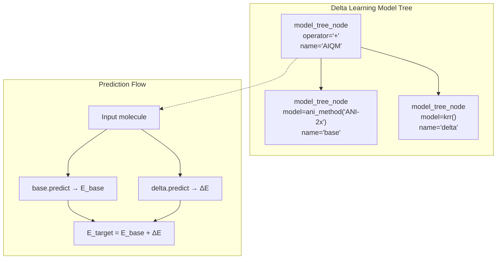
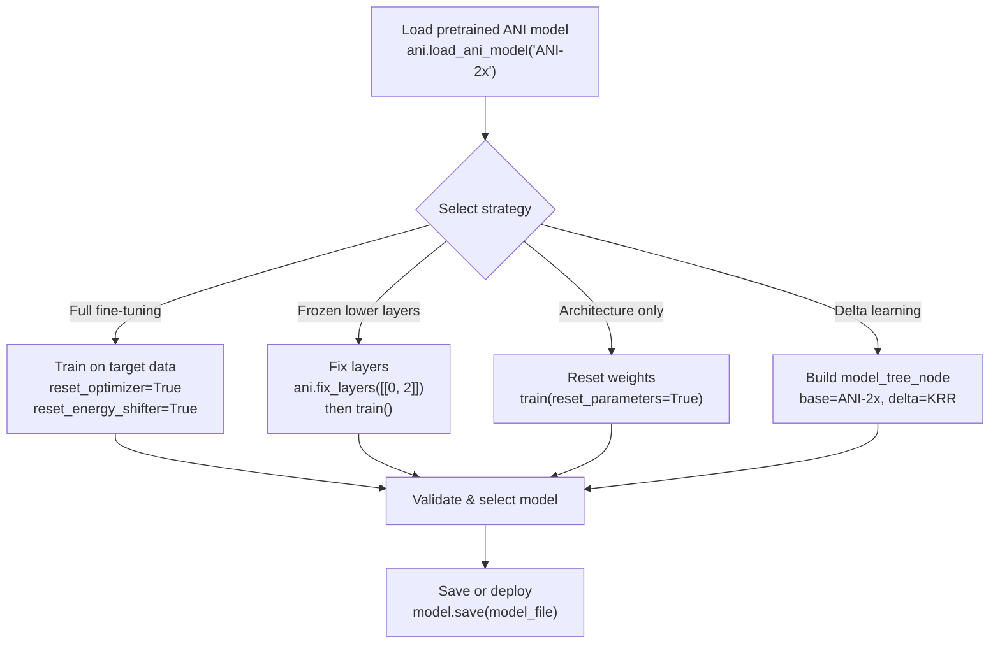

This page documents how MLatom enables **transfer learning** — reusing knowledge from pretrained models to accelerate training on new chemical domains — and **model fine-tuning** — selectively adjusting portions of an existing model to adapt it to target tasks. These capabilities are critical for molecular machine learning, where generating high-level reference data (e.g., CCSD(T)) is expensive and data-efficient learning strategies directly impact research throughput.

## Architectural Overview

MLatom implements transfer learning through two complementary mechanisms: **neural network fine-tuning** (applicable to TorchANI, PhysNet, and MACE models) and **delta learning via model composition** (the `model_tree_node` system). The former operates at the parameter level within a single model architecture, while the latter composes multiple models arithmetically at prediction time. Both approaches are grounded in MLatom's unified model class hierarchy, where `ml_model` defines the `train()`/`predict()`/`load()`/`save()` contract and each interface specializes these methods.

## Pretrained Model Loading

The entry point for any transfer learning workflow is loading a pretrained model. MLatom provides two distinct loading paths: loading a saved custom model from disk, and loading a published universal ML potential (e.g., ANI-1x, ANI-1ccx, ANI-2x). The `downloadable_model` mixin class further automates the acquisition of pretrained model files by checking standard filesystem locations (`$MODELSPATH`, `[mlatom_dir]/mlatom_models/`, `~/.mlatom/models/`) and downloading from remote URLs when necessary [Sources: [model_cls.py](mlatom/model_cls.py#L208-L340)].

For **TorchANI models**, the `ani.load()` method accepts a `.pt` model file and deserializes the complete model state — AEV computer parameters, network architecture dictionaries, energy shifter, and neural network weights. Crucially, it accepts a `reset_parameters` flag that, when `True`, triggers `NN_initialize()` to re-randomize all network weights via Kaiming normal initialization while preserving the architecture. This enables the "load architecture, train from scratch" pattern. Alternatively, `load_ani_model(method)` loads a named pretrained model (ANI-1x, ANI-1ccx, ANI-2x) directly from TorchANI's built-in model zoo, setting up `species_order`, `aev_computer`, `networkdict`, and `energy_shifter` automatically [Sources: [torchani_interface.py](mlatom/interfaces/torchani_interface.py#L204-L312)].

For **MACE models**, the loading path is simpler — `mace.load()` uses `torch.load()` to deserialize the model state dict and maps it to the configured device. MACE's `train()` method always constructs a fresh model from the training data's `z_table` and hyperparameters, meaning fine-tuning with MACE requires re-initialization from data statistics rather than warm-starting from weights [Sources: [mace_interface.py](mlatom/interfaces/mace_interface.py#L245-L248)].

For **PhysNet models**, `physnet.load()` restores from a directory containing TensorFlow checkpoint files (`best_model.ckpt`) alongside metadata (`best_loss.npz`, `NAS.npz`). If `self.model` already exists when `train()` is called, PhysNet **reuses the existing model** rather than constructing a new one, enabling natural fine-tuning from a loaded checkpoint [Sources: [physnet_interface.py](mlatom/interfaces/physnet_interface.py#L170-L202)].

| Model Interface | Load Format | Reset Weights on Load | Reuses Model in `train()` |
|---|---|---|---|
| `ani` / `msani` | `.pt` (TorchANI dict) | Via `reset_parameters=True` | Yes, with optional resets |
| `mace` | `.pt` (PyTorch state) | No built-in flag | No — always rebuilds |
| `physnet` | Directory (TF checkpoint) | No built-in flag | Yes — if `self.model` exists |

## Neural Network Fine-Tuning Strategies

### Selective Layer Freezing

The most granular fine-tuning mechanism in MLatom is **per-element layer freezing**, implemented exclusively in the TorchANI `ani` and `msani` classes via the `fix_layers()` method. This method accepts a specification of which linear layers should be made non-trainable (`requires_grad=False`) for each elemental sub-network, enabling strategies such as freezing lower-level feature extractors while keeping higher-level output layers adaptive [Sources: [torchani_interface.py](mlatom/interfaces/torchani_interface.py#L704-L770)].

The method operates on TorchANI's named parameter structure (`{species}.{layer_index}.{weight_or_bias}`) and interprets layer indices relative to the `Linear` layers within each elemental sub-network. When a single list is provided, it is broadcast across all species. When a list of lists is provided, each sub-list targets a specific element in `species_order`.

> [!TIP]
> Layer freezing is invoked **during** `train()` when the `hyperparameters` dict contains a `'fixed_layers'` key. The check occurs after confirming `self.model` exists but before training begins, making it a natural hook for transfer learning workflows. The AEV computation layers (index 0 in the outer `Sequential`) are unaffected since they operate on indices within each elemental sub-network.

### Training Control Flags

The `ani.train()` and `msani.train()` methods expose a comprehensive set of flags that control what gets reset — and what gets preserved — when fine-tuning begins on a loaded model:

| Flag | Effect | Use Case |
|---|---|---|
| `reset_parameters` | Re-initializes all network weights via `NN_initialize()` (Kaiming normal) | Architecture transfer without weight reuse |
| `reset_network` | Reconstructs the neural network entirely via `NN_setup()` | Architecture change during fine-tuning |
| `reset_optimizer` | Re-creates the optimizer via `optimizer_setup()` | New learning rate schedule on existing weights |
| `reset_optim_state` | Clears optimizer momentum/adaptive state | Prevents stale gradient statistics |
| `reset_energy_shifter` | Replaces or clears the atomic self-energy shifter | New chemical domain with different atomization energies |
| `check_point` | Path to a checkpoint file; loads both model weights and optimizer state | Resume interrupted training |
| `use_last_model` | If `False`, restores best validation model at end; if `True`, keeps last epoch | Controlling final model selection |

These flags compose independently. For example, a standard fine-tuning workflow would load a pretrained model (preserving all weights) and call `train()` with `reset_optimizer=True` (fresh Adam/SGD state) and `reset_energy_shifter=True` (recalibrate for new domain), while leaving `reset_parameters=False` and `reset_network=False` [Sources: [torchani_interface.py](mlatom/interfaces/torchani_interface.py#L313-L430)].

The energy shifter deserves special attention: it stores per-element self-energies that serve as a baseline correction. When transferring between chemical domains (e.g., from organic molecules to organometallics), `reset_energy_shifter=True` causes MLatom to recompute or clear these values. If a list is provided, a new `EnergyShifter` is constructed from those values; if a `torchani.utils.EnergyShifter` instance is provided, it replaces the existing one directly [Sources: [torchani_interface.py](mlatom/interfaces/torchani_interface.py#L367-L373)].

### PhysNet Fine-Tuning via Model Persistence

PhysNet follows a simpler but effective fine-tuning path. Since `train()` checks `if not self.model` before constructing a new `NeuralNetwork`, any previously loaded model is reused with its learned weights intact. The `check_point` parameter enables resuming training from a saved checkpoint, restoring both model weights and optimizer state. The `use_last_model` flag controls whether the final model in memory is the best-validation model or the model from the final epoch [Sources: [physnet_interface.py](mlatom/interfaces/physnet_interface.py#L221-L300)].

PhysNet also performs neural architecture search (NAS) statistics normalization (`Eshift`, `Escale`) from the training data on every `train()` call, which implicitly adapts the output scaling to the new domain even when weights are preserved [Sources: [physnet_interface.py](mlatom/interfaces/physnet_interface.py#L252-L253)].

## Delta Learning via Model Composition

Beyond parameter-level fine-tuning, MLatom provides a **delta learning** framework through the `model_tree_node` class. This enables building models of the form `E_target = E_base + ΔE`, where `E_base` is a pretrained lower-level method and `ΔE` is a learned correction. This is the architectural foundation of AIQM methods and similar composite approaches documented in [AIQM Methods and Delta Learning](11-aiqm-methods-and-delta-learning) [Sources: [model_cls.py](mlatom/model_cls.py#L960-L1040)].

The `model_tree_node` class implements a tree structure where each node holds either a child `model` or a set of child nodes. Each node carries an `operator` string (e.g., `'+'`, `'-'`) that determines how predictions from its children are combined. During prediction, the tree is traversed recursively: leaf nodes invoke their model's `predict()`, and parent nodes combine child results using the specified operator.

The prediction pipeline stores intermediate results on the molecule object itself using the node's `name` attribute, enabling parent nodes to access child results without explicit return value threading. For multi-state calculations, the tree traversal extends across electronic states [Sources: [model_cls.py](mlatom/model_cls.py#L994-L1090)].

This design means delta models can mix model types freely — a neural network base (ANI, MACE, PhysNet) can be corrected by a kernel ridge regression delta, or vice versa. The only requirement is that all models in the tree produce compatible output properties.

## Practical Workflow: Fine-Tuning a Pretrained ANI Model

The following flowchart illustrates a complete fine-tuning workflow, from loading a pretrained universal potential through selective training to deployment:

## Model Persistence and Checkpointing

All trainable models in MLatom support `save()` and `load()` for serialization. TorchANI models save as `.pt` files containing the complete state (AEV computer, network dict, energy shifter, optimizer state). PhysNet saves as directories containing TensorFlow checkpoints and metadata. MACE saves as `.pt` files via `torch.save()`.

The `ani` and `msani` classes additionally support `save_every_epoch` and `save_epoch_interval` parameters during training, enabling the creation of epoch-level checkpoints. Combined with `check_point` loading, this provides full training resumption capability — essential for long-running fine-tuning jobs on GPU clusters [Sources: [torchani_interface.py](mlatom/interfaces/torchani_interface.py#L313-L336)].

## Integration with Hyperparameter Optimization

When fine-tuning, the interplay between transfer learning controls and hyperparameter optimization becomes important. The `ml_model` base class provides `optimize_hyperparameters()` and `calculate_validation_loss()` methods that search over `hyperparameters` objects. During optimization, each evaluation invokes a full `train()` → `predict()` → `loss()` cycle. Fine-tuning flags (`reset_optimizer`, `reset_energy_shifter`) are orthogonal to this process — they control *initialization behavior*, while hyperparameter optimization controls *search behavior*. Practitioners should typically fine-tune with `reset_optimizer=True` during hyperparameter search to ensure each evaluation starts from a consistent optimizer state [Sources: [model_cls.py](mlatom/model_cls.py#L609-L728)].

## Summary: Transfer Learning Capability Matrix

| Capability | `ani` / `msani` | `physnet` | `mace` | `kreg` / `krr` |
|---|:---:|:---:|:---:|:---:|
| Load pretrained model | ✓ | ✓ | ✓ | ✓ |
| Fine-tune from weights | ✓ | ✓ | ✗ | ✗ |
| Per-element layer freezing | ✓ | ✗ | ✗ | N/A |
| Reset weights, keep architecture | ✓ | ✗ | ✗ | N/A |
| Reset optimizer state only | ✓ | ✗ | ✗ | N/A |
| Reset energy shifter | ✓ | ✗ | ✗ | N/A |
| Checkpoint resume | ✓ | ✓ | ✗ | N/A |
| Delta learning composition | ✓ (via tree) | ✓ (via tree) | ✓ (via tree) | ✓ (via tree) |
| Universal model zoo loading | ✓ (ANI-1x/1ccx/2x) | ✗ | ✗ | ✗ |

For deeper exploration of how these mechanisms connect to specific methods, see [Model Class Hierarchy](9-model-class-hierarchy) for the inheritance structure, [AIQM Methods and Delta Learning](11-aiqm-methods-and-delta-learning) for production delta-learning workflows, and [Hyperparameter Optimization](12-hyperparameter-optimization) for search strategies during fine-tuning.