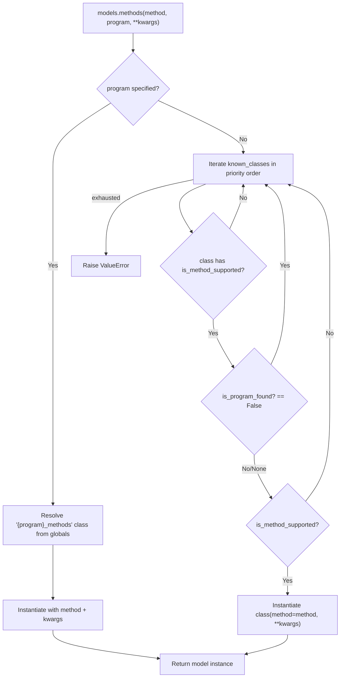
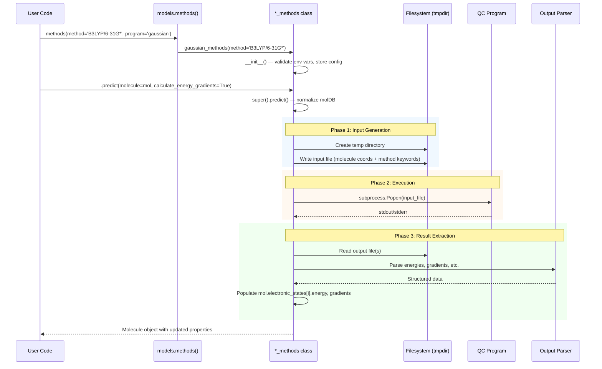

MLatom provides a unified abstraction layer over a diverse ecosystem of quantum chemistry programs, enabling any supported external method to be invoked through a single consistent API. Whether you need a ground-state DFT single point, excited-state gradients for nonadiabatic dynamics, or spin-orbit coupling vectors, the interface architecture routes your request to the correct program, translates molecular data into its input format, executes the calculation, and parses results back into MLatom's standard molecule objects. This page dissects the architectural patterns, dispatch mechanism, property coverage, and practical usage of every interfaced quantum chemistry program.

## Architectural Overview

All quantum chemistry program interfaces inherit from a common base class hierarchy rooted in the `model` class at [model_cls.py](/dralgroup/mlatom/blob/main/mlatom/model_cls.py#L20-L137). The critical intermediate class is `method_model`, which extends `model` with introspection capabilities specific to external chemistry programs: method validation, binary discovery via environment variables, and structured error reporting.

Sources: [model_cls.py](/dralgroup/mlatom/blob/main/mlatom/model_cls.py#L175-L206)

The dispatch mechanism lives in the `models.methods()` factory function, which resolves a method name (with an optional program hint) to the correct interface class. When called without `program`, it iterates through `known_classes` in priority order—the first class whose `is_program_found()` returns `True` and whose `is_method_supported()` matches the requested method wins. This priority ordering is defined at [models.py](/dralgroup/mlatom/blob/main/mlatom/models.py#L624-L625) and determines default behavior when multiple programs support the same method name.

```mermaid
classDiagram
    direction TB
    
    class model {
        +nthreads: int
        +set_num_threads(nthreads)
        +predict(molecular_database, molecule, ...)
        +dump(filename, format)
    }
    
    class OMP_model {
        +set_num_threads(nthreads)
    }
    
    class MKL_model {
        +set_num_threads(nthreads)
    }
    
    class method_model {
        +bin_env_name: str
        +supported_methods: list
        +is_method_supported(method)$ bool
        +is_program_found()$ bool
        +get_bin_env_var()$ str
        +raise_unsupported_method_error(method)$
    }
    
    class gaussian_methods {
        +method: str
        +chkfilename: str
        +predict(..., nstates, gaussian_keywords)
    }
    
    class orca_methods {
        +bin_env_name: "orcabin"
        +solvent, solvation_model
        +predict(..., active_space, casscf_kwargs)
    }
    
    class pyscf_methods {
        +supported_methods: list
        +predict_for_molecule(...)
        +predict_for_molecule_DM21(...)
        +check_convergence(...)
    }
    
    class columbus_methods {
        +bin_env_name: "COLUMBUS"
        +level_of_theory: str
        +predict(..., nsinglets, ntriplets, calculate_nacv, calculate_soc)
    }
    
    class turbomole_methods {
        +predict(method='ADC(2)', ...)
        +set_num_threads(nthreads)
    }
    
    class mndo_methods {
        +bin_env_name: "mndobin"
        +supported_methods: list
        +predict(..., read_density_matrix)
    }
    
    class dftbplus_methods {
        +generate_dftbplus_input(...)
        +parse_output(...)
    }
    
    class xtb_methods {
        +supported_methods: list
        +predict(..., calculate_dipole_derivatives)
        +error_handle(stds)
    }
    
    model <|-- OMP_model
    model <|-- MKL_model
    model <|-- method_model
    OMP_model <|-- orca_methods
    OMP_model <|-- dftbplus_methods
    OMP_model <|-- xtb_methods
    OMP_model <|-- dftd4_methods
    method_model <|-- gaussian_methods
    method_model <|-- orca_methods
    method_model <|-- columbus_methods
    method_model <|-- turbomole_methods
    method_model <|-- mndo_methods
    method_model <|-- dftbplus_methods
    method_model <|-- xtb_methods
    method_model <|-- dftd3_methods
    method_model <|-- dftd4_methods
```

The inheritance pattern reveals two distinct design strategies. **External-process interfaces** (Gaussian, ORCA, COLUMBUS, Turbomole, MNDO, xTB, DFTB+) inherit from `method_model` and communicate with the quantum chemistry program through file I/O and subprocess execution. **Library interfaces** (PySCF) operate entirely in-process, importing the target program as a Python package and calling its API directly—this is reflected by the `OMP_pyscf` subclass that handles OpenMP thread configuration through PySCF's own runtime settings.

Sources: [pyscf_interface.py](/dralgroup/mlatom/blob/main/mlatom/interfaces/pyscf_interface.py#L23-L52), [model_cls.py](/dralgroup/mlatom/blob/main/mlatom/model_cls.py#L169-L174)

## The Method Dispatch Mechanism

The `models.methods()` function is the single entry point for creating any quantum chemistry model instance. Its resolution logic operates in two phases, controlled by whether the `program` argument is provided.

When `program` is specified, the function constructs a class name string (`f'{program.casefold()}_methods'`) and looks it up in the module globals. If found, it instantiates the class with the provided method and keyword arguments. When `program` is omitted, the function iterates through `known_classes` (a priority-ordered list) and for each class: skips it if it lacks `is_method_supported`; skips it if `is_program_found()` returns `False` (meaning the environment variable for its binary is not set); and returns the first class where `is_method_supported(method)` matches. If no class matches, it raises a descriptive `ValueError` listing three possible causes: method name misspelling, program not installed, or need for explicit `program` specification.

Sources: [models.py](/dralgroup/mlatom/blob/main/mlatom/models.py#L627-L691)

The `method_model` base class provides three class methods that power this dispatch. `is_method_supported()` checks the class's `supported_methods` list using case-insensitive comparison. `is_program_found()` checks whether the class's `bin_env_name` exists as an environment variable. `get_bin_env_var()` returns the environment variable's value or `None`. For in-process interfaces like PySCF that don't rely on external binaries, `is_program_found()` may return `None` (meaning "not applicable"), which the dispatch loop treats as a pass-through rather than a rejection.

Sources: [model_cls.py](/dralgroup/mlatom/blob/main/mlatom/model_cls.py#L176-L203)

> [!TIP]
> The `known_classes` list order in [models.py](/dralgroup/mlatom/blob/main/mlatom/models.py#L624-L625) acts as a **precedence chain**. When multiple installed programs support the same method name (e.g., both MNDO and Sparrow support `PM6`), whichever appears first in the list wins. If you need to override the default, always pass `program=` explicitly.

## Program Interface Catalog

The following table provides a consolidated reference of every quantum chemistry program interface, its discovery mechanism, supported methods, and property calculation capabilities. Interfaces marked with "In-process" execute as Python library calls rather than subprocess launches.

Sources: [models.py](/dralgroup/mlatom/blob/main/mlatom/models.py#L636-L660), [gaussian_interface.py](/dralgroup/mlatom/blob/main/mlatom/interfaces/gaussian_interface.py#L19-L47), [orca_interface.py](/dralgroup/mlatom/blob/main/mlatom/interfaces/orca_interface.py#L23-L67), [pyscf_interface.py](/dralgroup/mlatom/blob/main/mlatom/interfaces/pyscf_interface.py#L31-L92), [columbus_interface.py](/dralgroup/mlatom/blob/main/mlatom/interfaces/columbus_interface.py#L13-L42), [turbomole_interface.py](/dralgroup/mlatom/blob/main/mlatom/interfaces/turbomole_interface.py#L20-L52), [mndo_interface.py](/dralgroup/mlatom/blob/main/mlatom/interfaces/mndo_interface.py#L37-L78), [dftbplus_interface.py](/dralgroup/mlatom/blob/main/mlatom/interfaces/dftbplus_interface.py#L33-L60), [xtb_interface.py](/dralgroup/mlatom/blob/main/mlatom/interfaces/xtb_interface.py#L19-L76), [dftd3_interface.py](/dralgroup/mlatom/blob/main/mlatom/interfaces/dftd3_interface.py#L20-L48), [dftd4_interface.py](/dralgroup/mlatom/blob/main/mlatom/interfaces/dftd4_interface.py#L18-L44)

| Interface | Class | Discovery | Execution | Method Examples | Key Capabilities |
|-----------|-------|-----------|-----------|-----------------|------------------|
| **Gaussian** | `gaussian_methods` | `GAUSS_EXEDIR` env var | Subprocess | `B3LYP/6-31G*`, TD-DFT, ab initio | Multi-state TD-DFT, Hessian, dipole derivatives, external potential mode |
| **ORCA** | `orca_methods` | `orcabin` env var | Subprocess | `TD-wb97x/def2-SVP`, `qd-nevpt2`, `CCSD(T)*/CBS` | TD-DFT/TDA, QD-NEVPT2, CASSCF, solvation (SMD/CPCM), per-state gradients |
| **PySCF** | `pyscf_methods` | Python import (In-process) | In-process | `HF`, `MP2`, `CCSD`, `CCSD(T)`, `FCI`, `CISD`, `DM21*` | Full wavefunction methods, convergence check, DM21 functionals |
| **COLUMBUS** | `columbus_methods` | `COLUMBUS` env var | Subprocess (`runc`) | `CASSCF`, `MRCI` | NACV, SOC, singlet/triplet multi-state, MO coefficient export |
| **Turbomole** | `turbomole_methods` | `TURBODIR` env var | Subprocess (`dscf`+`ricc2`) | `ADC(2)`, CASSCF | Multi-state gradients via module pipeline |
| **MNDO** | `mndo_methods` | `mndobin` env var | Subprocess | `ODM2*`, `OM2`, `OM3`, `PM3`, `MNDO/d`, `SCC-DFTB` | Semiempirical OMx/NDDO, density matrix reading |
| **DFTB+** | `dftbplus_methods` | `dftbplusbin` env var | Subprocess | `DFTB` | Slater-Koster file management, SCF tolerance control |
| **xTB** | `xtb_methods` | `xtbbin` env var | Subprocess | `GFN2-xTB`, `GFN2-xTB*` | Solvation, dipole/polarizability derivatives, structured error handling |
| **DFT-D3** | `dftd3_methods` | `dftd3bin` env var | Subprocess | `d3zero`, `d3bj`, `d3bjm`, `d3zerom`, `d3op` | Dispersion corrections, numerical Hessian |
| **DFT-D4** | `dftd4_methods` | `dftd4bin` env var | Subprocess | `D4` | Dispersion corrections with OMP threading |

## Property Calculation Capabilities

Each interface implements a `predict()` method that accepts a standard set of flags controlling which quantum chemical properties are computed. While the base `model.predict()` signature defines `calculate_energy`, `calculate_energy_gradients`, and `calculate_hessian`, individual interfaces extend this with program-specific properties such as nonadiabatic coupling vectors, spin-orbit coupling, and dipole derivatives. The following matrix summarizes which properties each interface can compute based on its `predict()` method signature.

Sources: [gaussian_interface.py](/dralgroup/mlatom/blob/main/mlatom/interfaces/gaussian_interface.py#L72-L79), [orca_interface.py](/dralgroup/mlatom/blob/main/mlatom/interfaces/orca_interface.py#L89-L98), [pyscf_interface.py](/dralgroup/mlatom/blob/main/mlatom/interfaces/pyscf_interface.py#L91-L92), [columbus_interface.py](/dralgroup/mlatom/blob/main/mlatom/interfaces/columbus_interface.py#L44-L56), [turbomole_interface.py](/dralgroup/mlatom/blob/main/mlatom/interfaces/turbomole_interface.py#L43-L52), [mndo_interface.py](/dralgroup/mlatom/blob/main/mlatom/interfaces/mndo_interface.py#L68-L78), [xtb_interface.py](/dralgroup/mlatom/blob/main/mlatom/interfaces/xtb_interface.py#L105-L106), [dftbplus_interface.py](/dralgroup/mlatom/blob/main/mlatom/interfaces/dftbplus_interface.py#L286-L293)

| Property | Gaussian | ORCA | PySCF | COLUMBUS | Turbomole | MNDO | DFTB+ | xTB | DFT-D3/4 |
|----------|----------|------|-------|----------|-----------|------|-------|-----|----------|
| Energy | ✅ | ✅ | ✅ | ✅ | ✅ | ✅ | ✅ | ✅ | ✅ |
| Energy Gradients | ✅ | ✅ | ✅ | ✅ | ✅ | ✅ | ✅ | ✅ | ✅ |
| Hessian | ✅ | ✅ | ✅ | ✅ | ✅ | ✅ | ✅ | ✅ | ✅¹ |
| Multi-State Energies | ✅ | ✅ | ✅ | ✅ | ✅ | ✅ | — | — | — |
| Multi-State Gradients | — | ✅² | — | ✅ | ✅ | — | — | — | — |
| Dipole Derivatives | ✅ | — | ✅ | — | — | ✅ | — | ✅ | — |
| NACV | — | — | — | ✅ | — | ✅ | — | — | — |
| SOC | — | — | — | ✅ | — | — | — | — | — |
| Polarizability Derivatives | — | — | — | — | — | — | — | ✅ | — |
| Density Matrix | — | — | — | — | — | ✅ | — | — | — |
| Solvation | — | ✅ | — | — | — | — | — | ✅ | — |

¹ DFT-D3 only (numerical Hessian); ² Per-state gradient via list of bools

## Interface Lifecycle: From Invocation to Result

All subprocess-based interfaces follow the same operational lifecycle, implemented within each class's `predict()` method. Understanding this pattern is essential for debugging integration issues and extending the framework with new program interfaces.

The lifecycle has three phases. **Input generation** creates a temporary working directory (or uses the user-specified `working_directory`), translates the molecule's coordinates into the program's input format, and appends method-specific keywords. **Execution** launches the external program as a subprocess, typically with `subprocess.Popen` and `communicate()` for synchronous blocking. **Result extraction** reads one or more output files, parses energies/gradients/hessians using program-specific parsers, and populates the corresponding fields on the molecule or electronic state objects. The `save_files_in_current_directory` flag, present on all interfaces, controls whether the temporary directory is cleaned up or retained for inspection after the calculation.

Sources: [gaussian_interface.py](/dralgroup/mlatom/blob/main/mlatom/interfaces/gaussian_interface.py#L116-L148), [columbus_interface.py](/dralgroup/mlatom/blob/main/mlatom/interfaces/columbus_interface.py#L79-L103), [turbomole_interface.py](/dralgroup/mlatom/blob/main/mlatom/interfaces/turbomole_interface.py#L75-L103)

## Gaussian Interface

The Gaussian interface ([gaussian_interface.py](/dralgroup/mlatom/blob/main/mlatom/interfaces/gaussian_interface.py#L19-L148)) is the most feature-rich external interface, supporting ground-state and TD-DFT calculations with energies, gradients, Hessians, and dipole derivatives. It validates the `GAUSS_EXEDIR` environment variable at initialization time and defaults thread count to `cpu_count()`. The `predict()` method automatically injects Gaussian keywords: `force(nostep)` for gradient requests, `freq` for Hessian requests (creating a checkpoint file), and `IOp(7/33=1)` for dipole derivative requests. For multi-state TD-DFT calculations, it parses the `TD-` prefix from the method string and generates the appropriate `TD(NStates=...,Root=...)` directive.

A specialized feature of the Gaussian interface is the **external potential mode**, enabled through the `run_gaussian_job()` function's `external_task` parameter. This mechanism, implemented jointly with [gaussian_external.py](/dralgroup/mlatom/blob/main/mlatom/interfaces/gaussian_external.py#L25-L110), allows an MLatom model to provide an external potential to Gaussian—enabling, for example, Delta-learning corrections where Gaussian computes a base property and MLatom adds a correction on-the-fly. The external script (`gaussian_external.py`) handles the `EIn`/`EOu` file protocol that Gaussian uses for external potential communication.

Sources: [gaussian_interface.py](/dralgroup/mlatom/blob/main/mlatom/interfaces/gaussian_interface.py#L149-L165), [gaussian_external.py](/dralgroup/mlatom/blob/main/mlatom/interfaces/gaussian_external.py#L25-L110)

> [!TIP]
> When requesting `calculate_hessian=True` with Gaussian, the interface automatically sets `chkfilename=True`, generating a `.chk` file. This checkpoint file is also used by the `read_Hessian_matrix_from_Gaussian_chkfile()` utility function at [gaussian_interface.py](/dralgroup/mlatom/blob/main/mlatom/interfaces/gaussian_interface.py#L294-L327), which extracts the analytical Hessian in atomic units directly from the binary checkpoint format.

## ORCA Interface

The ORCA interface ([orca_interface.py](/dralgroup/mlatom/blob/main/mlatom/interfaces/orca_interface.py#L23-L216)) is the most versatile in terms of quantum chemistry method coverage, supporting TD-DFT/TDA, QD-NEVPT2, CASSCF, and the composite `CCSD(T)*/CBS` method. The binary is located via the `orcabin` environment variable. The interface distinguishes method types by parsing prefixes from the method string: `TD-` triggers full TD-DFT, `TDA-` triggers Tamm-Dancoff approximation, and `qd-nevpt2` triggers the quasi-degenerate perturbation theory path. Each method type follows a separate output parsing pipeline: `_parse_tddft_output()` for TD-DFT/DFT ground states and `_parse_qd_nevpt2_output()` for multireference methods.

A unique feature is the **per-state gradient** capability via the `calculate_energy_gradients` list argument. Instead of a single boolean, you can pass a list like `[False, True, False]` to request gradients only for a specific excited state. The interface validates that only one state has gradients requested (an ORCA limitation) and raises a descriptive error if the ground state gradient is requested for a TD-DFT calculation, which ORCA does not support.

Sources: [orca_interface.py](/dralgroup/mlatom/blob/main/mlatom/interfaces/orca_interface.py#L88-L183), [orca_interface.py](/dralgroup/mlatom/blob/main/mlatom/interfaces/orca_interface.py#L155-L172)

The `CCSD(T)*/CBS` composite method is implemented as a separate `ccsdtstarcbs` class ([orca_interface.py](/dralgroup/mlatom/blob/main/mlatom/interfaces/orca_interface.py#L763-L834)) that orchestrates multiple ORCA calculations with different basis sets and extracts combined energies. The `orca_methods` class delegates to this composite when `method='CCSD(T)*/CBS'` is specified, making it transparently available through the standard dispatch mechanism.

Sources: [orca_interface.py](/dralgroup/mlatom/blob/main/mlatom/interfaces/orca_interface.py#L84-L86), [orca_interface.py](/dralgroup/mlatom/blob/main/mlatom/interfaces/orca_interface.py#L763-L813)

## PySCF Interface: In-Process Execution

The PySCF interface ([pyscf_interface.py](/dralgroup/mlatom/blob/main/mlatom/interfaces/pyscf_interface.py#L31-L375)) differs fundamentally from all other interfaces because it operates entirely within the Python process—no subprocesses, no file I/O for communication, no environment variable requirements. This makes it significantly faster for single-molecule calculations and easier to debug, as all computation occurs in the same memory space. The `OMP_pyscf` base class ([pyscf_interface.py](/dralgroup/mlatom/blob/main/mlatom/interfaces/pyscf_interface.py#L23-L30)) configures OpenMP threads through PySCF's own `pyscf.lib.num_threads()` function.

The `supported_methods` list includes `HF`, `MP2`, `FCI`, `CISD`, `CCSD`, `CCSD(T)`, and the DeepMind density functionals `DM21`, `DM21m`, `DM21mu`, and `DM21mc`. The `is_method_supported()` method performs case-insensitive matching, while the main `predict_for_molecule()` method routes to appropriate PySCF API calls based on the method string. A dedicated `predict_for_molecule_DM21()` method handles the DeepMind functionals, which require a separate code path because they use `pyscf.dft.functional` rather than standard DFT functionals.

Sources: [pyscf_interface.py](/dralgroup/mlatom/blob/main/mlatom/interfaces/pyscf_interface.py#L50-L92), [pyscf_interface.py](/dralgroup/mlatom/blob/main/mlatom/interfaces/pyscf_interface.py#L313-L363)

## COLUMBUS Interface: Multi-State Dynamics

The COLUMBUS interface ([columbus_interface.py](/dralgroup/mlatom/blob/main/mlatom/interfaces/columbus_interface.py#L13-L283)) is the most specialized quantum chemistry interface, designed primarily for nonadiabatic dynamics simulations. It supports CASSCF and MRCI levels of theory with a uniquely rich set of multi-state properties: per-state energies for both singlet and triplet manifolds, per-state energy gradients, nonadiabatic coupling vectors (NACV) between all state pairs, and spin-orbit coupling (SOC) vectors between singlet-triplet pairs. The interface manages singlet/triplet state counting through the `nsinglets` and `ntriplets` parameters, with validation ensuring `nstates == nsinglets + ntriplets`.

The NACV extraction reads gradient-difference files from the `GRADIENTS/` directory (e.g., `cartgrd.nad.drt1.stateM.drt1.stateN.sp`), applies Bohr-to-angstrom conversion, and stores the result in a symmetric `mol.nacv[i][j]` tensor where `nacv[j][i] = -nacv[i][j]`. SOC extraction parses the `HT matrix in AU` block from the `runls` output file, converting from atomic units to cm⁻¹. Both properties are critical for surface-hopping nonadiabatic molecular dynamics, where COLUMBUS serves as the primary quantum chemistry engine.

Sources: [columbus_interface.py](/dralgroup/mlatom/blob/main/mlatom/interfaces/columbus_interface.py#L217-L275)

## Semiempirical and Tight-Binding Interfaces

The MNDO interface ([mndo_interface.py](/dralgroup/mlatom/blob/main/mlatom/interfaces/mndo_interface.py#L37-L78)) provides access to a wide range of semiempirical methods through the MNDO or Sparrow programs. The `mndo_method_keywords` dictionary maps method names to their MNDO keyword strings, and `supported_methods` is derived from this dictionary. The interface supports density matrix reading (`read_density_matrix=True`), which is essential for certain excited-state methods, and NACV calculations. The `heats_scf_methods` attribute identifies which methods produce heat-of-formation-calibrated results.

The xTB interface ([xtb_interface.py](/dralgroup/mlatom/blob/main/mlatom/interfaces/xtb_interface.py#L19-L106)) wraps the GFN-xTB family of tight-binding methods. Beyond basic energy and gradient calculations, it supports dipole and polarizability derivative calculations (important for IR spectra), implicit solvation through xTB's `--gbsa` flag, and stack size management for large molecules via `unlimited_stack_size`. The interface includes a structured `error_handle()` method that examines xTB's stderr output to identify and report common failure modes such as SCF convergence issues.

The DFTB+ interface ([dftbplus_interface.py](/dralgroup/mlatom/blob/main/mlatom/interfaces/dftbplus_interface.py#L33-L60)) generates DFTB+ input files including the `dftb_in.hsd` configuration and manages Slater-Koster file paths through the `get_skdir()` class method. It supports standard DFTB energy and gradient calculations with configurable SCF tolerance.

Sources: [mndo_interface.py](/dralgroup/mlatom/blob/main/mlatom/interfaces/mndo_interface.py#L19-L78), [xtb_interface.py](/dralgroup/mlatom/blob/main/mlatom/interfaces/xtb_interface.py#L62-L106), [dftbplus_interface.py](/dralgroup/mlatom/blob/main/mlatom/interfaces/dftbplus_interface.py#L58-L293)

## Dispersion Correction Interfaces

The DFT-D3 ([dftd3_interface.py](/dralgroup/mlatom/blob/main/mlatom/interfaces/dftd3_interface.py#L20-L125)) and DFT-D4 ([dftd4_interface.py](/dralgroup/mlatom/blob/main/mlatom/interfaces/dftd4_interface.py#L18-L125)) interfaces provide access to Grimme's dispersion correction schemes. DFT-D3 supports five damping function variants: `d3zero` (zero-damping), `d3bj` (Becke-Johnson), `d3bjm`, `d3zerom`, and `d3op`. Both interfaces accept a `functional` parameter for functional-specific damping parameters. The DFT-D3 interface uniquely implements a `numerical_hessian()` method for computing Hessians via finite differences of analytical gradients, useful when the dispersion correction needs to be combined with a method that does not provide analytical second derivatives.

Sources: [dftd3_interface.py](/dralgroup/mlatom/blob/main/mlatom/interfaces/dftd3_interface.py#L20-L63), [dftd4_interface.py](/dralgroup/mlatom/blob/main/mlatom/interfaces/dftd4_interface.py#L18-L56), [dftd3_interface.py](/dralgroup/mlatom/blob/main/mlatom/interfaces/dftd3_interface.py#L108-L125)

## Common Configuration Patterns

All external-process interfaces share a consistent set of configuration parameters for controlling execution environment and file management. These parameters are not formally enforced by the `method_model` base class but are implemented identically across all interface classes through convention.

| Parameter | Type | Default | Purpose |
|-----------|------|---------|---------|
| `save_files_in_current_directory` | `bool` | `True` (varies) | If `True`, input/output files remain in the current directory instead of a temp directory |
| `working_directory` | `str` | `None` | Custom directory for all calculation files; created if it doesn't exist |
| `directory_with_input_files` | `str` | `''` | Directory containing pre-existing input files to copy into the working directory (COLUMBUS, Turbomole) |
| `nthreads` | `int` | Varies | Number of parallel threads/processes; maps to program-specific parallelism settings |
| `method` | `str` | Varies | Method specification in the target program's syntax |

The `method_model.get_bin_env_var()` class method reads the binary path from the environment variable named by `bin_env_name`. Each interface validates this at initialization and raises a `ValueError` with a clear message if the program is not found. The standard naming convention for environment variables is `{program}bin` (e.g., `orcabin`, `mndobin`, `dftd4bin`) or a program-specific name like `GAUSS_EXEDIR` for Gaussian, `TURBODIR` for Turbomole, and `COLUMBUS` for the COLUMBUS package.

Sources: [model_cls.py](/dralgroup/mlatom/blob/main/mlatom/model_cls.py#L197-L202), [gaussian_interface.py](/dralgroup/mlatom/blob/main/mlatom/interfaces/gaussian_interface.py#L47-L48), [orca_interface.py](/dralgroup/mlatom/blob/main/mlatom/interfaces/orca_interface.py#L69-L71), [columbus_interface.py](/dralgroup/mlatom/blob/main/mlatom/interfaces/columbus_interface.py#L38-L42), [turbomole_interface.py](/dralgroup/mlatom/blob/main/mlatom/interfaces/turbomole_interface.py#L29-L31)

## Next Steps

Having understood how MLatom communicates with quantum chemistry programs through the unified `predict()` interface, the natural progression depends on your use case. If you are interested in machine learning potentials that can replace or augment these QC calculations, proceed to [Universal ML Potential Interfaces](15-universal-ml-potential-interfaces). To see how these interfaces are consumed by simulation workflows such as geometry optimization and molecular dynamics, see [Geometry Optimization Workflows](17-geometry-optimization-workflows) and [Molecular Dynamics Engine](19-molecular-dynamics-engine). For the broader model class hierarchy that these interfaces fit into, consult [Model Class Hierarchy](9-model-class-hierarchy).