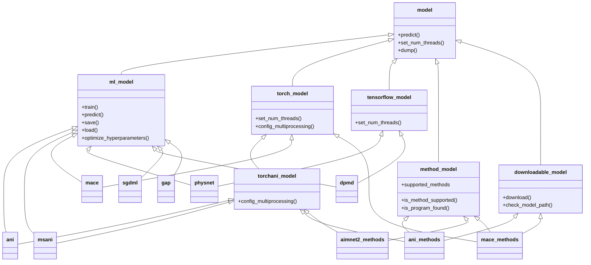
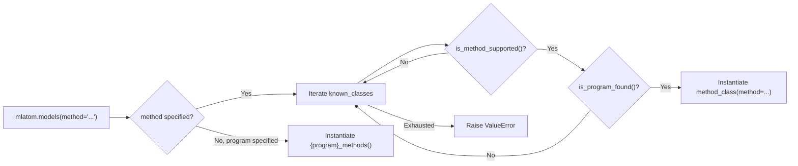

MLatom provides a unified interface layer to a broad ecosystem of universal machine learning potentials — pre-trained or custom-trained models that can predict energies, forces, and Hessians for molecular systems across chemical space. These interfaces normalize the considerable API diversity across programs like TorchANI, MACE, DeePMD-kit, PhysNet, sGDML, and GAP into a consistent `train → predict → save` workflow, while also exposing pre-trained foundational models for immediate drop-in use without any training step.

## Architectural Overview

The interface layer lives entirely within the `mlatom/interfaces/` directory and follows a disciplined inheritance hierarchy rooted in base classes defined in [model_cls.py](mlatom/model_cls.py). Every ML potential interface inherits from at least `ml_model`, which itself extends the foundational `model` class. Framework-specific mixins — `torch_model`, `torchani_model`, `tensorflow_model` — handle device management and thread configuration for their respective backends. This separation of concerns means adding a new potential interface requires implementing only the methods that are genuinely unique to that program, while inheriting cross-cutting concerns like hyperparameter optimization, validation, and model serialization.



## The Two Design Axes: Trainable Models vs. Pre-trained Methods

The most important architectural distinction among these interfaces is not the underlying ML framework, but rather whether the model is **trainable from user data** or is a **pre-trained foundational model** distributed by its authors. Trainable models inherit from `ml_model`, which provides `train()`, `save()`, `load()`, `predict()`, and hyperparameter optimization machinery. Pre-trained methods inherit from `method_model` (which exposes a `supported_methods` list and program-discovery logic) and typically from `downloadable_model` (which handles automatic model file retrieval). They generally implement only `predict()`.

Sources: [model_cls.py](mlatom/model_cls.py#L343-L379), [model_cls.py](mlatom/model_cls.py#L175-L207)

| Dimension | Trainable Models | Pre-trained Methods |
|---|---|---|
| **Base class** | `ml_model` | `method_model` (+ optional `downloadable_model`) |
| **Primary operation** | `train()` → `save()` → `predict()` | `predict()` only |
| **User data required** | Yes (training set) | No |
| **Hyperparameter tuning** | Built-in via `ml_model` | Not applicable |
| **Model persistence** | `.pt`, `.pb`, `.npz`, extended XYZ | Downloaded to local directory |
| **Examples** | `ani`, `mace`, `physnet`, `dpmd`, `sgdml`, `gap` | `ani_methods`, `aimnet2_methods`, `mace_methods` |

## Trainable ML Potentials

### ANI (TorchANI)

The `ani` class in [torchani_interface.py](mlatom/interfaces/torchani_interface.py#L92-L821) wraps the TorchANI library to provide ANI-style neural network potentials built on the Atom-centered Symmetry Functions (AEV) representation. It inherits from both `ml_model` and `torchani_model`, making it a PyTorch-native model with TorchANI-specific multiprocessing configuration. The constructor accepts a `model_file` path for loading or a fresh set of `hyperparameters` for training. Device selection defaults to CUDA if available, falling back to CPU [torchani_interface.py](mlatom/interfaces/torchani_interface.py#L146-L164).

The hyperparameter space is rich and well-structured, covering training behavior (`learning_rate`, `batch_size`, `max_epochs`), loss configuration (`force_coefficient`, `loss_type`), network architecture (`neurons`, `activation_function`), and AEV descriptor parameters (`Rcr`, `Rca`, `EtaR`, `ShfR`, `Zeta`, `ShfZ`, `EtaA`, `ShfA`). Notably, the network architecture is specified per species: the default `neurons=[[160, 128, 96]]` defines a single species with three hidden layers [torchani_interface.py](mlatom/interfaces/torchani_interface.py#L105-L133). The `fix_layers()` method enables transfer learning by freezing selected layers during retraining [torchani_interface.py](mlatom/interfaces/torchani_interface.py#L704-L770).

Data conversion uses `molDB2ANIdata()` or `molDB2ANIdata_state()` to bridge MLatom's `molecular_database` into TorchANI's `TransformableIterable` format, including proper handling of periodic boundary conditions when present [torchani_interface.py](mlatom/interfaces/torchani_interface.py#L64-L89). A sibling class, `msani` [torchani_interface.py](mlatom/interfaces/torchani_interface.py#L823-L1577), extends this architecture for multi-state (excited-state) potential energy surfaces, accepting an `nstates` parameter and managing per-state training and prediction.

Sources: [torchani_interface.py](mlatom/interfaces/torchani_interface.py#L92-L821), [torchani_interface.py](mlatom/interfaces/torchani_interface.py#L64-L89)

### MACE

The `mace` class in [mace_interface.py](mlatom/interfaces/mace_interface.py#L117-L841) interfaces to the MACE (Multi-body Atomic Cluster Expansion) framework, an equivariant neural network potential based on E(3)-equivariant message passing. It inherits from `ml_model` and `torch_model` (but not `torchani_model`, since it does not use TorchANI's AEV computation). MACE's hyperparameter space is the most extensive of all interfaces, reflecting the framework's rich set of architectural choices: the equivariant hidden irreps (`hidden_irreps`), the type of interaction block (`interaction`), the number of interaction layers (`num_interactions`), and the body-order correlation (`correlation`) [mace_interface.py](mlatom/interfaces/mace_interface.py#L129-L213).

The `train()` method internally converts MLatom's `molecular_database` into MACE's native `Configurations` format using the `load_from_molDB()` helper, which converts energies from Hartree to eV and forces by sign-flipping (MLatom stores gradients, MACE expects forces) [mace_interface.py](mlatom/interfaces/mace_interface.py#L43-L85). The `get_dataset_from_molDB()` function handles automatic train/validation splitting via MACE's `SubsetCollection` [mace_interface.py](mlatom/interfaces/mace_interface.py#L87-L115). MACE's checkpoint system is patched via `CheckpointHandler_modified` to integrate with MLatom's directory management [mace_interface.py](mlatom/interfaces/mace_interface.py#L843-L862).

Sources: [mace_interface.py](mlatom/interfaces/mace_interface.py#L117-L213), [mace_interface.py](mlatom/interfaces/mace_interface.py#L43-L85)

### PhysNet

The `physnet` class in [physnet_interface.py](mlatom/interfaces/physnet_interface.py#L62-L713) wraps the PhysNet TensorFlow-based potential, which uses continuous-filter convolutional layers with residual connections. It inherits from `ml_model` and `tensorflow_model`, requiring the `PhysNet` environment variable to point to a local installation [physnet_interface.py](mlatom/interfaces/physnet_interface.py#L15-L34). Its hyperparameters include PhysNet-specific architectural controls: `num_blocks`, `num_residual_atomic`, `num_residual_interaction`, `num_residual_output`, `cutoff`, and physical correction terms (`use_electrostatic`, `use_dispersion`, Grimme D3 parameters) [physnet_interface.py](mlatom/interfaces/physnet_interface.py#L73-L109).

The `train()` method supports TensorFlow session management with configurable `summary_interval`, `validation_interval`, and `save_interval`, and implements early stopping via a `threshold`/`patience` mechanism [physnet_interface.py](mlatom/interfaces/physnet_interface.py#L221-L648). Data conversion uses `molDB2PhysNetData()` which returns a custom `_DataContainer` subclass [physnet_interface.py](mlatom/interfaces/physnet_interface.py#L48-L61).

Sources: [physnet_interface.py](mlatom/interfaces/physnet_interface.py#L62-L109), [physnet_interface.py](mlatom/interfaces/physnet_interface.py#L221-L248)

### DeePMD-kit

The `dpmd` class in [dpmd_interface.py](mlatom/interfaces/dpmd_interface.py#L66-L393) interfaces to the DeepMD-kit framework for deep potential models, inheriting from `ml_model` and `tensorflow_model`. It manages training through DeePMD-kit's JSON-based configuration system, with `update_json()` translating MLatom's hyperparameter values into the JSON structure [dpmd_interface.py](mlatom/interfaces/dpmd_interface.py#L208-L250). Hyperparameters include `rcut`, `neuron`/`n_neuron` specifications, `sel` for neighbor selection, and a learning rate schedule with `start_lr`, `decay_steps`, and `decay_rate` [dpmd_interface.py](mlatom/interfaces/dpmd_interface.py#L78-L98).

Data conversion via `molDB2DPdata()` writes NumPy arrays (coordinates, energies, forces) into DeePMD-kit's expected directory structure under `set.000` (training) and `set.001` (validation) [dpmd_interface.py](mlatom/interfaces/dpmd_interface.py#L25-L65). The interface includes a custom `earlyStopCls` with configurable `patience` and `threshold` [dpmd_interface.py](mlatom/interfaces/dpmd_interface.py#L395-L419).

Sources: [dpmd_interface.py](mlatom/interfaces/dpmd_interface.py#L66-L98), [dpmd_interface.py](mlatom/interfaces/dpmd_interface.py#L25-L65)

### sGDML

The `sgdml` class in [sgdml_interface.py](mlatom/interfaces/sgdml_interface.py#L65-L1131) interfaces to the Symmetric Gradient Domain Machine Learning (sGDML) package, a kernel-based method that constructs force-matched potentials using symmetric gradient-domain kernels. Unlike the neural network interfaces, it has a simpler hyperparameter set focused on the kernel and training strategy: `no_E` (exclude energy matching), `gdml` (gradient-domain only), `perms` (permutation handling), `sigma` (kernel width), `E_cstr` (energy constraint), and `cprsn` (compression) [sgdml_interface.py](mlatom/interfaces/sgdml_interface.py#L89-L96).

The training pipeline in `sgdml` is notably more complex than the neural network interfaces because sGDML requires an explicit model selection process. The `train()` method orchestrates `create()` (which generates training configurations across sigma values and permutation settings), `train_models()` (which runs parallel sGDML training jobs), `select()` (which picks the best model based on validation errors), and `test()` (final evaluation on a held-out test set) [sgdml_interface.py](mlatom/interfaces/sgdml_interface.py#L151-L646). Data conversion via `molDB2sGDMLdata()` assembles the sGDML dataset dict with energy/force statistics and an MD5 checksum [sgdml_interface.py](mlatom/interfaces/sgdml_interface.py#L32-L63).

> [!TIP]
> The sGDML interface is unique among trainable potentials in that it performs an internal model selection loop over multiple sigma values and training configurations. This is because sGDML models are defined by a single kernel width parameter — unlike neural networks which have thousands of trainable parameters — so the interface sweeps over candidate sigma values and automatically selects the best-performing model.

Sources: [sgdml_interface.py](mlatom/interfaces/sgdml_interface.py#L65-L96), [sgdml_interface.py](mlatom/interfaces/sgdml_interface.py#L221-L646)

### GAP (SOAP)

The `gap` class in [gap_interface.py](mlatom/interfaces/gap_interface.py#L48-L244) provides an interface to the Gaussian Approximation Potential framework using Smooth Overlap of Atomic Positions (SOAP) descriptors, executed through the external QUIP/gap_fit binaries. It inherits directly from `ml_model` without any framework-specific mixin, since it communicates via subprocess calls rather than an in-process library. The `$gap_fit` and `$quip` environment variables must point to the respective executables [gap_interface.py](mlatom/interfaces/gap_interface.py#L18-L26).

Hyperparameters control the SOAP descriptor: `l_max`, `n_max`, `atom_sigma`, `cutoff`, `zeta`, and `n_sparse` (the number of sparse points for the kernel approximation) [gap_interface.py](mlatom/interfaces/gap_interface.py#L60-L82). Data conversion uses `molDB2extendedXYZ()` which writes the extended XYZ format expected by `gap_fit`, including PBC information and force sign conventions [gap_interface.py](mlatom/interfaces/gap_interface.py#L28-L46).

Sources: [gap_interface.py](mlatom/interfaces/gap_interface.py#L48-L82), [gap_interface.py](mlatom/interfaces/gap_interface.py#L28-L46)

## Pre-trained Foundational Models

### ANI Methods

The `ani_methods` class in [torchani_interface.py](mlatom/interfaces/torchani_interface.py#L1637-L1895) provides instant access to published ANI models without any training step. It supports a wide range of methods: `ANI-1x`, `ANI-1ccx`, `ANI-2x`, `ANI-1x-D4`, `ANI-2x-D4`, `ANI-1xnr` (a reactive potential), `ANI-1ccx-gelu`, and `ANI-1x-gelu` variants [torchani_interface.py](mlatom/interfaces/torchani_interface.py#L1647). The class implements a sophisticated model composition system using `model_tree_node`: individual neural network sub-models are averaged (for ensemble prediction), and for D4-corrected variants, a D4 dispersion node is summed with the neural network average [torchani_interface.py](mlatom/interfaces/torchani_interface.py#L1683-L1698).

The GELU variants (`ANI-1ccx-gelu`, `ANI-1x-gelu`) leverage the `downloadable_model` mixin to automatically fetch model files from Zenodo on first use, placing them in `ani_1ccx_gelu_model/` or `ani_1x_gelu_model/` directories with 8 cross-validation checkpoint files each [torchani_interface.py](mlatom/interfaces/torchani_interface.py#L1700-L1731). The reactive `ANI-1xnr` model is loaded via a dedicated `load_ani1xnr_model()` function [torchani_interface.py](mlatom/interfaces/torchani_interface.py#L1897-L1936).

Sources: [torchani_interface.py](mlatom/interfaces/torchani_interface.py#L1637-L1698), [torchani_interface.py](mlatom/interfaces/torchani_interface.py#L1700-L1731)

### AIMNet2 Methods

The `aimnet2_methods` class in [aimnet2_interface.py](mlatom/interfaces/aimnet2_interface.py#L14-L64) provides access to AIMNet2 models, which combine neural network potentials with DFT functional information. Supported methods include `AIMNet2@b973c`, `AIMNet2@b973c-d3`, `AIMNet2@wb97m`, and `AIMNet2@wb97m-d3`, covering elements H, B, C, N, O, F, Si, P, S, Cl, As, Se, Br, I [aimnet2_interface.py](mlatom/interfaces/aimnet2_interface.py#L26-L27). The constructor accepts either a specific `model_index` (for a single model) or no index (for an ensemble average) [aimnet2_interface.py](mlatom/interfaces/aimnet2_interface.py#L29-L42). Single-model predictions use the `aimnet2_methods_single` class with `downloadable_model` capabilities [aimnet2_interface.py](mlatom/interfaces/aimnet2_interface.py#L66-L118).

Sources: [aimnet2_interface.py](mlatom/interfaces/aimnet2_interface.py#L14-L64), [aimnet2_interface.py](mlatom/interfaces/aimnet2_interface.py#L66-L118)

### MACE Methods

The `mace_methods` class in [mace_methods_interface.py](mlatom/interfaces/mace_methods_interface.py#L5-L88) provides access to pre-trained MACE-OFF foundational models. Supported methods include `mace-off23`, `mace-off23s`, `mace-off23m`, `mace-off23l`, `mace-off23bm`, `mace-off24`, and `mace-off24m` [mace_methods_interface.py](mlatom/interfaces/mace_methods_interface.py#L17). Each method maps to a specific model file (e.g., `mace-off24` → `MACE-OFF24_medium.model`) [mace_methods_interface.py](mlatom/interfaces/mace_methods_interface.py#L18-L33).

Unlike the trainable `mace` class, `mace_methods` wraps MACE's ASE calculator (`mace.calculators.mace_off`) and delegates all computation through the ASE `Atoms` interface, converting energies from eV to Hartree and forces with appropriate sign convention during prediction [mace_methods_interface.py](mlatom/interfaces/mace_methods_interface.py#L54-L88). Model files are expected to be placed in the `mace_off_model/` directory; if not found, the interface raises an informative error directing the user to download them manually [mace_methods_interface.py](mlatom/interfaces/mace_methods_interface.py#L59-L63).

> [!TIP]
> The `mace_methods` class uses ASE's calculator interface internally rather than the raw MACE PyTorch model. This means you can also use the returned `mace_off` calculator object directly with any ASE workflow (geometry optimization, molecular dynamics, etc.) if you need more control than MLatom's predict method provides.

Sources: [mace_methods_interface.py](mlatom/interfaces/mace_methods_interface.py#L5-L88)

## Unified Method Dispatch

All pre-trained methods are accessible through a single entry point: `mlatom.models.methods()`. This function iterates through the `known_classes` list — `[aiqm1, aiqm2, aiqm3, dens, ani_methods, aimnet2_methods, mace_methods, ...]` — and checks each class's `is_method_supported()` and `is_program_found()` methods to resolve the correct interface automatically [models.py](mlatom/models.py#L624-L693). The order in `known_classes` determines the default when multiple interfaces could handle the same method name. For explicit control, the `program` parameter can be specified to bypass automatic resolution.

The unified dispatch means that calling `mlatom.models(method='ANI-1ccx')` or `mlatom.models(method='mace-off24')` works identically from the user's perspective, regardless of the underlying framework, device requirements, or model file format.

Sources: [models.py](mlatom/models.py#L624-L693)



## Capability Matrix

The following table summarizes the key capabilities of each interface, distinguishing between trainable models and pre-trained methods:

| Interface | Class | Framework | Train | Predict Energy | Predict Forces | Predict Hessian | Batch Prediction | Multi-state |
|---|---|---|---|---|---|---|---|---|
| ANI | `ani` | PyTorch/TorchANI | ✅ | ✅ | ✅ | ✅ | ✅ (`batch_size`) | ❌ |
| MS-ANI | `msani` | PyTorch/TorchANI | ✅ | ✅ | ✅ | ✅ | ✅ | ✅ |
| ANI Methods | `ani_methods` | PyTorch/TorchANI | ❌ | ✅ | ✅ | ✅ | ✅ | ❌ |
| AIMNet2 | `aimnet2_methods` | PyTorch | ❌ | ✅ | ✅ | ✅ | ✅ | ❌ |
| MACE | `mace` | PyTorch | ✅ | ✅ | ✅ | ✅ | ✅ (`batch_size`) | ❌ |
| MACE Methods | `mace_methods` | PyTorch/ASE | ❌ | ✅ | ✅ | ✅ | ❌ | ❌ |
| PhysNet | `physnet` | TensorFlow | ✅ | ✅ | ✅ | ✅ | ❌ | ❌ |
| DeePMD-kit | `dpmd` | TensorFlow | ✅ | ✅ | ✅ | ✅ | ❌ | ❌ |
| sGDML | `sgdml` | NumPy/PyTorch | ✅ | ✅ | ✅ | ✅ | ✅ (`batch_size`) | ❌ |
| GAP | `gap` | External (QUIP) | ✅ | ✅ | ✅ | ❌ | ❌ | ❌ |

## Predict Interface Contract

Every interface implements a `predict()` method with a shared signature contract inherited from the base `model` and `ml_model` classes. The standardized parameters are:

- `molecular_database` / `molecule` — input data (one or the other, not both)
- `calculate_energy` — whether to compute energies
- `calculate_energy_gradients` — whether to compute forces (negative gradient of energy)
- `calculate_hessian` — whether to compute the second derivative matrix
- `property_to_predict` — attribute name to store energies (default: `'estimated_y'`)
- `xyz_derivative_property_to_predict` — attribute name to store gradients
- `hessian_to_predict` — attribute name to store Hessian

The `batch_size` parameter, where supported, controls how many molecules are processed in a single forward pass. Neural network interfaces (`ani`, `msani`, `mace`, `sgdml`) expose this parameter; TensorFlow-based interfaces (`physnet`, `dpmd`) and external binary interfaces (`gap`) process the full database at once. Force sign conventions are handled internally: MLatom stores energy gradients (∂E/∂x), while some external programs expect forces (−∂E/∂x), so conversion happens at the interface boundary.

Sources: [model_cls.py](mlatom/model_cls.py#L78-L87), [model_cls.py](mlatom/model_cls.py#L365-L378)

## Hyperparameter Optimization Integration

All trainable interfaces benefit from the hyperparameter optimization infrastructure built into `ml_model`. The `optimize_hyperparameters()` method [model_cls.py](mlatom/model_cls.py#L609-L727) accepts an `optimization_algorithm` (e.g., grid search, Bayesian optimization), a `maximum_evaluations` budget, and delegates to `calculate_validation_loss()` [model_cls.py](mlatom/model_cls.py#L450-L608) for evaluation. This means any interface that defines its hyperparameters with proper `minval`/`maxval`/`optimization_space`/`dtype` metadata automatically gains hyperparameter search capability without any additional code. The ANI and MACE interfaces have the most thoroughly specified optimization spaces, making them particularly well-suited for automated hyperparameter tuning workflows.

Sources: [model_cls.py](mlatom/model_cls.py#L609-L727), [model_cls.py](mlatom/model_cls.py#L856-L905)

## Directory Structure

```
mlatom/interfaces/
├── torchani_interface.py      # ani, msani, ani_child, ani_methods, ani1xnr
├── mace_interface.py           # mace (trainable)
├── mace_methods_interface.py   # mace_methods (pre-trained MACE-OFF)
├── aimnet2_interface.py        # aimnet2_methods, aimnet2_methods_single, aimnet2_methods_ensemble
├── physnet_interface.py        # physnet
├── dpmd_interface.py           # dpmd (DeepMD-kit)
├── sgdml_interface.py          # sgdml
├── gap_interface.py            # gap (GAP/SOAP via QUIP)
├── torchani_heavy_parts.py     # shared TorchANI utilities
└── ...
```

## Next Steps

- For the full model class hierarchy and the `ml_model` base class capabilities (hyperparameter optimization, cross-validation, serialization), see [Model Class Hierarchy](9-model-class-hierarchy).
- To understand how these ML potentials are composed with semiempirical methods and DFT corrections (e.g., ANI-1x-D4, AIQM1), see [AIQM Methods and Delta Learning](11-aiqm-methods-and-delta-learning).
- For configuring hyperparameter search strategies that apply across all trainable interfaces, see [Hyperparameter Optimization](12-hyperparameter-optimization).
- To learn how these potentials plug into ASE for simulation workflows, see [ASE and Simulation Tool Integration](16-ase-and-simulation-tool-integration).
- For the quantum chemistry program interfaces (Gaussian, ORCA, PySCF, etc.) that sit alongside these ML potential interfaces, see [Quantum Chemistry Program Interfaces](14-quantum-chemistry-program-interfaces).