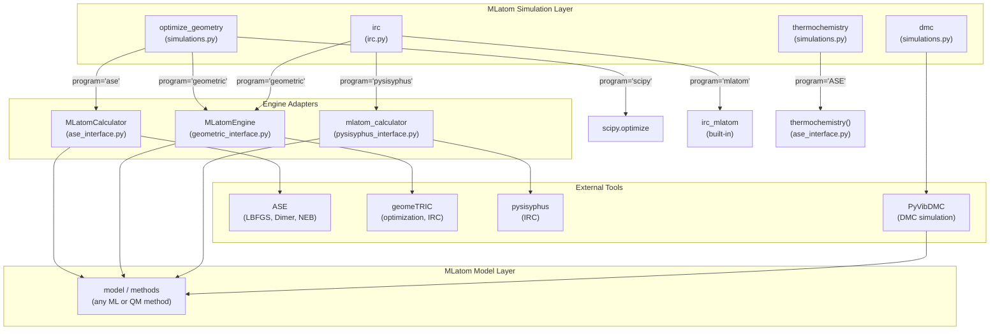

MLatom's architecture deliberately decouples **model evaluation** from **simulation orchestration**. While MLatom's native model classes handle energy/force/hessian prediction, the actual driving of geometry optimizations, intrinsic reaction coordinate (IRC) calculations, and quantum nuclear simulations is delegated to specialized external libraries. This page documents the adapter layer that bridges MLatom's internal data model to three external simulation engines—ASE, geomeTRIC, and pysisyphus—plus the PyVibDMC integration for diffusion Monte Carlo.

## Architecture: The Adapter Dispatch Pattern

The integration follows a consistent **Engine Adapter** pattern. Each external tool exposes a domain-specific API (ASE's `Calculator`, geomeTRIC's `Engine`, pysisyphus's `Calculator`) that expects atomic coordinates and returns energies/forces in its own unit convention. MLatom's adapter classes translate between MLatom's `molecule`/`molecular_database` data structures and each tool's expectations, while the `optimize_geometry` and `irc` classes in `simulations.py` and `irc.py` serve as dispatchers that select the appropriate backend.

Sources: [simulations.py](mlatom/simulations.py#L92-L268), [ase_interface.py](mlatom/interfaces/ase_interface.py#L1-L7), [geometric_interface.py](mlatom/interfaces/geometric_interface.py#L1-L16), [pysisyphus_interface.py](mlatom/interfaces/pysisyphus_interface.py#L1-L15)

## Program Auto-Detection and Dispatch Logic

When users instantiate `optimize_geometry` without explicitly specifying a `program`, MLatom employs a priority-based auto-detection strategy. The dispatcher checks for the presence of installed packages in a specific order, falling through to the next option if the current one is unavailable.

| Priority | Program | Detection Method | Default Algorithm |
|----------|---------|-----------------|-------------------|
| 1 | `geometric` | `importlib.util.find_spec('geometric')` | geomeTRIC's internal optimizer |
| 2 | `Gaussian` | `os.environ['GAUSS_EXEDIR']` | Gaussian's built-in |
| 3 | `ase` | `importlib.util.find_spec('ase')` | `LBFGS` |
| 4 | `scipy` | `importlib.util.find_spec('scipy')` | User-specified or scipy default |

The algorithm choice can also force program selection: specifying `optimization_algorithm='dimer'` or `'neb'` automatically overrides the program to `'ase'`, while `'qst2'` or `'qst3'` forces `'gaussian'`. The `maximum_number_of_steps` defaults to 200, and the `convergence_criterion_for_forces` defaults to 0.02 eV/Å for ASE-based optimizations. For transition state searches, only `'Gaussian'`, `'ASE'`, and `'geometric'` are supported backends.

Sources: [simulations.py](mlatom/simulations.py#L198-L221), [simulations.py](mlatom/simulations.py#L208-L213), [simulations.py](mlatom/simulations.py#L248-L250)

## ASE Integration: MLatomCalculator

The ASE integration lives entirely in [ase_interface.py](mlatom/interfaces/ase_interface.py) and centers on the `MLatomCalculator` class, which extends ASE's `ase.calculators.calculator.Calculator`. This adapter is the bridge that allows any MLatom model to participate as an energy/force provider within ASE's rich ecosystem of optimizers, molecular dynamics routines, and analysis tools.

### The MLatomCalculator Adapter

`MLatomCalculator` implements the minimal ASE `Calculator` contract by declaring `implemented_properties = ['energy', 'forces']` and overriding `calculate()`. The translation pipeline inside `calculate()` follows a specific sequence: the current ASE `Atoms` object is serialized to a temporary `extxyz` file, read back into an MLatom `molecule`, and the coordinates from that file are applied to a copy of the original molecule. This workaround exists because ASE `Atoms` objects do not natively carry MLatom-specific metadata like charge or multiplicity.

The energy conversion is critical: MLatom operates internally in Hartree, while ASE uses eV. The conversion factor `ase.units.Hartree` is applied to both energy and forces (forces are negative energy gradients, hence `forces = -energy_gradients`). For optimization trajectory tracking, a global `optimization_trajectory` object accumulates `molecular_trajectory_step` entries at each step. A post-processing pass removes the duplicate energy entry that ASE produces on initialization.

> [!TIP]
> The `MLatomCalculator` uses a temporary file round-trip (write extxyz → read back) to translate between ASE `Atoms` and MLatom `molecule`. This is explicitly noted as a workaround in the source. The global variable pattern for trajectory tracking (`globals()['optimization_trajectory']`) means nested or concurrent ASE optimizations within the same process would interfere with each other.

### Geometry Optimization via ASE

The `optimize_geometry()` function in `ase_interface.py` accepts a `model`, `initial_molecule`, convergence parameters, and an `optimization_algorithm` keyword (defaulting to `'LBFGS'`). It supports arbitrary ASE optimizer names through dictionary lookup (`optimize.__dict__[optimization_algorithm]`), meaning any optimizer registered in `ase.optimize` is accessible. The function also supports **constraints** through ASE's `FixBondLengths` and `FixInternals` constraint classes, mapped from a dictionary with keys `'bond_length'`, `'bonds'`, `'angles'`, and `'dihedrals'`.

The higher-level `opt_geom_ase()` method in `simulations.py` dispatches either to `ase_interface.optimize_geometry()` for minimum energy searches or to `ase_interface.transition_state()` when `self.ts=True`, passing through `ase_kwargs` as `program_kwargs`.

Sources: [ase_interface.py](mlatom/interfaces/ase_interface.py#L23-L89), [ase_interface.py](mlatom/interfaces/ase_interface.py#L172-L213), [simulations.py](mlatom/simulations.py#L335-L361)

### Transition State Search via ASE

ASE provides two transition state algorithms through MLatom's interface: the **Dimer method** and the **Nudged Elastic Band (NEB)**. The `transition_state()` function routes based on the `optimization_algorithm` parameter.

The **Dimer method** (`dimer_method()`) wraps ASE's `DimerControl`, `MinModeAtoms`, and `MinModeTranslate` classes. It accepts an optional `random_seed` kwarg for reproducibility. The dimer rotates in the space perpendicular to the minimum-mode direction to find the saddle point.

The **NEB method** (`nudged_elastic_band()`) requires separate `initial_molecule` and `final_molecule` arguments (reactant and product). It creates `number_of_middle_images` intermediate images (default 3), interpolates the path using `NEB.interpolate()`, and assigns `MLatomCalculator` to each intermediate image. The `MDMin` optimizer drives the band relaxation.

| Feature | Dimer Method | NEB |
|---------|-------------|-----|
| Input | Single TS guess geometry | Reactant + Product geometries |
| `optimization_algorithm` | `'dimer'` | `'NEB'` |
| Key ASE classes | `DimerControl`, `MinModeAtoms`, `MinModeTranslate` | `NEB`, `MDMin` |
| Extra parameter | `random_seed` | `number_of_middle_images` |
| ASE kwargs | Passed to `DimerControl` | Passed to `NEB` constructor |

Sources: [ase_interface.py](mlatom/interfaces/ase_interface.py#L91-L169)

### Thermochemistry via ASE

The `thermochemistry()` function in `ase_interface.py` leverages ASE's `IdealGasThermo` class to compute standard thermodynamic properties from vibrational frequencies and electronic energy. The function handles negative frequencies automatically (removes them before computation) and supports both linear and nonlinear molecular geometries. The `symmetry_number` attribute on the molecule defaults to 1 if not set.

Energy unit conversion follows a three-stage pipeline: MLatom Hartree → eV (via `ase.units.Hartree`) → kcal/mol (via `ev2kcal`) → Hartree (via `constants.kcalpermol2Hartree`). The computed properties are written directly onto the `molecule` object.

| Property | Description |
|----------|-------------|
| `molecule.ZPE` | Zero-point energy |
| `molecule.H` | Enthalpy at 298.15 K |
| `molecule.H0` | Enthalpy at 0 K |
| `molecule.U0` | Internal energy at 0 K |
| `molecule.G` | Gibbs free energy at 298.15 K |

This function is invoked by the `thermochem_ase()` method in `simulations.py`'s `thermochemistry` class, which chains a frequency calculation before the thermochemistry step.

Sources: [ase_interface.py](mlatom/interfaces/ase_interface.py#L214-L261), [simulations.py](mlatom/simulations.py#L831-L833)

## geomeTRIC Integration: MLatomEngine

The geomeTRIC integration ([geometric_interface.py](mlatom/interfaces/geometric_interface.py)) provides a more tightly-coupled engine adapter that handles both geometry optimization and IRC calculations. Unlike the ASE adapter's file-based translation, the geomeTRIC adapter works directly with coordinate arrays.

### The MLatomEngine Adapter

`MLatomEngine` extends `geometric.engine.Engine` and must construct a `geometric.molecule.Molecule` object during initialization. The constructor maps MLatom molecule properties—element symbols, coordinates (Å), charge, and multiplicity—into the geomeTRIC molecule format. The `build_topology(force_bonds=False)` call defers bond detection, which is appropriate for non-equilibrium geometries encountered during optimization.

The `calc_new()` method is the core evaluation hook called by geomeTRIC at each optimization step. It receives coordinates in **Bohr** and must return energy in Hartree and gradients in Hartree/Bohr. The conversion path is: received Bohr → multiplied by `constants.Bohr2Angstrom` to get Å for MLatom → model predicts energy (Hartree) and gradients (Hartree/Å) → gradients divided by `constants.Angstrom2Bohr` to return Hartree/Bohr. The trajectory is tracked via a simple list `self.trajdb` appended at each successful step.

> [!TIP]
> When geomeTRIC rejects an optimization step (e.g., line search failure), the `trajdb` list and geomeTRIC's internal `results.xyzs` can become misaligned. The `results_to_traj()` function handles this by performing RMSD-based alignment between stored trajectory molecules and geomeTRIC's result coordinates, skipping entries that don't match within a 1e-8 Å threshold.

### Geometry Optimization via geomeTRIC

The `optimize_geometry()` function in `geometric_interface.py` supports both minimum energy and transition state searches (controlled by the `ts` boolean). For transition state optimization, the hessian is pre-computed at the initial geometry and written to disk, as geomeTRIC requires an initial hessian for TS optimizations. The function wraps `geometric.optimize.run_optimizer()` with a `try/except` block that gracefully handles non-convergence: if `geometric.errors.GeomOptNotConvergedError` is raised, the trajectory accumulated in `trajdb` is still returned with a success flag.

The dispatcher in `simulations.py`'s `opt_geom_geometric()` stores both the `optimization_trajectory` and a `successful` flag. On failure, the initial geometry (with a single-point energy evaluation) is used as the "optimized" molecule.

Sources: [geometric_interface.py](mlatom/interfaces/geometric_interface.py#L17-L51), [geometric_interface.py](mlatom/interfaces/geometric_interface.py#L53-L98), [simulations.py](mlatom/simulations.py#L389-L404)

### IRC via geomeTRIC

The `generate_irc()` function in `geometric_interface.py` handles intrinsic reaction coordinate calculations. It follows the same pre-computation pattern as TS optimization: the hessian is computed and written to disk before launching geomeTRIC with `irc=True`. The default prediction kwargs ensure energy and gradients are calculated (`calculate_energy=True, calculate_energy_gradients=True`).

After geomeTRIC completes, reaction coordinates are extracted from the step indices in the log (`results.comms`). The trajectory is split at the TS point (where reaction coordinate equals 0) into forward and backward branches. The top-level `irc_geometric()` function in [irc.py](mlatom/irc.py) combines these branches using the `irc.combine()` classmethod, which reverses the forward trajectory and concatenates it with the backward trajectory through the shared TS point.

Sources: [geometric_interface.py](mlatom/interfaces/geometric_interface.py#L144-L204), [irc.py](mlatom/irc.py#L458-L462)

## pysisyphus Integration: mlatom_calculator

The pysisyphus interface ([pysisyphus_interface.py](mlatom/interfaces/pysisyphus_interface.py)) is specifically designed for IRC calculations. pysisyphus uses a fundamentally different model interface compared to geomeTRIC: instead of a single evaluation function, it requests **energy, forces, and hessian separately** through distinct method calls (`get_energy()`, `get_forces()`, `get_hessian()`). This is inefficient for models that compute these quantities simultaneously, which the source code explicitly notes as a design limitation.

### The mlatom_calculator Adapter

The `mlatom_calculator` extends pysisyphus's `Calculator` and uses a **caching dictionary** (`mlatom_results`, a class variable) to avoid redundant computations. When pysisyphus calls `get_energy()` and subsequently `get_forces()` at the same geometry, the cached result from the energy calculation is reused. The cache entry is deleted after retrieval to prevent stale data.

The constructor accepts initial energy, gradients, and hessian from the TS molecule, which avoids a redundant calculation at the starting geometry. Unit conversions are handled at the boundary: pysisyphus operates in Bohr, so coordinates are converted to Å before MLatom prediction, and gradients are converted from Hartree/Å to Hartree/Bohr on output. The hessian conversion divides by `(Angstrom2Bohr)²` to transform from Hartree/Ų to Hartree/Bohr².

### IRC via pysisyphus

The `generate_irc()` function supports directional control (`'forward'`, `'backward'`, or `'both'`) and configurable IRC algorithms (default: `'eulerpc'`). The pysisyphus `IRC_DICT` maps algorithm names to IRC integrator classes. Unlike geomeTRIC, pysisyphus **can** generate single-direction IRC paths.

After the IRC run completes, results are reassembled into a `molecular_database`. The trajectory ordering convention differs between tools: pysisyphus returns `forward (reversed) → TS → backward`, while Gaussian returns `backward (reversed) → TS → forward`. The interface normalizes this by reversing the trajectory for `'forward'` direction and negating reaction coordinates for `'backward'` direction.

> [!TIP]
> The pysisyphus interface includes a documented warning about a potential stale-cache problem: if the initial IRC step does not retrieve all three properties (energy, forces, hessian) from the TS, the cached results persist and corrupt subsequent steps. The `reset:bool=True` parameter and deletion-after-retrieval pattern mitigate this, but the design remains fragile for edge cases.

Sources: [pysisyphus_interface.py](mlatom/interfaces/pysisyphus_interface.py#L32-L115), [pysisyphus_interface.py](mlatom/interfaces/pysisyphus_interface.py#L117-L193)

## IRC Program Comparison

The `irc` class in [irc.py](mlatom/irc.py) dispatches to four possible backends. Each has distinct capabilities and limitations that influence which is appropriate for a given task.

| Feature | `mlatom` (built-in) | `geometric` | `pysisyphus` | `Gaussian` |
|---------|---------------------|-------------|--------------|------------|
| Direction control | Forward / Backward / Both | Both only | Forward / Backward / Both | Forward / Backward / Both |
| Hessian estimation | Bofill, SR1, PSB, or recalculate | geomeTRIC internal | Euler predictor-corrector | Gaussian internal |
| Integrator | LQA (local quadratic approximation) | geomeTRIC default | Configurable (eulerpc, etc.) | Gaussian default |
| Coordinate system | Mass-weighted | Cartesian | Mass-weighted (Bohr) | Gaussian internal |
| TS frequency validation | Automatic (runs `freq` if needed) | Automatic | Automatic | Skipped (Gaussian computes own) |
| Dependency | None | `geometric` | `pysisyphus` | Gaussian + `$GAUSS_EXEDIR` |

The built-in `mlatom` IRC implementation ([irc.py](mlatom/irc.py#L518-L659)) uses a **local quadratic approximation (LQA)** integrator and supports three Hessian update schemes: **Bofill** (default), **SR1** (symmetric rank-1), and **PSB** (Powell-symmetric-Broyden). The first displacement is derived from the imaginary-frequency normal mode, scaled by the user-specified `init_length` parameter. Each subsequent step uses the integrator to compute a mass-weighted step from the current gradient and (estimated) Hessian. Propagation terminates when either the gradient norm falls below `thred` (default 1e-5) or `n_steps` is exhausted.

Sources: [irc.py](mlatom/irc.py#L14-L70), [irc.py](mlatom/irc.py#L520-L658), [irc.py](mlatom/irc.py#L727-L775)

## PyVibDMC Integration: Diffusion Monte Carlo

The `dmc` class in [simulations.py](mlatom/simulations.py#L867-L958) wraps the external `PyVibDMC` package to perform diffusion Monte Carlo simulations for zero-point energy calculations. This integration follows a **potential function callback** pattern rather than an adapter class pattern.

The `potential_function()` method accepts walker coordinates from PyVibDMC (in Bohr) and returns energies. It constructs a `molecular_database` from the batch of coordinates, calls `model.predict()` for energy evaluation, and applies an `energy_scaling_factor`. PyVibDMC's `Potential_Direct` wrapper consumes this callback. The `initialize()` method uses PyVibDMC's `InitialConditioner` for harmonic oscillator sampling to generate the initial walker distribution.

The `run()` method configures and launches the full DMC simulation with parameters for walker count, timestep length (converted from fs to atomic units via `constants.fs2au`), equilibration, and descendant weighting. Results are loaded from the HDF5 output file via `pyvibdmc.SimInfo`, and `get_zpe()` returns the zero-point energy in Hartree, averaged from a configurable starting step.

Sources: [simulations.py](mlatom/simulations.py#L867-L958)

## Unit Conversion Reference

Each integration boundary involves unit conversions between MLatom's internal conventions and the external tool's conventions. This table summarizes the critical conversion points.

| Quantity | MLatom Internal | ASE | geomeTRIC | pysisyphus | PyVibDMC |
|----------|----------------|-----|-----------|------------|----------|
| Energy | Hartree | eV (×`Hartree`) | Hartree | Hartree | Hartree |
| Coordinates | Å | Å | Bohr (÷`Angstrom2Bohr`) | Bohr (÷`Angstrom2Bohr`) | Bohr |
| Forces | Hartree/Å | eV/Å | Hartree/Bohr | Hartree/Bohr | N/A |
| Hessian | Hartree/Ų | N/A | N/A | Hartree/Bohr² (÷`Angstrom2Bohr²`) | N/A |

Sources: [ase_interface.py](mlatom/interfaces/ase_interface.py#L203-L212), [geometric_interface.py](mlatom/interfaces/geometric_interface.py#L38-L51), [pysisyphus_interface.py](mlatom/interfaces/pysisyphus_interface.py#L49-L78), [simulations.py](mlatom/simulations.py#L890-L894)

## Continuation

This page covered the simulation tool integration layer. The following pages provide deeper dives into specific workflows and the underlying model system:

- **[Geometry Optimization Workflows](17-geometry-optimization-workflows)** — End-to-end optimization pipelines including constrained optimization, convergence behavior, and trajectory analysis
- **[Nonadiabatic and Surface-Hopping Dynamics](20-nonadiabatic-and-surface-hopping-dynamics)** — Advanced dynamics simulations that build on these same model interfaces
- **[Model Class Hierarchy](9-model-class-hierarchy)** — The model objects that all these adapters ultimately invoke through `_predict_geomopt()` and `predict()`
- **[Quantum Chemistry Program Interfaces](14-quantum-chemistry-program-interfaces)** — The Gaussian and PySCF interfaces that serve as alternative optimization backends