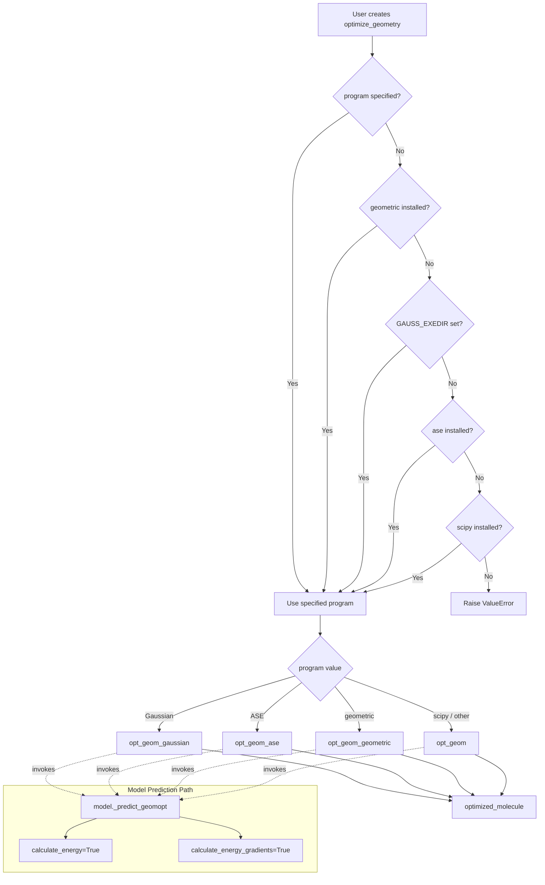

Geometry optimization is the computational process of finding stationary points on a molecular potential energy surface (PES) — typically energy minima or first-order saddle points (transition states). In MLatom, this capability is orchestrated through a unified class that routes requests to multiple backend engines depending on what software is available in the environment. The design philosophy decouples the model (any energy/gradient provider) from the optimization algorithm, enabling ML potentials, semi-empirical methods, and quantum chemistry programs to drive geometry searches through an identical interface.

Sources: [simulations.py](mlatom/simulations.py#L92-L154)

## Architecture Overview

The geometry optimization subsystem follows a hub-and-spoke architecture. The central orchestrator is `optimize_geometry`, which accepts a model, an initial molecule, and a set of control parameters. During `__init__`, the class inspects the runtime environment, selects an appropriate backend engine, and immediately invokes the corresponding optimization method. This eager-evaluation pattern means results are available as soon as the object is constructed.



The auto-detection priority follows a strict cascade: **geometric** → **Gaussian** (if `$GAUSS_EXEDIR` is set) → **ASE** → **scipy**. This priority reflects a preference for purpose-built geometry optimizers over generic scientific libraries, as seen in the constructor logic at lines 198–203 of `simulations.py`.

Sources: [simulations.py](mlatom/simulations.py#L155-L268)

## The `optimize_geometry` Class

### Constructor and Initialization

The constructor accepts a comprehensive set of parameters that control every aspect of the optimization workflow. Two molecule arguments exist for backward compatibility — `initial_molecule` and `molecule` — but they cannot both be provided simultaneously, raising a `ValueError` if they are. When `molecule` is used, the optimized result is written back into the same object (in-place overwrite), whereas `initial_molecule` leaves the original untouched.

The constructor automatically enforces two essential model prediction flags: `calculate_energy=True` and `calculate_energy_gradients=True`. These are injected into `model_predict_kwargs` even if the user did not specify them, because every geometry optimizer requires both energies and gradients to proceed. Additional bookkeeping parameters — trajectory dump settings, format, filename — are also packed into `model_predict_kwargs` so that the model's `_predict_geomopt` helper can handle them during each step.

A critical design detail is the **trajectory dumping mechanism**. When `dump_trajectory_interval` is set (including being forced to `1` for Gaussian optimizations), a `molecular_trajectory` object is created and begins dumping to disk immediately in the specified format (`json` or `h5md`). This enables post-hoc analysis of the optimization path even for very long runs.

Sources: [simulations.py](mlatom/simulations.py#L155-L275)

### Parameter Reference

| Parameter | Type | Default | Description |
|-----------|------|---------|-------------|
| `model` | `model` / `methods` | `None` | Any model providing energies and forces |
| `model_predict_kwargs` | `dict` | `{}` | Additional model prediction keyword arguments |
| `initial_molecule` | `molecule` | `None` | Starting geometry (non-destructive) |
| `molecule` | `molecule` | `None` | Starting geometry (overwritten with result) |
| `ts` | `bool` | `False` | Enable transition state search |
| `reactants` | `molecule` | `None` | Reactant for TS methods (qst2/qst3) |
| `products` | `molecule` | `None` | Product for TS methods (qst2/qst3) |
| `program` | `str` | auto-detect | Backend engine |
| `program_kwargs` | `dict` | `{}` | Engine-specific keyword arguments |
| `optimization_algorithm` | `str` | `None` | Specific algorithm (e.g., `'LBFGS'`, `'dimer'`) |
| `maximum_number_of_steps` | `int` | `200` | Step limit for ASE/scipy/geometric |
| `convergence_criterion_for_forces` | `float` | `0.02` | Force convergence in eV/Å (ASE) |
| `working_directory` | `str` | `'.'` | Directory for output files |
| `constraints` | `dict` | `None` | Geometric constraints (ASE/geometric) |
| `dump_trajectory_interval` | `int` | `None` | Dump every N steps (`None` = disabled) |
| `filename` | `str` | auto UUID | Trajectory output filename |
| `format` | `str` | `'json'` | Trajectory format (`json` or `h5md`) |
| `print_properties` | `bool`/`str` | `None` | Print progress (`None`, `'all'`) |

Sources: [simulations.py](mlatom/simulations.py#L92-L154)

## Backend Engines

### Geometric (Preferred Default)

The `geometric` library from the Grimme group is the first-choice engine when available. The integration is implemented in `mlatom/interfaces/geometric_interface.py` through a custom engine class `MLatomEngine` that subclasses `geometric.engine.Engine`. This engine translates between MLatom's molecule representation and geometric's internal coordinate system.

The `MLatomEngine.calc_new` method performs the critical unit conversion: geometric operates in **Bohr**, so incoming coordinates are converted from Bohr to Ångström before being set on the MLatom molecule, and the resulting gradients are converted back by dividing by `Angstrom2Bohr`. The energy is returned in Hartree (MLatom's native unit), while the gradient is flattened to a 1D array as geometric expects.

For **transition state searches**, the geometric backend first computes the Hessian at the initial geometry and writes it to a temporary file, then passes this initial Hessian to `geometric.optimize.run_optimizer` with `transition=True`. If optimization fails to converge (raised as `GeomOptNotConvergedError`), the last computed geometry is still returned as the result rather than the initial geometry. If a completely different error occurs, the initial geometry is used instead.

The `results_to_traj` function reconstructs a full optimization trajectory by reconciling geometric's internal step list with MLatom's trajectory database. A potential misalignment can occur when geometric rejects steps — the function handles this by comparing RMSD between stored molecules and reported coordinates to filter out rejected steps.

Sources: [geometric_interface.py](mlatom/interfaces/geometric_interface.py#L17-L98)

### ASE (Atomic Simulation Environment)

The ASE backend provides the widest algorithm variety, including both minimum and transition state search methods. The integration works through a custom `MLatomCalculator` that subclasses ASE's `Calculator` class. Energy unit conversion is handled explicitly: MLatom energies in Hartree are multiplied by `ase.units.Hartree`, and forces (negative gradients) are similarly scaled.

For **minimum energy optimizations**, ASE's `optimize` dispatch table is used directly — meaning any ASE optimizer name can be passed as `optimization_algorithm` (default: `'LBFGS'`). The convergence criterion maps to ASE's `fmax` parameter in eV/Å.

For **transition state searches**, two specialized algorithms are available through ASE:

- **Dimer method** (`optimization_algorithm='dimer'`): Uses ASE's `DimerControl`, `MinModeAtoms`, and `MinModeTranslate` classes. Supports a `random_seed` kwarg passed through `ase_kwargs`.
- **NEB (Nudged Elastic Band)** (`optimization_algorithm='neb'`): Requires both `reactants` and `products` molecules, and uses ASE's `NEB` class with `MDMin` as the image optimizer. The `number_of_middle_images` parameter (default 3) controls path resolution.

A notable implementation detail is that the ASE backend uses global variables (`initial_molecule`, `optimization_trajectory`) to pass context into the `MLatomCalculator.calculate` method. The code comments acknowledge this as an "ugly solution" — it's a pragmatic workaround for ASE's calculator interface not cleanly supporting external molecule objects. Additionally, ASE has a quirk of recording duplicate energy entries at the start of optimization, which is detected and corrected by comparing the first two step energies and shifting step indices.

Sources: [ase_interface.py](mlatom/interfaces/ase_interface.py#L23-L169)

### Gaussian

The Gaussian backend delegates all optimization work to the Gaussian quantum chemistry program through its external interface. When the program is selected, the model is serialized to `model.json` and a Gaussian input file (`gaussianN.com`) is generated with the appropriate task keyword — `opt` for minimum energy or `ts` for transition state. For the specialized `qst2` and `qst3` algorithms, reactant and product geometries are included in the input file.

Success detection is performed by scanning the Gaussian log file for the string `'Stationary point found'`. If found, `self.successful` is set to `True` and the optimized molecule is extracted from the last step of the optimization trajectory. If convergence is not achieved, the initial molecule is returned with all atomic coordinates set to `[None, None, None]` — a sentinel state indicating failure.

The Gaussian backend always forces `dump_trajectory_interval=1`, as the trajectory file is needed to reconstruct the optimization path from disk after Gaussian completes.

Sources: [simulations.py](mlatom/simulations.py#L277-L333)

### SciPy (Fallback)

The SciPy backend serves as the minimal-fallback option when no dedicated optimization software is installed. It wraps `scipy.optimize.minimize` with a closure-based objective function that takes flat coordinate arrays, reshapes them into molecular geometry, invokes `model._predict_geomopt`, and returns both the energy and gradient.

This backend has the most limited feature set: it supports no constraints, no transition state search, and relies entirely on the SciPy optimizer's own convergence criteria. The optimization algorithm is passed directly to SciPy's `method` parameter with no default value — if `None`, SciPy will choose its own.

Sources: [simulations.py](mlatom/simulations.py#L362-L387)

### Program Selection Matrix

| Feature | Gaussian | ASE | Geometric | SciPy |
|---------|----------|-----|-----------|-------|
| Minimum energy optimization | ✓ | ✓ | ✓ | ✓ |
| Transition state search | ✓ | ✓ (dimer/NEB) | ✓ | ✗ |
| QST2/QST3 | ✓ | ✗ | ✗ | ✗ |
| Constraints | ✗ | ✓ | ✓ | ✗ |
| Custom optimizer | ✗ | ✓ | ✗ | ✓ |
| Max steps control | N/A | ✓ | ✓ | N/A |
| Force convergence | N/A | ✓ | ✓ | N/A |
| Graceful non-convergence | ✗ | ✗ | ✓ | ✗ |

Sources: [simulations.py](mlatom/simulations.py#L208-L268), [ase_interface.py](mlatom/interfaces/ase_interface.py#L91-L169), [geometric_interface.py](mlatom/interfaces/geometric_interface.py#L53-L98)

## Model Integration and the `_predict_geomopt` Path

All optimization backends ultimately invoke energy and gradient predictions through a single code path: `model._predict_geomopt()`. This method is defined in the base `model` class in `model_cls.py` and acts as a wrapper around `predict()` that adds optimization-specific side effects.

The `_predict_geomopt` method receives the standard prediction kwargs plus several internal parameters: `return_string` (controls whether to return a string for external program interfaces), `dump_trajectory_interval` (controls intermediate trajectory dumping), `filename` and `format` (for trajectory I/O), and `print_properties` (for progress output). This indirection allows the model to handle trajectory bookkeeping centrally while keeping the optimization engines clean of I/O concerns.

The base `model` class is documented as a "Parent (super) class for models to enable useful features such as logging during geometry optimizations." All concrete model implementations — `krr`, `kreg`, `ani_methods`, `aiqm1`, `mace_methods`, etc. — inherit from this class either directly or through intermediate mixins like `torch_model`, `method_model`, or `downloadable_model`, ensuring that every model type can participate in geometry optimizations without engine-specific adaptation.

Sources: [model_cls.py](mlatom/model_cls.py#L20-L87)

## Constraint System

Geometric constraints are supported in both the ASE and geometric backends, passed through the `constraints` parameter. The constraint dictionary uses a structured format that is translated into backend-native constraint objects.

For **ASE**, the constraint dictionary supports:

| Key | Value Format | ASE Translation |
|-----|-------------|-----------------|
| `bond_length` | `[[idx0, idx1], ...]` | `FixBondLengths` |
| `bonds` | `[[target, [idx0, idx1]], ...]` | `FixInternals(bonds=...)` |
| `angles` | `[[target, [idx0, idx1, idx2]], ...]` | `FixInternals(angles_deg=...)` |
| `dihedrals` | `[[target, [idx0, idx1, idx2, idx3]], ...]` | `FixInternals(dihedrals_deg=...)` |

Both `FixBondLengths` and `FixInternals` constraints are applied as a combined list via `atoms.set_constraint()`. The geometric backend passes constraints through `geometric_kwargs` directly to the geometric library's optimization routine.

> [!TIP]
> Constraints are silently ignored by the Gaussian and SciPy backends. If your optimization requires constraints (e.g., constrained dihedral scans), explicitly set `program='ASE'` or `program='geometric'` to ensure they are enforced. The constructor does not validate constraint compatibility with the selected backend.

Sources: [simulations.py](mlatom/simulations.py#L222-L223), [ase_interface.py](mlatom/interfaces/ase_interface.py#L42-L68)

## Transition State Search

### Algorithm Routing

When `ts=True` is set, the `optimize_geometry` constructor validates that the selected program supports transition state search — only Gaussian, ASE, and geometric are permitted. Additionally, the `optimization_algorithm` parameter can force the program selection:

- Algorithms `'dimer'` and `'neb'` automatically switch the program to ASE.
- Algorithms `'qst2'` and `'qst3'` automatically switch to Gaussian.

This cross-parameter validation ensures that incompatible algorithm/program combinations are resolved before optimization begins.

### The `gen_ts` Function

For more elaborate transition state generation, the standalone `gen_ts()` function provides access to the **ECTS** (Elaborate Constrained Transition State) method implemented in `gen_ts_methods.py`. This function accepts separate `reactant` and `product` molecules (unlike `optimize_geometry` which uses `reactants`/`products` for QST methods), along with control parameters for the number of transition states (`n_ts`), path points (`n_path`), and averaging options.

Sources: [simulations.py](mlatom/simulations.py#L406-L437)

## IRC (Intrinsic Reaction Coordinate) Calculations

IRC calculations trace the minimum energy path connecting a transition state to reactant and product valleys. MLatom provides IRC functionality through two external engines.

### Geometric IRC

The geometric IRC interface in `geometric_interface.py` follows the same `MLatomEngine` pattern as geometry optimization. It requires a pre-computed Hessian (written to a temporary file as `hessian.txt`), then invokes `geometric.optimize.run_optimizer` with `irc=True`. The reaction coordinates are extracted from geometric's comment lines (step indices), and the trajectory is post-processed to handle the forward/backward directionality.

### PySyphus IRC

The pysisyphus interface provides a more sophisticated IRC implementation with multiple algorithm choices (default: `'eulerpc'`). The `mlatom_calculator` class adapts MLatom models to pysisyphus's `Calculator` interface, handling energy, forces, and Hessian separately through cached results to avoid redundant calculations — a critical optimization since pysisyphus calls `get_energy`, `get_forces`, and `get_hessian` independently.

Unit conversions in pysisyphus are handled at the calculator level: gradients are converted to forces by negation and dividing by `Angstrom2Bohr`, while Hessian elements are divided by `Angstrom2Bohr²`. The resulting trajectory uses mass-weighted reaction coordinates from pysisyphus's internal computation.

> [!TIP]
> The pysisyphus interface carries a documented warning about a potential bug: if the initial IRC step fails to retrieve all three results (energy, gradients, Hessian) from the transition state, cached values from the initial step may persist into subsequent steps and cause errors. This is a known limitation of pysisyphus's separated property retrieval pattern.

### Native MLatom IRC

MLatom also includes a built-in IRC implementation in `mlatom/irc.py` with its own LQA (Local Quadratic Approximation) integrator (`integrator_lqa` class) and Hessian update methods including Powell (`psb`), SR1 (`sr1`), and Bofill (`bofill`) algorithms. The `irc` class manages IRC trajectories with full support for forward/backward direction splitting, trajectory persistence (JSON and XYZ formats), plotting, and result loading from previous calculations.

Sources: [geometric_interface.py](mlatom/interfaces/geometric_interface.py#L144-L204), [pysisyphus_interface.py](mlatom/interfaces/pysisyphus_interface.py#L1-193), [irc.py](mlatom/irc.py#L14-L832)

## Numerical Gradients and Hessian

When a model does not provide analytical gradients, MLatom can compute them numerically through `numerical_gradients()` in `simulations.py`. This function uses **two-point central finite differences** with a default displacement of `1e-5` Å. For a molecule with N atoms, it requires `3N + 1` single-point energy evaluations (3N displaced geometries plus the reference).

The implementation supports **parallel execution** via `joblib.Parallel`. When multiple threads are used, the model's thread count is temporarily set to 1 per worker to avoid oversubscription, then restored after computation. This is essential for models with internal parallelism (e.g., Fortran-backed KREG). The function can optionally return the full molecular database of displaced geometries for debugging or analysis purposes.

A companion function `numerical_hessian()` handles numerical Hessian computation with a larger default displacement of `5.29167e-4` Å (approximately 0.001 Bohr), which is appropriate for the second-order finite differences used in Hessian calculations.

Sources: [simulations.py](mlatom/simulations.py#L960-L1010)

## Usage Patterns

### Basic Minimum Energy Optimization

```python
import mlatom as ml

# Define the molecule and model
mol = ml.data.molecule()
mol.read_from_xyz_file(filename='ethanol.xyz')
aiqm1 = ml.models.methods(method='AIQM1', qm_program='MNDO')

# Run optimization (auto-selects backend)
geomopt = ml.simulations.optimize_geometry(
    model=aiqm1,
    initial_molecule=mol,
    program='ASE'
)

# Access results
optmol = geomopt.optimized_molecule
geo = optmol.get_xyz_coordinates()
energy = optmol.energy
gradient = optmol.get_energy_gradients()
```

### Constrained Optimization with Geometric

```python
geomopt = ml.simulations.optimize_geometry(
    model=my_model,
    initial_molecule=mol,
    program='geometric',
    constraints={
        'bonds': [[1.09, [0, 1]]],
        'dihedrals': [[180.0, [0, 1, 2, 3]]]
    },
    maximum_number_of_steps=500
)
```

### Transition State Search

```python
# Dimer method via ASE
ts_opt = ml.simulations.optimize_geometry(
    model=my_model,
    initial_molecule=ts_guess,
    ts=True,
    program='ASE',
    optimization_algorithm='dimer'
)

# QST3 via Gaussian
ts_opt = ml.simulations.optimize_geometry(
    model=my_model,
    molecule=ts_guess,
    ts=True,
    reactants=reactant_mol,
    products=product_mol,
    program='Gaussian',
    optimization_algorithm='qst3'
)
```

### Trajectory Inspection

```python
# Enable trajectory dumping during optimization
geomopt = ml.simulations.optimize_geometry(
    model=my_model,
    initial_molecule=mol,
    program='geometric',
    dump_trajectory_interval=1,
    filename='opt_traj.json'
)

# Iterate through optimization steps
for step in geomopt.optimization_trajectory.steps:
    print(f"Step {step.step}: E = {step.molecule.energy:.6f} Ha")
```

Sources: [simulations.py](mlatom/simulations.py#L134-L151)

## Parallel Geometry Optimization

The `run_in_parallel()` function in `simulations.py` enables batch optimization across multiple molecules simultaneously. It uses `joblib.Parallel` for distribution and handles thread-per-model allocation intelligently: when there are fewer molecules than available threads, each model receives multiple threads; when there are more molecules than threads, each gets one.

The function supports optional temporary directory creation for each parallel job (useful for external program backends that may have file I/O conflicts), error-tolerant execution via `proceed_on_error`, and thread-count management for models with internal parallelism — the same pattern used by `numerical_gradients`.

Sources: [simulations.py](mlatom/simulations.py#L25-L90)

## CLI Integration

From the command line, geometry optimization is dispatched through `MLtasks.geomopt()` in `mlatom/MLtasks.py`, which parses the `geomopt` task from CLI arguments. The task loads the method/model, the molecular database, and delegates to `optimize_geometry`. A companion function `optfreq()` combines geometry optimization with frequency analysis — the natural next step for verifying that a stationary point is a true minimum (all real frequencies) or transition state (exactly one imaginary frequency).

Sources: [MLtasks.py](mlatom/MLtasks.py#L378-L454)

---

**Next Steps**: After completing geometry optimization, you will typically want to verify the nature of the stationary point through frequency analysis — see [Frequency and Thermochemistry Calculations](18-frequency-and-thermochemistry-calculations). For transition states, IRC analysis provides additional validation of the reaction path — see [Nonadiabatic and Surface-Hopping Dynamics](20-nonadiabatic-and-surface-hopping-dynamics) for advanced dynamics. To understand the model types that can drive these optimizations, consult [Model Class Hierarchy](9-model-class-hierarchy). For deeper exploration of how external programs are wrapped, see [Quantum Chemistry Program Interfaces](14-quantum-chemistry-program-interfaces) and [ASE and Simulation Tool Integration](16-ase-and-simulation-tool-integration).