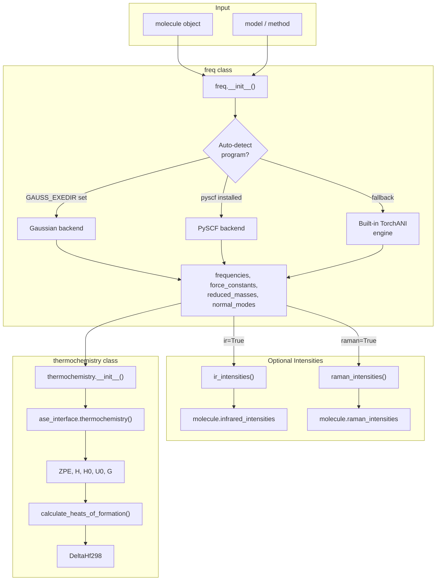

This page documents MLatom's frequency analysis and thermochemistry pipeline — the machinery that converts a stationary-point geometry into vibrational spectra, thermodynamic corrections, and heats of formation. The system unifies three computational backends (Gaussian, PySCF, and a built-in TorchANI-derived engine) behind a single `freq` class, then layers thermochemical analysis on top via the `thermochemistry` class. Understanding this pipeline is essential for validating molecular minima, predicting IR/Raman spectra, and computing Gibbs free energies that feed into [Geometry Optimization Workflows](17-geometry-optimization-workflows) and [Active Learning Pipeline](24-active-learning-pipeline).

## Architectural Overview

The frequency and thermochemistry subsystem lives entirely in [`mlatom/simulations.py`](mlatom/simulations.py) and connects to three external backends through the interfaces layer. The core data flow follows a strict topological ordering: model prediction → Hessian assembly → eigenvalue decomposition → normal mode extraction → intensity calculation → thermodynamic property assembly.



## Frequency Analysis Engine

The `freq` class ([`simulations.py`](mlatom/simulations.py#L440-L763)) is the central orchestrator. Upon instantiation, it automatically selects a computational backend, invokes the model for the Hessian, solves the vibrational eigenvalue problem, and optionally computes spectral intensities — all in a single constructor call.

### Constructor and Backend Selection

The constructor accepts a model (or QM method), a molecule, and several control flags. Backend selection follows a priority chain: if `program` is explicitly provided, it is used; otherwise the system probes for PySCF first, then checks the `GAUSS_EXEDIR` environment variable for Gaussian, and finally falls back to the built-in TorchANI-derived numerical engine ([`simulations.py`](mlatom/simulations.py#L520-L538)).

| Parameter | Type | Default | Description |
|-----------|------|---------|-------------|
| `model` | `model` or `methods` | `None` | Any model or method providing energies, forces, and Hessian |
| `molecule` | `data.molecule` | `None` | Molecule at a stationary point (energy minimum or transition state) |
| `program` | `str` | auto-detected | One of `'Gaussian'`, `'PySCF'`, `'ASE'`, or any other string for the built-in engine |
| `ir` | `bool` | `False` | Calculate infrared intensities (requires dipole derivative support) |
| `raman` | `bool` | `False` | Calculate Raman intensities (requires polarizability derivative support) |
| `normal_mode_normalization` | `str` | `'mass deweighted normalized'` | Normal mode convention: see Normal Mode Normalization section below |
| `anharmonic` | `bool` | `False` | Request anharmonic frequency calculation (Gaussian only) |
| `anharmonic_kwargs` | `dict` | `{}` | Additional keywords for anharmonic calculations (Gaussian only) |
| `working_directory` | `str` | `'.'` | Directory for temporary/intermediate files |

When `ir=True`, the constructor automatically injects `calculate_dipole_derivatives=True` into the model's prediction kwargs ([`simulations.py`](mlatom/simulations.py#L515-L516)). Similarly, `raman=True` injects `calculate_polarizability_derivatives=True` ([`simulations.py`](mlatom/simulations.py#L517-L519)). This design ensures models are queried for exactly the properties needed without requiring the user to manually wire these flags.

### The Built-in TorchANI-Derived Engine

The default computational path — `freq_modified_from_TorchANI` ([`simulations.py`](mlatom/simulations.py#L650-L762)) — is adapted from TorchANI (citing Gao et al., J. Chem. Inf. Model. 2020, 60, 3408). It performs the complete harmonic analysis pipeline in four stages.

**Stage 1 — Model prediction.** The model is called with `calculate_energy=True`, `calculate_energy_gradients=True`, and `calculate_hessian=True` to obtain the full Hessian matrix ([`simulations.py`](mlatom/simulations.py#L685-L686)). If the model only provides energies, the system falls back to [`numerical_hessian()`](mlatom/simulations.py#L1011-L1037), which computes second derivatives via two-point numerical differentiation of gradients.

**Stage 2 — Mass-weighted eigenvalue problem.** The Hessian is converted to mass-weighted coordinates through Löwdin diagonalization. Given Hessian **H** and diagonal mass matrix **T**, the system solves **T**⁻¹/² **H** **T**⁻¹/² **q'** = ω² **q'** where **q'** = **T**¹/² **q** ([`simulations.py`](mlatom/simulations.py#L690-L701)). The eigenvalues yield angular frequencies, which are converted to wavenumbers (cm⁻¹) via the unit converter `17091.7006789297` ([`simulations.py`](mlatom/simulations.py#L688-L716)).

**Stage 3 — Normal mode transformation.** Eigenvectors (the columns of the eigenvalue solution) represent mass-weighted normalized (MWN) modes. These are then transformed to the requested normalization convention ([`simulations.py`](mlatom/simulations.py#L722-L738)):

- **MWN** → **MDU**: divide by √(mass) for each Cartesian component
- **MDU** → **MDN**: normalize each mode vector to unit length

Reduced masses are computed as the square of the MDU normalization factors (in AMU), and force constants are converted from Ha/(AMU·Å²) to mDyne/Å using the factor `4.359744650780506` ([`simulations.py`](mlatom/simulations.py#L688), [`simulations.py`](mlatom/simulations.py#L728-L731)).

**Stage 4 — Attribute assignment.** The resulting `frequencies` (cm⁻¹), `force_constants` (mDyne/Å), `reduced_masses` (AMU), and per-atom `normal_modes` arrays are stored directly on the molecule object ([`simulations.py`](mlatom/simulations.py#L754-L761)). By default, all eigenvalues are returned (including translational/rotational modes), since filtering logic was commented out due to ambiguity around negative frequency handling at saddle points ([`simulations.py`](mlatom/simulations.py#L742-L753)).

> [!TIP]
> The built-in engine does **not** filter out translational and rotational modes (the first 5–6 eigenvalues). Downstream consumers such as the thermochemistry module handle this filtering themselves. If you are consuming frequencies directly, be aware that the array includes these non-vibrational entries.

### Gaussian and PySCF Backends

The **Gaussian backend** (`freq_gaussian`, [`simulations.py`](mlatom/simulations.py#L548-L569)) delegates the entire frequency calculation to Gaussian via an external interface. It serializes the model and molecule to JSON, invokes Gaussian with either `Freq` or `Freq(anharmonic)` keywords, and then parses the output back. Anharmonic calculations are supported by passing `anharmonic=True` and optional `anharmonic_kwargs` such as `['NoRaman']` ([`gaussian_interface.py`](mlatom/interfaces/gaussian_interface.py#L188-L199)).

The **PySCF backend** (`freq_pyscf`, [`simulations.py`](mlatom/simulations.py#L571-L576)) calls `model.predict()` with `calculate_hessian=True`, then delegates thermodynamic analysis to `pyscf_interface.thermo_calculation()`. This path also invokes `thermo_modified_from_pyscf()` for the full statistical thermodynamics treatment ([`pyscf_interface.py`](mlatom/interfaces/pyscf_interface.py#L376-L537)).

### Numerical Differentiation Utilities

For models that lack analytical Hessians, MLatom provides [`numerical_hessian()`](mlatom/simulations.py#L1011-L1037) and [`numerical_gradients()`](mlatom/simulations.py#L960-L1009). The Hessian function uses a nested two-point scheme: outer loop displaces each coordinate by `displacement` (default 5.29167×10⁻⁴ Å ≈ 0.001 bohr) and computes numerical gradients at each displaced geometry, which themselves use two-point differentiation with `displacement4grads` (default 1×10⁻⁵ Å). All single-point calculations are parallelized via `joblib` ([`simulations.py`](mlatom/simulations.py#L995-L1004)).

| Function | Default displacement | Parallelized | Output location |
|----------|---------------------|--------------|-----------------|
| `numerical_gradients()` | 1×10⁻⁵ Å | Yes (via joblib) | `molecule.energy_gradients` |
| `numerical_hessian()` | 5.29167×10⁻⁴ Å | Yes (inner gradients) | `molecule.hessian` |

## Normal Mode Normalization Conventions

Different quantum chemistry packages output normal modes in different coordinate representations. MLatom's frequency engine supports all three major conventions, which is critical when interfacing with external programs or when composing model trees in [Model Class Hierarchy](9-model-class-hierarchy).

The transformation chain and orthogonality properties are summarized below. Let **L** = **T**⁻¹/² **Q** where **Q** are the eigenvectors and **T** is the mass matrix.

| Convention | Abbreviation | Formula from eigenvectors | Orthogonal? | Normalized? | Used by |
|------------|-------------|--------------------------|-------------|-------------|---------|
| Mass-weighted normalized | MWN | **L** (raw eigenvectors) | Yes | Yes | Internal computation |
| Mass-deweighted unnormalized | MDU | **L** · diag(1/√mᵢ) | No | No | ASE |
| Mass-deweighted normalized | MDN | MDU / ‖MDU‖ | No | Yes | Gaussian, ORCA (default in MLatom) |

When `ir=True` or `raman=True` with a non-Gaussian backend, the intensity calculation methods internally convert the stored modes from the requested normalization back through the chain: MDN → MWN (by rescaling with √mass and re-normalizing) → MDU (by dividing by √mass), because the dipole/polarizability derivative contraction requires mass-deweighted unnormalized modes ([`simulations.py`](mlatom/simulations.py#L587-L604), [`simulations.py`](mlatom/simulations.py#L617-L633)).

> [!TIP]
> If you switch `normal_mode_normalization` to `'mass weighted normalized'`, the `ir_intensities()` and `raman_intensities()` methods will return early without computation ([`simulations.py`](mlatom/simulations.py#L605), [`simulations.py`](mlatom/simulations.py#L635)). Always use `'mass deweighted normalized'` or `'mass deweighted unnormalized'` when requesting spectral intensities.

## IR and Raman Intensity Calculation

### Infrared Intensities

The `ir_intensities()` method ([`simulations.py`](mlatom/simulations.py#L581-L611)) computes IR intensities in km/mol from dipole derivatives (expected in Debye/Å) using the formula:

*I*ₖ = κ · Σₜ (∂μₜ/∂Qₖ)²

where κ is a composite physical constant involving the fine structure constant, Avogadro's number, Bohr-to-Ångström conversion, and Debye unit conversion ([`simulations.py`](mlatom/simulations.py#L585)). The dipole derivatives are reshaped to a (3N×3) matrix and contracted with the mass-deweighted unnormalized normal modes via `np.dot` and `np.einsum` ([`simulations.py`](mlatom/simulations.py#L606-L611)).

### Raman Intensities

The `raman_intensities()` method ([`simulations.py`](mlatom/simulations.py#L613-L647)) computes Raman scattering activities from polarizability derivatives. For each normal mode, the isotropic (ᾱ²) and anisotropic (γ²) invariants are computed:

ᾱ² = (α'ₓₓ + α'ᵧᵧ + α'ᵤᵤ)² / 9

γ² = [(α'ₓₓ − α'ᵧᵧ)² + (α'ₓₓ − α'ᵤᵤ)² + (α'ᵧᵧ − α'ᵤᵤ)² + 6(α'²ₓᵧ + α'²ₓᵤ + α'²ᵧᵤ)] / 2

The final Raman activity is 45·ᾱ² + 7·γ², converted to Å⁴/AMU using unit conversion constants ([`simulations.py`](mlatom/simulations.py#L640-L647)). These activities feed into the [`raman`](mlatom/spectra.py#L497-L537) spectrum class for Lorentzian broadening.

## Thermochemistry Calculations

The `thermochemistry` class ([`simulations.py`](mlatom/simulations.py#L764-L866)) builds directly on top of the `freq` class, adding statistical thermodynamic analysis and heats of formation. It always begins by running a frequency calculation, then dispatches to the appropriate backend for thermodynamic property evaluation.

### Initialization and Dispatch

The constructor ([`simulations.py`](mlatom/simulations.py#L814-L829)) follows the same backend auto-detection logic as `freq`: PySCF is preferred, then Gaussian, with ASE available as an explicit option. After frequency analysis completes, if the program is ASE, it calls `ase_interface.thermochemistry()`; otherwise it proceeds directly to `calculate_heats_of_formation()`.

### ASE Thermochemistry Backend

The ASE path ([`ase_interface.py`](mlatom/interfaces/ase_interface.py#L214-L261)) wraps ASE's `IdealGasThermo` class. It first filters out negative frequencies (printing a warning for each), converts frequencies from cm⁻¹ to eV, and determines molecular geometry (linear vs. nonlinear) from `molecule.shape`. The `IdealGasThermo` object is constructed with vibrational energies, potential energy (converted from Hartree), molecular geometry, symmetry number, and spin multiplicity. All thermodynamic quantities are computed at 298.15 K and 101325 Pa, then converted from eV → kcal/mol → Hartree ([`ase_interface.py`](mlatom/interfaces/ase_interface.py#L249-L260)).

### Available Thermodynamic Properties

After a `thermochemistry` calculation, the following attributes are populated on the molecule object:

| Property | Description | Backend availability |
|----------|-------------|---------------------|
| `ZPE` | Zero-point vibrational energy | All |
| `H0` | Enthalpy at 0 K | All |
| `U0` | Internal energy at 0 K (equal to H0) | All |
| `H` | Enthalpy at 298.15 K | All |
| `G` | Gibbs free energy at 298.15 K | All |
| `DeltaE2U` | Thermal correction to internal energy | Gaussian only |
| `DeltaE2H` | Thermal correction to enthalpy | Gaussian only |
| `DeltaE2G` | Thermal correction to Gibbs energy | Gaussian only |
| `U` | Internal energy at 298.15 K | Gaussian only |
| `S` | Entropy at 298.15 K | Gaussian only |
| `atomization_energy_0K` | Atomization energy at 0 K | All (if model supports atoms) |
| `ZPE_exclusive_atomization_energy_0K` | ZPE-corrected atomization energy | All (if model supports atoms) |
| `DeltaHf298` | Heat of formation at 298 K | All (if model supports atoms) |

### Heats of Formation

The `calculate_heats_of_formation()` method ([`simulations.py`](mlatom/simulations.py#L835-L865)) computes ΔHf₂₉₈ by an atomization energy scheme. For each atom in the molecule, it creates a single-atom molecule, predicts its energy, and sums atomic contributions. The atomization energy is then:

Eₐₜₒₘ = Σ E(atom) − U₀(molecule)

The heat of formation is assembled as:

ΔHf₂₉₈ = Σ H₀(atom) − Eₐₜₒₘ + (H₂₉₈ − H₀)(molecule) − Σ ΔH(atom)

where ΔH(atom) = 1.4811 kcal/mol × conversion factor is applied to each atom ([`simulations.py`](mlatom/simulations.py#L848-L862)). If the model cannot predict single-atom energies (common for some ML potentials), the method silently returns without setting `DeltaHf298`.

## Usage Examples

### Basic Frequency Calculation with ML Model

```python
import mlatom as ml

# Load optimized geometry
mol = ml.data.molecule()
mol.read_from_xyz_file(filename='ethanol.xyz')

# Use any supported model or method
model = ml.models.methods(method='AIQM1', qm_program='MNDO')

# Run frequency analysis (auto-detects backend)
ml.simulations.freq(model=model, molecule=mol)
print(f"Frequencies (cm⁻¹): {mol.frequencies}")
```

### Frequency with IR and Raman Intensities

```python
import mlatom as ml

mol = ml.data.molecule()
mol.read_from_xyz_file(filename='benzene.xyz')

model = ml.models.methods(method='wB97X/6-31G*', qm_program='Gaussian')

# Request both IR and Raman in a single call
ml.simulations.freq(
    model=model, 
    molecule=mol, 
    ir=True, 
    raman=True,
    program='ASE'
)
print(f"IR intensities (km/mol): {mol.infrared_intensities}")
print(f"Raman activities (Å⁴/AMU): {mol.raman_intensities}")
```

### Full Thermochemistry with Heat of Formation

```python
import mlatom as ml

mol = ml.data.molecule()
mol.read_from_xyz_file(filename='ethanol.xyz')
mol.multiplicity = 1
mol.shape = 'nonlinear'
mol.symmetry_number = 1  # set if known for better accuracy

model = ml.models.methods(method='AIQM1', qm_program='MNDO')

# Complete thermochemistry analysis
ml.simulations.thermochemistry(model=model, molecule=mol, program='ASE')

print(f"ZPE:             {mol.ZPE:.6f} Hartree")
print(f"H0:              {mol.H0:.6f} Hartree")
print(f"H (298.15 K):    {mol.H:.6f} Hartree")
print(f"G (298.15 K):    {mol.G:.6f} Hartree")
if hasattr(mol, 'DeltaHf298'):
    print(f"ΔHf (298 K):     {mol.DeltaHf298:.6f} Hartree")
```

### Numerical Hessian for Models Without Analytical Hessians

```python
import mlatom as ml
import numpy as np

mol = ml.data.molecule()
mol.read_from_xyz_file(filename='molecule.xyz')

model = ml.models.methods(method='AIQM1', qm_program='MNDO')

# Compute Hessian numerically, then run frequency analysis
ml.simulations.numerical_hessian(mol, model)
ml.simulations.freq(model=model, molecule=mol, program='ASE')
```

The complete frequency-to-spectra pipeline continues in [IR and Raman Spectra Calculation](21-ir-and-raman-spectra-calculation), where the computed frequencies and intensities are broadened into continuous spectra using the `ir` and `raman` classes from [`spectra.py`](mlatom/spectra.py#L455-L537). For broader context on how these calculations fit into optimization workflows, see [Geometry Optimization Workflows](17-geometry-optimization-workflows); for the model capabilities required (Hessian prediction, dipole derivatives), consult [Model Class Hierarchy](9-model-class-hierarchy) and [Quantum Chemistry Program Interfaces](14-quantum-chemistry-program-interfaces).