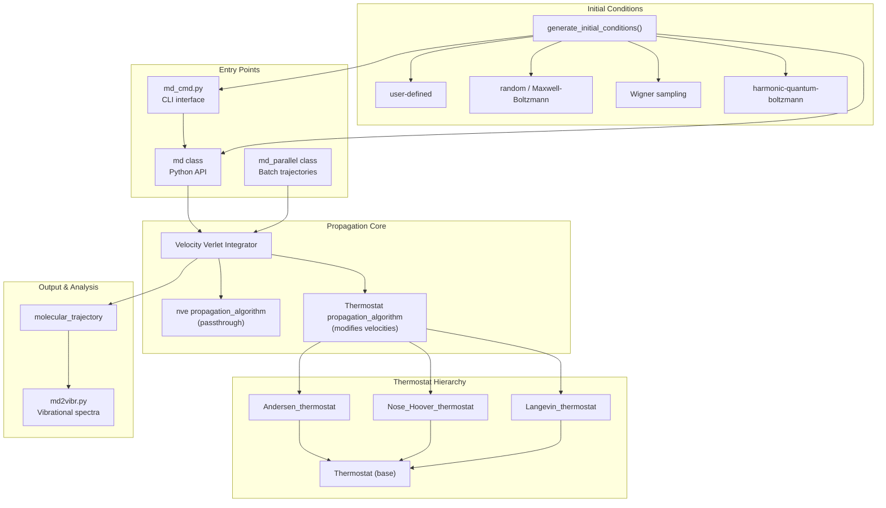

The Molecular Dynamics (MD) engine in MLatom propagates nuclear motion on potential energy surfaces provided by any supported model—whether a machine learning potential like AIQM1 or a conventional quantum chemistry method. It implements a Velocity Verlet integrator with support for both NVE and NVT ensembles, three thermostat families, multiple initial condition sampling strategies, and both single-trajectory and batch-parallel execution modes. This page covers the core MD machinery; for dynamics involving electronic transitions, see [Nonadiabatic and Surface-Hopping Dynamics](20-nonadiabatic-and-surface-hopping-dynamics).

Sources: [md.py](mlatom/md.py#L1-L9), [md_parallel.py](mlatom/md_parallel.py#L1-L9)

## Architecture Overview

The MD engine is organized as a layered system: initial conditions feed into a propagation loop that delegates thermostatting to pluggable thermostat objects, and trajectory output is handled through the molecular trajectory data layer.



The design follows a **strategy pattern** for thermostatting: the `md` class holds a reference `self.propagation_algorithm` that points to either an `nve()` passthrough object or a thermostat instance. Both expose the same two-phase interface (`update_velocities_first_half_step` and `update_velocities_second_half_step`), making them interchangeable behind the propagation loop.

Sources: [md.py](mlatom/md.py#L132-L135), [thermostat.py](mlatom/thermostat.py#L13-L18)

## Velocity Verlet Integration

The core integrator follows the standard Velocity Verlet scheme adapted for MLatom's internal unit system (energy in Hartree, distance in Ångström, time in femtoseconds). At each propagation step after the initial one, the algorithm executes:

**1. First velocity half-step** — Delegated to the propagation algorithm (thermostat or NVE passthrough).

**2. Coordinate update** — Positions advance according to `coord = coord + v·dt + 0.5·a·dt²` [md.py](mlatom/md.py#L190).

**3. Second velocity half-step (pre-force)** — `v = v + 0.5·a·dt` [md.py](mlatom/md.py#L193).

**4. Force evaluation** — The model predicts energy and gradients; acceleration is computed as `a = -∇E / m · (1/ram2au) · (Bohr²/Ų) · (fs²/au²)` to convert from Hartree/Bohr forces into Å/fs² accelerations [md.py](mlatom/md.py#L200-L201).

**5. Second velocity half-step (post-force)** — `v = v + 0.5·a·dt` [md.py](mlatom/md.py#L204).

**6. Optional momentum removal** — If `eliminate_momentum=True`, both center-of-mass translation and rigid-body rotation are stripped from velocities [md.py](mlatom/md.py#L207-L211).

**7. Thermostat second half-step** — Completes the velocity modification for the current timestep [md.py](mlatom/md.py#L217-L218).

The loop terminates either when `step × dt ≥ maximum_propagation_time` or when a user-defined `stop_function` returns `True`. At step zero, the engine only computes initial forces and records the starting geometry—no position or velocity updates occur.

Sources: [md.py](mlatom/md.py#L158-L247), [md.py](mlatom/md.py#L264-L276)

## The `md` Class: Single-Trajectory Dynamics

The primary entry point for running one MD trajectory. Instantiating `ml.md()` automatically triggers propagation via its constructor.

| Parameter | Type | Default | Description |
|---|---|---|---|
| `model` | `model` or `methods` | `None` | Any model providing energies and gradients |
| `molecule_with_initial_conditions` | `data.molecule` | `None` | Molecule with initial coordinates and velocities |
| `molecule` | `data.molecule` | `None` | Alias (mutually exclusive with above) |
| `ensemble` | `str` | `'NVE'` | Ensemble type: `'NVE'` or `'NVT'` |
| `thermostat` | `Thermostat` | `None` | Thermostat instance (required for NVT) |
| `time_step` | `float` | `0.1` | Integration timestep in femtoseconds |
| `maximum_propagation_time` | `float` | `1000` | Maximum propagation time in femtoseconds |
| `dump_trajectory_interval` | `int` or `None` | `None` | Dump interval in steps (`None` disables) |
| `filename` | `str` or `None` | `None` | Trajectory output file |
| `format` | `str` | `'h5md'` | Output format: `'h5md'` or `'json'` |
| `eliminate_momentum` | `bool` | `False` | Remove translational and angular momentum each step |
| `stop_function` | `callable` | `None` | User-defined early termination callback |
| `stop_function_kwargs` | `dict` | `None` | Keyword arguments for `stop_function` |

The constructor automatically detects molecular linearity to set degrees of freedom (3N−5 for linear, 3N−6 for nonlinear) and begins propagation immediately. The resulting trajectory is accessible at `dyn.molecular_trajectory` as a `data.molecular_trajectory` object. Each step records `time`, `step`, `total_energy`, and `temperature` alongside the molecular state.

Sources: [md.py](mlatom/md.py#L99-L156), [md.py](mlatom/md.py#L219-L226)

## The `md_parallel` Class: Batch Trajectory Propagation

For workflows that require propagating many independent trajectories simultaneously (e.g., ensemble-averaged property calculations or nonadiabatic MD), `md_parallel` operates on a `molecular_database` of initial conditions rather than a single molecule. The key architectural differences from `md` are:

- **Batch force evaluation**: All active trajectories are predicted in a single model call at each step [md_parallel.py](mlatom/md_parallel.py#L168-L170).
- **Per-trajectory stop functions**: Each trajectory is independently tracked by a `stop_array` boolean mask; terminated trajectories are excluded from subsequent force evaluations [md_parallel.py](mlatom/md_parallel.py#L231-L248).
- **Excess energy redistribution**: An `excess_energy` parameter injects kinetic energy uniformly across the trajectory duration via `rescale_velocity`, scaling velocities at each step to match the target kinetic energy [md_parallel.py](mlatom/md_parallel.py#L209-L214).
- **Trajectory length tracking**: `molecular_trajectory.traj_len` stores the final step index for each trajectory, which is essential for computing ensemble averages when trajectories terminate at different times [md_parallel.py](mlatom/md_parallel.py#L255-L257).

The class does not currently expose a `Langevin_thermostat` import, limiting parallel NVT dynamics to Andersen and Nose-Hoover thermostats.

Sources: [md_parallel.py](mlatom/md_parallel.py#L17-L151), [md_parallel.py](mlatom/md_parallel.py#L261-L264)

## Thermostat System

All thermostats extend a common `Thermostat` base class and expose the two-phase velocity update interface expected by the propagation loop. The system supports three distinct thermostatting strategies.

### Andersen Thermostat

The Andersen thermostat implements stochastic collisions: at each timestep, each atom has a probability `p = γ · dt` of having its velocity replaced by a random sample from the Maxwell-Boltzmann distribution at the target temperature. The velocity modulus is computed from the atom's mass and the target temperature, accounting for the unit conversion chain (K → kcal/mol → Hartree → Å/fs units). The `gamma` parameter (collision rate, default 0.2 fs⁻¹) controls the strength of thermostatting—higher values produce tighter temperature control at the cost of dynamical realism.

Sources: [thermostat.py](mlatom/thermostat.py#L20-L93)

### Nose-Hoover Thermostat

The Nose-Hoover chain thermostat is the most sophisticated option, implementing a multi-stage integration based on the Martyna-Klein-Tuckerman scheme (DOI: 10.1080/00268979600100761). It nests three configurable parameters:

| Parameter | Default | Description |
|---|---|---|
| `nose_hoover_chain_length` | 3 | Number of thermostat "beads" in the chain |
| `multiple_time_steps` (Nc) | 3 | Number of sub-divisions per timestep |
| `number_of_yoshida_suzuki_steps` (Nys) | 7 | Integration order (1, 3, 5, or 7) |
| `nose_hoover_chain_frequency` | 1/16 ≈ 0.0625 fs⁻¹ | Oscillation frequency of chain variables |
| `temperature` | 300 K | Target temperature |
| `degrees_of_freedom` | auto | Can be a negative offset from 3N |

The Yoshida-Suzuki coefficients are precomputed at initialization for the selected order (1, 3, 5, or 7). The effective masses `NHC_Q` follow the convention where Q₁ = N_dof·kT/ω² and Qᵢ = kT/ω² for i > 1, ensuring proper ergodic sampling. The thermostat applies a cumulative velocity scaling factor computed from the chain variables' evolution, which can be restored across checkpoint restarts via the `NHC_xi` and `NHC_vxi` keyword arguments.

Sources: [thermostat.py](mlatom/thermostat.py#L95-L278)

### Langevin Thermostat

The Langevin thermostat applies friction and stochastic kicks using the BAOAB-like splitting scheme (DOI: 10.1103/PhysRevE.75.056707). At each half-step, velocities are damped by factor `C₁ = exp(−τ·dt/2)` and then perturbed by Gaussian noise with standard deviation `C₂ = √(k_BT·(1−C₁²)/m)`. The `tau` parameter (default 0.001 fs⁻¹) controls friction strength. Unlike Andersen, which acts on individual atoms stochastically, Langevin applies continuous friction to all atoms simultaneously, making it particularly suitable for condensed-phase simulations.

Sources: [thermostat.py](mlatom/thermostat.py#L280-L337)

### Thermostat Comparison

| Feature | Andersen | Nose-Hoover | Langevin |
|---|---|---|---|
| Deterministic | No (stochastic) | Yes (deterministic) | No (stochastic) |
| Velocity modification | Replace per-atom | Scale globally | Damp + perturb per-atom |
| Key parameter | `gamma` (collision rate) | `NHC_frequency` (chain freq) | `tau` (friction coeff) |
| Configurable chain length | N/A | Yes (`NHC_length`) | N/A |
| Parallel trajectory support | Yes | Yes | No (single-trajectory only) |
| Typical use case | Gas-phase sampling | Canonical ensemble properties | Condensed-phase dynamics |

Sources: [md.py](mlatom/md.py#L96-L98), [md_parallel.py](mlatom/md_parallel.py#L96-L97)

## Initial Condition Generation

Initial conditions are prepared through the `ml.generate_initial_conditions()` function, which supports multiple sampling strategies. The choice of method determines what information the input molecule must carry (coordinates only, or coordinates plus Hessian/frequencies).

| Method | Required on molecule | Description |
|---|---|---|
| `'user-defined'` | Coordinates | Loads positions and velocities from separate XYZ/VXYZ files |
| `'random'` | Coordinates | Generates random velocities at a target temperature or kinetic energy |
| `'maxwell-boltzmann'` | Coordinates | Samples velocities from the Maxwell-Boltzmann distribution |
| `'wigner'` | Coordinates + Hessian | Wigner nuclear sampling (modified from Newton-X) |
| `'harmonic-quantum-boltzmann'` | Coordinates + frequencies | Harmonic quantum Boltzmann sampling (J. Phys. Chem. A 1998, 102, 3648) |

All methods except `'user-defined'` can automatically eliminate angular momentum by default. The Wigner sampler requires a Hessian matrix (obtainable via `ml.models.methods.predict(molecule=mol, calculate_hessian=True)`), while the harmonic quantum Boltzmann sampler requires pre-computed normal mode frequencies. An optional excitation energy window filter can reject samples whose vertical excitation energies fall outside a specified range—useful for targeted nonadiabatic dynamics studies.

> [!TIP]
> When using the `'random'` or `'wigner'` methods, the `degrees_of_freedom` parameter can be specified as a negative integer (e.g., `-6`) which is interpreted as `3N - 6`, automatically accounting for the number of atoms. This is the default convention throughout the MD engine and CLI interface.

Sources: [initial_conditions.py](mlatom/initial_conditions.py#L105-L304), [initial_conditions.py](mlatom/initial_conditions.py#L219-L226)

## CLI Interface

The command-line interface in `md_cmd.py` maps directly to the Python API through the `MD_CMD.dynamics()` classmethod. All key parameters have CLI counterparts:

| CLI Flag | Python Equivalent | Default |
|---|---|---|
| `dt` | `time_step` | 0.1 fs |
| `trun` | `maximum_propagation_time` | 1000 fs |
| `initXYZ` | (file path argument) | `''` |
| `initVXYZ` | (file path argument) | `''` |
| `initConditions` | `generation_method` | `''` (user-defined) |
| `ensemble` | `ensemble` | `'nve'` |
| `thermostat` | thermostat type | `''` |
| `temperature` | `temperature` | 300 K |
| `gamma` | `gamma` (Andersen) | 0.2 fs⁻¹ |
| `initTemperature` | `initial_temperature` | 300 K |
| `trajH5MDout` | `filename` (H5MD) | `'traj.h5'` |
| `trajTextOut` | output plain text | `'traj'` |

The CLI automatically detects linear molecules to set the correct degrees of freedom and always enables angular momentum elimination (`noang=1`). The `randomSeed` option allows reproducible initial condition generation.

Sources: [md_cmd.py](mlatom/md_cmd.py#L12-L51), [md_cmd.py](mlatom/md_cmd.py#L58-L222)

## Trajectory Output and Checkpointing

The MD engine supports two trajectory serialization formats:

- **H5MD** (`.h5`): HDF5-based format, efficient for large trajectories and compatible with the molecular trajectory data layer. Each dump interval appends to the file incrementally.
- **JSON**: Plain-text JSON format, suitable for inspection and post-processing.

When `dump_trajectory_interval` is set, the engine writes trajectory snapshots at that cadence. If no `filename` is provided, a UUID-based name is generated automatically. The `dump_md_checkpoint` method writes a human-readable checkpoint file containing the last step's coordinates, velocities, ensemble type, and full thermostat state—enabling exact restart of interrupted simulations.

Sources: [md.py](mlatom/md.py#L137-L145), [md.py](mlatom/md.py#L237-L245), [md.py](mlatom/md.py#L249-L262)

## Gap-Driven Dynamics

The `gap_md` class in `gap_md.py` extends the single-surface MD engine to handle dynamics on two electronic states with automatic surface switching. It wraps a standard model with a `gap_model` adapter that intercepts energy and gradient predictions, returning values for either the lower or upper surface based on whether the current nuclear geometry places the system above or below a configurable energy gap threshold. At each step, velocities are rescaled by a factor `√(1 − ΔE/E_kin)` to approximately conserve total energy across surface hops. This provides a lightweight alternative to full nonadiabatic surface hopping when only two states are relevant.

Sources: [gap_md.py](mlatom/gap_md.py#L16-L37), [gap_md.py](mlatom/gap_md.py#L91-L158)

## Post-Processing: Vibrational Spectra from Trajectories

The `md2vibr.py` module converts MD trajectories into vibrational spectra through time-correlation analysis. The `vibrational_spectrum` class accepts a `molecular_database` (or trajectory) and timestep, then computes either infrared spectra (from dipole moment autocorrelation) or power spectra (from velocity autocorrelation). Key processing steps include Hann windowing, mean removal, zero-padding, and normalization. The Fourier transform implementation uses numpy's FFT with proper scaling for frequency-domain representation.

Sources: [md2vibr.py](mlatom/md2vibr.py#L16-L188)

## Usage Example: Complete NVT Dynamics

The following workflow demonstrates a typical MD simulation with Nose-Hoover thermostatting, from initial condition generation through trajectory analysis:

```python
import mlatom as ml

# 1. Load molecular geometry
mol = ml.data.molecule()
mol.read_from_xyz_file(filename='ethanol.xyz')

# 2. Set up the model
aiqm1 = ml.models.methods(method='AIQM1')

# 3. Generate initial conditions (user-defined velocities)
init_cond_db = ml.generate_initial_conditions(
    molecule=mol,
    generation_method='user-defined',
    file_with_initial_xyz_coordinates='ethanol.xyz',
    file_with_initial_xyz_velocities='ethanol.vxyz'
)
init_mol = init_cond_db.molecules[0]

# 4. Configure thermostat
nose_hoover = ml.md.Nose_Hoover_thermostat(
    temperature=300,
    molecule=init_mol,
    degrees_of_freedom=-6  # 3N - 6
)

# 5. Run dynamics (propagation starts automatically)
dyn = ml.md(
    model=aiqm1,
    molecule_with_initial_conditions=init_mol,
    ensemble='NVT',
    thermostat=nose_hoover,
    time_step=0.5,
    maximum_propagation_time=10.0,
    dump_trajectory_interval=1,
    filename='traj.h5',
    format='h5md'
)

# 6. Access results
traj = dyn.molecular_trajectory
traj.dump(filename='traj', format='plain_text')

# 7. Optional: save checkpoint for restart
dyn.dump_md_checkpoint(filename='md_chk')
```

> [!TIP]
> Energy and distance units in MLatom are always **Hartree** and **Ångström** respectively. The acceleration conversion factor `1/ram2au · (Bohr/Å)² · (fs/au)²` at [md.py#L172](mlatom/md.py#L172) handles the internal unit transform from model-predicted Hartree/Bohr gradients to Å/fs² accelerations. If using a custom model with different native units, you must ensure consistency before passing it to the MD engine.

Sources: [md.py](mlatom/md.py#L57-L94), [md.py](mlatom/md.py#L172-L173)

## Next Steps

- **[Nonadiabatic and Surface-Hopping Dynamics](20-nonadiabatic-and-surface-hopping-dynamics)** — For dynamics involving electronic state transitions, including fewest-switches surface hopping (FSSH) and Landau-Zener-based hopping algorithms.
- **[IR and Raman Spectra Calculation](21-ir-and-raman-spectra-calculation)** — For harmonic-frequency-based spectra as an alternative to the trajectory-correlation approach in `md2vibr.py`.
- **[Molecular Trajectory and HDF5 I/O](8-molecular-trajectory-and-hdf5-i-o)** — For details on the `molecular_trajectory` data structure used to store and serialize MD results.
- **[Molecule and Atom Classes](6-molecule-and-atom-classes)** — For the underlying molecular representation that carries coordinates, velocities, energies, and gradients through the MD loop.