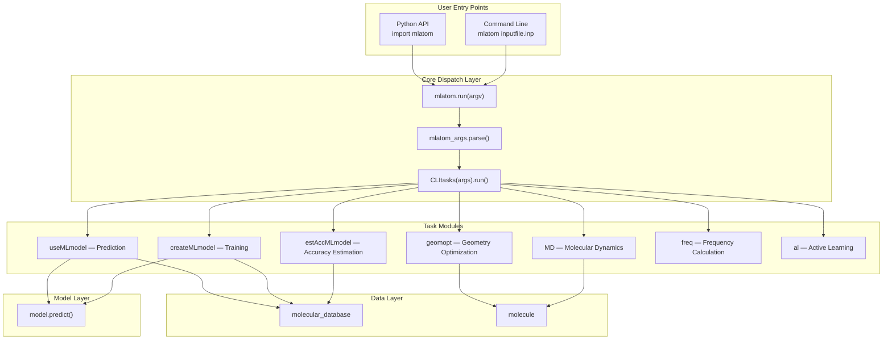

Get MLatom up and running in minutes. This page walks you through the two primary interaction modes — the **Python API** and the **command-line interface (CLI)** — with concrete, runnable examples for the most common tasks: loading molecular data, predicting properties, training machine learning models, and running simulations.


## The Two Faces of MLatom

MLatom 3.22.0 is a comprehensive package for atomistic simulations powered by machine learning, developed by Pavlo O. Dral and collaborators at Xiamen University. It supports the full lifecycle of computational chemistry workflows — from data management and ML model training to geometry optimization, molecular dynamics, and spectroscopy. Every feature is accessible through two equivalent interfaces, unified by a shared task dispatch architecture.



Both entry points converge on the same execution path: the `run()` function in [MLatom.py](mlatom/MLatom.py#L61-L174) parses arguments via the `mlatom_args` class, then delegates to the `CLItasks` dispatcher. This means **anything you can do from the command line, you can also do from Python** — and vice versa.

## Prerequisites and Installation

MLatom is available on PyPI. Install it with a single command:

```bash
pip install mlatom
```

You can verify your installation and check for updates using the built-in version flags:

```bash
mlatom --version          # prints current version, checks PyPi for latest
mlatom --list             # lists all installed mlatom locations on your system
```

These flags are handled directly in the `run()` function before argument parsing begins, as seen in [MLatom.py](mlatom/MLatom.py#L81-L134). For advanced features (specific quantum chemistry program interfaces, GPU acceleration for neural network potentials, etc.), additional dependencies are required — see [Installation and Dependencies](3-installation-and-dependencies) for the complete guide.

## Understanding the Architecture

Before writing code, it helps to understand the three foundational layers that every MLatom workflow touches. Each maps directly to a Python module you'll import:

| Layer | Module | Core Classes | Purpose |
|-------|--------|-------------|---------|
| **Data** | `mlatom.data` | `atom`, `molecule`, `molecular_database`, `ml_database` | Represent and manipulate molecular structures, properties, and datasets |
| **Model** | `mlatom.models` | `ml_model`, `krr`, `kreg`, `methods()` | Create, train, predict with, and save machine learning and quantum chemistry models |
| **Simulation** | `mlatom.simulations` | `optimize_geometry()`, `freq()`, `md()`, `irc()` | Run atomistic simulations using any model as the energy/gradient engine |

The `model` class hierarchy in [model_cls.py](mlatom/model_cls.py#L20-L343) serves as the backbone: `model()` is the root parent, `ml_model(model)` adds training capabilities, and specialized subclasses like `torch_model`, `torchani_model`, and `downloadable_model` provide framework-specific behavior. All of these are re-exported at the top level of the package via [__init__.py](mlatom/__init__.py#L1-L17) so you can access them as `mlatom.molecule`, `mlatom.kreg`, etc.

## Quick Example: Loading and Exploring Molecules

The `molecule` class is your primary data container. It stores atomic species, 3D coordinates, energies, gradients, Hessians, and arbitrary scalar/vector properties. Create one from scratch or load from standard file formats:

```python
import mlatom

# Load from an XYZ file (reads the first molecule)
mol = mlatom.molecule.from_xyz_file('water.xyz')

# Load a full dataset of molecules
molDB = mlatom.molecular_database.from_xyz_file('dataset.xyz')

# Inspect basic properties
print(f'Atoms: {mol.get_number_of_atoms()}')
print(f'Formula: {mol.get_element_symbols()}')
print(f'Coordinates (Å):\n{mol.xyz_coordinates}')

# Access individual atoms
for i, at in enumerate(mol.atoms):
    print(f'  Atom {i}: {at.element_symbol} at {at.xyz_coordinates}')
```

The `molecule` class, defined in [data.py](mlatom/data.py#L356-L1470), supports multiple input formats beyond XYZ — including SMILES strings, NumPy arrays, JSON, and HDF5. You can also construct molecules programmatically from `atom` objects:

```python
at1 = mlatom.atom(element_symbol='O', xyz_coordinates=[0.0, 0.0, 0.1173])
at2 = mlatom.atom(element_symbol='H', xyz_coordinates=[0.0, 0.7572, -0.4692])
at3 = mlatom.atom(element_symbol='H', xyz_coordinates=[0.0, -0.7572, -0.4692])
mol = mlatom.molecule(atoms=[at1, at2, at3])
```

## Quick Example: Predicting Molecular Properties

MLatom provides pre-built and pre-trained methods through the `methods()` factory function. This is the fastest path from structure to property — no training required. The function iterates through a priority list of `known_classes` and returns the first matching model that supports your requested method and has its required program installed.

```python
import mlatom

# Load a molecule
mol = mlatom.molecule.from_xyz_file('ethanol.xyz')

# Create a model — AIQM1 is a pre-trained semiempirical ML method
model = mlatom.methods(method='AIQM1')

# Predict energy and energy gradients
model.predict(molecule=mol, calculate_energy=True, calculate_energy_gradients=True)

# Access results
print(f'Energy: {mol.energy:.6f} Hartree')
print(f'Gradients shape: {mol.energy_gradients.shape}')
```

The `methods()` function in [models.py](mlatom/models.py#L627-L691) supports dozens of methods out of the box — including `AIQM1`, `AIQM2`, `AIQM3`, `ANI-2x`, `GFN2-xTB`, various DFT and ab initio methods through Gaussian, PySCF, ORCA, and more. When you specify a method name without a program, MLatom automatically detects which installed program can handle it.

## Quick Example: Training a Machine Learning Model

For cases where pre-trained methods aren't sufficient, MLatom lets you train your own ML potentials. The most commonly used model type is `kreg` (Kernel Ridge Regression with RE descriptors), which learns molecular energies and gradients from a reference dataset:

```python
import mlatom

# Step 1: Load training data
molDB = mlatom.molecular_database.from_xyz_file('training_data.xyz')
molDB.read_from_y_file('training_energies.txt')            # reference energies
molDB.read_from_xyz_derivative_property_file('training_gradients.xyz')  # reference gradients

# Step 2: Create a KREG model
model = mlatom.kreg(model_file='my_model.json')

# Step 3: Train
model.train(
    molecular_database=molDB,
    property_to_learn='y',                        # energies stored as mol.y
    xyz_derivative_property_to_learn='xyz_derivatives_y'  # gradients
)

# Step 4: Predict on new molecules
test_mol = mlatom.molecule.from_xyz_file('test.xyz')
model.predict(molecule=test_mol, calculate_energy=True, calculate_energy_gradients=True)
print(f'Predicted energy: {test_mol.energy:.6f} Hartree')
```

The `ml_model` base class, defined in [model_cls.py](mlatom/model_cls.py#L343-L816), provides the unified `train()` and `predict()` interface that all trainable models implement. The `kreg` class in [models.py](mlatom/models.py#L343-L595) extends this with kernel-specific hyperparameter optimization, descriptor generation, and support for both the Fortran (MLatomF) and Python backends.

> [!TIP]
> When training KREG models with energy gradients, the `xyz_derivative_property_to_learn` argument must point to the property name where gradients are stored. By convention, the `read_from_xyz_derivative_property_file()` method stores them as `xyz_derivatives_y`. Always ensure this matches what you pass to `train()`.

## Quick Example: Command-Line Interface

For batch processing, scripting, and reproducibility, the CLI mode is often more convenient. You write an input file with keyword-value pairs, then run it with a single command:

```bash
# Predict energies with AIQM1
mlatom useMLmodel XYZfile=molecules.xyz AIQM1 YestFile=energies.txt

# Train a KREG model
mlatom createMLmodel XYZfile=training.xyz Yfile=energies.txt YgradXYZfile=gradients.xyz MLmodelType=KREG MLmodelOut=model.json

# Run geometry optimization
mlatom geomopt XYZfile=initial.xyz AIQM1 optXYZ=optimized.xyz

# Estimate model accuracy with cross-validation
mlatom estAccMLmodel XYZfile=data.xyz Yfile=ref_energies.txt MLmodelIn=model.json CVtest
```

The CLI argument parser in [args_class.py](mlatom/args_class.py#L401-L775) recognizes a comprehensive list of tasks defined in the `_task_list` — currently 25+ tasks spanning ML model creation, PES exploration, dynamics, spectroscopy, and active learning. Key-value pairs can use standard quantum chemistry naming conventions (e.g., `ANI-2x`, `GFN2-xTB`, `CCSD(T)*/CBS`) with automatic alias resolution.

## Quick Example: Geometry Optimization

MLatom wraps geometry optimization into a single high-level function that works with any compatible model. The `optimize_geometry()` function imported from `mlatom.simulations` handles convergence checking, trajectory logging, and result extraction:

```python
import mlatom

# Set up model and initial geometry
model = mlatom.methods(method='AIQM1')
mol = mlatom.molecule.from_xyz_file('ethanol.xyz')

# Run optimization
geomopt = mlatom.optimize_geometry(
    model=model,
    initial_molecule=mol,
    convergence_criterion_for_forces=0.02,  # eV/Å
    maximum_number_of_steps=200
)

# Access results
optimized = geomopt.optimized_molecule
print(f'Optimized energy: {optimized.energy:.6f} Hartree')
optimized.write_file_with_xyz_coordinates('optimized.xyz')
```

Internally, the CLI `geomopt` task in [MLtasks.py](mlatom/MLtasks.py#L386-L453) follows the same pattern — it loads data, creates a model, calls `simulations.optimize_geometry()`, and writes results. The Python API simply exposes the same pipeline without the argument-parsing layer.

## Quick Example: Molecular Dynamics

Running molecular dynamics follows the same pattern — provide a model and initial conditions, and MLatom handles the integration:

```bash
# CLI: run 1 ps of NVE dynamics at 300 K
mlatom MD XYZfile=init.xyz AIQM1 initTemp=300 dt=0.1 trun=1000 \
    trajXYZout=traj.xyz trajEpot=energy.dat
```

The MD parameters are pre-configured in the `mlatom_args` class with sensible defaults — `dt=0.1 fs`, `trun=1000 fs`, `ensemble='nve'`, and various output file paths for trajectories, energies, and temperatures, as seen in [args_class.py](mlatom/args_class.py#L595-L632).

## Summary: Which Mode to Use

| Scenario | Recommended Mode | Why |
|----------|-----------------|-----|
| Interactive exploration, Jupyter notebooks | Python API | Immediate feedback, easy plotting, step-by-step debugging |
| Reproducible batch jobs, HPC clusters | CLI with input files | Self-documenting, easy to version-control, no Python overhead |
| Custom ML pipelines, integration with other tools | Python API | Full programmatic control over data flow |
| Quick property calculations on a few molecules | Either — CLI is faster for single commands | |
| Training and hyperparameter optimization | Python API for flexibility, CLI for standard workflows | Python allows custom validation loops |

## Where to Go Next

This Quick Start covers the core patterns. To deepen your understanding and unlock MLatom's full capabilities, follow this reading progression:

1. **[Installation and Dependencies](3-installation-and-dependencies)** — Set up quantum chemistry program interfaces, GPU support, and optional backends
2. **[Usage Modes and Input Files](4-usage-modes-and-input-files)** — Complete CLI reference with all keywords and input file syntax
3. **[Molecule and Atom Classes](6-molecule-and-atom-classes)** — Deep dive into the data model, properties, and file I/O
4. **[Model Class Hierarchy](9-model-class-hierarchy)** — Understand all available model types and their inheritance
5. **[AIQM Methods and Delta Learning](11-aiqm-methods-and-delta-learning)** — Explore pre-trained methods and how to correct them
6. **[Geometry Optimization Workflows](17-geometry-optimization-workflows)** — Advanced optimization features, transition state search, IRC
7. **[Molecular Dynamics Engine](19-molecular-dynamics-engine)** — Thermostats, NVE/NVT ensembles, trajectory analysis
