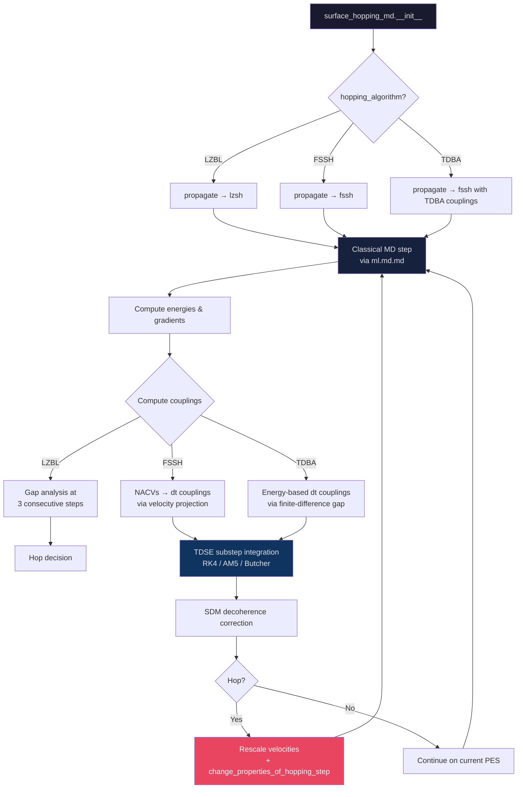
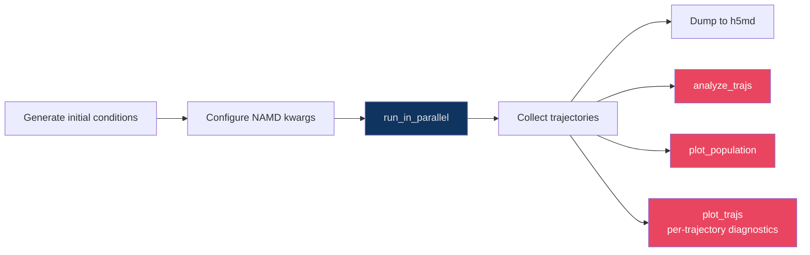

The nonadiabatic molecular dynamics (NAMD) subsystem in MLatom provides a comprehensive Python-native framework for simulating electronic transitions during nuclear motion. Implemented primarily in `namd.py`, it supports three distinct surface-hopping algorithms—LZBL (Landau-Zener-based fewest-switches), FSSH (fewest-switches surface hopping), and TDBA (time-dependent Born-Oppenheimer approximation)—each with configurable decoherence corrections, velocity rescaling strategies, and multi-step integrators for the time-dependent Schrödinger equation. The module integrates tightly with the classical MD engine ([md.py](mlatom/md.py)) and the parallel simulation harness ([simulations.py](mlatom/simulations.py)), enabling production-scale trajectory ensembles with machine-learned or quantum-chemical potential energy surfaces.

Sources: [namd.py](mlatom/namd.py#L1-L10)

## Architectural Overview

The NAMD engine is built around a single orchestrating class (`surface_hopping_md`) that delegates nuclear propagation to the classical MD integrator while managing electronic state evolution internally. The architecture separates concerns across three layers: the propagation loop (nuclear dynamics), the electronic TDSE solver (state coefficients), and the stochastic hop decision engine.



Sources: [namd.py](mlatom/namd.py#L21-L271), [namd.py](mlatom/namd.py#L485-L531), [namd.py](mlatom/namd.py#L533-L725)

## The `surface_hopping_md` Class

The primary entry point for nonadiabatic dynamics is `mlatom.namd.surface_hopping_md`. Its constructor accepts the molecule, model, algorithm configuration, and propagation parameters, then immediately invokes `self.propagate()` at [line 271](mlatom/namd.py#L271), meaning dynamics begin on instantiation. The trajectory result is stored in `self.molecular_trajectory`, an instance of `data.molecular_trajectory`.

### Constructor Parameters

| Parameter | Type | Default | Description |
|-----------|------|---------|-------------|
| `model` | `model` / `methods` | `None` | Any model providing energies, forces, and (for FSSH) NACVs |
| `molecule_with_initial_conditions` | `data.molecule` | `None` | Molecule with initial coordinates, velocities, and optionally `current_state` |
| `ensemble` | `str` | `'NVE'` | Ensemble type; `'NVE'` or `'NVT'` |
| `thermostat` | `Thermostat` | `None` | Andersen or Nosé-Hoover thermostat |
| `time_step` | `float` | `0.1` | Nuclear propagation time step (fs) |
| `time_step_tdse` | `float` | `None` | Electronic substep (fs); defaults to `time_step / 20` for FSSH/TDBA |
| `integrator` | `str` | `'Butcher'` | TDSE integrator: `'RK4'`, `'AM5'`, or `'Butcher'` |
| `decoherence_model` | `str` | `'SDM'` | Decoherence correction type |
| `decoherence_SDM_decay` | `float` | `0.1` | SDM decay parameter |
| `coupling_calc_threshold` | `float` | `None` | Energy gap threshold (eV) to skip coupling calculations |
| `maximum_propagation_time` | `float` | `100` | Maximum simulation time (fs) |
| `hopping_algorithm` | `str` | `'LZBL'` | `'LZBL'`, `'FSSH'`, or `'TDBA'` |
| `nstates` | `int` | `None` | Number of electronic states |
| `initial_state` | `int` | `None` | Starting state; defaults to `nstates - 1` |
| `random_seed` | `int` / callable | `generate_random_seed` | Seed for reproducibility |
| `prevent_back_hop` | `bool` | `False` | Suppress upward (energy-gaining) hops |
| `rescale_velocity_direction` | `str` | `None` | `'momentum'`, `'nacv'`, or `'gradient difference'` |
| `insufficient_energy_action` | `str` | `'do not change velocities'` | Action when kinetic energy is insufficient for hop |
| `reduce_kinetic_energy` | `bool` | `False` | Scale kinetic energy by DOF for hop probability |
| `reduce_memory_usage` | `bool` | `False` | Stream trajectory to disk instead of holding in memory |

Sources: [namd.py](mlatom/namd.py#L154-L177)

## Hopping Algorithms

MLatom implements three surface-hopping algorithms, each rooted in different theoretical approximations for nonadiabatic transition probabilities. The selection is enforced at construction via case-insensitive string matching at [lines 207–214](mlatom/namd.py#L207-L214).

### LZBL — Landau-Zener-Based Fewest Switches

The LZBL algorithm avoids explicit nonadiabatic coupling vectors entirely. Instead, it detects avoided crossings by monitoring the energy gap across three consecutive trajectory steps. At each propagation step, the `lzsh` method ([line 485](mlatom/namd.py#L485)) propagates the nuclei one additional step forward and then evaluates the energy gap pattern:

- **Crossing detection**: The gap must form a local minimum at the central step (gap[t−1] > gap[t] < gap[t+1]) — see [lines 509–524](mlatom/namd.py#L509-L524).
- **Probability calculation**: Uses the Landau-Zener formula via `lz_prob` at [line 528](mlatom/namd.py#L528), computing the gap second derivative analytically from three points.
- **Back-hop prevention**: When `prevent_back_hop` is `False`, upward hops are suppressed only if kinetic energy (optionally reduced by DOF factor) is less than the energy gap — [lines 511–515](mlatom/namd.py#L511-L515).

The LZBL algorithm does **not** require NACVs from the model, making it compatible with any multi-state energy/gradient model without coupling support.

### FSSH — Fewest-Switches Surface Hopping

FSSH is the most feature-rich algorithm in the module. It solves the semiclassical time-dependent Schrödinger equation on a grid of substeps within each nuclear time step. The `fssh` method ([line 533](mlatom/namd.py#L533)) orchestrates the following substep cycle:

1. **Energy interpolation**: Energies at substep boundaries are interpolated from 2–4 trajectory points using linear, quadratic, or cubic `scipy.interpolate.interp1d` — see `interpolate_energy` at [line 736](mlatom/namd.py#L736).
2. **NACV interpolation**: Nonadiabatic coupling vectors are linearly interpolated between trajectory steps — [line 619](mlatom/namd.py#L619).
3. **Phase alignment**: NACV phases are aligned via dot-product comparison to prevent sign discontinuities — [lines 565–585](mlatom/namd.py#L565-L585).
4. **Time-derivative couplings**: Computed by projecting NACVs onto nuclear velocities via `get_dt_coupling` at [line 754](mlatom/namd.py#L754): `d_ij = v · d_ij`.
5. **TDSE integration**: State coefficients are evolved using one of three integrators (detailed below).
6. **Hopping probability**: Calculated from state coefficient time derivatives using a trapezoidal formula — [lines 682–687](mlatom/namd.py#L682-L687).

> [!TIP]
> FSSH requires the model to provide NACVs (`calculate_nacv=True` is automatically set at [line 317](mlatom/namd.py#L317)). If the model does not support NACV prediction, TDBA should be used instead as a coupling-free alternative within the FSSH framework.

### TDBA — Time-Dependent Born-Oppenheimer Approximation

TDBA reuses the entire FSSH electronic propagation machinery but replaces NACV-derived time-derivative couplings with energy-gap-based approximations. The `get_tdba_dt_coupling` method ([line 762](mlatom/namd.py#L762)) computes couplings from the energy gap and its second time derivative using the formula `d_ij = sign(gap) * sqrt(gap'' / gap) / 2`. This is computed via finite differences over 3–4 trajectory points depending on the step index — [lines 775–796](mlatom/namd.py#L775-L796). A `coupling_calc_threshold` parameter allows skipping coupling calculations when the energy gap exceeds a threshold (in eV), improving performance for well-separated states.

Sources: [namd.py](mlatom/namd.py#L207-L214), [namd.py](mlatom/namd.py#L485-L531), [namd.py](mlatom/namd.py#L533-L725), [namd.py](mlatom/namd.py#L762-L797)

## TDSE Integration Methods

The electronic Schrödinger equation is integrated at the substep level (`time_step_tdse`) using one of three numerical integrators. All convert time to atomic units via `constants.fs2au`.

### Integrator Comparison

| Integrator | Order | Startup | Description | Method Reference |
|------------|-------|---------|-------------|-----------------|
| `RK4` | 4th | Immediate | Classical Runge-Kutta; two-point coupling/phase evaluation | [line 838](mlatom/namd.py#L838) |
| `AM5` | 5th | 3 substeps | Adams-Moulton multistep predictor-corrector; requires 4 previous ćdot values | [line 830](mlatom/namd.py#L830) |
| `Butcher` | 5th | 3 substeps | Butcher's 5th-order method using two coupling/phase history points | [line 820](mlatom/namd.py#L820) |

Both AM5 and Butcher fall back to RK4 for the first 3 substeps of the simulation (when insufficient history exists) — see [lines 654–663](mlatom/namd.py#L654-L663). The `coeff_dot` method at [line 799](mlatom/namd.py#L799) computes the time derivative of the state coefficient vector: `ċ = −d · exp(iφ) · c`.

### Phase Evolution

Phase differences between electronic states are evolved via `evolve_phase` ([line 802](mlatom/namd.py#L802)). For the startup phase (2 energy points), a trapezoidal rule is used; for subsequent steps (3 energy points), a Simpson-like formula with coefficients `[−1/12, 2/3, 5/12]` is applied — [lines 807–810](mlatom/namd.py#L807-L810).

Sources: [namd.py](mlatom/namd.py#L799-L849)

## Decoherence Correction

All FSSH/TDBA trajectories apply decoherence correction to prevent unphysical accumulation of amplitude on non-active states. The Simplified Decay of Mixing (SDM) model is implemented in `decoherence_correction` at [line 851](mlatom/namd.py#L851):

- Each non-active state coefficient decays exponentially: `c_i *= exp(−Δt/τ_i)`
- The decay timescale depends on the energy gap and kinetic energy: `τ_i = (1 + γ/E_kin) / |ΔE|`
- The active state coefficient is renormalized to preserve total probability

The `decoherence_SDM_decay` parameter (γ) controls the decay rate. This correction is applied at every substep — [line 696](mlatom/namd.py#L696).

Sources: [namd.py](mlatom/namd.py#L851-L862)

## Velocity Rescaling and Hop Mechanics

When a hop is triggered (hopping probability exceeds the random number), the `rescale_velocities` method on the molecule object adjusts nuclear velocities along a chosen direction to conserve total energy. The velocity rescaling direction is controlled by `rescale_velocity_direction`, which defaults to `'momentum'` for LZBL/TDBA and `'nacv'` for FSSH — [lines 230–233](mlatom/namd.py#L230-L233).

| Direction Strategy | Description | Applicable Algorithms |
|-------------------|-------------|----------------------|
| `'momentum'` / `'along velocities'` | Scale total kinetic energy isotropically | All |
| `'nacv'` / `'nacs'` | Scale velocity component along NACV | FSSH (uses computed NACVs) |
| `'gradient difference'` | Scale along gradient difference vector | All (requires lazy gradient computation) |

If the new state's energy gradient was not computed during the trajectory step (because gradients were selectively computed only for the active state), the system triggers an on-demand model prediction — [lines 368–395](mlatom/namd.py#L368-L395). The `insufficient_energy_action` parameter controls behavior when kinetic energy cannot accommodate the energy change: `'do not change velocities'` (frustrated hop), `'zero velocities'`, or `'raise error'`.

After rescaling, `change_properties_of_hopping_step` ([line 864](mlatom/namd.py#L864)) updates the potential energy, energy gradients, kinetic energy, and total energy on the trajectory step to reflect the new electronic state.

> [!TIP]
> When `reduce_kinetic_energy=True`, the kinetic energy used in LZBL hop probability calculations is divided by the number of vibrational degrees of freedom (3N−5 for linear, 3N−6 for nonlinear molecules), as computed at [lines 250–256](mlatom/namd.py#L250-L256). This accounts for the fact that only a fraction of kinetic energy is available along the coupling direction.

Sources: [namd.py](mlatom/namd.py#L360-L400), [namd.py](mlatom/namd.py#L864-L874)

## Propagation Loop Architecture

The main `propagate` method ([line 273](mlatom/namd.py#L273)) implements a look-ahead pattern where the nuclear trajectory is propagated one step beyond the current decision point, then the hop decision is made retrospectively using data from consecutive steps. The key architectural patterns are:

- **Lazy gradient computation**: Only the active state's energy gradient is computed by default ([lines 291–303](mlatom/namd.py#L291-L303)), reducing computational cost for multi-state models.
- **One-step propagation flag**: The `one_step_propagation` boolean at [line 319](mlatom/namd.py#L319) tracks whether a new MD step must be computed. After a hop, the look-ahead step is discarded and propagation restarts from the hopping point — [lines 401–403](mlatom/namd.py#L401-L403).
- **Memory management**: With `reduce_memory_usage=True`, trajectory data is periodically flushed to disk in h5md format and pruned from memory — [lines 436–453](mlatom/namd.py#L436-L453).
- **Early termination**: A user-defined `stop_function` is invoked at each step with the current molecular geometry — [lines 405–410](mlatom/namd.py#L405-L410).

The loop terminates when `istep * time_step` exceeds `maximum_propagation_time`, with a final cleanup that removes the trailing overshoot step — [lines 477–483](mlatom/namd.py#L477-L483).

Sources: [namd.py](mlatom/namd.py#L273-L483)

## Parallel Trajectory Execution

Production NAMD simulations typically require hundreds of trajectories for statistical convergence. MLatom provides `ml.simulations.run_in_parallel` ([simulations.py](mlatom/simulations.py#L25)) for embarrassingly parallel trajectory propagation using joblib. The function creates per-trajectory temporary directories, distributes thread counts across workers, and handles per-job error recovery.

```python
# Parallel trajectory ensemble
dyns = ml.simulations.run_in_parallel(
    molecular_database=init_cond_db,
    task=ml.namd.surface_hopping_md,
    task_kwargs=namd_kwargs,
    create_and_keep_temp_directories=True
)
trajs = [d.molecular_trajectory for d in dyns]
```

Sources: [simulations.py](mlatom/simulations.py#L25-L90), [namd.py](mlatom/namd.py#L126-L131)

## Trajectory Analysis and Visualization

The `namd` module provides a suite of post-processing functions for trajectory ensembles.

### Analysis Functions

| Function | Purpose | Signature |
|----------|---------|-----------|
| `analyze_trajs` | Print normal/abnormal termination statistics | `(trajectories, maximum_propagation_time)` |
| `analyze_trajs_from_disk` | Same as above but loading from h5md files | `(ntraj, max_propagation_time, dirname, traj_filename)` |
| `plot_population` | Generate state population vs. time plot from in-memory trajectories | `(trajectories, time_step, max_propagation_time, nstates, filename, pop_filename)` |
| `plot_population_from_disk` | Generate population plot from disk-resident trajectories | `(time_step, max_propagation_time, nstates, filename, dirname, ntraj)` |

The `analyze_trajs` function ([line 876](mlatom/namd.py#L876)) classifies each trajectory as "normally" terminated (if final time matches `maximum_propagation_time`) or "abnormally" terminated (if stopped early by a stop function or error).

### Per-Trajectory Diagnostic Plots

For single-trajectory inspection, MLatom provides specialized plotting functions that accept a trajectory object and optional matplotlib axes:

| Function | Plots | Source |
|----------|-------|--------|
| `plot_pes` | All PES energies + active state energy colored by kinetic energy | [line 1052](mlatom/namd.py#L1052) |
| `plot_nacs` | Frobenius norms of NACVs (with optional predicted NACV overlay) | [line 1084](mlatom/namd.py#L1084) |
| `plot_tdc` | Time-derivative couplings from substep data | [line 1129](mlatom/namd.py#L1129) |
| `plot_pop` | Substep-resolved state populations | [line 1163](mlatom/namd.py#L1163) |
| `plot_dist` | Bond distances, angles, or dihedral angles vs. time | [line 1199](mlatom/namd.py#L1199) |
| `plot_trajs` | Combined 4-panel figure: PES, NACs/TDCs, populations, geometry | [line 1254](mlatom/namd.py#L1254) |

The `plot_trajs` function automatically detects whether substep coupling data is available (`substep_time_derivative_coupling`) and switches between NAC and TDC display modes accordingly — [lines 1276–1288](mlatom/namd.py#L1276-L1288).

Sources: [namd.py](mlatom/namd.py#L876-L1050), [namd.py](mlatom/namd.py#L1052-L1299)

## Data Model: Trajectory Steps and Substeps

Each step in a `molecular_trajectory` carries rich metadata for post-processing. The following attributes are populated during NAMD propagation:

| Attribute | Type | Algorithm | Description |
|-----------|------|-----------|-------------|
| `current_state` | `int` | All | Active electronic state index |
| `hopping_probabilities` | `list[float]` | All | Per-state hop probabilities (−1 for disallowed) |
| `random_number` | `float` | All | Random number used for hop decision |
| `state_coefficients` | `ndarray[complex]` | FSSH/TDBA | Electronic state amplitudes |
| `substep_potential_energy` | `list` | FSSH/TDBA | Interpolated energies at each TDSE substep |
| `substep_velocities` | `list` | FSSH/TDBA | Interpolated velocities at each TDSE substep |
| `substep_nonadiabatic_coupling_vectors` | `list` | FSSH | Interpolated NACVs at each TDSE substep |
| `substep_time_derivative_coupling` | `list` | FSSH/TDBA | Time-derivative couplings at each TDSE substep |
| `substep_state_coefficients` | `list` | FSSH/TDBA | State coefficients at each TDSE substep |
| `substep_state_coefficients_dot` | `list` | FSSH/TDBA | Coefficient time derivatives at each substep |
| `substep_phase` | `list` | FSSH/TDBA | Phase differences at each substep |
| `substep_random_numbers` | `list` | FSSH/TDBA | Per-substep random numbers |
| `substep_hopping_probabilities` | `list` | FSSH/TDBA | Per-substep hopping probabilities |

Sources: [namd.py](mlatom/namd.py#L348-L351), [namd.py](mlatom/namd.py#L704-L723)

## Complete Workflow Example

The following diagram illustrates the end-to-end workflow from initial condition generation through parallel dynamics, trajectory dumping, and population analysis:



A typical production invocation configures the algorithm, runs an ensemble in parallel, and then analyzes the results:

```python
import mlatom as ml

# Setup NAMD
namd_kwargs = {
    'model': aiqm1,                    # Any multi-state model
    'time_step': 0.25,                  # Nuclear time step (fs)
    'maximum_propagation_time': 100,    # Total simulation time (fs)
    'hopping_algorithm': 'LZBL',        # 'LZBL', 'FSSH', or 'TDBA'
    'nstates': 3,                       # Number of electronic states
    'initial_state': 2,                 # Start on S2
    'prevent_back_hop': False,          # Allow upward hops
}

# Run ensemble in parallel
dyns = ml.simulations.run_in_parallel(
    molecular_database=init_cond_db,
    task=ml.namd.surface_hopping_md,
    task_kwargs=namd_kwargs,
    create_and_keep_temp_directories=True
)
trajs = [d.molecular_trajectory for d in dyns]

# Dump trajectories
for itraj, traj in enumerate(trajs, 1):
    traj.dump(filename=f"traj{itraj}.h5", format='h5md')

# Analyze and plot
ml.namd.analyze_trajs(trajectories=trajs, maximum_propagation_time=100)
ml.namd.plot_population(trajectories=trajs, time_step=0.25,
                        max_propagation_time=100, nstates=3,
                        filename='pop.png', pop_filename='pop.txt')
```

Sources: [namd.py](mlatom/namd.py#L81-L143)

## Next Steps

- **[Molecular Dynamics Engine](19-molecular-dynamics-engine)** — Understand the underlying classical MD integrator that `surface_hopping_md` delegates nuclear propagation to.
- **[Model Class Hierarchy](9-model-class-hierarchy)** — Learn how multi-state models provide energies, gradients, and NACVs to the NAMD engine.
- **[Quantum Chemistry Program Interfaces](14-quantum-chemistry-program-interfaces)** — Explore which external programs can serve as the QM backend for NAMD.
- **[OmniP2x Multi-State Potentials](27-omnip2x-multi-state-potentials)** — Discover ML models specifically designed for multi-state surface-hopping dynamics.
- **[Molecular Trajectory and HDF5 I/O](8-molecular-trajectory-and-hdf5-i-o)** — Understand the trajectory data structure used for storage and retrieval of NAMD results.
- **[UV-Vis Spectra and Nuclear Ensemble Approach](22-uv-vis-spectra-and-nuclear-ensemble-approach)** — See how excited-state dynamics results connect to spectral simulations.