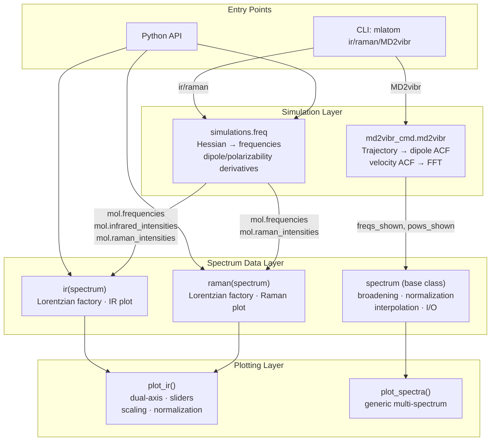
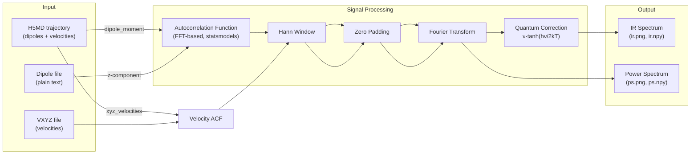

MLatom provides two fundamentally distinct pathways to compute infrared (IR) and Raman vibrational spectra: **harmonic frequency analysis** from the molecular Hessian, and **MD-derived spectra** from trajectory time-correlation functions. Both pathways converge on a shared spectrum representation layer for broadening, plotting, and comparison. This page dissects each pipeline from physics to implementation.

## Architectural Overview

The IR/Raman spectroscopy subsystem spans four modules with clearly separated concerns: simulation (Hessian or trajectory), spectrum data objects, plotting, and CLI dispatch.



Sources: [spectra.py](mlatom/spectra.py#L17-L220), [simulations.py](mlatom/simulations.py#L440-L546), [md2vibr_cmd.py](mlatom/md2vibr_cmd.py#L54-L364), [MLtasks.py](mlatom/MLtasks.py#L603-L633)

## Harmonic Frequency Analysis Pipeline

The harmonic approach computes vibrational frequencies and intensities directly from the molecular Hessian matrix and property derivatives. It is the standard method for equilibrium-geometry spectra and is invoked by both the `ir` and `raman` CLI commands via the shared `freq()` task function.

### CLI Dispatch and Task Wiring

At the CLI level, the `ir` and `raman` task functions in [MLtasks.py](mlatom/MLtasks.py#L603-L608) both route into the shared `freq(args)` dispatcher. The `ir` function passes arguments directly, while `raman` injects `args.ir = True` alongside its own flag — this ensures both IR and Raman intensities are computed together for Raman tasks, since the thermochemistry output table displays both when available.

The `freq()` function at [MLtasks.py](mlatom/MLtasks.py#L462-L601) loads molecular data, instantiates the model, and invokes `simulations.thermochemistry()` (which internally calls `simulations.freq()`). After computation, it prints a formatted table of modes with frequencies, reduced masses, force constants, and intensities, and applies method-specific frequency scaling factors.

### Frequency and Intensity Computation

The core `freq` class in [simulations.py](mlatom/simulations.py#L440-L546) orchestrates three major steps. First, it requests the model to compute the Hessian and (when IR or Raman is enabled) the corresponding property derivatives — dipole derivatives for IR, polarizability derivatives for Raman. These are injected into `model_predict_kwargs` as `calculate_dipole_derivatives` and `calculate_polarizability_derivatives` at [simulations.py](mlatom/simulations.py#L515-L519).

Second, the Hessian is diagonalized using Löwdin orthogonalization in `freq_modified_from_TorchANI()` at [simulations.py](mlatom/simulations.py#L650-L760). The mass-scaled Hessian `T^(-1/2) H T^(-1/2)` is eigen-decomposed to yield angular frequencies, which are converted to wavenumbers (cm⁻¹). Normal modes are computed in three possible normalization schemes: mass-weighted normalized (MWN), mass-deweighted unnormalized (MDU), and mass-deweighted normalized (MDN).

Third, intensities are computed from the property derivatives projected onto the normal modes:

- **IR intensities** ([simulations.py](mlatom/simulations.py#L581-L611)): Dipole derivatives (in Debye/Ångström) are projected onto mass-deweighted normal modes. The intensity for mode *q* is computed as `k × Σ(dμ/dq)²`, where `k` is a composite unit conversion constant involving the fine-structure constant, atomic mass unit, Avogadro's number, Bohr-to-Ångström conversion, yielding units of km/mol.

- **Raman intensities** ([simulations.py](mlatom/simulations.py#L613-L647): Polarizability derivatives are projected onto normal modes, then decomposed into isotropic (`α²`) and anisotropic (`γ²`) scattering components. The Raman activity for each mode is `45α² + 7γ²`, converted to Å⁴/AMU via physical constants.

### Frequency Scaling

Built-in scaling factors are applied per method at [MLtasks.py](mlatom/simulations.py#L528-L556) to correct systematic harmonic frequency errors:

| Method | Scaling Factor |
|--------|---------------|
| AIQM1 | 0.957 |
| AIQM2 | 0.962 |
| AIQM3 | 0.959 |
| Custom (`--scaling`) | User-specified |

> [!TIP]
> The scaling factor is applied multiplicatively to frequencies *only* — intensities remain unscaled. When a custom `--scaling` argument is provided (non-zero and non-one), it overrides the method default. The `--scaling 0.0` flag explicitly disables scaling even for AIQM methods.

## Spectrum Data Objects

### Class Hierarchy

The spectrum representation layer in [spectra.py](mlatom/spectra.py#L17-L538) uses inheritance to share common spectral manipulation while providing domain-specific constructors and plotting.

| Class | Extends | Purpose | Key Constructor Parameters |
|-------|---------|---------|---------------------------|
| `spectrum` | — | Base: data storage, broadening, normalization, interpolation, I/O | `x`, `y`, `xy_pairs`, `xy` |
| `ir` | `spectrum` | IR spectra: frequency/intensity semantics, Lorentzian factory | `frequencies`, `infrared_intensities` |
| `raman` | `spectrum` | Raman spectra: frequency/intensity semantics, Lorentzian factory | `frequencies`, `raman_intensities` |

Both `ir` and `raman` store domain-specific attribute aliases (`self.frequencies`, `self.infrared_intensities`, `self.raman_intensities`) alongside the generic `x`/`y` from the base class, and default to inverted x-axis in their `plot()` methods.

### Broadening Functions

The base `spectrum` class at [spectra.py](mlatom/spectra.py#L89-L164) provides a `broaden()` classmethod that convolutes a discrete line spectrum over a continuous range using one of three line-shape functions:

| Function | Formula | Parameters | Default Width |
|----------|---------|------------|--------------|
| **Normalized Gaussian** | `f = a / (σ√2π) × exp(-(x-μ)²/2σ²)` | `sigma` (σ) | 20 |
| **Gaussian** | `f = fmax × exp(-(x-μ)²/2σ²)` | `sigma` (σ) | 20 |
| **Lorentzian** | `f = fmax / (1 + ((μ-x)/(w×2))²)` | `w` (FWHM) | 30 |

The `broaden()` method iterates over each line in the input spectrum, applies the selected broadening function over the full `spectrum_range`, and accumulates the resulting curves. Individual component curves are stored in `y_components` for later analysis.

The `ir` and `raman` classes each expose a `lorentzian()` classmethod at [spectra.py](mlatom/spectra.py#L482-L492) and [spectra.py](mlatom/spectra.py#L524-L534) respectively, which extract `molecule.frequencies` and the corresponding intensities, then delegate to `cls.broaden()` with `broadening_func='Lorentzian'`. The default spectrum range is `np.arange(500, 4001)` cm⁻¹.

### Normalization Methods

The `normalize()` method at [spectra.py](mlatom/spectra.py#L52-L79) supports four strategies applied to the Riemann sum of the spectrum:

| Method | Normalization | Use Case |
|--------|--------------|----------|
| `average` | Divide by Σ(y·dx) | Unit-area spectra |
| `sqrt` | Divide by √(Σ(y²·dx)) | Variance-based |
| `max` | Divide by max(y) | Peak-height scaling |
| `msc` | √y / √Σy | Mean-square correction |

## MD-to-Vibrational Spectrum Pipeline

The alternative pathway computes IR spectra from molecular dynamics trajectories by Fourier-transforming the dipole moment autocorrelation function (DACF). This approach captures anharmonic and temperature effects inherently absent from harmonic analysis.

### Pipeline Architecture

The MD pathway has two implementations: a Python class in [md2vibr.py](mlatom/md2vibr.py#L16-L188) for programmatic use, and a CLI-oriented version in [md2vibr_cmd.py](mlatom/md2vibr_cmd.py#L54-L564) with richer input options and debug modes.



### Data Input and Spectrum Selection

The CLI module in [md2vibr_cmd.py](mlatom/md2vibr_cmd.py#L400-L478) auto-detects the spectrum type based on available data. When an H5MD file is provided without an explicit `output` option, it first attempts to read dipole moments (IR); if unavailable, it falls back to velocities (power spectrum). The three input modes are mutually exclusive and enforced by the argument parser.

| Input Source | CLI Argument | Data Extracted | Spectrum Type |
|-------------|-------------|---------------|---------------|
| H5MD file | `trajH5MDin` | Dipole moments or velocities | Auto-detected |
| VXYZ file | `trajvxyzin` | Atomic velocities | Power spectrum only |
| Dipole text file | `trajdpin` | Z-component of dipole | IR spectrum only |

### IR Spectrum Computation

The IR spectrum is computed through the dipole autocorrelation function in [md2vibr.py](mlatom/md2vibr.py#L166-L188). The default pipeline (debug mode 6) applies these steps in sequence:

1. **Autocorrelation**: The dipole time series is autocorrelated using `statsmodels.tsa.stattools.acf` with FFT acceleration, truncated to `autocorrelationDepth` time steps.
2. **Hann windowing**: Each lag value is multiplied by the Hann function `0.5 × (1 - cos(2πk/N))` to reduce spectral leakage at [md2vibr.py](mlatom/md2vibr.py#L90-L91).
3. **Zero-padding**: Zeros are appended up to `zeroPadding` steps to increase frequency resolution.
4. **FFT and frequency correction**: The Fourier transform is computed, positive frequencies are selected and converted from Hz to cm⁻¹. A quantum correction transforms discrete Fourier frequencies using the formula `√(2 - 2cos(2πΔtν/c)) / (2πΔt/c)` at [md2vibr.py](mlatom/md2vibr.py#L109-L112).
5. **Quantum harmonic correction**: Intensities are multiplied by `ν × tanh(hν / 2kT)` at T = 300 K to approximate the quantum population factor at [md2vibr.py](mlatom/md2vibr.py#L179-L187).

> [!TIP]
> The quantum correction factor `ν × tanh(hν/2kT)` converts the classical Fourier power spectrum into an approximation of the quantum absorption spectrum. At 300 K, this factor is ≈0 for low frequencies (approaching classical behavior) and ≈hν²/2kT for high frequencies. The `format` parameter in `plot_infrared_spectrum()` supports both `'modulus'` (|μ| autocorrelation) and `'vector'` (sum of μx² + μy² + μz² autocorrelations).

### Power Spectrum Computation

The vibrational density of states (power spectrum) is computed from the velocity autocorrelation function (VACF) in [md2vibr.py](mlatom/md2vibr.py#L135-L164). The VACF sums autocorrelations across all atoms and all three Cartesian coordinates, using the mean of each coordinate time series as a threshold to skip near-zero-mean components (e.g., frozen atoms). After Hann windowing and zero-padding, the power spectrum is obtained via FFT without the quantum correction applied to IR spectra.

### CLI Configuration for MD2Vibr

The `md2vibr_cmd.Args` class at [md2vibr_cmd.py](mlatom/md2vibr_cmd.py#L24-L47) defines the full parameter set:

| Parameter | Default | Description |
|-----------|---------|-------------|
| `trajH5MDin` | `''` | Input H5MD trajectory file |
| `trajvxyzin` | `''` | Input VXYZ velocity file |
| `trajdpin` | `''` | Input plain-text dipole file |
| `dt` | `0` | Time step in femtoseconds (required for vxyz/dp) |
| `autocorrelationDepth` | `1024` | Maximum ACF lag in femtoseconds |
| `zeropadding` | `1024` | Zero-padding length in femtoseconds |
| `start_time` | `0` | Trajectory start time in fs |
| `end_time` | `-1` | Trajectory end time in fs (-1 = full) |
| `step` | `1` | Sampling stride |
| `threshold` | `0.1` | Peak detection threshold (normalized) |
| `normalize_intensity` | `1` | Whether to normalize output intensity |
| `output` | `''` | Force `'ir'` or `'ps'` output type |

## Plotting and Visualization

### The `plot_ir()` Function

The dedicated IR plotting function at [spectra.py](mlatom/spectra.py#L1283-L1445) provides publication-quality visualization with interactive widgets. It accepts either pre-computed `spectra` objects or a raw `molecule` from which it can generate a Lorentzian-broadened spectrum on the fly.

Key features include dual-axis plotting (broadened spectrum on the left axis, line spectrum on the right red axis), optional frequency scaling for comparing theoretical against experimental spectra, and Jupyter notebook interactivity via `ipywidgets` sliders for both FWHM tuning (10–50 cm⁻¹) and peak highlighting. When `peak_highlight_slider` is active, clicking a peak invokes `molecule.view(normal_mode=highlight-1)` to visualize the corresponding vibrational normal mode.

| Parameter | Default | Description |
|-----------|---------|-------------|
| `spectra` | `None` | List of pre-computed spectrum objects |
| `molecule` | `None` | Molecule with frequency/intensity data |
| `lorentzian` | `False` | Generate Lorentzian-broadened spectrum from molecule |
| `fwhm` | `30` | Full width at half-maximum (cm⁻¹) |
| `band_width_slider` | `False` | Enable interactive FWHM slider |
| `peak_highlight_slider` | `False` | Enable interactive peak highlight |
| `spectrum_range` | `np.arange(500,4001)` | Wavenumber range (cm⁻¹) |
| `normalize` | `False` | Normalize spectra before plotting |
| `scaling_factor` | `None` | Scale theoretical spectrum frequencies |
| `colors` | `['k', 'r']` | Line colors for spectra and stick spectrum |

### Base Spectrum Plotting

Both `ir.plot()` and `raman.plot()` at [spectra.py](mlatom/spectra.py#L479-L522) invoke the base `spectrum.plot()` method with inverted x-axis (convention for decreasing wavenumber) and domain-specific axis labels. The base method delegates to the `plot` class in [plot.py](mlatom/plot.py#L10-L46) which renders a line chart without markers.

## Programmatic Usage Summary

The two computation pathways can be invoked programmatically as follows:

**Harmonic approach** — compute frequencies and intensities from a model, then generate broadened spectra:

```python
import mlatom as ml

mol = ml.data.molecule()
mol.read_from_xyz_file('molecule.xyz')
model = ml.models.methods(method='AIQM1', qm_program='MNDO')

# Frequency analysis with IR intensities
ml.simulations.freq(model=model, molecule=mol, ir=True, raman=True)

# Generate broadened spectra
ir_spectrum = ml.spectra.ir.lorentzian(molecule=mol, fwhm=30)
raman_spectrum = ml.spectra.raman.lorentzian(molecule=mol, fwhm=30)

# Plot with interactive controls
ml.spectra.plot_ir(molecule=mol, lorentzian=True, fwhm=30,
                   band_width_slider=True, peak_highlight_slider=True)
```

**MD approach** — compute spectra from trajectory data:

```python
# Python API
vib_spec = ml.md2vibr.vibrational_spectrum(molecular_database=traj_db, dt=0.5)
freqs, intensities = vib_spec.plot_infrared_spectrum('ir.png', return_spectrum=True)

# Or via CLI
# mlatom MD2vibr trajH5MDin=traj.h5 output=ir dt=0.5 autocorrelationDepth=1024 zeropadding=2048
```

Sources: [spectra.py](mlatom/spectra.py#L455-L534), [md2vibr.py](mlatom/md2vibr.py#L16-L188), [MLtasks.py](mlatom/MLtasks.py#L631-L633)

## Next Steps

- **[Frequency and Thermochemistry Calculations](18-frequency-and-thermochemistry-calculations)** — for the full frequency analysis and thermochemistry workflow including the `freq` and `thermochemistry` classes
- **[UV-Vis Spectra and Nuclear Ensemble Approach](22-uv-vis-spectra-and-nuclear-ensemble-approach)** — for electronic excitation spectra using the sibling `uvvis` class
- **[Spectrum Comparison Metrics](23-spectrum-comparison-metrics)** — for quantitative spectral similarity measures (Pearson, cosine, RMSD, etc.) available in the `spectrum_comparison` class
- **[Molecular Dynamics Engine](19-molecular-dynamics-engine)** — for generating the trajectories consumed by the MD-to-vibrational pipeline