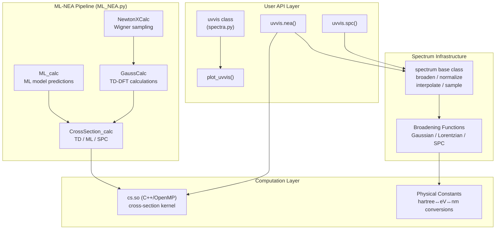
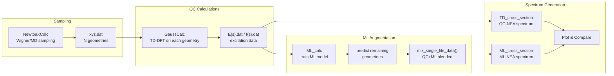

Computing accurate UV-Vis absorption spectra requires more than a single-point electronic structure calculation. Nuclear motion broadens spectral lines, shifts peak positions, and in some cases creates entirely new spectral features invisible at the equilibrium geometry. MLatom provides two complementary approaches to address this — the **single-point convolution (SPC)** method for quick estimates from a single geometry, and the **Nuclear Ensemble Approach (NEA)** for physically rigorous spectra that account for vibronic effects. Both are unified under a `uvvis` spectrum class that handles unit conversions, broadening, and visualization in a single consistent API.

Sources: [spectra.py](mlatom/spectra.py#L1-L16), [ML_NEA.py](mlatom/ML_NEA.py#L1-L9)

## Architectural Overview

The UV-Vis spectroscopy subsystem spans three layers: a pure-Python spectrum manipulation layer in `spectra.py`, a high-performance C++ cross-section engine in `cs.cpp`, and an end-to-end workflow orchestrator in `ML_NEA.py` that automates everything from molecular dynamics sampling through quantum chemistry calculations to spectrum generation. These layers share physical constants defined in `constants.py` and operate on the same [`molecule`](6-molecule-and-atom-classes) / [`molecular_database`](7-molecular-database-management) data structures used throughout MLatom.



The core physical constant linking wavelength and energy is `ev_nm_conversion_constant = h·c × 10⁹`, providing the conversion functions `eV2nm()` and `nm2eV()` used across all spectrum calculations.

Sources: [spectra.py](mlatom/spectra.py#L17-L114), [cs.cpp](mlatom/MLatomF_src/cs.cpp#L1-L17), [constants.py](mlatom/constants.py#L53-L62)

## The `spectrum` Base Class and the `uvvis` Subclass

All spectral types in MLatom inherit from the `spectrum` base class, which provides a general-purpose xy-data container with manipulation primitives. The constructor accepts either raw `x`/`y` arrays, pre-paired `xy_pairs`, or an `xy` matrix, and stores them internally as both column vectors and transposed pairs for flexible downstream access. Key capabilities include linear and cubic interpolation via SciPy, Riemann-sum normalization (average, sqrt, max, and MSC methods), spectrum broadening by arbitrary functions, range clipping, and data persistence to `.npy` or text formats.

The `broaden()` class method is the central convolution engine: it iterates over each point in a line spectrum, evaluates a user-supplied broadening function at every target wavelength, and accumulates the component curves into the final spectrum. Three built-in broadening functions are provided — `normalized_Gaussian`, `Gaussian`, and `Lorentzian` — each parameterized by peak position, intensity/scaling factor, x-range, and width parameter. This same mechanism is reused by both SPC and NEA to produce continuous spectra from discrete excitation data.

The `uvvis` subclass extends `spectrum` with UV-Vis-specific semantics. Its constructor accepts physical quantities directly — `wavelengths_nm`, `energies_eV`, `molar_absorbance`, and `cross_section` — and automatically derives the complementary representations using the conversion factor `1 Ų/molecule = 1/3.82353×10⁻⁵ M⁻¹cm⁻¹`. This means you can construct a spectrum from any consistent unit pair and immediately access all other representations without manual conversion.

Sources: [spectra.py](mlatom/spectra.py#L17-L282)

## Single-Point Convolution (SPC) Method

The SPC method generates a UV-Vis spectrum from excitation energies and oscillator strengths computed at a **single molecular geometry** (typically the equilibrium structure). It is the faster of the two approaches and is useful for quick spectral estimates, screening studies, or when nuclear ensemble data is unavailable. The implementation follows the methodology described in doi:[10.1007/s00894-020-04355-y](http://doi.org/10.1007/s00894-020-04355-y).

The method proceeds in three stages. First, excitation energies stored in Hartree on the molecule object are converted to eV using `constants.hartree2eV`. Second, a wavelength grid is automatically constructed spanning ±3 band widths beyond the extreme excitation energies. Third, the `broaden()` engine is invoked with a custom `spc_broadening_func` that computes Gaussian-broadened extinction coefficients at each wavelength:

$$\varepsilon(\lambda) = \frac{0.619 \cdot n \cdot f}{\delta \cdot 3.82353 \times 10^{-5}} \exp\!\left(-\frac{\left[\frac{hc}{\lambda} - \Delta E + \Delta E_{\text{shift}}\right]^2}{\delta^2}\right)$$

where `n` is the refractive index, `f` the oscillator strength, `δ` the band width in eV, and `ΔE_shift` an optional peak shift parameter. The prefactor 0.619 encodes the physical conversion from oscillator strength to molar absorbance.

| Parameter | Type | Default | Description |
|-----------|------|---------|-------------|
| `molecule` | `mlatom.data.molecule` | required | Molecule with `excitation_energies` (Hartree) and `oscillator_strengths` |
| `band_width` | `float` | `0.3` | Gaussian broadening width in eV |
| `shift` | `float` | `0.0` | Energy shift applied to all peaks, in eV |
| `refractive_index` | `float` | `1.0` | Solvent refractive index correction |

The SPC method is a class method, invoked as `mlatom.spectra.uvvis.spc(molecule=mol, band_width=0.3)`. It returns a fully populated `uvvis` object with all unit representations available as attributes.

Sources: [spectra.py](mlatom/spectra.py#L287-L366)

## Nuclear Ensemble Approach (NEA) — Core API

The NEA produces a vibrationally-resolved UV-Vis spectrum by sampling an ensemble of nuclear geometries (typically via Wigner distribution from harmonic frequencies or from ab initio molecular dynamics trajectories) and computing vertical excitation properties at each geometry. This captures vibronic broadening, Herzberg-Teller effects, and temperature-dependent peak shifts that SPC cannot reproduce. The MLatom implementation follows the original NEA formulation from *Theor. Chem. Acc.* **2012**, *131*, 1237.

The `nea()` class method accepts a `molecular_database` where each molecule carries `excitation_energies` and `oscillator_strengths`. It automatically determines the energy range from the ensemble min/max, then delegates the cross-section calculation to a compiled C++ shared library (`cs.so`) via Python's `ctypes` FFI. The C++ kernel uses OpenMP parallelism to evaluate the absorption cross section at each wavelength point by summing Gaussian-broadened contributions across all ensemble geometries and all excited states:

$$\sigma(\tilde{E}) = \frac{C}{N \cdot \tilde{E}} \sum_{i=1}^{N_{\text{geom}}} \sum_{s=1}^{N_{\text{states}}} E_s^{(i)} \cdot f_s^{(i)} \cdot \exp\!\left(-\frac{(\tilde{E} - E_s^{(i)})^2}{2\delta^2}\right)$$

where `C` is a physical prefactor incorporating `π·e²/(2mₑ·c·ε₀)·h/(2π)·10²⁰` (converting to Ų·eV units), `N` is the number of ensemble geometries, and `δ` is the broadening width.

| Parameter | Type | Default | Description |
|-----------|------|---------|-------------|
| `molecular_database` | `mlatom.data.molecular_database` | required | Ensemble with `excitation_energies` (Hartree) and `oscillator_strengths` |
| `wavelengths_nm` | `np.ndarray` | auto | Wavelength grid in nm; auto-computed if `None` |
| `broadening_width` | `float` | `0.05` | Gaussian broadening width in eV (narrower than SPC default) |

Note that the NEA default broadening width (0.05 eV) is significantly narrower than SPC's default (0.3 eV) because the nuclear ensemble itself provides much of the spectral broadening. The Python layer prepares C-type arrays from the molecular database, loads `cs.so` from the same directory as `spectra.py`, invokes the `cs_calc` entry point, and converts the resulting cross sections back to molar absorbance using the same conversion factor as SPC.

Sources: [spectra.py](mlatom/spectra.py#L368-L453), [cs.cpp](mlatom/MLatomF_src/cs.cpp#L49-L71)

## The C++ Cross-Section Kernel (`cs.so`)

The compiled shared library `cs.so` (built from [cs.cpp](mlatom/MLatomF_src/cs.cpp)) is the computational bottleneck solver for NEA cross-section calculations. It exposes a single `extern "C"` function `cs_calc` that accepts flat C arrays for excitation energies and oscillator strengths (indexed as `[state][geometry]`), the number of states, the number of geometry points, broadening parameters, and output buffers.

The function first precomputes `devided = -δ²/2` to avoid redundant division inside the inner loop, then distributes wavelength points across OpenMP threads with `schedule(dynamic)` for load balancing. Each thread calls `calc_at_de()` which iterates over all states and geometries, retrieving data via a `getValue()` accessor that maps the flat array layout to 2D indexing. The result at each energy point is `cs_coeff × Σ(E·f·Gauss) / (N·Ẽ)`.

The same `cs.so` library is used by both the main `uvvis.nea()` API and the standalone `ML_NEA.py` pipeline's `CrossSection_calc._calc_with_data()` method, ensuring consistent numerical results across both usage paths.

Sources: [cs.cpp](mlatom/MLatomF_src/cs.cpp#L1-L71)

> [!TIP]
> The C++ cross-section library (`cs.so`) must be pre-compiled from `MLatomF_src/cs.cpp` and placed alongside `spectra.py`. The `uvvis.nea()` method locates it via `os.path.abspath(__file__)` — if you encounter a missing shared library error, ensure the compiled `.so` file exists in the `mlatom/` directory.

## The ML-NEA Pipeline (ML_NEA.py)

Beyond the core API, MLatom ships a standalone end-to-end pipeline in `ML_NEA.py` that automates the entire NEA workflow — from generating the nuclear ensemble through Newton-X molecular dynamics, computing TD-DFT excitations with Gaussian, training ML models for excitation energies/oscillator strengths, and finally generating both QC-NEA and ML-NEA spectra. This pipeline was implemented by Bao-Xin Xue and is designed for reproducible paper-scale workflows.

### Pipeline Architecture

The pipeline is organized into several cooperating classes, each responsible for one stage of the workflow:



### Cross-Section Calculation Variants

The `CrossSection_calc` base class defines the computational framework shared by all spectrum generators. It encapsulates all physical constants (Boltzmann constant, Planck constant, speed of light, electron charge/mass, vacuum permittivity) and pre-computes the cross-section prefactor `cs_coeff = π·e²/(2mₑ·c·ε₀)·h/(2π)·10²⁰` in units of Ų·eV. Two concrete implementations exist:

| Class | Purpose | Data Source |
|-------|---------|-------------|
| `TD_cross_section` | QC-NEA from TD-DFT results | `E{s}.dat` / `f{s}.dat` files |
| `ML_cross_section` | ML-NEA with mixed QC/ML data | Trained ML model predictions blended with QC data |

The `ML_cross_section` class inherits from both `CrossSection_calc` and `ML_calc`, giving it access to the ML model training and prediction machinery. Its `mix_single_file_data()` method implements a key strategy: for geometries where QC calculations were actually performed, the original QC values are used; for the remaining geometries, ML predictions replace QC values (clamped to non-negative). This delta-learning-like approach lets you achieve near-QC accuracy with only a fraction of the QC calculations.

The `SPC_cross_section` class provides a pure-Python reference implementation of the SPC formula, useful for validation or environments where the C++ library is unavailable. It implements the same `0.619·n·f/δ · exp(...)` formula found in the main API's `spc_broadening_func`.

Sources: [ML_NEA.py](mlatom/ML_NEA.py#L1155-L1196), [ML_NEA.py](mlatom/ML_NEA.py#L1336-L1610), [ML_NEA.py](mlatom/ML_NEA.py#L1061-L1083)

### Workflow Control and the Newton-X Interface

The `NewtonXCalc` class provides a Python interface to the Newton-X program for generating nuclear ensembles. It manages the full workflow: transferring equilibrium geometry and frequency data to the Newton-X working directory, launching Wigner-sampled or MD trajectories, and extracting the resulting ensemble as a multi-XYZ file. The `RecurPaperProcedure` class at the top of the control hierarchy orchestrates the full paper-reproduction workflow, including conditional logic for detecting existing optimization outputs, managing temporary directories, and comparing QC-NEA vs. ML-NEA results.

The `Config` and `ProcedureCtl` classes handle user-facing configuration — setting the number of TD points (`nTDpoints`), the number of QC training points (`nQMpoints`), the broadening parameter `deltaQCNEA`, and flags for plotting comparison figures. The `ControlPartProxy` class provides a simplified API entry point that can invoke either the full paper procedure or a programmatic API.

Sources: [ML_NEA.py](mlatom/ML_NEA.py#L786-L889), [ML_NEA.py](mlatom/ML_NEA.py#L2255-L2562)

## Spectrum Visualization and Plotting

MLatom provides two complementary plotting pathways for UV-Vis spectra. The `uvvis.plot()` instance method is a thin wrapper that delegates to `plot_uvvis()`, which is the full-featured plotting function. `plot_uvvis()` handles both pre-computed spectra objects and on-the-fly SPC generation directly from molecule data, and supports an interactive band-width slider via `ipywidgets` for Jupyter notebook environments.

The function orchestrates several visualization features: optional oscillator strength stick plots on a secondary y-axis, spectrum normalization, peak shifting, wavelength range clipping, and component analysis that identifies which molecular geometries or excited states contribute most to spectral features above a threshold. It delegates the actual rendering to the generic `plot_spectra()` function, which manages the matplotlib figure creation and styling.

| Feature | Parameter | Description |
|---------|-----------|-------------|
| Stick spectra | `oscillator_strength=True` | Overlay oscillator strengths as vertical bars on y2-axis |
| SPC on-the-fly | `spc=True` | Generate SPC spectra from molecule/DB at plot time |
| Interactive width | `band_width_slider=True` | Jupyter slider for real-time band width adjustment |
| Peak analysis | `print_peaks=True` | Print dominant peak positions and intensities |
| Component analysis | `analyze_component=True` | Report geometry/state contributions per peak |
| Normalize | `normalize=True` | Scale spectra to unit integral for comparison |

Sources: [spectra.py](mlatom/spectra.py#L1188-L1282), [spectra.py](mlatom/spectra.py#L284-L285)

## Practical Usage Patterns

### Generating an SPC Spectrum from a Single Geometry

```python
import mlatom
import numpy as np

# Assume 'mol' has excitation_energies (Hartree) and oscillator_strengths
uvvis_spectrum = mlatom.spectra.uvvis.spc(
    molecule=mol,
    band_width=0.3,
    shift=0.0,
    refractive_index=1.33  # e.g., water
)
uvvis_spectrum.plot(filename='spc_spectrum.png')
print(uvvis_spectrum.wavelengths_nm)   # wavelength grid
print(uvvis_spectrum.molar_absorbance) # ε in M⁻¹ cm⁻¹
print(uvvis_spectrum.cross_section)    # σ in Ų/molecule
```

### Generating an NEA Spectrum from a Nuclear Ensemble

```python
# 'db' is a molecular_database with excitation properties per geometry
uvvis_nea = mlatom.spectra.uvvis.nea(
    molecular_database=db,
    broadening_width=0.05
)
uvvis_nea.plot(filename='nea_spectrum.png')
```

### Interactive SPC with Band-Width Tuning (Jupyter)

```python
mlatom.spectra.plot_uvvis(
    molecule=mol,
    spc=True,
    band_width=0.3,
    band_width_slider=True
)
```

## Unit Conversions Reference

All UV-Vis calculations depend on a consistent set of physical constants and conversion factors. The following table summarizes the key relationships used throughout the codebase:

| From | To | Factor | Constant Location |
|------|----|--------|-------------------|
| Hartree | eV | `27.2114079527` | `constants.hartree2eV` |
| eV | nm | `h·c × 10⁹ / E` | `constants.eV2nm()` |
| nm | eV | `h·c × 10⁹ / λ` | `constants.nm2eV()` |
| M⁻¹ cm⁻¹ | Ų/molecule | `× 3.82353 × 10⁻⁵` | Hardcoded in `uvvis.__init__` |
| Ų/molecule | M⁻¹ cm⁻¹ | `÷ 3.82353 × 10⁻⁵` | Hardcoded in `uvvis.__init__` |

> [!TIP]
> Molecule objects must carry `excitation_energies` in **Hartree**, not eV. The `uvvis.spc()` and `uvvis.nea()` methods perform the conversion internally via `constants.hartree2eV`, but passing eV values directly will produce incorrectly shifted spectra.

Sources: [constants.py](mlatom/constants.py#L39-L62), [spectra.py](mlatom/spectra.py#L325-L326), [spectra.py](mlatom/spectra.py#L431)

## Relationship to Other Subsystems

UV-Vis spectrum computation sits at the convergence of several MLatom subsystems. The input data — excited-state energies and oscillator strengths — comes from either quantum chemistry program interfaces (see [Quantum Chemistry Program Interfaces](14-quantum-chemistry-program-interfaces)) or ML models trained on such data (see [Model Class Hierarchy](9-model-class-hierarchy)). The nuclear ensemble itself is typically generated from frequency calculations (see [Frequency and Thermochemistry Calculations](18-frequency-and-thermochemistry-calculations)) or from nonadiabatic molecular dynamics trajectories (see [Nonadiabatic and Surface-Hopping Dynamics](20-nonadiabatic-and-surface-hopping-dynamics)). Once spectra are computed, the `spectrum_comparison` class (covered in [Spectrum Comparison Metrics](23-spectrum-comparison-metrics)) provides metrics like Pearson correlation, cosine similarity, and KL divergence for quantitative spectral comparison.