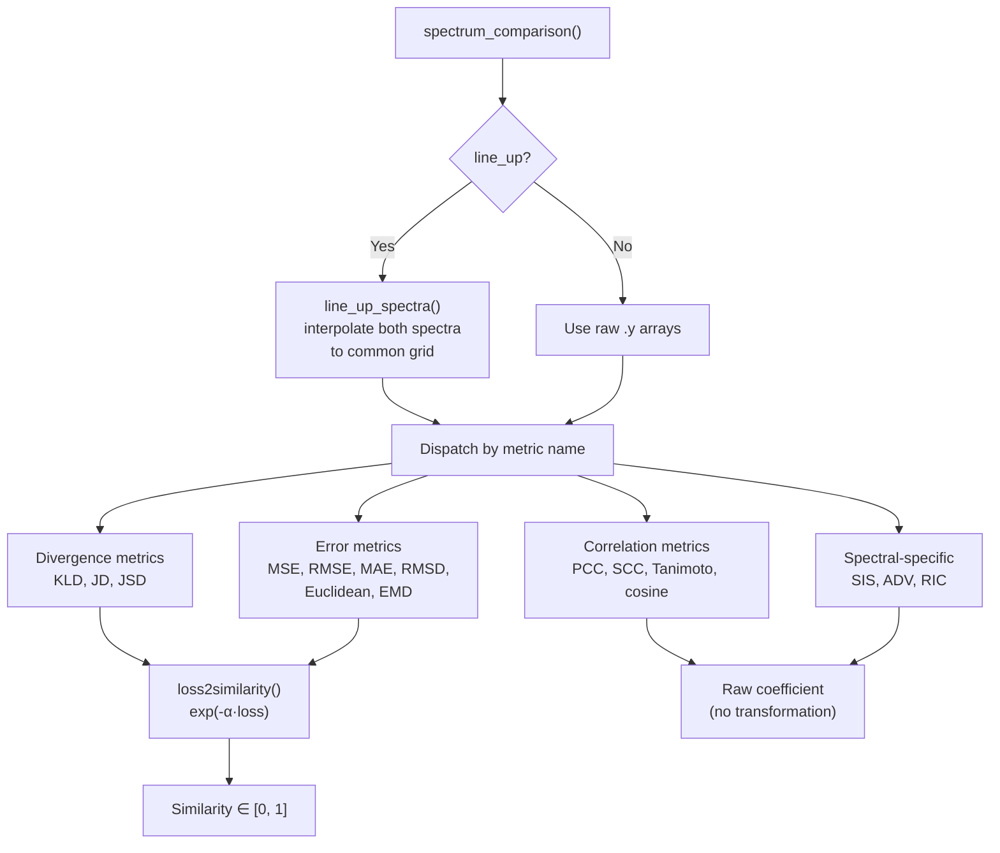
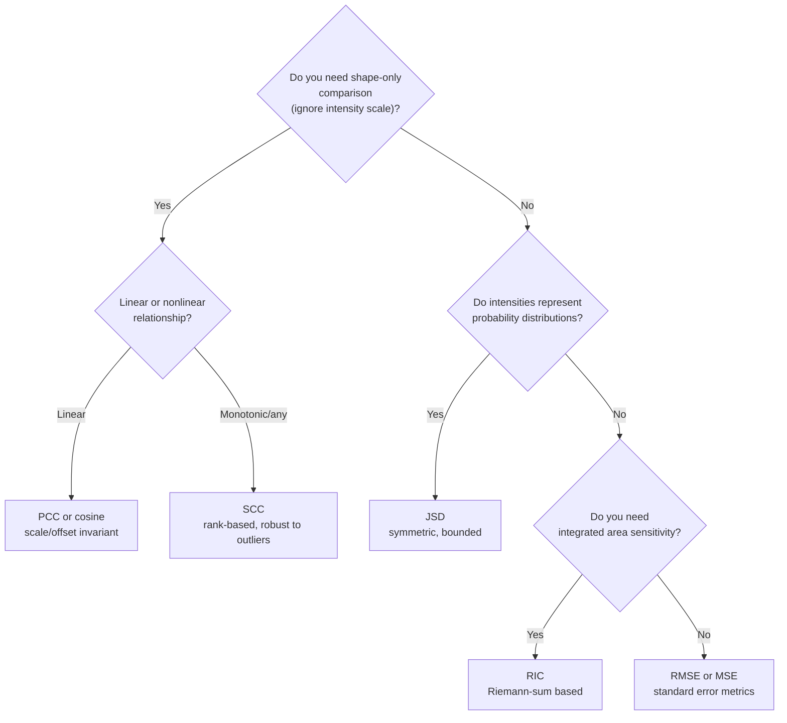

Quantifying spectral similarity is a fundamental requirement when validating machine-learned spectra against reference quantum-chemical calculations or experimental data. MLatom provides a comprehensive suite of 15 comparison metrics within the `spectrum_comparison` class, unified behind a single dispatcher that handles pre-processing alignment, metric computation, and optional similarity transformation in one call. This page documents the architecture, every available metric, and the alignment pipeline that ensures apples-to-apples comparisons even when spectra originate from different computational sources with mismatched discretizations.

## Architecture Overview

The entire comparison subsystem lives in [`spectrum_comparison`](mlatom/spectra.py#L539-L1016), a utility class inside `mlatom/spectra.py` (credited to Yangtao Chen and Yifan Hou). It is deliberately stateless—all methods are `@classmethod`s—so it functions as a namespace rather than an object with identity. Every metric expects two pre-aligned intensity arrays (`spectra_ref`, `spectra_pred`) of shape `(n_wavelength,)`, and the public entry point `spectrum_comparison()` manages alignment before dispatching to the appropriate metric function.



This architecture separates **concerns** cleanly: alignment is an orthogonal pre-processing step, metric computation is pure math, and similarity transformation is an optional post-processing layer. The `loss2similarity` bridge function at [line 627](mlatom/spectra.py#L627-L636) converts any non-negative loss `L` into a similarity score via `exp(-α·L)`, where `α` is a tunable hyperparameter (default 0.2). This is applied to most error/divergence metrics but **not** to correlation coefficients, which are already bounded.

## The Alignment Pipeline: `line_up_spectra`

Before any metric can operate, both spectra must share an identical x-axis grid. The [`line_up_spectra`](mlatom/spectra.py#L607-L621) method computes the intersection of the two spectral ranges, then interpolates both onto a common grid.

The logic is straightforward:
1. **Range intersection**: `range_lb = max(min(s1), min(s2))`, `range_ub = min(max(s1), max(s2))` — any x-region outside both spectra is discarded at [line 611–612](mlatom/spectra.py#L611-L612).
2. **Grid construction**: If `align_list` is `None`, a uniformly spaced grid with 2 points per unit of x-range is created via `np.linspace(range_lb, range_ub, int((range_ub-range_lb)*2+1))` at [line 614](mlatom/spectra.py#L614). Otherwise the user-supplied `align_list` is clipped to the intersection bounds.
3. **Interpolation**: Each spectrum's [`sample()`](mlatom/spectra.py#L82-L87) method is called, which internally delegates to `scipy.interpolate.interp1d` (linear or cubic) and returns a new `spectrum` object on the unified grid.

> [!TIP]
> The default grid density of **2 points per unit x-range** may be too coarse for UV-Vis spectra (nm scale) but adequate for IR/Raman (cm⁻¹ scale). Always pass an explicit `align_list` when comparing high-resolution spectra to avoid interpolation artifacts that inflate error metrics.

## Metric Catalog

All 15 metrics are registered in the [`spectrum_comparison()`](mlatom/spectra.py#L544-L605) dispatcher via case-insensitive string matching. The following table provides a complete taxonomy.

### Correlation-Based Metrics

| Metric Key | Method | Range | Symmetric | Transformation | Reference |
|---|---|---|---|---|---|
| `PCC` | [`pearson_coefficient`](mlatom/spectra.py#L639-L661) | [−1, 1] | ✅ | None (raw) | [JCTC 2020](https://pubs.acs.org/doi/10.1021/acs.jctc.0c01279) |
| `SCC` | [`spearman_coeffient`](mlatom/spectra.py#L664-L687) | [−1, 1] | ✅ | None (raw) | — |
| `Tanimoto` | [`tanimoto_coefficient`](mlatom/spectra.py#L690-L708) | [−0.33, 1] | ✅ | None (raw) | — |
| `cosine` | [`cosine`](mlatom/spectra.py#L955-L971) | [−1, 1] | ✅ | None (raw) | — |

The **Pearson** coefficient at [line 656–660](mlatom/spectra.py#L656-L660) is computed as `Σ(ref−ref̄)(pred−pred̄) / √(Σ(ref−ref̄)² · Σ(pred−pred̄)²)`, making it sensitive to linear relationships but insensitive to global scaling or offset. The **Spearman** coefficient at [line 680–686](mlatom/spectra.py#L680-L686) replaces values with ranks before applying the same formula, capturing monotonic (nonlinear) relationships. The **Tanimoto** coefficient at [line 707](mlatom/spectra.py#L707) follows the vector formulation `Σ(a·b) / (Σa² + Σb² − Σa·b)`, familiar from cheminformatics fingerprint similarity.

### Information-Theoretic Divergence Metrics

| Metric Key | Method | Symmetric | Transformation | α parameter |
|---|---|---|---|---|
| `KLD` | [`KL_divergence_transformed`](mlatom/spectra.py#L711-L728) | ❌ | `exp(-0.2·L)` | 0.2 |
| `JD` | [`jeffery_divergence_transformed`](mlatom/spectra.py#L731-L748) | ❌ | `exp(-0.2·L)` | 0.2 |
| `JSD` | [`JS_divergence_transformed`](mlatom/spectra.py#L751-L769) | ✅ | `exp(-0.8·L)` | **0.8** |

The **KL divergence** at [line 727](mlatom/spectra.py#L727) is `Σ ref · log(ref / (pred + ε))` with `ε = 1e-8` for numerical stability. Because `D_KL(P‖Q) ≠ D_KL(Q‖P)`, `spectrum1` is always treated as the reference distribution. The **Jeffery divergence** at [line 747](mlatom/spectra.py#L747) computes `Σ (ref − pred) · log(ref / (pred + ε))`, which is also asymmetric. The **Jensen-Shannon divergence** at [line 767–768](mlatom/spectra.py#L767-L768) symmetrizes by computing `½ D_KL(ref‖M) + ½ D_KL(pred‖M)` where `M = (ref+pred)/2`, and notably uses a **higher α of 0.8** at [line 769](mlatom/spectra.py#L769) to counteract the typically smaller magnitude of JSD values.

> [!TIP]
> All divergence metrics assume the intensity values represent probability-like distributions (non-negative). Passing raw (un-normalized) spectral intensities will produce unreliable results. Always call `spectrum.normalize()` before computing KLD, JD, or JSD.

### Error and Distance Metrics

| Metric Key | Method | Symmetric | Transformation |
|---|---|---|---|
| `MSE` | [`mse_transformed`](mlatom/spectra.py#L792-L809) | ✅ | `exp(-0.2·L)` |
| `RMSE` | [`rmse_transformed`](mlatom/spectra.py#L812-L829) | ✅ | `exp(-0.2·L)` |
| `MAE` | [`mae_transformed`](mlatom/spectra.py#L832-L849) | ✅ | `exp(-0.2·L)` |
| `RMSD` | [`rmsd_transformed`](mlatom/spectra.py#L912-L930) | ✅ | `exp(-0.2·L)` |
| `EMD` | [`earth_mover_distance_transformed`](mlatom/spectra.py#L772-L789) | ✅ | `exp(-0.2·L)` |
| `Euclidean` | [`euclidean_transformed`](mlatom/spectra.py#L933-L951) | ✅ | `1/(1+d)` |

Both `RMSE` and `RMSD` are implemented identically as `√(mean((ref−pred)²))` at [line 828](mlatom/spectra.py#L828) and [line 929](mlatom/spectra.py#L929) respectively — the duplicate names exist for compatibility with literature conventions. The **EMD** at [line 788](mlatom/spectra.py#L788-L789) delegates to `scipy.stats.wasserstein_distance`, making it the only metric that can theoretically handle unequal-length arrays (though alignment normally equalizes them). The **Euclidean** metric at [line 950–951](mlatom/spectra.py#L950-L951) uses an alternative transformation `1/(1+d)` instead of the exponential decay, providing a slightly softer falloff curve.

### Spectral-Specific Metrics

| Metric Key | Method | Extra Parameters | Reference |
|---|---|---|---|
| `SIS` | [`spectral_information_similarity`](mlatom/spectra.py#L852-L909) | `threshold=1e-10` | [chemprop-IR](https://github.com/gfm-collab/chemprop-IR) |
| `ADV` | [`absolute_difference_value_search`](mlatom/spectra.py#L974-L993) | None | [J. Cheminf.](https://journals.pan.pl/dlibra/publication/122822/edition/107074/content) |
| `RIC` | [`relative_integral_change`](mlatom/spectra.py#L996-L1015) | Requires `align_list` | — |

The **SIS** metric at [lines 900–908](mlatom/spectra.py#L900-L908) first floors both spectra at `threshold` to avoid `log(0)`, then computes a symmetric information distance `Σ(n₁·log(n₁/n₂) + n₂·log(n₂/n₁))` and converts to similarity as `1/(1+Σdistance)`. The original convolution-based implementation from chemprop-IR is preserved as commented-out code at [lines 868–899](mlatom/spectra.py#L868-L899).

The **ADV** metric at [line 991–993](mlatom/spectra.py#L991-L993) computes `1 − Σ|ref−pred| / Σ|ref|`, which is a normalized L1 error expressing the fraction of reference spectral area that is "lost" in the prediction.

The **RIC** metric at [lines 1011–1014](mlatom/spectra.py#L1011-L1014) is unique in requiring the `align_list` parameter directly (rather than just aligned y-arrays). It computes `1 − Σ|ref−pred|·dx / Σ(ref·dx)` via Riemann sums, measuring the relative change in integrated area under the curve.

## The `loss2similarity` Bridge

The [`loss2similarity`](mlatom/spectra.py#L627-L636) function is the universal adapter for converting unbounded loss values into bounded similarity scores:

```python
similarity = exp(-α * loss)
```

When `loss = 0` (perfect match), similarity is exactly 1.0. As loss grows, similarity decays exponentially toward 0. The default `α = 0.2` at [line 627](mlatom/spectra.py#L627) means a loss of 5 yields similarity ≈ 0.37, and a loss of 10 yields ≈ 0.14. The **Jensen-Shannon divergence** is the exception, using `α = 0.8` at [line 769](mlatom/spectra.py#L769) because JSD values are typically an order of magnitude smaller than raw error metrics.

Metrics that bypass this transformation entirely — PCC, SCC, Tanimoto, cosine, ADV, and RIC — return their raw mathematical values, which are already naturally bounded.

## Usage Patterns

### Direct Dispatch

The primary entry point is the class method [`spectrum_comparison()`](mlatom/spectra.py#L544-L605), which accepts two `spectrum` objects and a metric name string:

```python
from mlatom import spectra

# Assuming spec_ref and spec_pred are spectrum() instances
similarity = spectra.spectrum_comparison.spectrum_comparison(
    spectrum1=spec_ref,
    spectrum2=spec_pred,
    metric='SIS',
    align_method_dict={'interpolate_method': 'linear'},
    metric_arg_dict={'threshold': 1e-10, 'std_dev': 10},
    line_up=True
)
```

The `align_method_dict` is forwarded to [`line_up_spectra`](mlatom/spectra.py#L608-L621) and supports `interpolate_method` (`"linear"` or `"cubic"`) and `align_list`. The `metric_arg_dict` is forwarded as `**kwargs` to the specific metric function, enabling per-metric parameters like `threshold` for SIS or `alpha` for `loss2similarity`.

### Bypassing Alignment

When spectra are already on the same grid (e.g., from identical simulation parameters), set `line_up=False` to skip interpolation overhead. The raw `.y` arrays are then passed directly to the metric function at [lines 552–554](mlatom/spectra.py#L552-L554).

### Metric Selection Guidance



For **active learning loops** (see [Active Learning Pipeline](24-active-learning-pipeline)), the divergence metrics (KLD, JSD) are particularly informative because they quantify information loss in a physics-motivated way. For **spectral assignment validation** in UV-Vis workflows (see [UV-Vis Spectra and Nuclear Ensemble Approach](22-uv-vis-spectra-and-nuclear-ensemble-approach)), correlation coefficients (PCC, SCC) provide intuitive shape-overlap scores.

## Relationship to Other MLatom Modules

The `spectrum_comparison` class operates downstream of the spectral generation pipeline. The [`spectrum`](mlatom/spectra.py#L17-L217) base class provides the data structures and interpolation machinery that `line_up_spectra` consumes. The specialized subclasses — [`uvvis`](mlatom/spectra.py#L220-L454), [`ir`](mlatom/spectra.py#L455-L496), and [`raman`](mlatom/spectra.py#L497-L537) — generate the spectrum objects that are ultimately compared. The broader [`plot_spectra`](mlatom/spectra.py#L1020-L1186) function provides the visual inspection counterpart to these quantitative metrics, with normalization and peak-shifting capabilities that should be applied consistently before comparison.

For scalar property accuracy assessment (energies, gradients), MLatom uses a separate statistics module at [`mlatom/stats.py`](mlatom/stats.py) providing `mae`, `mse`, `rmse`, and `correlation_coefficient` — these are **not** spectrum-aware and do not handle alignment, making them unsuitable for spectral data where x-axis correspondence matters.

## Summary Table

| Category | Metrics | Return Range | Best For |
|---|---|---|---|
| **Correlation** | PCC, SCC, Tanimoto, cosine | [−1, 1] | Shape matching, scale-invariant comparison |
| **Divergence** | KLD, JD, JSD | [0, 1] (transformed) | Distributional comparison, information-theoretic |
| **Error** | MSE, RMSE, MAE, RMSD, Euclidean, EMD | [0, 1] (transformed) | Point-wise accuracy, general-purpose |
| **Spectral** | SIS, ADV, RIC | [0, 1] or raw | Domain-specific spectral similarity |

---

**Next steps**: For understanding how spectra are generated before comparison, see [IR and Raman Spectra Calculation](21-ir-and-raman-spectra-calculation) and [UV-Vis Spectra and Nuclear Ensemble Approach](22-uv-vis-spectra-and-nuclear-ensemble-approach). To learn how spectrum comparison fits into iterative model improvement, see [Active Learning Pipeline](24-active-learning-pipeline). For the underlying spectral data model, see the `spectrum` class at [lines 17–217](mlatom/spectra.py#L17-L217).